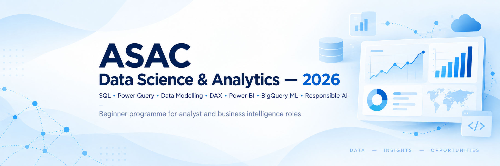
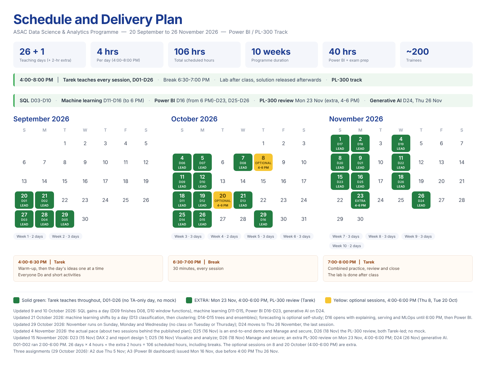

# ASAC Data Science & Analytics — 2026

A beginner programme for analyst and business intelligence roles: SQL in BigQuery, machine learning in BigQuery ML, Power BI (Power Query, data modelling, DAX, report design, sharing and security) and generative AI for analysts. It supports preparation for the Microsoft Power BI Data Analyst exam (PL-300); the programme itself does not award Microsoft certification.

**Dates:** 20 September – 26 November 2026  
**Class time:** 4:00–8:00 PM (Amman time), break 6:30–7:00 PM  
**Instructor:** Tarek Atwan

## Schedule

[Student schedule with links to every session's slides](course/STUDENT_SCHEDULE.md) · [Calendar as a PDF](course/assets/schedule.pdf) · [Excel version](course/assets/student-schedule.xlsx) · [Google Sheets](https://docs.google.com/spreadsheets/d/1eese9ddJeecPEWQ60ApRvr0rfiYVBfoNaogoYhwyRNk/edit?usp=sharing)

## Modules

| Module | Dates | What you learn |
|---|---|---|
| [01 Data foundations](modules/01-data-foundations/) | 20–21 Sep | Analyst roles, reading a table, data quality, where data lives |
| [02 SQL](modules/02-sql/) | 27 Sep – 12 Oct | Queries, aggregation, joins, CTEs, views and window functions in BigQuery |
| [03 Machine learning and AI](modules/03-machine-learning-and-ai/) | 18–29 Oct, 26 Nov | Regression, classification, clustering and trees in BigQuery ML; generative AI used with checks |
| [04 Power Query](modules/04-power-query/) | 29 Oct – 4 Nov | Importing, cleaning, appending and merging data in Power BI |
| [05 Data modelling and DAX](modules/05-data-modeling-and-dax/) | 4–15 Nov | Star schemas, relationships, a date table, measures and time intelligence |
| [06 Visualisation and storytelling](modules/06-visualization-and-storytelling/) | 15–16 Nov | Report design, interaction, analysis and the story |
| [07 Manage and secure Power BI](modules/07-power-bi-service/) | 16 and 23 Nov | Publishing, workspaces, sharing, refresh, row-level security; BigQuery to a published report |
| [08 PL-300 and career readiness](modules/08-pl300-and-career-readiness/) | 23–24 Nov | PL-300 review; GitHub, Markdown and your portfolio |

Generative AI belongs to module 03 but is taught last, on 26 November.

## How the course works

- **Session:** one class. Slides and labs are named by session (D01, D02 …); the [student schedule](course/STUDENT_SCHEDULE.md) shows which slides each date used.
- **Lab:** practice you complete after class. Labs are not submitted or graded. Solutions are released after the session; some are shown in class instead.
- **Assignment:** graded work done outside class, with a brief, a deadline and a rubric. There are three, each due before 4:00 PM on its due date:
  - [Assignment 1: SQL](modules/02-sql/assignments/A01-SQL-Football/README.md), 12–21 October
  - [Assignment 2: machine learning](modules/03-machine-learning-and-ai/assignments/A02-ML-Hotel-Bookings/README.md), 29 October – 5 November
  - [Assignment 3: a Power BI dashboard](modules/06-visualization-and-storytelling/assignments/A03-NYC-Taxi-Dashboard/README.md), 18–26 November

## Tools

| Tool | Used for |
|---|---|
| BigQuery Sandbox | SQL and BigQuery ML (free, no credit card) |
| Power BI Desktop | Power Query, modelling, DAX and reports (Windows only) |
| Power BI Service | Publishing, sharing and security, where your account allows |
| GitHub | Your portfolio |

If a paid or restricted feature is not available to you, it is demonstrated in class and you get a free alternative.

> [!NOTE]
> These materials are also in the course [Google Drive folder](https://drive.google.com/drive/folders/14MonW3zPw5i9iubBdrclYS3XEZeaqYBP?usp=sharing). If the two ever disagree, this repository is correct.

## Reuse

No public reuse licence has been selected for these materials. Public access to the repository does not grant permission to copy, modify or redistribute its contents.
