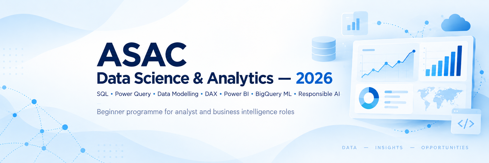
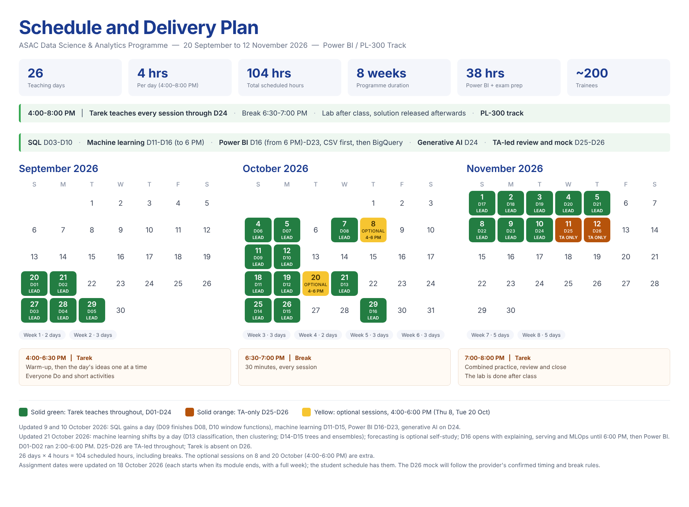

# ASAC Data Science & Analytics — 2026

This beginner programme prepares learners for analyst and business intelligence roles. It combines guided instruction with practical work in SQL, Power Query, data modelling, DAX, report design, introductory machine learning and responsible AI.

**Dates:** 20 September–26 November 2026 (from November: Sundays, Mondays and Wednesdays)  
**Class time:** 4:00–8:00 PM (Asia/Amman), from 27 September; D01–D02 ran 2:00–6:00 PM  
**Format:** 26 sessions across 8 weeks, for 104 scheduled hours  
**Optional review:** Thursday 8 October, 4:00–6:00 PM, a review of the SQL from D03 to D08 (yellow on the schedule)  
**Lead instructor:** Tarek Atwan  
**Cohort:** Approximately 200 trainees

The programme supports preparation for the Microsoft Power BI Data Analyst certification exam (PL-300). Completing the programme does not award Microsoft certification; learners must pass Microsoft's exam to earn it.

## Schedule and delivery plan

[Download the schedule as a PDF](course/assets/schedule.pdf)

[View the student schedule](course/STUDENT_SCHEDULE.md) · [Download the Excel version](course/assets/student-schedule.xlsx) · [Open in Google Sheets](https://docs.google.com/spreadsheets/d/1eese9ddJeecPEWQ60ApRvr0rfiYVBfoNaogoYhwyRNk/edit?usp=sharing)

The scheduled hours include a 30-minute break from 6:30 to 7:00 PM. Labs start at 7:00 PM, right after the break. The final mock exam will follow the timing and break rules confirmed by its provider.

> [!NOTE]
> Course materials will be released weekly before the first session of each new week.

## How the course is organised

Five words are used consistently across the schedule, this repository and every brief.

| Term | What it means |
|---|---|
| **Module** | A subject area, numbered 01 to 08. A module is not a week: module 02 spans several weeks, and week 8 draws on more than one module. Each module has a folder under [`modules/`](modules/) holding its content, labs, assignments, datasets and resources. |
| **Session** | One four-hour class, identified as D01 to D26. The identifier never changes, so D08 means the same session in every document. |
| **Lab** | Practice done in class to reinforce the concept just taught. It is not graded and does not become homework. If you do not finish, the reference solution is released at the debrief. |
| **Homework** | A weekly set issued in class and due before the first session of the following week. About 26 hours across the programme. There is no homework in week 8. |
| **Assignment** | Graded work done outside class, with a published brief, deadline and rubric. There are three: A1 to A3. |
| **Practical** | A graded, open-book assessment completed inside a session. There are two: P1 and P2. |

The third-party mock on D26 is separate from all of these. It informs the voucher decision and carries no course marks.

## Course coverage

| Module | Days | Scheduled hours | Main focus |
|---|---|---:|---|
| [01 Data foundations](modules/01-data-foundations/) | D01–D02 | 8 | Analyst roles, data quality, ethics and the Power BI workflow |
| [02 SQL](modules/02-sql/) | D03–D10 | 32 | Querying, joins, CTEs, views and window functions in BigQuery |
| [03 Machine learning and AI literacy](modules/03-machine-learning-and-ai/) | D11–D15, D24 | 24 | BigQuery ML, model evaluation, predictions for Power BI and generative AI used with checks |
| [04 Power Query](modules/04-power-query/) | D16–D17 | 8 | Importing, profiling, cleaning, combining and validating data |
| [05 Data modelling and DAX](modules/05-data-modeling-and-dax/) | D18–D20 | 12 | Star schemas, relationships, measures and filter context |
| [06 Visualisation and storytelling](modules/06-visualization-and-storytelling/) | D21–D22 | 8 | Report design, accessibility, interaction and presentation |
| [07 Managing and securing Power BI](modules/07-power-bi-service/) | D23 | 4 | Publishing, workspaces, refresh and row-level security |
| [08 PL-300 review and career readiness](modules/08-pl300-and-career-readiness/) | D25–D26 | 8 | Structured review, mock practice and next steps |

Modules are numbered in the order they are taught. Generative AI (D24) belongs to module 03 although it is taught after Power BI.

## How sessions work

Tarek leads concepts and demonstrations. On shared days, he hands the class to the assigned TAs for a structured lab. The schedule uses three delivery markers:

- Solid green: instructor-led throughout
- Split green and orange: instructor-led teaching followed by a TA-led lab; the printed handoff time controls the split
- Solid orange: TA-led throughout

Labs are completed in class. Weekly homework provides about 26 hours of practice outside class. Formal assessment consists of four assignments, two open-book practicals and continuous professional practice; there is no capstone project.

The third-party mock on the final day supports the programme's voucher decision under rules supplied to learners by the programme team. It is separate from the course grade and does not award Microsoft certification.

## Tools and access

| Tool | Use in the programme |
|---|---|
| BigQuery Sandbox | SQL and BigQuery ML |
| GitHub | Portfolio work and version control |
| Power BI Desktop | Power Query, modelling, DAX and report development |
| Power BI Service | Selected publishing and security demonstrations where access permits |

Required trainee work uses free access and does not require a credit card. Power BI Desktop requires access to Windows. If a paid or restricted feature is unavailable, the instructor demonstrates it and provides an equivalent free evidence route.

> [!Note]
>
> A copy of these materials is mirrored in the course
> [Google Drive folder](https://drive.google.com/drive/folders/14MonW3zPw5i9iubBdrclYS3XEZeaqYBP?usp=sharing).
> This repository is the original; if the two ever disagree, trust this one.

## Reuse

No public reuse licence has been selected for these materials. Public access to the repository does not grant permission to copy, modify or redistribute its contents.