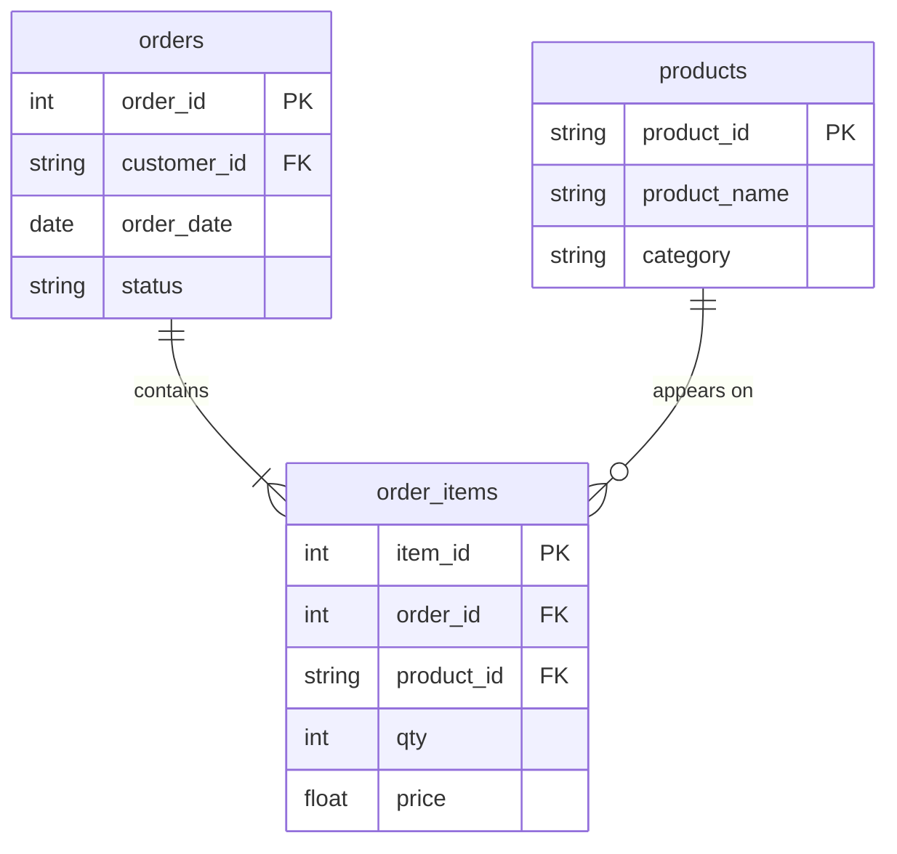

# D01's answer, in SQL

In this activity, you will answer the first question of the programme, "which product category produced the most completed-order revenue last month?" (August 2026), with a three-table join, and check it against the answer you worked out by hand on D01.

**Time:** 22 minutes · **Data:** `D03.order_items`, `D03.orders`, `D03.products` (D03 activity 01) · **Starter:** `Unsolved/d01_category_revenue.sql`

Imagine it is September 2026, the setting of D01, so "last month" means 1–31 August 2026. Every order in `D03.orders` was placed between 3 and 24 August 2026. The data never changes, so the answer stays the same whenever you take this course.

## How the tables connect

Join keys: `order_items.order_id = orders.order_id` and `order_items.product_id = products.product_id`.

PK is the primary key: it names one row. FK is a foreign key: it points to a row in another table. The line between two tables shows the join: the end with two short bars is the "one" side, and the end that splits into a fork is the "many" side.

## Instructions

1. Start from `order_items`: it has the amounts. Record its row count and `SUM(qty * price)` in the audit table.

2. Join `orders` to get each line's `status`. Record the rows and the sum again. Did they change? Why not?

3. Join `products` to get each line's `category`. Record them again.

4. Keep completed orders placed last month, group by category, and sum `qty * price` as `revenue`.

    Translate: `WHERE o.status = 'completed' AND o.order_date BETWEEN '2026-08-01' AND '2026-08-31'`; sort by `revenue`, largest first (`ORDER BY revenue DESC`). Written as dates, "last month" gives the same answer whenever the query runs; "last month" counted from today's date would move every month.

5. Run it once more without the status filter. Keep the `orders` join and the date filter, and delete only the status test, so the `WHERE` keeps just the `BETWEEN` line. Keep the sort by `revenue`, largest first. Which category wins now?

## Check yourself

| Query | Rows returned | One value to check |
|---|---:|---|
| 1 | 1 | 12 rows; 487.00 |
| 2 | 1 | 12 rows; 487.00 |
| 3 | 1 | 12 rows; 487.00 |
| 4 | 3 | Accessories 166.00; Shoes 136.50; Outerwear 84.00 |
| 5 | 3 | Shoes 195.00; Accessories 166.00; Outerwear 126.00 |

Query 4 must match D01 exactly: Accessories, 166.00.

## Hint

Each line of `order_items` finds exactly one order and one product, so the joins add columns without adding rows. That is why the audit numbers stay the same. On D01 you saw the other case: leave the cancelled order in and the winner changes.

## References

The D01 tables, course-owned synthetic data, 19 September 2026.
