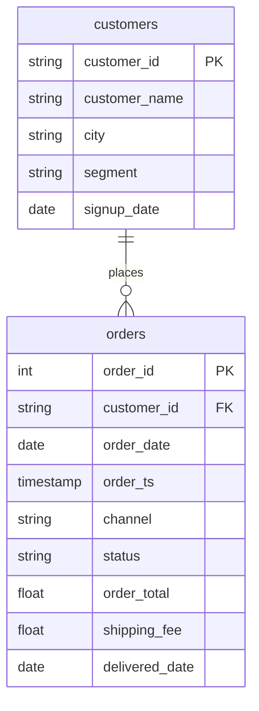

# Group by a column from the other table

In this activity, you will answer "completed revenue by customer segment" by joining `orders` to `customers`, auditing the join, and grouping by the cleaned segment.

**Time:** 12 minutes · **Data:** `nakheel.orders`, `nakheel.customers` (D04 activity 03) · **File:** `Solved/segment_after_join.sql`

The amount is on `orders`; the segment is on `customers`. One join brings the column, then D04's `GROUP BY` does the rest.

## How the tables connect



Join key: `orders.customer_id = customers.customer_id`.

PK is the primary key: it names one row. FK is a foreign key: it points to a row in another table. The line between two tables shows the join: the end with two short bars is the "one" side, and the end that splits into a fork is the "many" side.

## Instructions

1. Run the Five Checks out loud. `orders`: one row per order. `customers`: one row per customer. Key: `customer_id`, unique in `customers` (500 and 500, from D06, [Join Nakheel orders to customers](../../D06/05-Evr-Orders-to-Customers/README.md)). Rows expected: at most 2,771, the number of completed orders. Unmatched rows: order 101664 has no customer.

2. Open `Solved/segment_after_join.sql` and run query 1, the audit before the join: completed orders on `orders` alone. You should see 2,771 orders and 316,023.50.

3. `INNER JOIN` or `LEFT JOIN`? Decide, then run query 2, the audit after an `INNER JOIN` to `customers`. You should see 2,770 orders and 315,085.50. One order and 938.00 are gone: order 101664, the orphan you found on D06. So this report needs a `LEFT JOIN`.

4. Type query 3 yourself, line by line, then run it:

    ```sql
    SELECT COALESCE(LOWER(TRIM(c.segment)), 'unknown') AS segment_clean,
           COUNT(*) AS completed_orders,
           ROUND(SUM(o.order_total), 2) AS revenue
    FROM nakheel.orders AS o
    LEFT JOIN nakheel.customers AS c
      ON o.customer_id = c.customer_id
    WHERE o.status = 'completed'
    GROUP BY segment_clean
    ORDER BY revenue DESC;
    ```

    - `LOWER(TRIM(c.segment))` is the D04 fix for "Retail", "retail" and "RETAIL ": five spellings become two.
    - `COALESCE(…, 'unknown')` gives the order with no customer a label instead of a blank group.
    - BigQuery lets you use the `SELECT` name `segment_clean` in `GROUP BY`. If the query fails, check that the name is spelled the same in both places.

    You should see 3 rows: retail 2,393 orders, 160,881.50; wholesale 377, 154,204.00; unknown 1, 938.00.

5. Add the three revenues. They make 316,023.50, the audit total from step 2. The groups add up to the audit, so no row was lost or copied.

6. Write one sentence a manager could use. For example: wholesale is 377 orders and nearly half of completed revenue.

## Check yourself

| Query | Rows returned | One value to check |
|---|---:|---|
| 1 | 1 | 2,771 orders; 316,023.50 |
| 2 | 1 | 2,770 orders; 315,085.50 |
| 3 | 3 | retail 160,881.50; wholesale 154,204.00; unknown 938.00 |

Why not drop the `unknown` row? It is 938.00 of real, completed revenue. Report it and name it.

## References

Nakheel Retail, course-owned synthetic data generated 24 September 2026. See [the dataset README](../../D04/03-Evr-Upload-Nakheel/Resources/README.md).
