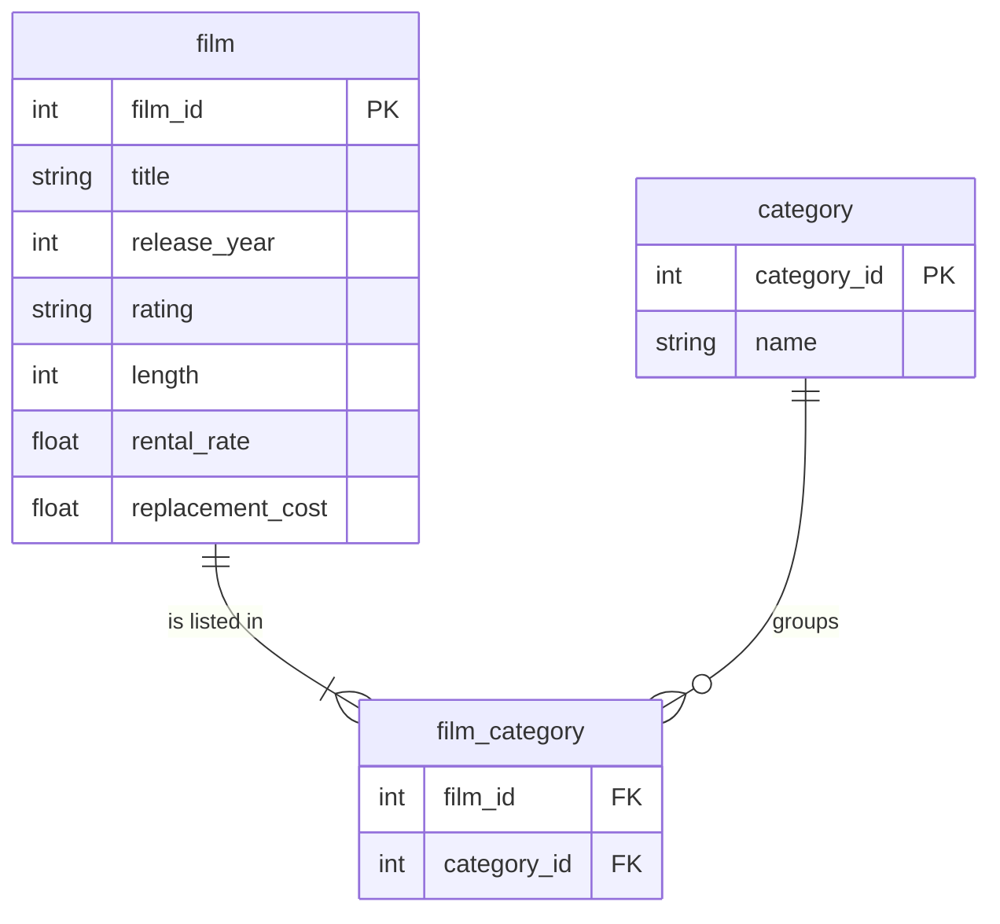

# A bridge table: films per category

In this activity, you will upload three tables from a film rental database, join through a table that links films to categories, and explain why 1,000 films become 2,367 rows.

**Time:** 28 minutes · **Data:** three CSVs in `Resources/` → `pagila.film`, `pagila.film_category`, `pagila.category` (you upload them in step 1) · **Starter:** `Unsolved/films_per_category.sql`

Pagila is a sample database for a DVD rental shop, used in many SQL courses. It is a new sector on purpose: film and media, with the same method as Nakheel. One film can belong to more than one category, so the link between films and categories is kept in a third table, `film_category`, with one row per film per category. A table that sits between two others like this is called a **bridge table**.

## How the tables connect

Join keys: `film_category.film_id = film.film_id` and `film_category.category_id = category.category_id`. `film_category` is the bridge table: each row pairs one film with one category, so a film with three categories has three rows there.

PK is the primary key: it names one row. FK is a foreign key: it points to a row in another table. The line between two tables shows the join: the end with two short bars is the "one" side, and the end that splits into a fork is the "many" side.

## Instructions

1. Upload the three tables.

    - Save `film.csv`, `category.csv` and `film_category.csv` from this activity's [`Resources/`](Resources/) folder to your laptop. On GitHub, use **Download raw file** for each; in a zip they are already inside the activity folder.
    - In BigQuery, create a dataset `pagila` in **Multi-region US**.
    - From the dataset's **⋮** menu, choose **Create table** and upload each CSV as a table with the same name without `.csv`. Tick **Auto detect** and, under **Advanced options**, set **Header rows to skip** to `1`.
    - Open **Preview** on `film_category`: two columns only, `film_id` and `category_id`.

    **Checkpoint:** three tables, `film` 1,000 rows, `category` 16, `film_category` 2,367. The **Details** tab of each table shows its number of rows.

2. "Can a film be in more than one category?" Look at film 1, ACADEMY DINOSAUR: show its rows in `film_category` with the category names.

    Translate: `film_category INNER JOIN category` on `category_id`, `WHERE fc.film_id = 1`; show `fc.film_id` and the category name as `category`, sorted by `category`.

3. Audit, before: the number of rows in `film`.

4. Audit, after `film INNER JOIN film_category`: the number of rows and the number of different films. Is the join wrong? What is one row now?

5. "How many films do we have in each category?" Join `category` as well, and group by its `name`. Show the name as `category` and the count as `films`. Sort by `films`, largest first, then by `category`.

6. Add up your 16 category counts, in your head, on paper or with the Hint. Compare the sum with the number of films. Write one line in your file explaining the difference.

7. "What is the catalogue's total `rental_rate`?" Sum `rental_rate` on `film` alone. Then sum `f.rental_rate` after the join to `film_category`. Round both sums to 2 decimals with `ROUND(..., 2)`. Which number is the catalogue's total? What happened to the other one?

## Check yourself

| Step | Rows returned | One value to check |
|---|---:|---|
| 2 | 3 | Games, New, Travel |
| 3 | 1 | 1,000 |
| 4 | 1 | 2,367 rows; 1,000 films |
| 5 | 16 | Drama and Music, 152 each |
| 7 | 1 | 2,980.00 on `film` |
| 7b | 1 | 7,077.33 after the join |
| Review | 3 | 403 films have 3 categories |

The Review row is the query behind step 6's explanation: how many categories each film has (36 films have 1, 561 have 2, 403 have 3). It needs a query inside a query, which is D08, so it is in the Solved file for you to run and read rather than write.

## Why 1,000 films become 2,367 rows

After the join, one row is one film in one category. A film in three categories is counted in all three. That is correct for "films per category", and wrong for anything that should count each film once, such as the catalogue's `rental_rate` total. It is fan-out again, the lesson from [Audit the join](../../D06/06-Stu-Join-Audit/README.md) on D06, through a bridge table: a bridge table means **many-to-many**, and every total across it needs the audit.

## Hint

To add up the 16 counts without a calculator, count the rows after the join: every row of `film_category` that finds a film and a category is one film-category pair.

## References

Pagila sample database, copyright Devrim Gündüz, [github.com/devrimgunduz/pagila](https://github.com/devrimgunduz/pagila), commit 9baf49c, used under the permission notice in the included [`LICENSE.txt`](Resources/LICENSE.txt). Course copy taken 24 September 2026. See [`Resources/README.md`](Resources/README.md).
