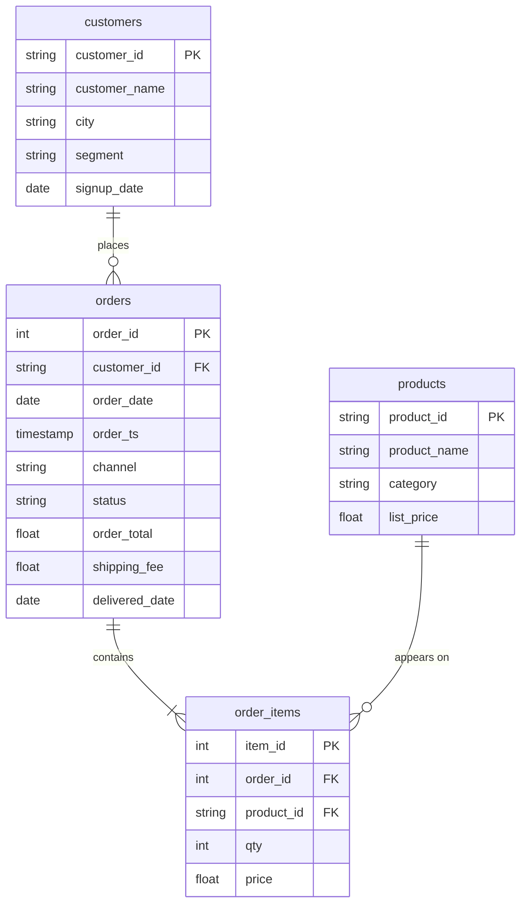

# Subquery practice

In this activity, you will answer four manager questions with a subquery: the products above the average price, the customers who never ordered and the products never sold (with `NOT IN`), and the name of the biggest customer.

**Time:** 12 minutes · **Data:** `nakheel.products`, `nakheel.customers`, `nakheel.orders`, `nakheel.order_items` (D04 activity 03) · **Starter:** `Unsolved/subquery_practice.sql`

**When:** done after class on D09 (Sunday 11 October), before the D08 lab. The Solved folder is released with the lab's.

For every question, write the inner query first and run it on its own. Only when it gives what you expect, put it in brackets inside the outer query.

## How the tables connect



Join keys: `orders.customer_id = customers.customer_id`, `order_items.order_id = orders.order_id` and `order_items.product_id = products.product_id`.

PK is the primary key: it names one row. FK is a foreign key: it points to a row in another table. The line between two tables shows the join: the end with two short bars is the "one" side, and the end that splits into a fork is the "many" side.

## Instructions

1. "Which products cost more than our average list price?"

    Translate: products whose `list_price` is greater than the average `list_price` of all products. Show `product_id`, `product_name`, `category` and `list_price`; sort by `list_price`, most expensive first (`ORDER BY list_price DESC`). The inner query returns one number, so `>` works.

2. "Which customers have never placed an order? This time without a join."

    Translate: customers whose `customer_id` is `NOT IN` the list of `customer_id` values in `orders`. Show `customer_id` and `customer_name`; sort by `customer_id` (`ORDER BY customer_id`). `NOT IN` keeps a row when its value is nowhere in the list. You found the same customers on D07 with a `LEFT JOIN` in [Never ordered, never sold](../../D07/02-Stu-Never-Ordered/README.md).

3. "Which products have never been sold?"

    Translate: products whose `product_id` is `NOT IN` the list of `product_id` values in `order_items`. Show `product_id` and `product_name`; sort by `product_id` (`ORDER BY product_id`).

4. "Who is our biggest customer by completed revenue? I want the name, not just the ID."

    Translate: the inner query finds one `customer_id`: completed orders, grouped by customer, sorted by `SUM(order_total)` from largest, first row only. The outer query looks that customer up in `customers` and shows `customer_id` and `customer_name`.

## Check yourself

| Question | Rows returned | One value to check |
|---|---:|---|
| 1 | 22 | the average list price is 20.35; P-015 Wool overcoat first, 60.00 |
| 2 | 39 | the same 39 customers as D07; C-1013 Anas Abbadi first by ID |
| 3 | 4 | P-009, P-025, P-046, P-058 |
| 4 | 1 | C-1380, Leen Najjar |

If question 4 stops with `Scalar subquery produced more than one element`, the inner query returns more than one row. Run it alone and count its rows.

## Hint

In question 4 the inner query can sort by a sum it does not show: `ORDER BY SUM(order_total) DESC`. `LIMIT 1` then keeps only the first row, so the inner query returns one value and `=` is safe. Run it alone first: you should see one `customer_id`.

## Bonus

Not required, not checked. `NOT IN` has a trap. Questions 2 and 3 work because `orders.customer_id` and `order_items.product_id` are never empty. If the list from the inner query contains a `NULL`, `NOT IN` returns no rows at all. Run these two and compare:

```sql
SELECT customer_id
FROM nakheel.customers
WHERE customer_id NOT IN ('C-1001');

SELECT customer_id
FROM nakheel.customers
WHERE customer_id NOT IN ('C-1001', NULL);
```

The first returns 499 rows. The second returns 0. `NOT IN ('C-1001', NULL)` means "not equal to `'C-1001'` and not equal to `NULL`". A comparison with `NULL` is never true (its result is unknown), so no row passes. The D07 `LEFT JOIN … IS NULL` does not have this problem, so use it when the column in the inner query can be empty.

## Check yourself: bonus

| Question | Rows returned | One value to check |
|---|---:|---|
| Bonus 1 | 499 | every customer except C-1001 |
| Bonus 2 | 0 | no rows |

## References

Nakheel Retail, course-owned synthetic data generated 24 September 2026. See [the dataset README](../../D04/03-Evr-Upload-Nakheel/Resources/README.md).
