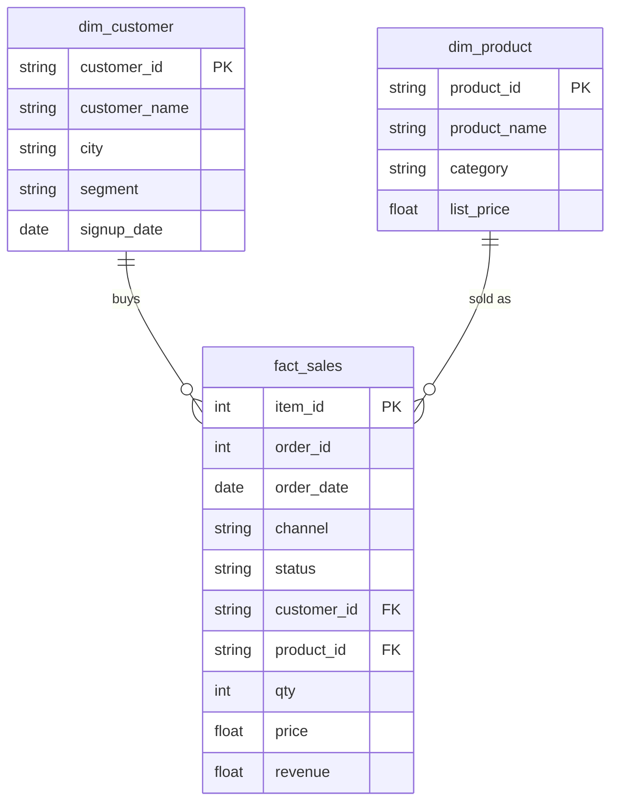

# Prove the views give the numbers you know

In this activity, you will answer three questions you have answered before, this time from the `bi` views, and check that the numbers match.

**Time:** 20 minutes · **Data:** `bi.fact_sales` (activity 07), `bi.dim_product`, `bi.dim_customer` (activity 08) · **Starter:** `Unsolved/check_views.sql`

**Before you start:** you need the three views from [Save a query as a view](../07-Ins-First-View/README.md) and [The customer and product views](../08-Evr-Dimension-Views/README.md).

A view is only useful if you can trust it. The test is simple: use it to reproduce answers you already have. If the numbers match, the view is right; if they do not, find out why before anyone builds a report on it.

## How the tables connect

Join keys: `fact_sales.customer_id = dim_customer.customer_id` and `fact_sales.product_id = dim_product.product_id`. `fact_sales` is the fact table, one row per order line. The two `dim_` views describe its customers and products.

PK is the primary key: it names one row. FK is a foreign key: it points to a row in another table. The line between two tables shows the join: the end with two short bars is the "one" side, and the end that splits into a fork is the "many" side.

## Instructions

1. "Completed revenue by product category." Answer it from the views.

    Translate: `bi.fact_sales INNER JOIN bi.dim_product` on `product_id`; completed lines only; show `p.category` and `ROUND(SUM(f.revenue), 2) AS revenue`; sort by `revenue`, largest first (`ORDER BY revenue DESC`). You do not need `orders`: `fact_sales` already carries the status.

    You should see 6 rows, Outerwear first with 76,637.00: the answer to the D06 lab, [Revenue by category, with a join audit](../../D06/09-Lab-Category-Revenue/README.md).

2. "Completed revenue by customer segment."

    Translate: `bi.fact_sales LEFT JOIN bi.dim_customer` on `customer_id`; completed lines only; group by `c.segment`. Show `c.segment` and the revenue rounded to 2 decimals as `revenue`; sort by `revenue`, largest first (`ORDER BY revenue DESC`).

    You should see retail 160,881.50, wholesale 154,204.00, and a row with a `NULL` segment worth 938.00. These are the numbers from [Group by a column from the other table](../../D07/04-Ins-Segment-After-Join/README.md), with order 101664 once more. The segment is `NULL` rather than `unknown` because `dim_customer` has no row for C-0999, so the `LEFT JOIN` fills its columns with `NULL`.

3. The same join as an `INNER JOIN`, audited: count the completed lines and add up their revenue, rounded to 2 decimals.

    You should see 6,946 lines and 315,085.50. Order 101664's 5 lines, worth 938.00, are gone.

4. Power BI will meet this order too. When you relate `fact_sales` to `dim_customer` in Power BI (D18), those 5 lines will have no customer. Checkpoint C3 of the lab, [Reporting views for Power BI and for D11](../10-Lab-Reporting-Views/README.md), fixes it at the source, in a view.

## Check yourself

| Step | Rows returned | One value to check |
|---|---:|---|
| 1 | 6 | Outerwear first, 76,637.00 |
| 2 | 3 | retail 160,881.50; wholesale 154,204.00; `NULL` 938.00 |
| 3 | 1 | 6,946 lines; 315,085.50 |

If Outerwear shows more than 76,637.00, the `WHERE f.status = 'completed'` is missing: `fact_sales` keeps every status. In `fact_sales`, one row is one order line, and `revenue` is that line's `qty * price`.

## Hint

Give each view a short alias, as you do with tables: `FROM bi.fact_sales AS f INNER JOIN bi.dim_product AS p ON f.product_id = p.product_id`.

## References

Nakheel Retail, course-owned synthetic data generated 24 September 2026. See [the dataset README](../../D04/03-Evr-Upload-Nakheel/Resources/README.md).
