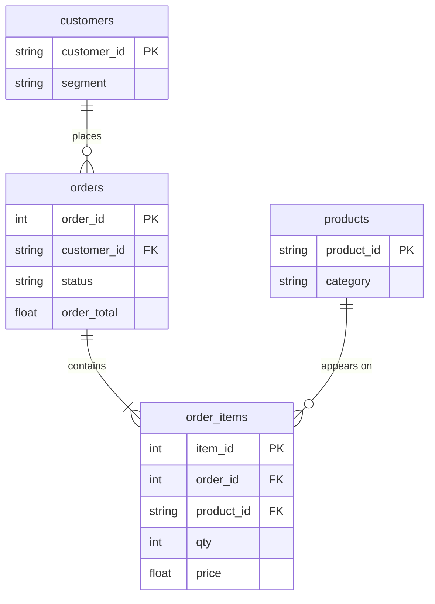

# Plan the steps, then write them

In this activity, you will work with a partner to answer two manager questions as CTEs: you plan the steps in comments first, name each step after what one row of it is, and check each step's rows before you write the next.

**Time:** 20 minutes · **Data:** `nakheel.orders`, `nakheel.order_items`, `nakheel.products`, `nakheel.customers` (D04 activity 03) · **Starter:** `Unsolved/plan_the_steps.sql`

**How to pair:** for question 1, one of you plans the steps aloud and the other types; for question 2, swap. The person typing does not type a step until the planner has said what one row of it is.

## How the tables connect

`PK` is the primary key and `FK` a foreign key. Only the columns this activity uses are shown.

## Instructions

1. **"Which categories brought in more than the average category?"** Completed orders only; revenue is `qty * price` from `order_items`.

    Plan first, in three comment lines, before any SQL: what is one row of each step?

    - Step 1, `category_revenue`: one row per category, its completed revenue. It needs the D06 three-table join: `order_items` to `orders` (for `status`) to `products` (for `category`). Name the columns `category` and `revenue`. Check it: 6 rows, read largest first (`ORDER BY revenue DESC`).
    - Step 2, `average_category`: one row, the average of step 1's revenue, named `avg_revenue`. Check it, rounded to 2 decimals: 52,670.58.
    - The answer: the categories from step 1 above the number in step 2. Show `category` and `revenue`, rounded to 2 decimals; best first (`ORDER BY revenue DESC`).

    You should see 2 rows: Outerwear 76,637.00 and Shoes 62,373.50.

2. **"How many customers spent more than the average customer, and what share of our completed revenue do they bring?"** Swap roles. Plan the steps in comments first.

    Translate:
    - Step 1, `customer_revenue`: one row per customer, `customer_id` and `SUM(order_total) AS revenue` of completed orders. Check: 452 rows.
    - Step 2, `average_customer`: one row, the average of step 1. Check: 699.17.
    - Step 3, `big_customers`: the rows of step 1 above step 2, with `customer_id` and `revenue`. Check: 91 rows, read largest revenue first (`ORDER BY revenue DESC`).
    - The answer, one row: the number of big customers, their revenue, and their share of all completed revenue as a percentage with one decimal. Name them `big_customers`, `their_revenue` (rounded to 2 decimals) and `share_pct`.

    For the share, divide by the total of **step 1**, not by a number you type: `(SELECT SUM(revenue) FROM customer_revenue)`.

    You should see 1 row: 91 customers, 241,338.00, 76.4%.

3. Write the answer to question 2 as one sentence for the manager. For example: "91 of our 452 buying customers, one in five, bring in three-quarters of our completed revenue."

## Check yourself

| Question | Rows returned | One value to check |
|---|---:|---|
| 1, step 1 | 6 | Outerwear first, 76,637.00 |
| 1, step 2 | 1 | 52,670.58 |
| 1 | 2 | Outerwear 76,637.00 · Shoes 62,373.50 |
| 2, step 3 | 91 | each above 699.17 |
| 2 | 1 | 91 · 241,338.00 · 76.4 |

A different count is information, not failure. Go back to the last step whose check was right and look at the step after it.

## Hint

Every step after the first reads the one before it by name: `FROM customer_revenue`, `FROM average_customer`. Two CTEs need one comma between them and none after the last: `WITH a AS (...), b AS (...), c AS (...) SELECT ...`.

## Bonus

Which segment are the 91 big customers in? Add one more step: `big_customers` `LEFT JOIN nakheel.customers`, with the D07 segment cleaning (`COALESCE(LOWER(TRIM(segment)), 'unknown')`). Show `segment_clean`, `COUNT(*) AS customers` and their revenue rounded to 2 decimals; most customers first (`ORDER BY customers DESC`). You should see retail 55, wholesale 35 and unknown 1. Which group is more surprising, and why?

## References

Nakheel Retail, course-owned synthetic data generated 24 September 2026. See [the dataset README](../../../../../shared/datasets/nakheel/README.md).
