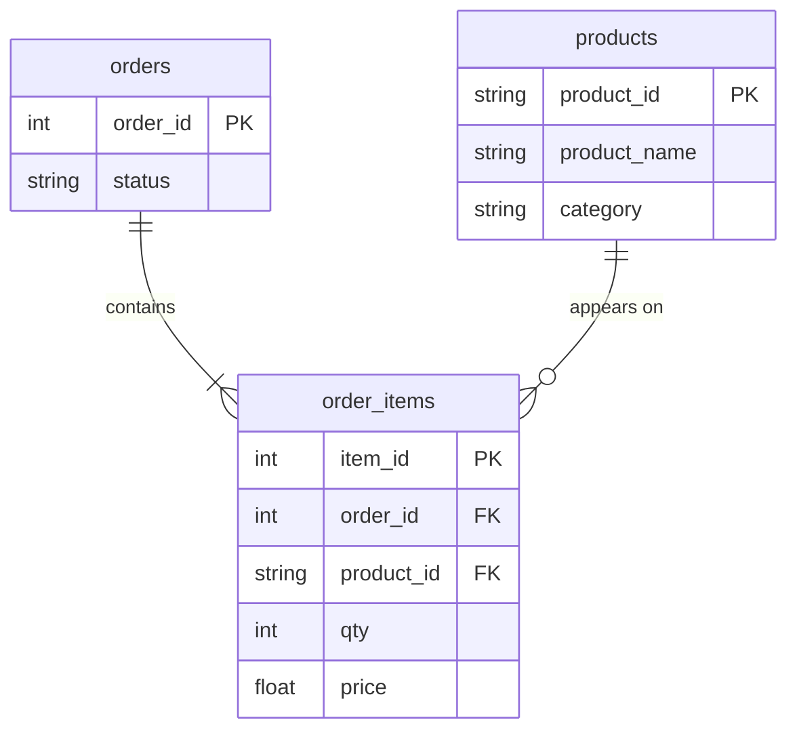

# Each product's share of its category

In this activity, you will answer "What share of its category's revenue does each product bring?" with `SUM(...) OVER (PARTITION BY category)`: one row per product, with its category's total beside it.

**Time:** 15 minutes · **Data:** `nakheel.order_items`, `nakheel.orders`, `nakheel.products` (D04 activity 03) · **Starter:** `Unsolved/share_of_category.sql`

## How the tables connect



`PK` is the primary key and `FK` a foreign key. Only the columns this activity uses are shown.

## Instructions

1. **Step 1, one row per product.** In a CTE named `product_revenue`: completed revenue per category and product, with the D06 three-table join. Three columns: `category`, `product_name` and `SUM(i.qty * i.price) AS revenue`.

    Read it with `SELECT * FROM product_revenue`. You should see 56 rows: 4 of the 60 products have never been sold (D07).

2. **The category total on every row.** In the final `SELECT`, keep `category`, `product_name` and `revenue`, and add a column:

    ```sql
    SUM(revenue) OVER (PARTITION BY category) AS category_revenue
    ```

    - `PARTITION BY category` splits the rows into one window per category. The `SUM` is calculated inside each window and written on each of its rows.
    - `GROUP BY category` would return 6 rows. `PARTITION BY category` returns all 56, each with its own category's total.

    You should see 56 rows. Every Outerwear row says 76,637.00, the D06 lab answer.

3. **The share.** Add one more column: the product's revenue divided by its category's revenue, times 100, rounded to one decimal, `AS share_pct`. Sort by `share_pct`, highest first.

    You should see 56 rows. White thobe is first with 24.1% of Tops; Leather belt is second with 22.2% of Accessories.

4. Say it as a manager would: "In Tops, one product, the white thobe, brings in almost a quarter of the category."

## Check yourself

| Step | Rows returned | One value to check |
|---|---:|---|
| 1 | 56 | Outerwear products sum to 76,637.00 |
| 2 | 56 | category_revenue 76,637.00 on every Outerwear row |
| 3 | 56 | White thobe first, 24.1 |

## Hint

The window goes in the final `SELECT`, which reads `product_revenue`, so `revenue` is already one row per product. If you get `SELECT list expression references column qty which is neither grouped nor aggregated`, the window is in the same `SELECT` as the `GROUP BY`; move it to the final `SELECT`.

## References

Nakheel Retail, course-owned synthetic data generated 24 September 2026. See [the dataset README](../../../../../shared/datasets/nakheel/README.md).
