# From a CSV file to a chart: one pass through Power BI

In this activity, you will load two Nakheel files into Power BI, clean one messy column in Power Query, and build a bar chart and a card whose numbers match the SQL answers you already know.

**In class:** steps 1 to 5 together (Everyone Do, 20 minutes), step 6 on your own (10 minutes) · **Data:** `customers.csv` and `orders.csv` from [`shared/datasets/nakheel`](../../../../../shared/datasets/nakheel/README.md) · **Tool:** Power BI Desktop (Windows), or Power BI in the browser at `app.powerbi.com` (Mac, or any computer without Desktop)

## The story

You know Nakheel from the SQL weeks: 500 customers, 3,000 orders, and a completed revenue of 316,023.50 dinars that you computed with `SUM(order_total) … WHERE status = 'completed'`. Power BI is where a manager will see those numbers, so the first job is to get the same answer there. On the way you will meet the three places every Power BI report passes through: **Power Query** (get and clean the data), the **semantic model** (the tables Power BI keeps) and the **report** (the charts).

## What you will learn

- To load a CSV file and open Power Query before loading, not after.
- To read column quality and column distribution, and to fix a text column with **Trim** and **Capitalize Each Word**, the Power Query version of `INITCAP(TRIM(segment))`.
- That every click in Power Query becomes a named step under **Applied steps**, like the steps of a CTE.
- To build a chart and a card, filter a visual, and check it against a known SQL total.

## How to read the steps

The steps are written for **Power BI Desktop**. Where the browser is different, a box marked **In the browser** gives the browser steps in full; follow those instead of the Desktop steps above it. Where a step has no such box, it is the same in both.

Every step ends with **What you should see**. Do not go on to the next step until your screen matches it.

## Before you start

### Download the two files

1. Open the [`shared/datasets/nakheel`](../../../../../shared/datasets/nakheel/) folder on GitHub.
2. Click `customers.csv`. On the page that opens, click **Download raw file** (the downward arrow at the top right of the file).
3. Go back to the folder and do the same for `orders.csv`.
4. Move both files into one folder you can find again, for example `Documents\ASAC\nakheel` on Windows or `Documents/ASAC/nakheel` on a Mac.

**What you should see:** one folder holding `customers.csv` and `orders.csv`. If you open a file in Excel to look at it, close it **without saving**: Excel can rewrite the dates and numbers when it saves.

### Open Power BI

- **Desktop (Windows):** open Power BI Desktop. On the start screen, click **Blank report**. If a sign-in window appears, you can sign in with your university account or close it; today's steps work either way.
- **Browser (Mac, or no Desktop):** go to `app.powerbi.com` and sign in with your university account.

**What you should see:** Desktop shows an empty report page with the **Visualizations** and **Data** panes on the right. The browser shows the Power BI **Home** page.

## Step 1 · Get the customers file, and open Power Query before loading

1. On the **Home** tab, click **Get data** → **Text/CSV**. (If a large **Get Data** window opens instead of a short list, click **File** on the left, then **Text/CSV**, then **Connect**.)

2. Go to your folder, select `customers.csv` and click **Open**.

3. A preview window opens with `customers.csv` at the top and the first rows below. Check that **Delimiter** says **Comma**.

   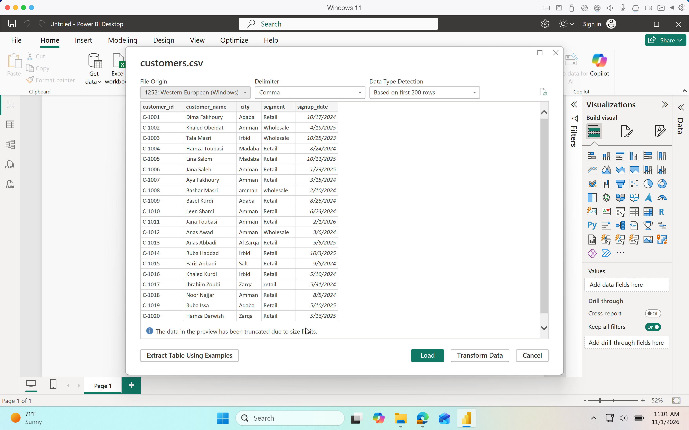

4. Click **Transform Data**. Do **not** click **Load**: **Load** skips Power Query and loads the file as it is.

   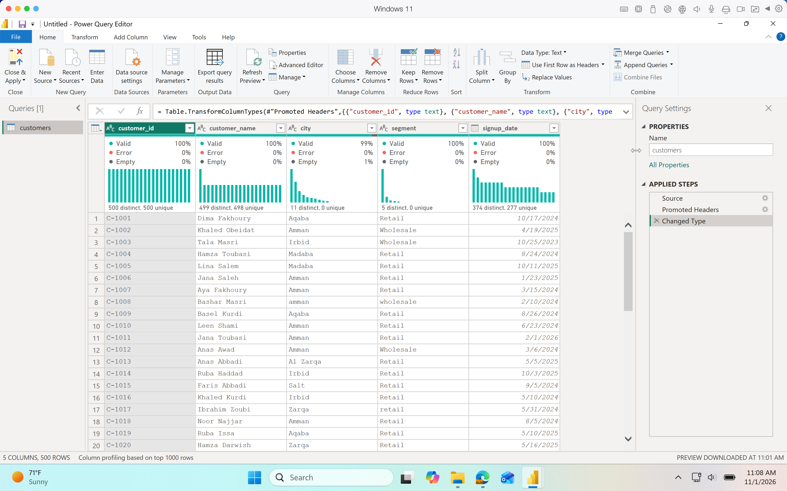

> **In the browser**
>
> 1. In the navigation pane on the left, click **+ New Report**.
>
> 2. On the **Build your first report** page, click **Get data**. A window opens listing data sources.
>
> 3. Click **Text/CSV** (type `csv` in the search box if you do not see it).
>
> 4. Under **Connection settings**, choose **Upload file**, then click **Browse** and pick `customers.csv` (or drag the file into the box). If it asks you to sign in, choose **Organizational account** and sign in with your university account.
>
>    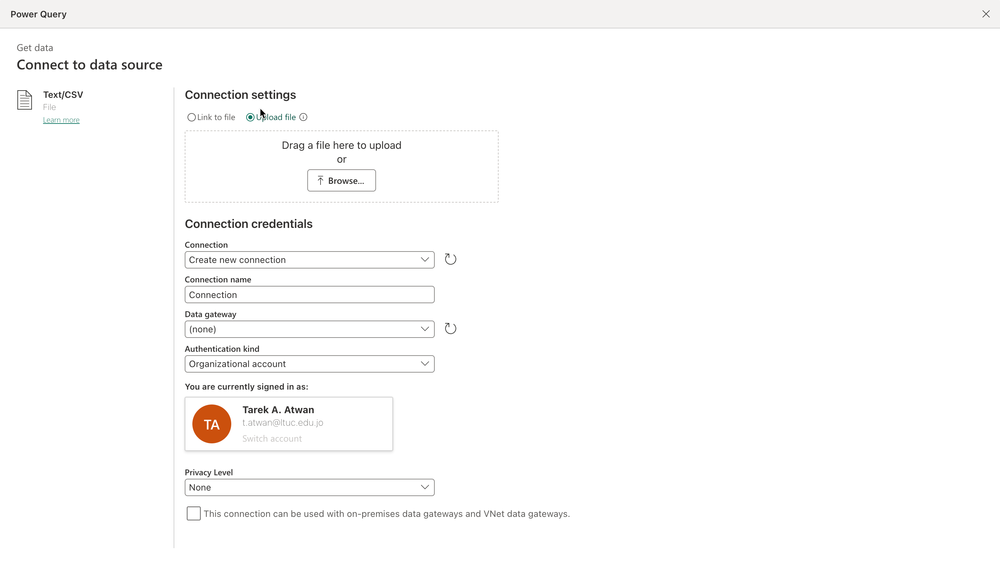
>
>    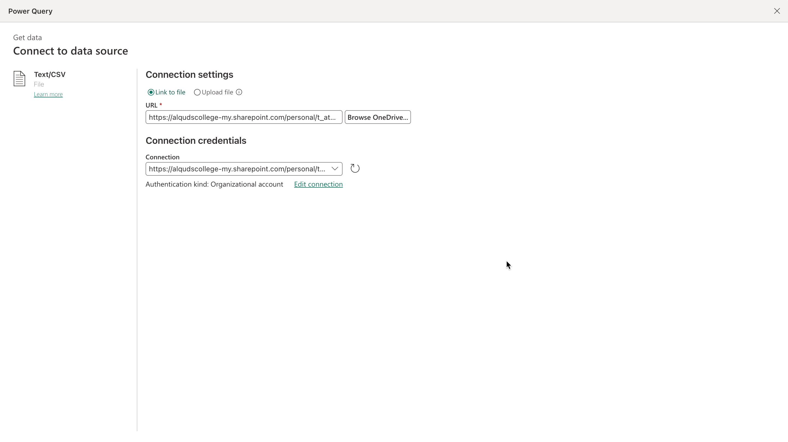
>
> 5. Leave the other settings as they are and click **Next**. A preview of the first rows opens.
>
>    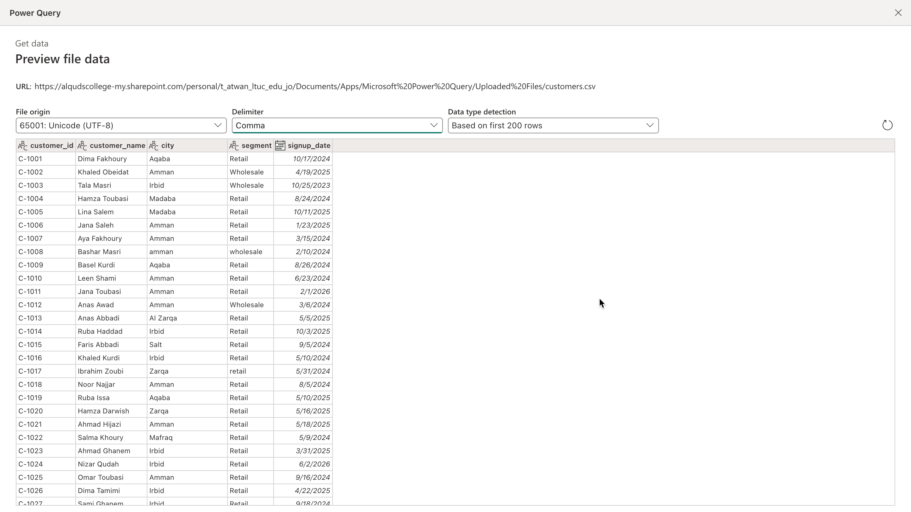
>
> 6. Click Next and it will take you to Power Query screen to **Transform** the data.
>
>    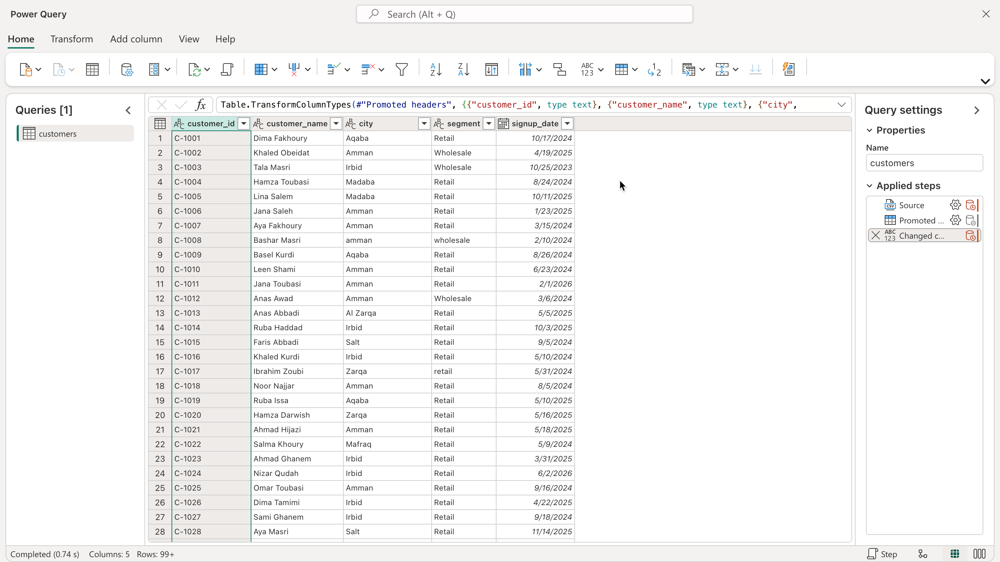
>
> If there is no **Get data** on the **Build your first report** page, or it stops you with a licence or gateway message, use [If the browser will not let you edit](#if-the-browser-will-not-let-you-edit) at the end of this page.

**What you should see:** the **Power Query Editor**. On the left, **Queries** lists `customers`. In the middle, a grid with five columns: `customer_id`, `customer_name`, `city`, `segment`, `signup_date`. On the right, **Applied steps** lists **Source**, **Promoted Headers** and **Changed Type**.

## Step 2 · Profile the columns

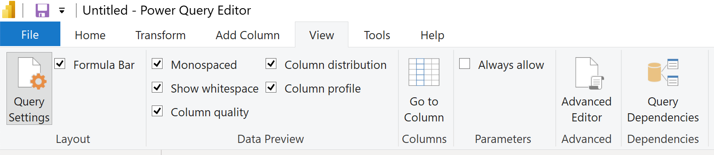

1. Click the **View** tab. In the **Data Preview** group, tick **Column quality**, **Column distribution** and **Column profile**.
2. At the bottom left of the window, the status bar says **Column profiling based on top 1000 rows**. Click those words and choose **Column profiling based on entire data set**. With 500 rows nothing changes here; with a big file, the first 1,000 rows can hide a problem.
3. Click the `segment` column header. The whole column turns highlighted.
4. Read the line under the `segment` header: it says **5 distinct, 0 unique**.
5. Look at the bottom of the window: **Column statistics** on the left and **Value distribution** on the right. Hover over each bar in **Value distribution** to see its value and its count.

> **In the browser:** on the **View** tab, open **Data view** and tick the same three options in the drop-down. Items 2 to 5 are the same.
>
> 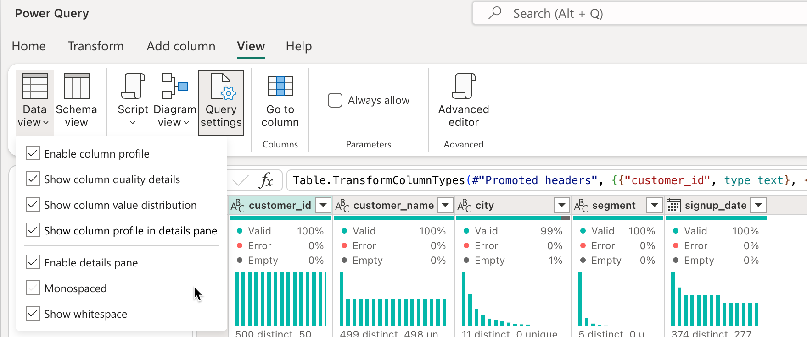

**What you should see:** five bars in **Value distribution**: `Retail` 408, `Wholesale` 61, `retail` 18, `RETAIL` 9 and `wholesale` 4. The `RETAIL` value has a space at the end that you cannot see, and Power Query counts it as a value of its own. These are the counts that `SELECT segment, COUNT(*) FROM nakheel.customers GROUP BY segment` returns in BigQuery.

## Step 3 · Clean segment, and read the Applied steps

1. Make sure the `segment` column is still selected (its header is highlighted).

2. Click the **Transform** tab → **Format** → **Trim**. Use the **Transform** tab, not **Add Column**: **Add Column** → **Format** makes a new column and leaves `segment` as it was.

    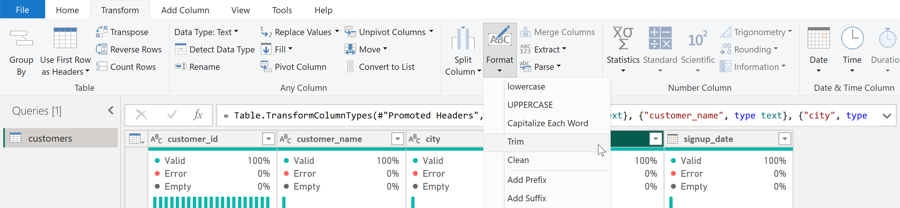

    **Applied steps** gains **Trimmed Text**. `segment` still shows **5 distinct**: the space has gone, but `RETAIL` is still in capitals.

3. With `segment` still selected, click **Transform** → **Format** → **Capitalize Each Word**.

    **Applied steps** gains **Capitalized Each Word**, and `segment` now shows **2 distinct**.

    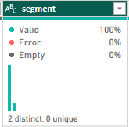

4. Click **Changed Type** in **Applied steps**. The grid shows `segment` as it arrived, with the five spellings. Now click **Capitalized Each Word** to come back to the end.

    Always finish on the **last** step. If you add a step while an earlier one is selected, Power Query asks whether to insert it in the middle of the chain; click **Cancel**, select the last step and try again.

    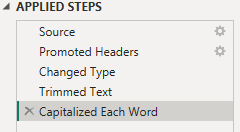

    PowerBI Desktop Screen

    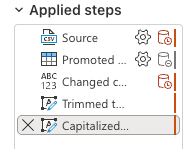

    PowerBI Web Screen

**What you should see:** **Applied steps** reads **Source**, **Promoted Headers**, **Changed Type**, **Trimmed Text**, **Capitalized Each Word**, with the last one selected. Hovering over the bars in **Value distribution** shows `Retail` 435 and `Wholesale` 65 (408 + 18 + 9 = 435; 61 + 4 = 65). In SQL you would write `INITCAP(TRIM(segment))`.

Each step works on the result of the step before, like a chain of CTEs. Power BI replays the whole chain every time the data refreshes, so the cleaning happens again on next month's file without anyone remembering to do it.

> **Note**
>
> Notice the top bar which contains a code snippet. You may see something like this:
>
> ```
> = Table.TransformColumns(#"Trimmed Text",{{"segment", Text.Proper, type text}})
> ```
>
> or
>
> ```
> Table.TransformColumns(#"Trimmed text", {{"segment", each Text.Proper(_), type nullable text}})
> ```
>
>
>
> This is called __Power Query M Code__ or short __M code__

## Step 4 · Load, and build a bar chart

1. **Power BI Desktop:** On the **Home** tab, select **Close & Apply**. Power Query closes and Power BI loads the cleaned `customers` table.

    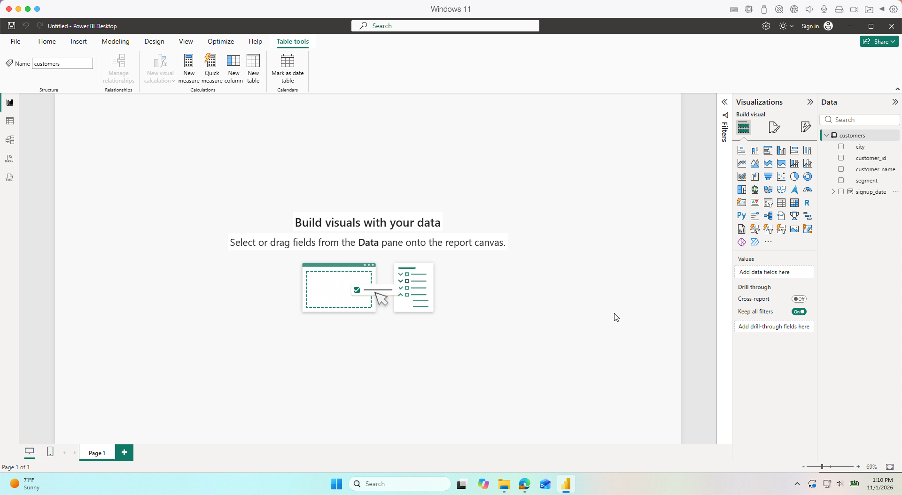

2. **Power BI in the browser:** Select **Create a report**. Choose **My workspace**, name the semantic model `D16-nakheel`, and confirm. Power BI creates the semantic model and opens the report editor.

    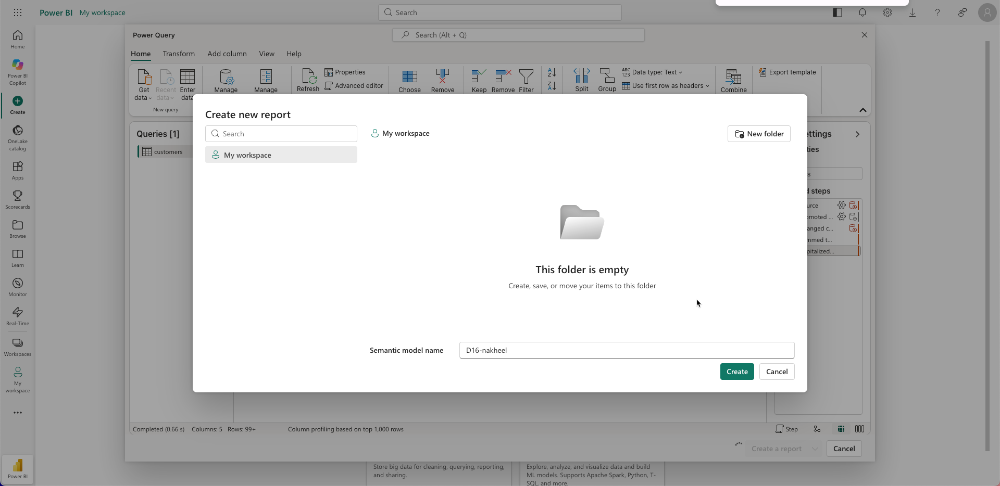

You should now have the cleaned `customers` table available for reporting.

> **Note:** We will add the `orders` table in Step 5. The steps differ slightly between Desktop and the browser, but both support adding tables to an existing data model.

1. Click an empty spot on the report page.
2. In the **Visualizations** pane, on the **Build visual** tab, click **Clustered bar chart** (horizontal bars). Hover over an icon to see its name. An empty chart frame appears on the page.
3. In the **Data** pane, click the arrow beside `customers` to see its columns.
4. Drag `segment` into the **Y-axis** box in the **Visualizations** pane.
5. Drag `customer_id` into the **X-axis** box. Power BI cannot add up an ID, so it counts it: the box shows **Count of customer_id**.
6. With the chart still selected, click **Format visual** (the paintbrush icon in the **Visualizations** pane) → **Visual** → switch **Data labels** to **On**.
7. If the chart is small, drag its bottom-right corner to make it bigger.

**What you should see:** two bars, **Retail 435** and **Wholesale 65**. Use the Power Query profile in step 2 to check the five raw spellings. Power BI's model groups text without distinguishing case, so the report chart alone cannot show every spelling problem.

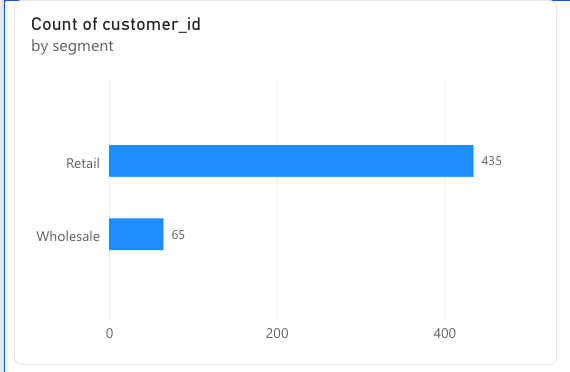

## Step 5 · A card that matches SQL

#### **Add the orders table**

__Power BI Desktop__

1. On the **Home** tab, select **Get data → Text/CSV**.
2. Select `orders.csv` and click **Load**. If you choose **Transform Data** instead, finish with **Close & Apply**.
3. **Check:** the **Data** pane now lists `orders` under `customers`.

__Power BI in the browser__

1. Click __Open semantic model__ from the top, then click __Editing__. This may open a new browser tab (see screen below)

2. Switch from **Viewing mode** to **Editing mode**.

3. Select **Get data → Text/CSV** and upload `orders.csv`.

4. Click **Next**, then **Transform data**.

5. Review the table in Power Query, then select **Save** and apply the changes if prompted.

6. Go back to the report tab, click the __refresh__ button from the top banner and it will show the `orders` table being added

    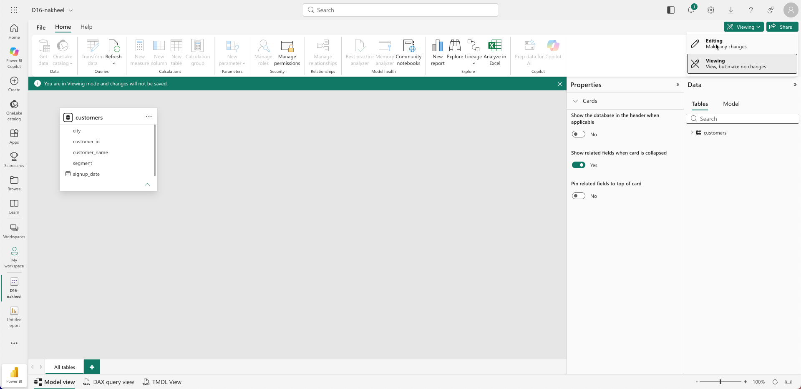

**Create the visualization**

1. Click an **empty** spot on the report page. If the bar chart is still selected, the next click turns the bar chart into a card; if that happens, press **Ctrl+Z** (**Cmd+Z** on a Mac) and click an empty spot first.

2. In **Visualizations** → **Build visual**, click **Card**.

    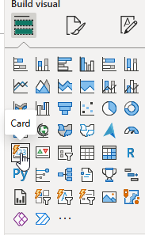

3. In the **Data** pane, expand `orders` and drag `order_total` into the card's **Values** box. The box shows **Sum of order_total**.

4. The card shows the total in short form (**340.37K**). To see every digit: with the card selected, **Format visual** → **Visual** → **Callout** → Under __Apply settings to__ select  `Sum of order_total` → **Value** → **Display units** change from __All__ to **None**.

    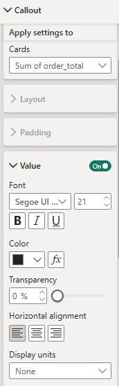

5. Read the number. SQL said 316,023.50. Ask yourself which orders this card is adding up.

    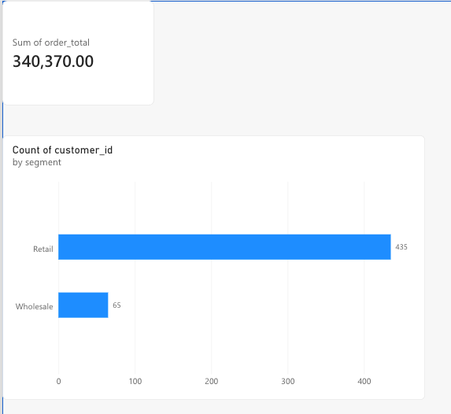

6. Open the **Filters** pane (the panel labelled **Filters** beside **Visualizations**; click it if it is collapsed). With the card selected, the pane shows a section **Filters on this visual**.

7. Drag `status` from `orders` in the **Data** pane into **Filters on this visual**, onto **Add data fields here**.

8. The new `status` filter opens as a list of values (**Filter type: Basic filtering**). Tick **completed** only.

    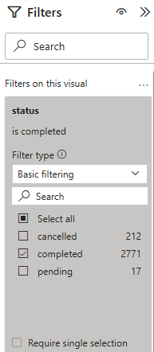

**What you should see:** before the filter, **340,370** (every order, with the cancelled and pending ones). After the filter, **316,023.50**: the SQL answer. Same data, same filter, same number. Depending on your settings the card may show the decimals and the thousands comma differently; the digits are what matter.

## Step 6 · One more chart (on your own)

1. Click an empty spot on the report page.

2. In **Visualizations** → **Build visual**, click **Clustered column chart** (vertical bars).

3. From `orders`, drag `channel` into the **X-axis** box and `order_total` into the **Y-axis** box (**Sum of order_total**).

4. With the chart selected, drag `status` into **Filters on this visual** and tick **completed** only. The card's filter does not carry over: each visual has its own filters.

5. Hover over each column; the tooltip shows its exact value.

6. Click **Format visual** and add Data Labels.

7. Save your work:
    - **Desktop:** **File** → **Save as**, click __Browse this device__, go to your folder (whichever one you want), name the file `D16-nakheel-first-report` and click **Save**. Power BI adds `.pbix`.

    - **In the browser:** **File** → **Save** (save this report), name the report `D16-nakheel-first-report`, and save it to **My workspace**. Go to __My Workspace__ and you should see the __Semantic Model__ and the __Report__

      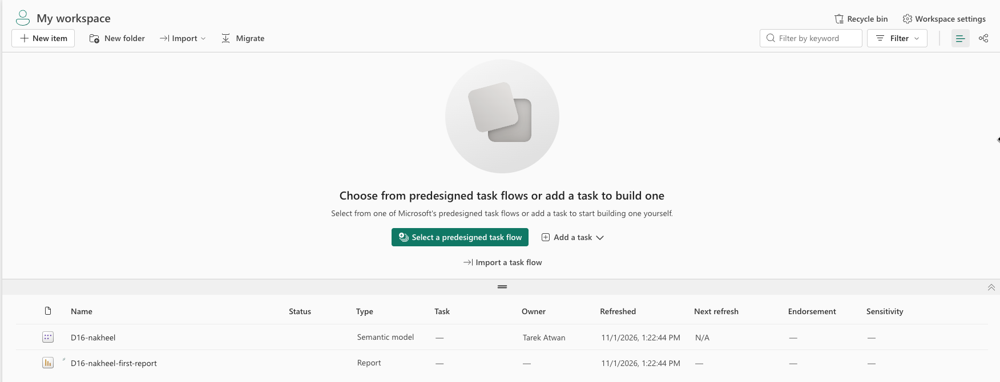

**What you should see:** two columns, **store 205,338.00** and **online 110,685.50**, which add up to 316,023.50. Lab 11 starts from the file you just saved.

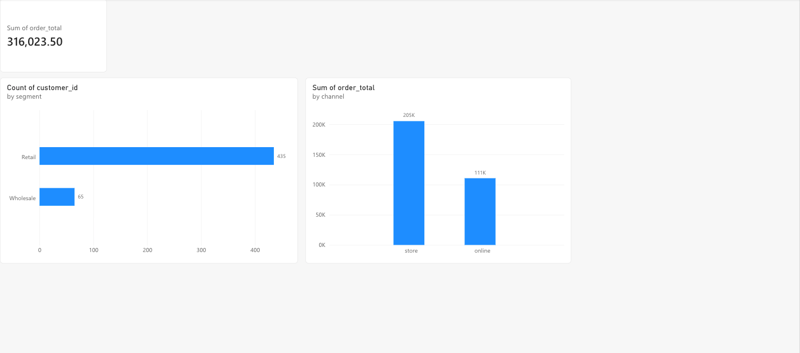

## Check yourself

| Step | One value to check |
|---|---|
| 2 | `segment`: 5 distinct values · Retail 408 |
| 3 | `segment`: 2 distinct values · Retail 435 · Wholesale 65 |
| 4 | bar chart: Retail 435 · Wholesale 65 |
| 5 | card: 340,370 before the filter · 316,023.50 after |
| 6 | store 205,338.00 · online 110,685.50 |

## If something goes wrong

| What you see | Why | What to do |
|---|---|---|
| You never saw Power Query | You clicked **Load** in step 1 | **Home** → **Transform data** opens it now; continue from step 2 |
| The cleaned bar chart does not show Retail 435 and Wholesale 65 | The Trim or Capitalize step is missing, or you used **Add Column** | **Home** → **Transform data**, select `customers`, read **Applied steps**; redo step 3, then **Close & Apply** |
| The card's **Values** box does not say **Sum of order_total** | `order_total` arrived as text, so Power BI cannot add it up | **Home** → **Transform data**, select `orders`, click the type icon at the left of the `order_total` header → **Decimal number** → **Close & Apply** |
| The card shows 340,370 | No `status` filter on the card | Step 5, items 6 to 8 |
| The column chart adds up to 340,370 | The new chart has no filter of its own | Step 6, item 4 |
| A visual turned into a different visual | You picked a visual type while another visual was selected | **Ctrl+Z** (**Cmd+Z**), click an empty spot, pick again |
| The **Filters** pane is missing | It is hidden | **View** tab → **Filters** (Desktop) |

## If the browser will not let you edit

Some accounts cannot reach Power Query in the browser. You can still do most of the activity:

1. In **My workspace**, click **New item** → **Semantic model** → **Excel or CSV**, and choose `customers.csv`. Power BI builds a semantic model from the file without opening Power Query.
2. In **My workspace**, click **More options (...)** beside the new semantic model → **Create report**.
3. Build the bar chart from step 4, then compare its labels with a classmate's cleaned result. Capitalization differences can be grouped together by the model even before cleaning, so the chart is not a substitute for profiling the raw column in Power Query.
4. Do the same for `orders.csv` and build the card and the column chart from steps 5 and 6. They need no cleaning, so your numbers will match.
5. Tell a TA which account you used, so we can record which accounts cannot edit.

## Hint

If the card shows `316.02K`, it is the right number in short form. Step 5, item 4 under **Create the visualization** shows it in full.

## Bonus

`city` in `customers.csv` has the same kind of problem as `segment`, and one more. Profile it the way you profiled `segment` in step 2 and find both problems. [Lab 11](../11-Lab-Power-Query-First-Clean/README.md) cleans it.

## References

Nakheel Retail, synthetic course data; see [`shared/datasets/nakheel`](../../../../../shared/datasets/nakheel/README.md). Microsoft: [Text/CSV connector](https://learn.microsoft.com/en-us/power-query/connectors/text-csv), [Data profiling tools](https://learn.microsoft.com/en-us/power-query/data-profiling-tools), [Text case in Power Query and the model](https://learn.microsoft.com/en-us/powerquery-m/m-working-with-case), [Card visual](https://learn.microsoft.com/en-us/power-bi/visuals/power-bi-visualization-card), [Get data in the Power BI service](https://learn.microsoft.com/en-us/power-bi/connect-data/service-get-data), [Edit semantic models in the Power BI service](https://learn.microsoft.com/en-us/power-bi/transform-model/service-edit-data-models), and the Microsoft Learn module [Clean, transform, and load data in Power BI](https://learn.microsoft.com/en-us/training/modules/clean-data-power-bi/).
