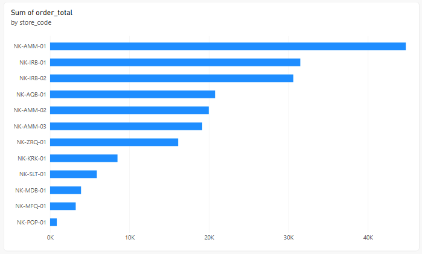
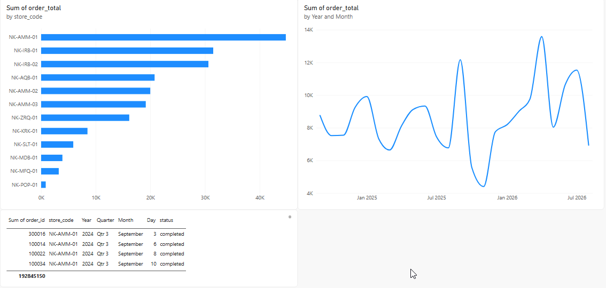

# Solution: which shop, which month?

## Build and read the three checks

1. From `store_files_sales`, build a **Clustered bar chart**: `store_code` on Y-axis, **Sum of order_total** on X-axis. Filter this visual to **completed** and sort descending by revenue. The top bar is `NK-AMM-01` at **44,776.50**.

   

2. Add a **Line chart** from the same table: `order_date` on X-axis and **Sum of order_total** on Y-axis, again filtered to **completed**. Keep Year and Month in the hierarchy, remove Quarter and Day, and expand all down one level. Read the **24** month points. If there is no automatic hierarchy, use **Add Column → Date → Month → Start of Month** in Power Query, apply/save, refresh and use that full date on the axis.

3. To inspect the stall, use a separate Table visual with `order_id`, `store_code`, `order_date` and `status`. Filter it to `NK-POP-01`, with **no status filter**: **19 orders**. Read the earliest and latest dates and compare with `notes.txt`. A completed-only count would be **18**, so keep the all-order count separate from the revenue chart.

4. Save. The answers below name both the amounts and their dates so you can check what the charts mean.

   

Revenue answers use `store_files_sales` with the visual filter `status` = completed. The stall's 19-order count and its date range use all statuses.

## 1. The top shop

`NK-AMM-01` (Abdali, Amman): **44,776.50**. Then NK-IRB-01 31,498.50, NK-IRB-02 30,618.00, NK-AQB-01 20,774.50, NK-AMM-02 19,981.50, NK-AMM-03 19,156.50, NK-ZRQ-01 16,134.50, NK-KRK-01 8,495.50, NK-SLT-01 5,897.00, NK-MDB-01 3,908.00, NK-MFQ-01 3,239.50, NK-POP-01 858.00. They add up to 205,338.00.

```sql
-- the same answer from the Nakheel tables needs the store assignment, which lives only in the files;
-- the total checks against SQL:
SELECT SUM(order_total) FROM nakheel.orders WHERE channel = 'store' AND status = 'completed';  -- 205,338.00
```

## 2. The best and worst months

24 points, September 2024 to August 2026. Best: **April 2026, 13,585.50**. Worst: **November 2025, 4,405.00**.

## 3. The odd one out

`NK-POP-01`: `notes.txt` says it is "the Ramadan stall at City Mall (March 2025)". It took **19 orders** (18 completed, 858.00) between **15 and 28 March 2025**. It is not one of the shops, and it is not in the store list you will clean next. When the sales are matched to the store list, its 19 rows will have no store to match.

Common error: no `status` filter, so cancelled and pending orders are counted (all statuses: 220,602.00).

## The same in SQL (BigQuery)

With the store files uploaded (solution 01 lists the tables), the `store_sales` view holds the same 1,901 orders as `store_files_sales`, store codes included, so all three answers have a query. Each chart is a `GROUP BY`; the visual filter is the `WHERE`.

| Power BI | SQL |
|---|---|
| Bar chart, `store_code` on the axis, Sum of `order_total`, sorted | `GROUP BY store_code ORDER BY revenue DESC` |
| Line chart by Year and Month | `GROUP BY FORMAT_DATE('%Y-%m', order_date)` |
| **Filters on this visual**: `status` = completed | `WHERE status = 'completed'` |
| Table visual for one store, no status filter | `WHERE store_code = 'NK-POP-01'`, no status condition |

```sql
-- 1. The top shop: NK-AMM-01, 44,776.50
SELECT store_code, SUM(order_total) AS revenue
FROM nakheel_stores.store_sales
WHERE status = 'completed'
GROUP BY store_code
ORDER BY revenue DESC;

-- 2. The best and worst months: April 2026 13,585.50 · November 2025 4,405.00 (24 months)
SELECT FORMAT_DATE('%Y-%m', order_date) AS month, SUM(order_total) AS revenue
FROM nakheel_stores.store_sales
WHERE status = 'completed'
GROUP BY month
ORDER BY revenue DESC;

-- 3. The odd one out: 19 orders, 18 completed (858.00), 15 to 28 March 2025
SELECT COUNT(*) AS orders,
       COUNTIF(status = 'completed') AS completed_orders,
       SUM(IF(status = 'completed', order_total, 0)) AS completed_revenue,
       MIN(order_date) AS first_order, MAX(order_date) AS last_order
FROM nakheel_stores.store_sales
WHERE store_code = 'NK-POP-01';
```
