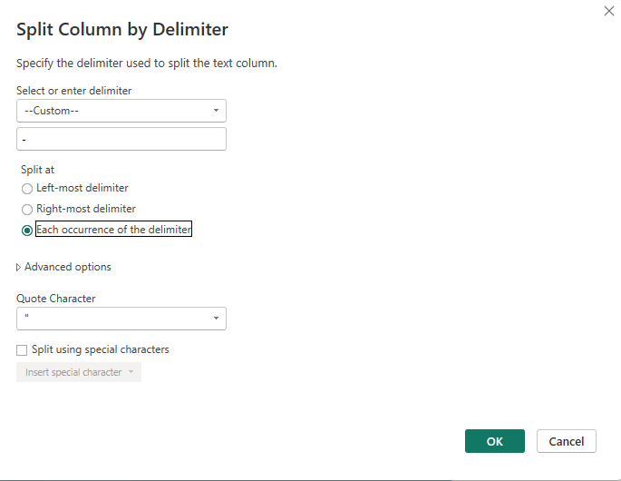
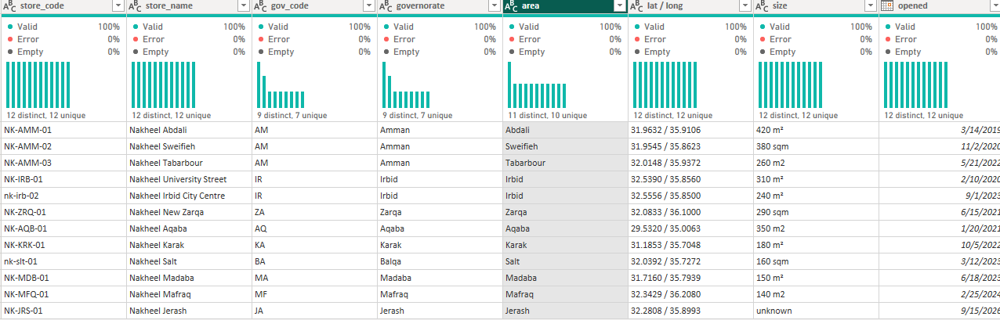
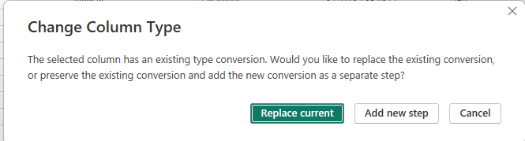
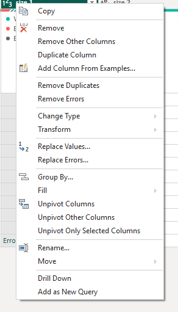
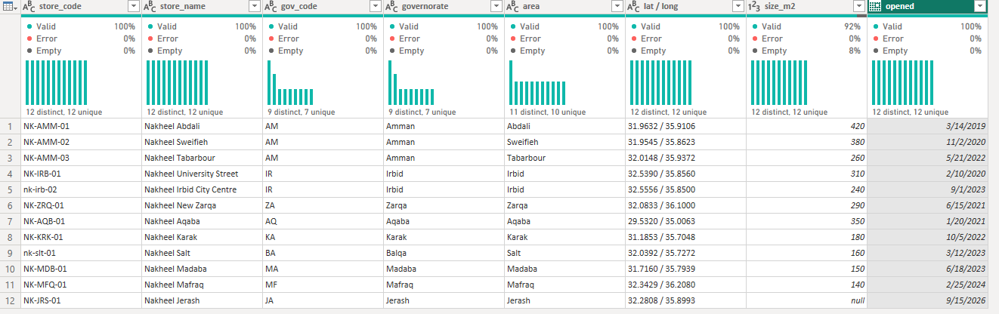

# The store list: Reference, Split Column and errors

In this activity, you will start cleaning Nakheel's store list: build the clean query as a **Reference** of the raw one, split a column that holds three facts into three columns, and deal with a value that will not turn into a number.

**In class:** a short demo, then you do it · **Data:** `stores_raw.csv` from [`nakheel_store_files.zip`](../../../../../shared/datasets/nakheel_stores/README.md) · **Tool:** Power BI Desktop or the browser

## The story

To show revenue by governorate, Power BI needs to know where each shop is. Head office keeps the store list in a spreadsheet typed by hand: three facts in one column, latitude and longitude together, sizes typed as `420 m²`, `380 sqm` or `unknown`. You cannot filter on a governorate that is buried in a longer text, or add up sizes that are text.

## What you will learn

- The difference between **Reference** and **Duplicate**, and why the clean query should be a reference.
- To split a column at a delimiter, every time it appears or only at the first one.
- What an **Error** cell is, how **Column quality** counts it, and when to **Keep errors**, **Remove errors** or **Replace errors**.

## Before you start

Work in the same Power BI file as activities 01 and 02 (Desktop), or the same semantic model (browser: add `stores_raw.csv` with **Get data** → **Text/CSV**, uploading the file, as in activity 01).

## Step 1 · Load the list, and look at it

**Home** → **New Source** (or **Get data**) → **Text/CSV** → `stores_raw.csv` → **Transform Data**. Turn on **View → Column quality / Column distribution / Column profile** if they are off (browser: **View → Data view**).

**What you should see:** 12 rows; one row is one store. Columns `store_code`, `store_name`, `governorate - city - area`, `lat / long`, `size`, `opened`. Jerash opens on 15 September 2026, after the sales data ends.

## Step 2 · Make the clean query with Reference

Keep `stores_raw` exactly as the file is, and do all the cleaning in a second query that reads it.

1. In the **Queries** pane on the left, right-click `stores_raw` and choose **Reference**. It is in the middle of the menu, just under **Duplicate**.

2. A new query appears, called `stores_raw (2)` by default. Right-click it → **Rename** → `stores`.

3. Select `stores` and look at **Applied steps**: one step, `Source`. Click it: the formula bar shows `= stores_raw`. `stores` starts from whatever `stores_raw` gives it.

4. Right-click `stores_raw` and untick **Enable load**. If Power BI warns that the data will be removed from the report, choose **Continue**. Only the clean `stores` goes into the model.

**What you should see:** `stores` with one step, `Source`, and the same 12 rows; `stores_raw` in italics.

**Reference or Duplicate?** Both make a new query from `stores_raw`, and both name it `stores_raw (2)`. The difference is in the steps:

| | Reference | Duplicate |
|---|---|---|
| First step of the new query | `Source = stores_raw` | a copy of every step of `stores_raw`, starting with `Csv.Document(...)` |
| You later change `stores_raw` | the change reaches `stores` | the copy does not change |

You do not need a duplicate today. If you want to see one, right-click `stores_raw` → **Duplicate**, look at its **Applied steps**, then right-click the copy → **Delete**.

Microsoft's words: a referenced query "uses the steps of a previous query without having to duplicate the query", and "any changes on the original query will transfer down to the referenced query". A duplicate is a copy that goes its own way.

## Step 3 · Three facts, three columns

1. In `stores`, select `governorate - city - area`.

2. **Home** → **Split Column** → **By Delimiter**. Choose **--Custom--** and type a space, a hyphen and a space: ` - `. **Split at:** **Each occurrence of the delimiter**. **OK**.

   

3. Rename the three new columns `gov_code`, `governorate` and `area`.

   

   

**What you should see:** `AM`, `Amman`, `Abdali` in the first row. **Column distribution** on `governorate` shows 9 distinct values: Amman has 3 shops, Irbid 2, the others 1.

## Step 4 · A size that is not a number

1. Select `size`. **Split Column** → **By Delimiter** → **Space** → **Split at:** **Left-most delimiter** → **OK**. You get `size.1` (`420`) and `size.2` (`m²`, `sqm`, `m2`).

2. Select `size.1`. If the split already added a **Changed Type** step and shows an error for `unknown`, keep that step. Otherwise click the type icon on the `size.1` header and choose **Whole Number**. If Power Query asks, choose **Replace current**.

   

3. Look at the row with `unknown` in the original `size` column: why can that text not become a number?

**What you should see:** Jerash's cell says **Error**. **Column quality** under `size.1`: Valid 92%, Error 8%: 11 of 12 rows. Click beside the word Error (not on it) to read the message underneath: Power Query could not convert `unknown` to a number.

This is a cell-level error: Power Query can still show the table preview, with an error in that cell. Resolve it before loading the table into the model. A step-level error, by contrast, stops the whole query (a yellow bar at the top).

## Step 5 · Look, then decide

1. Select `size.1`, then **Home → Keep Rows → Keep Errors**. One row: Jerash. This is how you find errors in a big table. Delete this step in **Applied steps** when you have looked.

2. Choose what Jerash's size should be. Removing the row (**Home** → **Remove Rows** → **Remove Errors**) would drop the store from the list. Its size is unknown, which is a fact, so keep the row and leave the size empty: right-click `size.1` → **Replace Errors** → type `null` → **OK**.

   

3. Remove `size.2` and rename `size.1` to `size_m2`.

**What you should see:** 12 rows. Jerash's `size_m2` is `null`; Column quality shows Empty 8%. To check the total, **Close & Apply** (browser: **Save**, then refresh the report) and make a card with `size_m2` (Sum) from `stores`: 2,880.

Save your changes before continuing: **File → Save** on Desktop; in the browser, **Save** Power Query changes, refresh the report and save the report.

## Check yourself

| Step | One value to check |
|---|---|
| 1 | 12 rows, 6 columns |
| 2 | `stores` has one step: `Source = stores_raw` |
| 3 | `governorate`: 9 distinct values |
| 4 | `size.1`: Valid 92%, Error 8% |
| 5 | 12 rows; the 11 known sizes add up to 2,880 m² |

## If something goes wrong

- **No Reference in the right-click menu:** you right-clicked a column header or a cell. Right-click the query name, `stores_raw`, in the **Queries** pane on the left.
- **The split makes only two columns:** you split at **Left-most delimiter**. Delete the step and choose **Each occurrence of the delimiter**.
- **The new columns start or end with a space** (`" Amman"`): the delimiter was a hyphen without the spaces. Delete the step and type space-hyphen-space.
- **Every size is an Error:** you changed the type of `size` before splitting it. Delete that step.

## Hint

In SQL, step 3 is `SPLIT(col, ' - ')[OFFSET(0)]` and so on, and step 5 is `SAFE_CAST(... AS INT64)`, which returns `NULL` where the cast fails, the same as **Replace Errors** with `null`.

## Bonus

Go back to `stores_raw` and change its last step, for example rename `store_name` to `name`. Then look at `stores`: the change came through, because `stores` is a reference. Undo it (delete the step) before you go on.

## References

Nakheel Retail store files, synthetic course data; see [`shared/datasets/nakheel_stores`](../../../../../shared/datasets/nakheel_stores/README.md). Use the [D17 guide](../README.md) for saving, browser navigation and row-count checks. Button and menu names can vary between Desktop and the browser. Power BI changes every month: if a name on your screen differs, look in the same tab or menu. Microsoft: [The Queries pane: Reference and Duplicate](https://learn.microsoft.com/en-us/power-query/queries-pane), [Split columns by delimiter](https://learn.microsoft.com/en-us/power-query/split-columns-delimiter), [Dealing with errors](https://learn.microsoft.com/en-us/power-query/dealing-with-errors), [Data profiling tools](https://learn.microsoft.com/en-us/power-query/data-profiling-tools).
