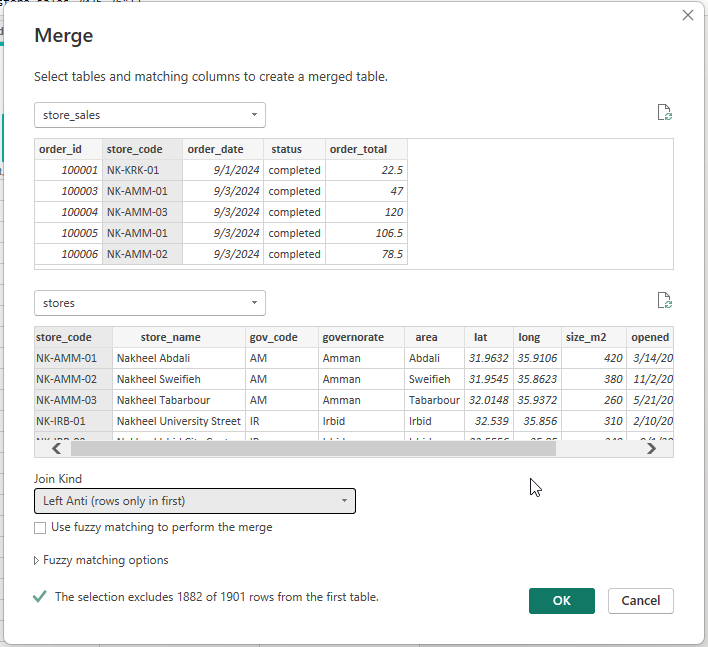
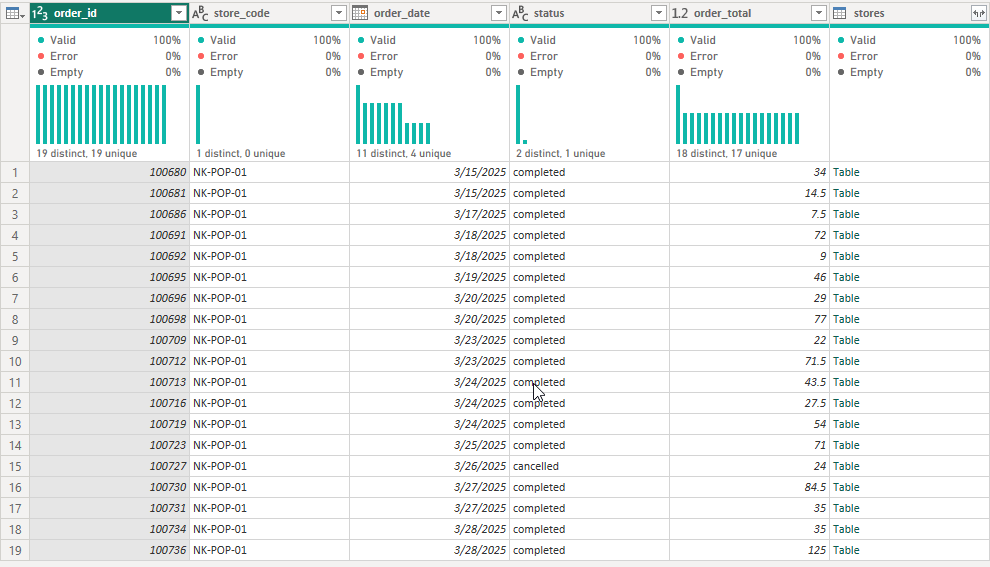
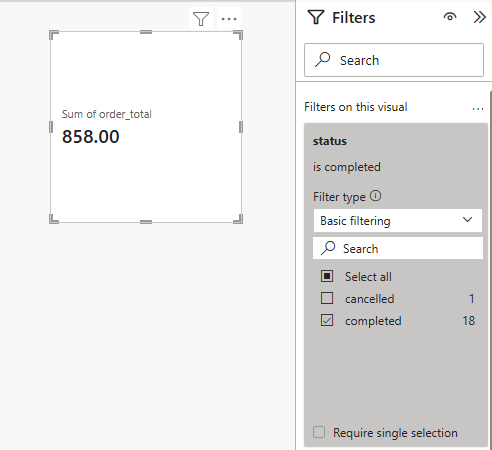
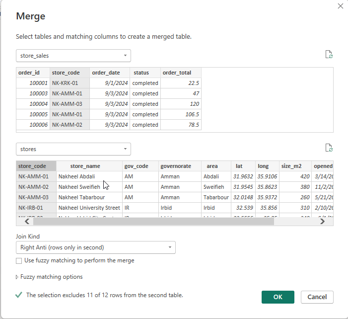
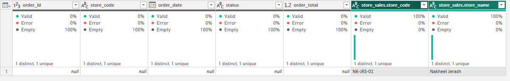
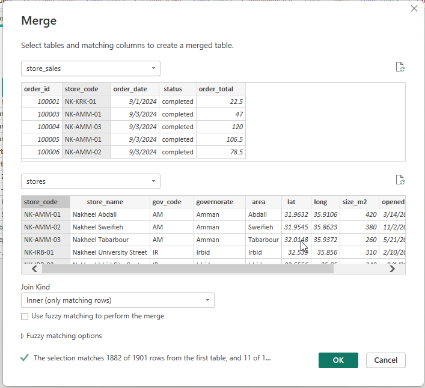
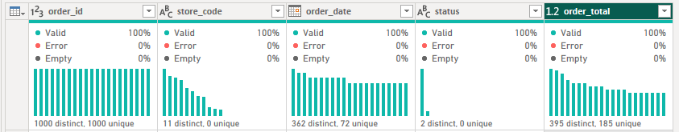
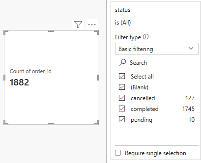
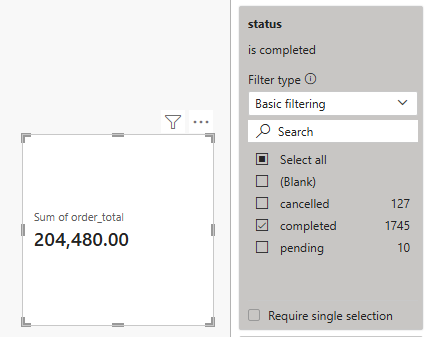

# Solution: who has no match?

## Build the three audit queries

1. Select `store_sales` → **Merge Queries as New**. Choose `stores` below, matching `store_code` to `store_code`, with **Left Anti**. Rename the new `Merge1` to `sales_without_store` and remove its nested `stores` column (empty tables): **19 rows**, all `NK-POP-01`. A Card on this query's **Sum of order_total**, filtered to **completed**, reads **858.00** from **18** completed orders.

   

   

   

   

2. Start again from `store_sales` and use **Right Anti**, naming the result `stores_without_sales`. Expand `store_code` and `store_name` from its nested `stores` column, retaining the prefix: **NK-JRS-01 / Nakheel Jerash**. The sales-side columns are null because this store has no sales match.

   

   

3. Start again from `store_sales` and use **Inner**, naming the result `store_sales_inner`, and remove its nested `stores` column. Apply/save and refresh. A Card from this query, filtered to **completed**, gives **204,480.00**. An unfiltered order count gives **1,882 rows**. Compare with the left-outer total: the missing **858.00** is the stall's completed revenue.

   

   

   

   

   

4. After checking, untick **Enable load** on these audit queries if available and save; delete the cards built on them, which now show an error. Their findings remain reproducible in Power Query without adding more sales copies to the report model.

Each merge starts from `store_sales`; merging the result of the previous anti join would answer a different question.

| Question | Answer |
|---|---|
| 1 | **19 rows**, all `NK-POP-01` (the Ramadan stall, 15–28 March 2025); 18 completed, **858.00** |
| 2 | **1 row**: `NK-JRS-01`, Nakheel Jerash, which opens on 15 September 2026, after the data ends |
| 3 | **1,882 rows**; completed total **204,480.00**, which is 858.00 short of the SQL answer |

Question 3 in words: an inner merge drops the stall's sales without a trace, so the chart's total no longer matches the books. The left outer merge keeps them under **(Blank)**, where someone can see them and ask. For revenue by governorate, use left outer, and say in the chart's title or a note what the blank bar is.

The most common error: running question 1 before the UPPERCASE fix, which returns 404 rows.

## The same in SQL (BigQuery)

Uses the views `store_sales` (solution 01) and `stores` with its UPPERCASE fix (solution 06). An anti join is a `LEFT JOIN` that keeps only the rows that found nothing.

| Power Query join kind | SQL |
|---|---|
| **Left Anti**: sales with no store | `LEFT JOIN stores ... WHERE t.store_code IS NULL` |
| **Right Anti**: stores with no sales | `RIGHT JOIN` (or `LEFT JOIN` from `stores`) `... WHERE s.store_code IS NULL` |
| **Inner** | `JOIN` (`INNER JOIN`) |
| **Left Outer** (activity 06) | `LEFT JOIN` |

```sql
-- 1. Sales without a store: 19 rows, all NK-POP-01; 18 completed, 858.00
SELECT s.*
FROM nakheel_stores.store_sales AS s
LEFT JOIN nakheel_stores.stores AS t ON s.store_code = t.store_code
WHERE t.store_code IS NULL;

-- 2. Stores without sales: NK-JRS-01, Nakheel Jerash
SELECT t.store_code, t.store_name
FROM nakheel_stores.store_sales AS s
RIGHT JOIN nakheel_stores.stores AS t ON s.store_code = t.store_code
WHERE s.store_code IS NULL;

-- 3. Inner: 1,882 rows; completed 204,480.00, 858.00 short of 205,338.00
SELECT COUNT(*) AS sales,
       SUM(IF(s.status = 'completed', s.order_total, 0)) AS completed_revenue
FROM nakheel_stores.store_sales AS s
JOIN nakheel_stores.stores AS t ON s.store_code = t.store_code;
```

The inner join's missing 858.00 leaves no trace in its own result; only a comparison with the left join's 205,338.00, or the anti join, shows it.
