# Lab 10 · A file as the till prints it: import errors

In this self-guided lab, you will load a shop's raw till export, get past the title lines, find the values that will not become numbers, and choose a fix for each that keeps the revenue right.

**When:** after class, at your own pace. Not submitted. · **Data:** `till_export_raw.csv` from [`nakheel_store_files.zip`](../../../../../shared/datasets/nakheel_stores/README.md) · **Start from:** a new Power BI file, or today's

## The story

Aqaba's till prints its August 2026 file with two title lines, a blank line, two voided receipts and one amount typed with its currency. Head office's figure for Aqaba's completed August sales is 2,032.50 dinars. The fastest-looking fix, **Remove Errors**, gives a different number. Your job is to get 2,032.50, and to know why.

## What you will learn

- To remove title rows and promote the real header row yourself.
- To find error cells with **Keep Errors** and read why each failed.
- To choose between fixing a value, filtering a row out and **Remove Errors**, by what each does to the total.

## Before you start

Open `till_export_raw.csv` in Notepad: three lines before the header, then the orders, and an empty line of commas at the end.

**In the browser:** **Get data** → **Text/CSV** in your semantic model's Power Query, uploading the file, if your account allows it (activity 01, "Before you start"). The steps are the same.

## Checkpoints

- **C1:** a table with the real headers `order_id`, `order_date`, `status`, `order_total` and 12 rows.
- **C2:** the three error cells found and each explained.
- **C3:** completed revenue 2,032.50 from 7 orders, with no row removed by **Remove Errors**.

## Step 1 · Start from the file as it is (C1)

1. **Get data** → **Text/CSV** → `till_export_raw.csv` → **Transform Data**.

   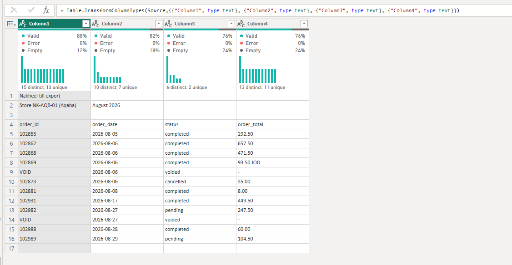

2. In **Applied steps**, delete steps after `Source` **from the last step upwards**, keeping `Source`. Power BI's automatic steps may treat a title line as the header; you will choose the header row yourself.

**What you should see:** 17 rows. Row 1 says `Nakheel till export`; the real header is row 4.

## Step 2 · Title rows off, header on (C1)

1. **Home** → **Remove Rows** → **Remove Top Rows** → **Number of rows:** `3` → **OK**.

   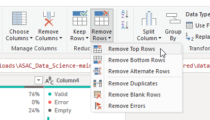

   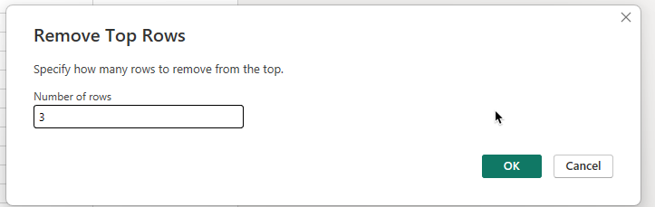

2. **Home** → **Use First Row as Headers**.

   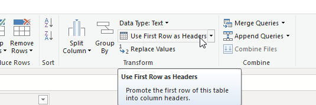

   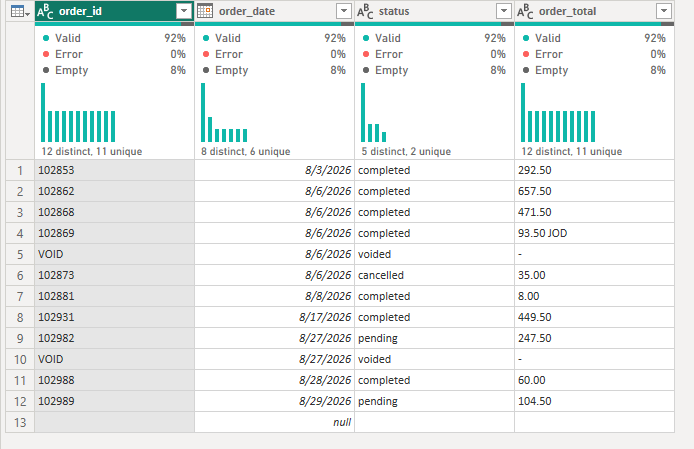

   

3. **Home** → **Remove Rows** → **Remove Blank Rows**.

   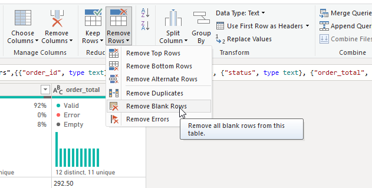

**What you should see:** 12 rows and the four real column names. Power BI may add a `Changed Type` step on its own after step 2; delete it, you will set the types yourself.

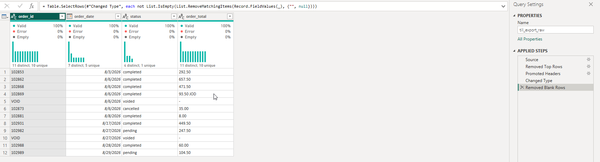

## Step 3 · Set the types, and find the errors (C2)

1. Set `order_id` to **Whole Number**, `order_date` to **Date**, `order_total` to **Decimal Number**.

   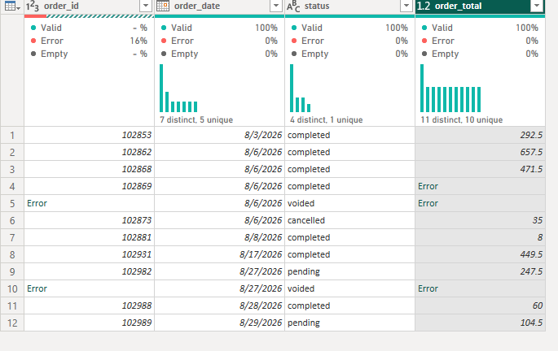

2. **View** → **Column quality**. `order_id` and `order_total` show errors.

3. Ctrl+click the `order_id` and `order_total` headers to select both, then **Home → Keep Rows → Keep Errors**. A row is kept if either selected column has an error.

**What you should see:** 3 rows. Two are `VOID` receipts: `order_id` is not a number and `order_total` is `-`. One is a real order, 102869, whose `order_total` was typed `93.50 JOD`. Click beside each Error to read it. Then delete the **Kept Errors** step.

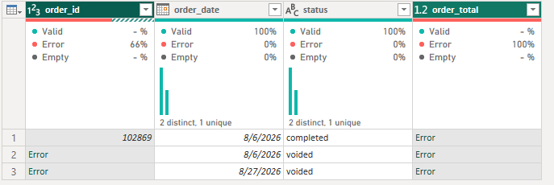

## Step 4 · Try the quick fix, and check it (C3)

1. Select all column headers (click the first, then Shift+click the last), then **Home → Remove Rows → Remove Errors**.
2. Filter `status` to completed and read the total (select `order_total`, **Transform → Statistics → Sum**).

**What you should see:** 6 completed orders, **1,939.00**. Order 102869's 93.50 was a sale, and **Remove Errors** threw it away. Delete the temporary Sum step first, then the completed-status filter, then **Removed Errors**, working backwards. You should be back to the 12 rows with their type-conversion errors.

## Step 5 · Fix each error for its reason (C3)

1. If **Kept Errors** is still in **Applied steps**, delete it. Then delete **Changed Type1**, the type step you added in step 3. You will fix the text first and set the type last, so no value has to fail.

   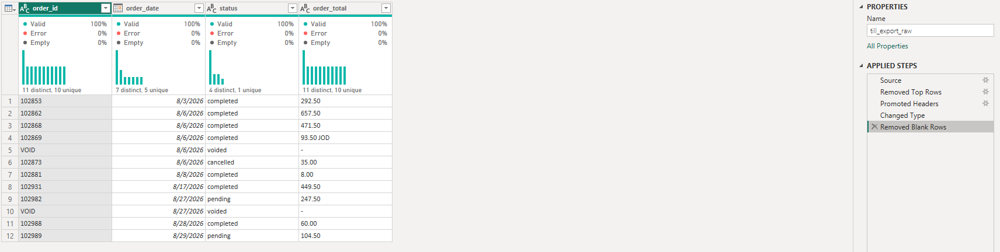

2. The typed currency is a real amount, and a space separates the number from `JOD`. Select `order_total`, then **Home** → **Split Column** → **By Delimiter** → **Space**.

   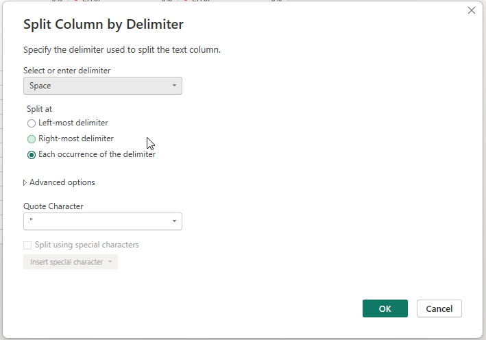

   Click Ok. 

   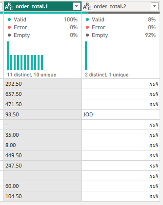

   `order_total.1` holds the amounts as text; `order_total.2` is `JOD` on one row and empty on the rest. Delete `order_total.2` and rename `order_total.1` to `order_total`. If Power BI added a **Changed Type** step after the split, delete it: the `-` cells must still be text for the next step.

   

3. The `-` on the voided receipts means "no amount", which Power Query writes as `null`. Right-click `order_total` → **Replace Values** → **Value To Find:** `-` → **Replace With:** `null` → **OK**.

   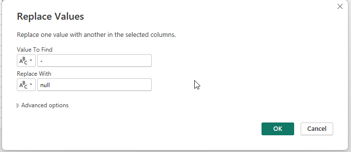

   Now set `order_total` to **Decimal Number**. Every value converts: `93.50` is a number now, and `null` stays empty.

   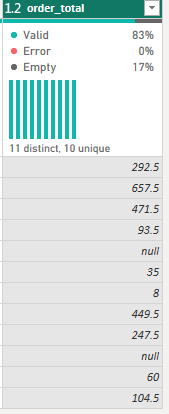

4. Filter `status` to completed. The two `VOID` receipts leave here because they are not completed orders: a row filtered out for a reason, not for an error. **Close & Apply** (browser: **Save**, then refresh the report), and make a card with `order_total` (Sum).

   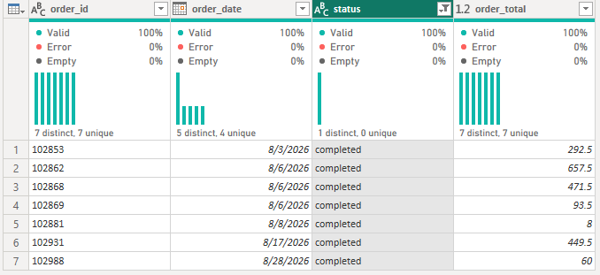

**What you should see:** no errors, 7 completed orders, **2,032.50**: Aqaba's August in `store_sales` from today's activity 01.

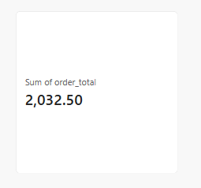

Save your changes before continuing: **File → Save** on Desktop; in the browser, **Save** Power Query changes, refresh the report and save the report.

## Check yourself

| Checkpoint | One value to check |
|---|---|
| C1 | 12 rows after Remove Blank Rows |
| C2 | 3 rows with errors: 2 `VOID`, 1 `93.50 JOD` |
| C3 | 7 completed orders · 2,032.50 (not 1,939.00) |

## If something goes wrong

- **Your headers are `Column1` to `Column4`:** **Use First Row as Headers** is missing, or you removed 4 rows instead of 3.
- **The `Replace Values` step did nothing, or `-` is still an Error:** a type step sits before it (yours from step 3, or one Power BI added after the split), so the cell was already an error. Delete that type step; replace first, set the type last.
- **`order_total.1` and `order_total.2` do not appear:** the split used a different delimiter. Delete the split step and choose **Space**.

## Bonus

**More practice, not checked:** instead of Split Column, try **Add Column** → **Column From Examples** on `order_total`: type `93.50` beside `93.50 JOD`. Compare the formula with your fix.

## References

Nakheel Retail store files, synthetic course data; see [`shared/datasets/nakheel_stores`](../../../../../shared/datasets/nakheel_stores/README.md). Use the [D17 guide](../README.md) for saving, browser navigation and row-count checks. Button and menu names can vary between Desktop and the browser. Power BI changes every month: if a name on your screen differs, look in the same tab or menu. Microsoft: [Dealing with errors](https://learn.microsoft.com/en-us/power-query/dealing-with-errors), [Filter a table by row position](https://learn.microsoft.com/en-us/power-query/filter-row-position), [Promote or demote column headers](https://learn.microsoft.com/en-us/power-query/table-promote-demote-headers).
