# Lab 11 · Optional: did each shop meet its target?

In this optional self-guided lab, you will put finance's monthly targets beside the shops' actual sales and answer a regional manager's question. On the way you will use three Power Query tools, **Unpivot**, **Group By** and a **Merge** on two keys, and see the one problem each of them solves.

**When:** after class, if you want more. Not submitted. · **Data:** `store_targets_2025-26.csv` from [`nakheel_store_files.zip`](../../../../../shared/datasets/nakheel_stores/README.md) ([single file](../../../../../shared/datasets/nakheel_stores/store_targets_2025-26.csv)), and the store sales: `store_sales` from today's activity 01, or [`Resources/store_sales.csv`](Resources/store_sales.csv) · **Start from:** a new Power BI file, or today's

## The question

The regional manager asks: **"Which shops met their monthly targets in 2025-26, and which met the year?"**

To answer, every target has to sit **beside** the sales of the same shop in the same month. That is the whole lab. The two files are not ready for it, and each step fixes one reason why.

| Step | The problem it fixes | The tool |
|---|---|---|
| 1 | You need finance's sheet in Power Query, as it is | **Get data** |
| 2 | The months are column names, so nothing can match them | **Unpivot** |
| 3 | The sales are one row per order; the targets are one row per month | **Group By** |
| 4 | Put each target beside its actual, then answer yes or no | **Merge** on two keys, **Conditional Column** |

**Follow one shop all the way through:** NK-AMM-01 (Abdali) in September 2025. Its target is 1,400 dinars; its 16 completed orders that month add up to 1,522.00. At the end of step 4 its row reads `yes`.

## Before you start

You need two things in one Power BI file: the targets (step 1 loads them) and the store sales, one row per order. Choose one route:

- **You have today's file:** open it and check that the **Queries** pane in Power Query has `store_sales` from activity 01: 1,901 rows, completed revenue 205,338.00.
- **You start fresh:** open a new Power BI file. **Get data** → **Text/CSV** → [`Resources/store_sales.csv`](Resources/store_sales.csv) (activity 01's result saved as a file) → **Transform Data**. Rename the query `store_sales`. Check that `order_date` is **Date** and `order_total` is **Decimal Number**.

**In the browser:** do the same in your semantic model's Power Query (**Transform data**), uploading the files, if your account allows it (activity 01, "Before you start").

## Checkpoints

- **C1:** `store_targets` kept as finance sent it (11 rows, 13 columns), and `targets_long`: 132 rows, columns `store_code`, `month`, `target`; the year's targets add up to 110,000.
- **C2:** `actuals_by_month`: completed 2025-26 sales grouped by `store_code` and `month`: 125 rows, 107,595.00 in all.
- **C3:** the two merged: 132 rows, 61 shop-months at or above target, 3 shops that met the year.

## Step 1 · Load the targets as finance keeps them (C1)

**Why this step:** before you change anything, look at what finance sent. You will keep this sheet untouched so you can compare it with what you make from it.

1. **Get data** → **Text/CSV** → `store_targets_2025-26.csv` → **Transform Data**.

2. Check the column names. They should be `store_code`, `2025-09`, `2025-10` and so on. If they are `Column1`, `Column2` … and the first row holds `store_code` and the months, Power BI did not promote the header for you:

   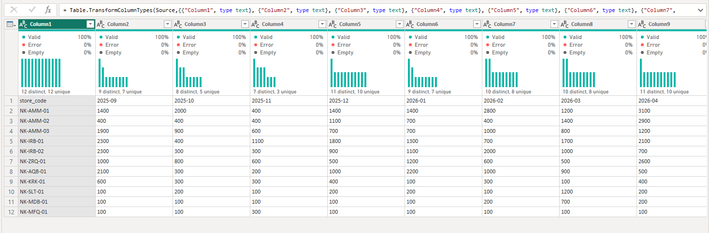

   Select **Home** → **Use First Row as Headers**. *Why:* without it, the month names sit in a data row, and step 2 would treat `2025-09` as if it were a target.

   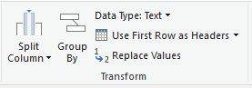

   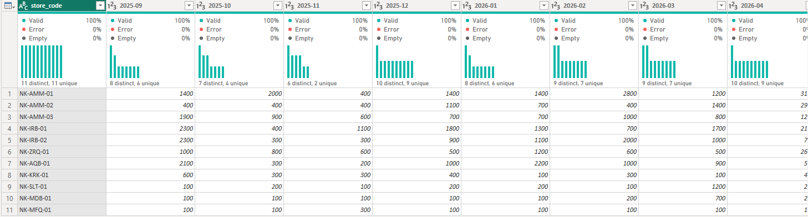

3. Rename the query `store_targets`.

**Look at it before you go on.** 11 rows, 13 columns. Here is the shop you are following:

| store_code | 2025-09 | 2025-10 | 2025-11 | … | 2026-08 |
|---|---:|---:|---:|---|---:|
| NK-AMM-01 | 1400 | 2000 | 400 | … | 500 |

One row is one **shop**. Now find "September 2025" in this table. It is not in any cell: it is the **name** of a column. That is the problem step 2 fixes.

## Step 2 · Turn the months into rows with Unpivot (C1)

**Why this step:** every sale has its date in a cell. To match September 2025 in the sales with September 2025 in the targets, the month has to be in a cell too, in a column of its own, the way `store_code` is. Power Query can match, filter and chart the values in a column; it can do none of that with a column's name. **Unpivot** moves the twelve month names down into one column, `month`, and their numbers into another, `target`.

1. Right-click `store_targets` in the **Queries** pane → **Reference**. Rename the new query `targets_long`.

   *Why a Reference:* `targets_long` starts from `store_targets` and adds its own steps, so finance's wide sheet stays as it was and you can click between the two to see what Unpivot did. Unpivot `store_targets` itself and the original is gone. (Activity 04 did the same with `stores_raw`.)

2. In `targets_long`, select `store_code`, right-click → **Unpivot Other Columns**.

   *Why "Other":* you name the column to keep as it is (`store_code`, the shop) and every other column becomes rows. When finance adds September 2026 as a new column, this step unpivots it too, with no change.

3. Rename `Attribute` to `month` and `Value` to `target`. Set `target` to **Whole Number**. Check that `store_code` and `month` are **Text**.

   *Why Text:* in step 3 you will write each sale's month as the text `2025-09`. A merge matches only values that are exactly the same, so both `month` columns must be the same text.

   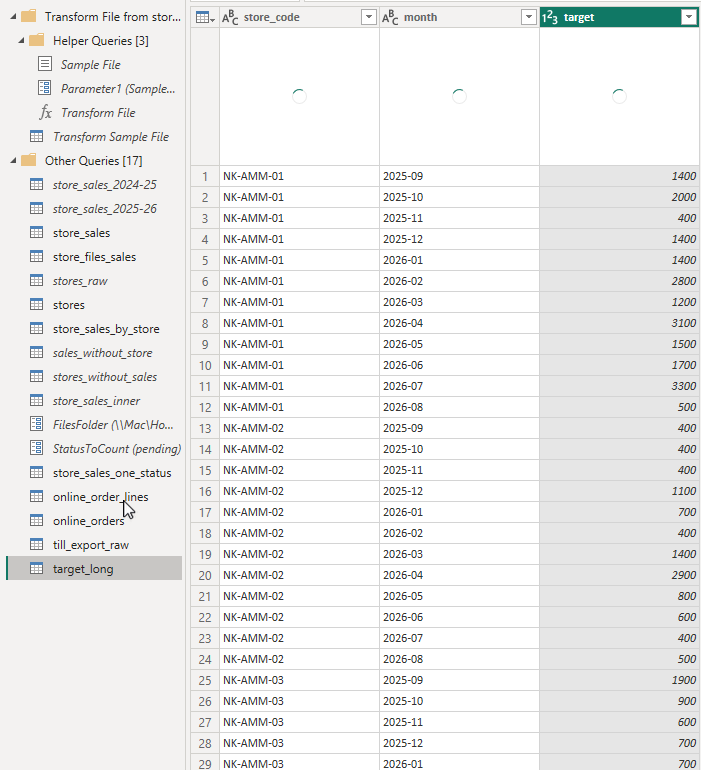

4. Right-click `store_targets` → untick **Enable load**. *Why:* it feeds `targets_long`, but nobody will chart the wide sheet, so it does not need to be a table in the report (as `stores_raw` in activity 04).

**What just happened.** NK-AMM-01 was one row with twelve month columns. Now it is twelve rows:

| store_code | month | target |
|---|---|---:|
| NK-AMM-01 | 2025-09 | 1400 |
| NK-AMM-01 | 2025-10 | 2000 |
| NK-AMM-01 | 2025-11 | 400 |
| … | … | … (9 more months) |

One row is now one **shop in one month**: 11 shops × 12 months = **132 rows**. Nothing was lost or added: the targets still add up to 110,000. Only the shape changed. You have seen the opposite move in Excel: a **PivotTable** turns rows into a wide summary that is easy to read. **Unpivot** goes back to one row per fact, the shape Power BI works with best.

## Step 3 · Sum the sales to the same level with Group By (C2)

**Why this step:** now look at the other side. `store_sales` has one row per **order**. NK-AMM-01 had 16 completed orders in September 2025; `targets_long` has **one** row for that shop and month. If you merged them now, the target 1,400 would be copied onto all 16 orders, and a total of `target` would count it 16 times. So first add up the orders to one row per shop and month, the same level as the targets. That is **Group By**, Power Query's `GROUP BY`.

1. Right-click `store_sales` → **Reference**. Rename it `actuals_by_month`. *Why:* `store_sales` stays whole for everything else that reads it.

2. Check `order_date` is **Date** and `order_total` is **Decimal Number**. Filter `status` to `completed`. Then filter `order_date` to **is after or equal to** 1 September 2025: open the filter on `order_date` and choose **Custom Filter…** (date filters appear only on a Date column).

   *Why these two filters:* only completed orders are revenue, and the targets start in September 2025, so earlier sales have no target to compare with.

   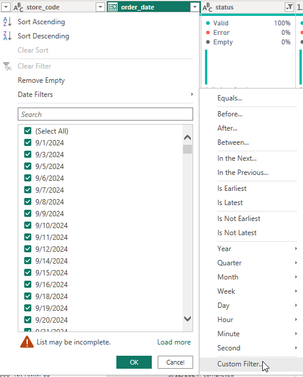

   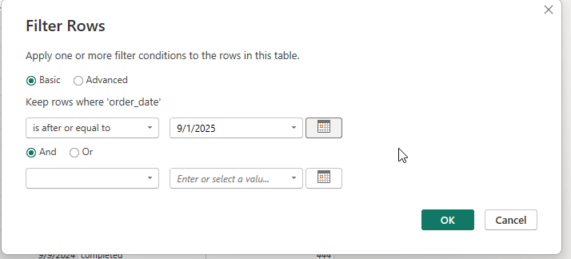

3. **Add Column → Custom Column**: **New column name** `month`, **Formula** `Date.ToText([order_date], "yyyy-MM")`.

   *Why:* a sale has a full date (`2025-09-05`); a target has a month (`2025-09`). This formula writes each date as its year and month, spelled exactly like the targets: `yyyy` is the four-digit year, `MM` the month as two digits. (`MMM` would write `Sep`, which would not match.)

   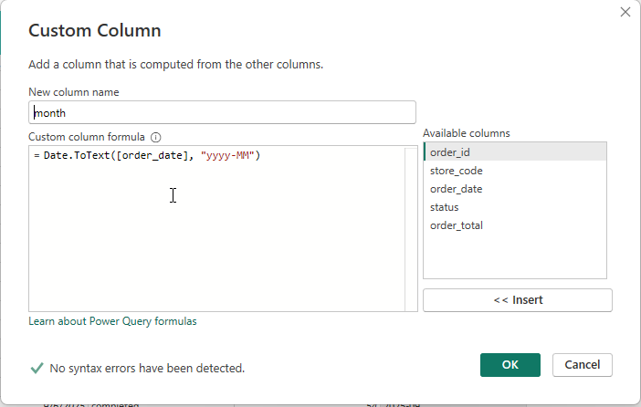

   Set the new column to **Text** to match `targets_long[month]`.

4. **Home** → **Group By** → **Advanced**. Group by `store_code`, then **Add grouping** → `month`. **New column name** `actual`, **Operation** **Sum**, **Column** `order_total`. **OK**.

   *Why two groupings:* you want one row per shop **and** month. Grouping by `store_code` alone would give one year's total per shop.

   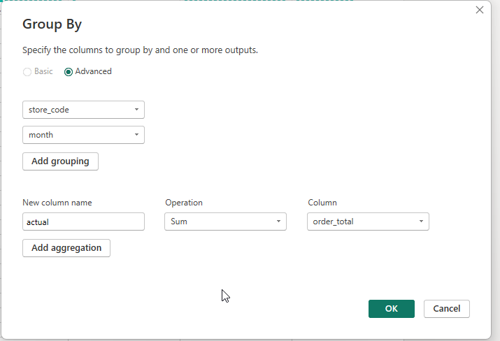

**What just happened.** NK-AMM-01's 16 completed orders in September 2025 (101360 for 32.00, 101366 for 92.00, 101371 for 34.50 and 13 more) became one row:

| store_code | month | actual |
|---|---|---:|
| NK-AMM-01 | 2025-09 | 1,522.00 |

**What you should see:** 125 rows, 107,595.00 in all. Not 132: seven shop-months had no completed sale, so there was nothing to group (step 4 deals with them). The pop-up stall is not here: it traded in March 2025, before this year.

## Step 4 · Put target beside actual, and answer (C3)

**Why this step:** both tables now have one row per shop and month, and both name the shop and the month in the same two columns. A **Merge** can now put each target beside its actual, the way activity 06 put each sale beside its store. This time the match needs **two** columns: `store_code` alone would match NK-AMM-01's September target with all twelve of its months.

1. Select `targets_long` → **Merge Queries as New**. Top: click `store_code`, then Ctrl+click `month`. Bottom: `actuals_by_month`, click `store_code`, then Ctrl+click `month`, in the same order. **Join Kind:** **Left Outer**.

   Read the line at the bottom before you click **OK**. It should say **125 of 132** rows match: every shop-month with sales. The screen below shows what a mismatch looks like: **0 of 132**, because `month` in `actuals_by_month` reads `2025-Sep` (the formula had `MMM`) while the targets say `2025-09`. If you see that, go back to step 3 and fix the formula.

   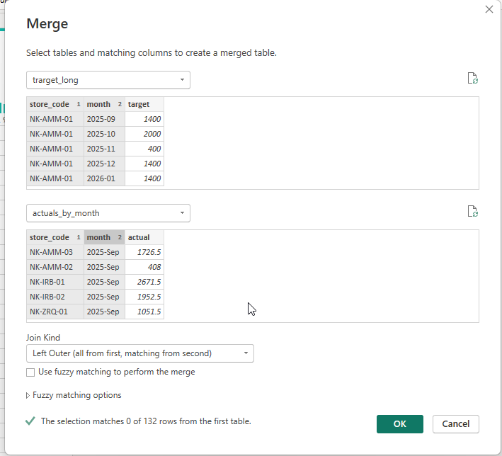

   *Why Left Outer:* it keeps all 132 targets, including the seven months with no sales. A shop that sold nothing in a month missed its target, and the manager should see that row, not lose it.

   Click **OK** and rename the query `targets_vs_actuals`.

2. Click the expand button on the `actuals_by_month` column, tick only `actual`, and untick **Use original column name as prefix**. Set `actual` to **Decimal Number**. Right-click it → **Replace Values**: find `null`, replace with `0`.

   *Why:* `null` means "no sale was found". A shop that sold nothing sold 0, and Power Query cannot compare an empty value with a target: the next step would show an Error on those seven rows.

   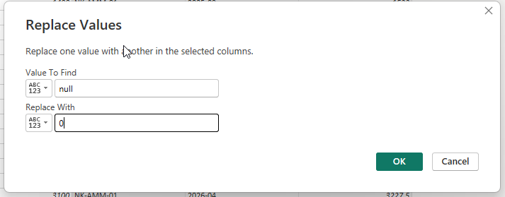

3. Select the `actual` column, then **Add Column** → **Conditional Column**: **New column name** `met_target`; **If** `actual` **is greater than or equal to**, then in the value box switch the small drop-down from **ABC** (a typed value) to **Select a column** and choose `target`; **Output** `yes`; **Else** `no`.

   *Why:* this is the manager's question, asked on every row: did the actual reach the target?

   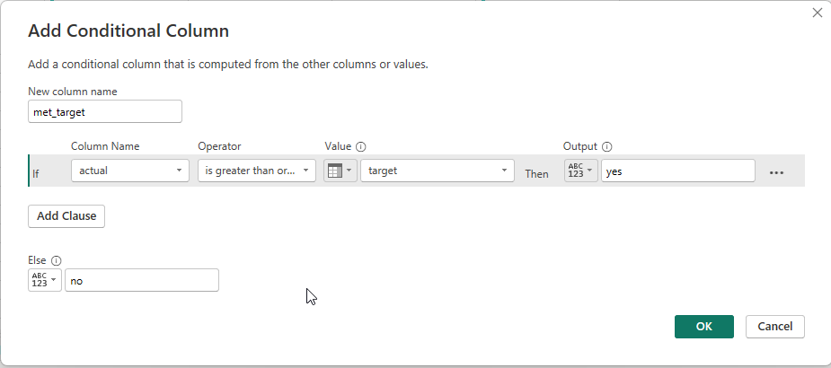

4. For the year: right-click `targets_vs_actuals` → **Reference** and rename it `targets_by_store`. **Home → Group By → Advanced**: group by `store_code`; add a sum of `actual` named `actual` and a sum of `target` named `target`.

   *Why a second Group By:* "met the year" is a different question from "met the month". A shop can miss some months and still meet the year, because a strong month makes up for a weak one.

   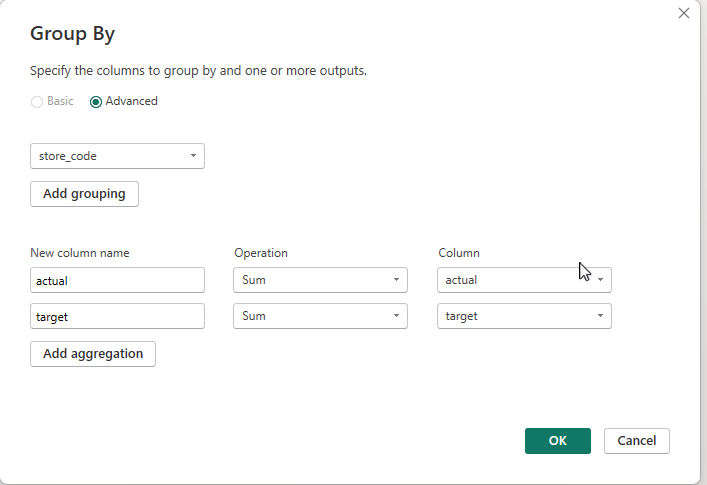

   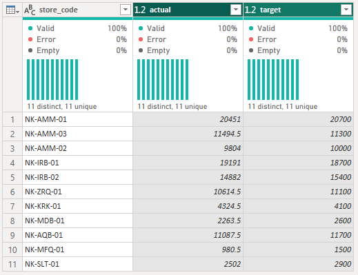

5. Add a conditional column `met_yearly_target`: if `actual` **is greater than or equal to** the column `target`, output `yes`; else `no`.

   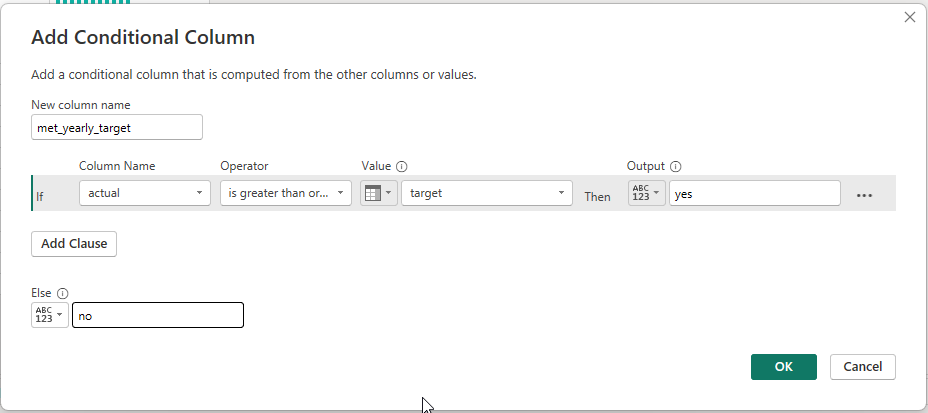

6. **Close & Apply** (browser: **Save**, then refresh the report). Use a **Table** visual with `store_code`, `actual`, `target` and `met_yearly_target` from `targets_by_store` to compare the year.

**What just happened.** The shop you followed, now beside its targets:

| store_code | month | target | actual | met_target |
|---|---|---:|---:|---|
| NK-AMM-01 | 2025-09 | 1400 | 1,522.00 | yes |
| NK-AMM-01 | 2025-10 | 2000 | 1,738.50 | no |
| NK-AMM-01 | 2025-11 | 400 | 556.50 | yes |
| … | … | … | … | … |

Over the year NK-AMM-01 met 7 of its 12 monthly targets but **missed the year**: 20,451.00 against 20,700. NK-AMM-03 met 8 months and **met the year**: 11,494.50 against 11,300. Monthly and yearly answers can differ, which is why the manager asked both.

**What you should see:** `targets_vs_actuals` has 132 rows; `met_target` is `yes` in 61. `targets_by_store` has 11 rows; over the year, actual 107,595.00 against target 110,000. Three shops beat their yearly target: NK-AMM-03, NK-IRB-01 and NK-KRK-01.

Save your changes before continuing: **File → Save** on Desktop; in the browser, **Save** Power Query changes, refresh the report and save the report.

## What you built

```text
store_targets  (one row per shop, as finance sent it)
   └─ targets_long      Unpivot: one row per shop and month ──┐
                                                             ├─ targets_vs_actuals   Merge on store_code + month
store_sales    (one row per order)                           │     └─ targets_by_store   Group By store_code: the year
   └─ actuals_by_month  Group By: one row per shop and month ─┘
```

Each query answers one small question, and each step in it fixes one problem you could see on the screen. That is all Power Query is: a list of small, readable fixes, kept in **Applied steps** and replayed at every refresh. You already know these moves from SQL: Unpivot is `UNPIVOT`, Group By is `GROUP BY`, and a merge on two keys is `LEFT JOIN ... ON a.store_code = t.store_code AND a.month = t.month`.

## Check yourself

| Checkpoint | One value to check |
|---|---|
| C1 | `store_targets` 11 rows · `targets_long` 132 rows · targets 110,000 |
| C2 | 125 rows · 107,595.00 |
| C3 | 61 `yes` · NK-KRK-01 met the year (4,324.50 against 4,100) |

## If something goes wrong

- **The columns are `Column1` to `Column13`, or Unpivot gives a `month` column full of `Column2`, `Column3` …:** the header was not promoted. Go back to step 1 and add **Use First Row as Headers** in `store_targets`.
- **The merge says 0 of 132:** the two `month` columns are not the same text. `2025-Sep` means the formula used `MMM`; a date in one query and text in the other also fails. Fix step 3 so both read `2025-09`.
- **The merge matches far fewer than 125:** the two keys were clicked in a different order in the two tables.
- **`met_target` shows Error on seven rows:** `actual` is still `null` there. Do the **Replace Values** in step 4.2 before the conditional column.
- **Unpivot made 143 rows, and `Attribute` holds the word `store_code` on some rows:** you chose **Unpivot Columns** with every column selected. Delete the step and use **Unpivot Other Columns** with only `store_code` selected.
- **`store_targets` is long too:** you unpivoted in `store_targets` itself instead of in its Reference. Delete the steps after the header in `store_targets`, and redo step 2 in `targets_long`.
- **There is no `store_sales`:** take the "start fresh" route in **Before you start**.

## Bonus

**More practice, not checked:** a clustered column chart of `target` and `actual` by `month` for one shop, with a slicer on `store_code`. Then try to build the same chart from `store_targets`: what would you put on the axis? That question is the reason for step 2.

## References

Nakheel Retail store files, synthetic course data; see [`shared/datasets/nakheel_stores`](../../../../../shared/datasets/nakheel_stores/README.md). `Resources/store_sales.csv` is activity 01's `store_sales` saved as a file: the two finance files appended, `amount` renamed `order_total`. Use the [D17 guide](../README.md) for saving, browser navigation and row-count checks. Button and menu names can vary between Desktop and the browser. Power BI changes every month: if a name on your screen differs, look in the same tab or menu. Microsoft: [Unpivot columns](https://learn.microsoft.com/en-us/power-query/unpivot-column), [Group by](https://learn.microsoft.com/en-us/power-query/group-by), [Merge queries overview](https://learn.microsoft.com/en-us/power-query/merge-queries-overview).
