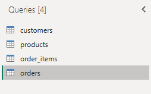
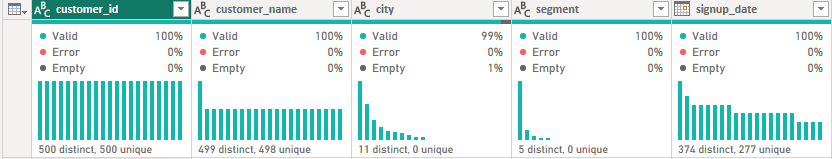
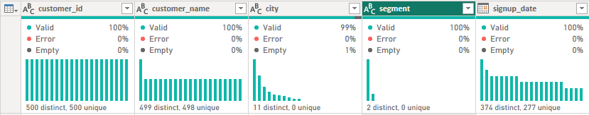
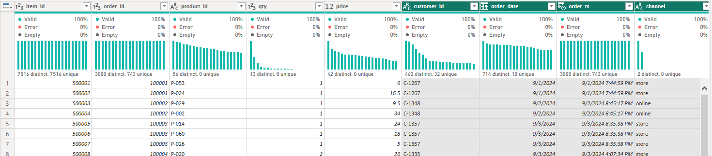
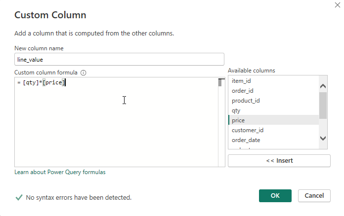
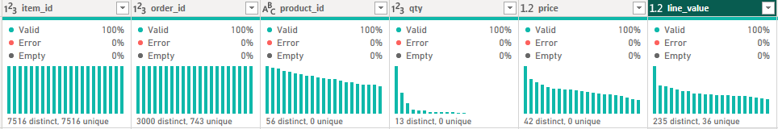
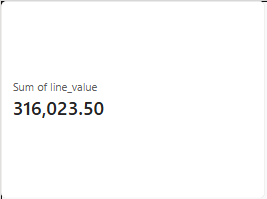

# Activity 01: load the four Nakheel tables, build sales_lines and name each table's grain

In this activity, you will load D16's four CSV files into a new Power BI file, put each order onto its lines with **Merge**, and say what one row is in every table.

**Files:** a new Power BI file · **Data:** `customers.csv`, `products.csv`, `orders.csv`, `order_items.csv` from [`shared/datasets/nakheel`](../../../../../shared/datasets/nakheel/README.md) (the files you used on D16) · **Guide:** [the D18 page](../README.md)

**The question:** a manager wants completed revenue by customer segment, by product category and by month. The number to land on is one you already have: **316,023.50** (D16).

| Step | The problem you will see | The tool |
|---|---|---|
| 1 | Four separate files | **Get data** → **Text/CSV** |
| 2 | `segment` has five spellings of two values | **Trim**, **Capitalize Each Word** |
| 3 | The revenue is on the lines, the customer and date on the order | **Merge Queries as New** |
| 4 | A line has a quantity and a price, but no value | **Custom Column** |
| 5 | Which tables hold events, and which describe things? | **Table view** row counts |

We follow **order 100003** all the way: one order, three lines, 47.00.

## Step 1 · Load the four CSV files

**Why this step:** a new day starts from a new file, so nothing from D17 can change today's numbers.

1. Download the four files (on GitHub: open each, **Download raw file**) and keep them in one folder.
2. **Get data** → **Text/CSV** → `customers.csv` → **Transform Data**. *Why:* **Transform Data** opens Power Query; **Load** would skip it.
3. **Home** → **New Source** → **Text/CSV** for `products.csv`, `orders.csv` and `order_items.csv`.

> **In Desktop:** save the file now as `D18-checkpoint.pbix`.
> **On the web:** **+ New Report** → **Get data** → **Text/CSV** → **Upload file** → `customers.csv`, then add the other three with **Get data** → **Upload file** inside the same Power Query editor. Save the semantic model as `D18-nakheel` in **My workspace**. Web changes are saved at once and cannot be undone.

**Check:** four queries in the **Queries** pane.

 

**What just happened:** order 100003 is one row in `orders` (C-1357, 2024-09-03, 47.00) and three rows in `order_items`.

## Step 2 · Fix the segment spellings

**Why this step:** the source contains inconsistent spaces and capitalisation in `segment`. Trim removes surrounding spaces; Capitalize Each Word gives the two segment names consistent spelling.

In `customers`, select `segment` → **Transform** → **Format** → **Trim**, then **Format** → **Capitalize Each Word**.

**Check:** **View** → tick **Column profile**, select `segment`: two values, **Retail 435** and Wholesale 65.

Read the `segment` profile before and after cleaning: **distinct** counts different values; **unique** counts values that occur only once. Two distinct segments and zero unique segments is expected: many customers share each segment. The turquoise bars show how often each value occurs; they are a check on the column's contents, not revenue bars.

**What just happened:** C-1357, order 100003's customer, now reads `Retail`.

## Step 3 · Put each order onto its lines with Merge

**Why this step:** revenue is on `order_items`, but the customer and the date are on `orders`. One order and its lines are the same sale at two grains, so we build one table at the line grain: this is the Merge from Part 1, not a relationship.

**Grain means what one row represents.** Order 100003 appears once in `orders` and three times in `order_items`. We need its customer and date beside each of those three lines to group their values later. Each line must match just one order; if `orders` contained two rows with the same `order_id`, expanding the Merge could duplicate lines and inflate revenue.

1. Select `order_items` → **Home** → **Merge Queries** → **Merge Queries as New**.
2. Top `order_items`, click `order_id`; bottom `orders`, click `order_id`; **Left Outer** → **OK**. *Why Left Outer:* every line is kept, even one whose order were missing.
3. Rename the new query `sales_lines`.
4. Click the expand button on the `orders` column. Untick `order_id` (the lines have it), `order_total` and `shipping_fee`, and **Use original column name as prefix** → **OK**. *Why untick the two totals:* they describe an order, not a line (next step).

**Check:** if the dialog counts all rows, **7,516 of 7,516** lines found their order (it may count a preview; step 5 counts the table).

**What just happened:** order 100003's three lines each carry `customer_id` C-1357 and `order_date` 2024-09-03.

In the screenshot, `order_id` repeats while `item_id` identifies each line. Repeating the order ID is correct at this grain. We have added information to each line, without turning the three lines into one order row.

## Step 4 · Add each line's value

**Why this step:** each line has a quantity and a price; multiplying them gives its revenue.

For each row, `[qty]` and `[price]` read that row's two values; `*` multiplies them. The new `line_value` column stores the result for that line. A report can then sum those line values over the rows its filters select.

1. **Add Column** → **Custom Column**, name `line_value`, formula `[qty] * [price]`; set its type to **Decimal Number**.

   

   

2. Right-click `orders` → untick **Enable load**; the same for `order_items`. *Why:* `sales_lines` now contains the order and line fields this report needs.

   The two queries remain in Power Query as inputs to `sales_lines`; disabling load does not delete them. Loading them would not automatically double the card, but it would offer report authors several tables for the same sales, at different grains.

3. **Close & Apply**. A **Card**: Sum of `line_value`, with `sales_lines[status]` = completed in **Filters on this visual**.

**Check:** the card reads **316,023.50** (set the card's display units to **None** if it shows `316.02K`: the D18 page says where).

This card checks the total of completed line values before we split it into segments, categories or months. It does not yet test relationships: its amount and status filter both come from `sales_lines`.

**What just happened:** order 100003's lines are 24.00 + 18.00 + 5.00 = 47.00. Had `order_total` come across, each line would carry 47.00 and the order would count as 141.00; over all orders the card would read 988,971.50.

## Step 5 · Name the grain of each table

**Why this step:** before adding anything up, say what one row is: "one row is one ___".

Open **Table view** (the second icon on the left) and select each table; the status bar shows its rows. Then answer: fact or dimension? And do `shipping_fee`, `price` and `customer_id` belong on `sales_lines`?

**Check:** `sales_lines` **7,516** rows (one line of an order), `customers` 500 (one customer), `products` 60 (one product).

**What just happened:** order 100003 is three rows of the fact table `sales_lines`; its customer is one row of `customers`, its products three rows of `products`.

`sales_lines` is the **fact table** because its rows record sales events and amounts. `customers` and `products` are **dimensions** because they describe who bought and what was bought. Keeping those descriptions once in their own tables lets us group the same sales in several ways without copying every description onto every line.

## Check yourself

| Step | One value |
|---|---|
| 1 | 4 queries |
| 2 | Retail 435 |
| 3 | 7,516 of 7,516 matched |
| 4 | 316,023.50 |
| 5 | `sales_lines` 7,516 rows |

## If something goes wrong

- **Columns named `orders.customer_id`:** the prefix box was ticked. Rename them, or redo the expand.
- **The card reads 340,370.00:** the `status` filter is missing.
- **`line_value` is 100 times too big:** your Windows uses a decimal comma. In `order_items`, set `price` with **Change Type** → **Using Locale…** → **Decimal Number**, **English (United States)**.

## Hint

A number belongs on a table only if it describes one row of that table.

## Bonus

In SQL this table is D08's view `bi.fact_sales`: `order_items` joined to `orders` on `order_id`. Which of today's steps matches the `JOIN`, and which matches `qty * price AS revenue`?

## References

Nakheel Retail, synthetic course data generated 24 September 2026 ([`shared/datasets/nakheel`](../../../../../shared/datasets/nakheel/README.md)). Menu names are Power BI's in November 2026. Microsoft: [Understand star schema and the importance for Power BI](https://learn.microsoft.com/en-us/power-bi/guidance/star-schema), [Merge queries overview](https://learn.microsoft.com/en-us/power-query/merge-queries-overview).
