# Activity 02: build, sort and mark the dates table

In this activity, you will build one date table, `dates`, in Power Query, put its month names in calendar order and mark it as the model's date table.

**Files:** your file from activity 01 · **Data:** `dates` is built here, from nothing; `sales_lines` (activity 01) · **Prepared file:** [`Resources/dates.pq`](../Resources/dates.pq) (the whole query, if you would rather paste it) · **Guide:** [the D18 page](../README.md)

**The question:** "revenue by month" needs months that sort January to December and one calendar that every date in the model shares.

| Step | The problem you will see | The tool |
|---|---|---|
| 1 | The model has no table with one row per day | **Blank Query**, `List.Dates`, **To Table** |
| 2 | A date alone cannot group by month or fiscal year | **Add Column** → **Date**, **Custom Column** |
| 3 | Month names sort April, August, December … | **Sort by column** |
| 4 | Power BI keeps a hidden calendar per date column | **Mark as date table**, Auto date/time off |

We follow **2024-09-03**, the day of order 100003.

## Step 1 · Make one row per day

**Why this step:** `sales_lines[order_date]` has 714 different dates for 7,516 rows, and 16 days with no order. A calendar needs every day once.

### Why use a date table when the sales already have dates?

`sales_lines` records what happened: several lines can share an order date, and a day without orders has no row. `dates` records the calendar: one row for every day, whether anything sold or not. For example, order 100003's three lines all match the single calendar row for 2024-09-03. A day without an order still has its own calendar row; we do not invent a sale to fill it.

The calendar also defines how days belong to months and fiscal years. A month selected from `dates` can filter sales now and, in the optional labs, store sales and targets using the same definition. Later, time calculations such as year-to-date revenue and revenue last year use the calendar to identify the period to compare.

**When would we do this?** Use a shared date table when reports need consistent time groupings, a business calendar such as September–August, or time calculations across periods. A quick report can use Power BI's automatic date hierarchies, but separate hidden calendars do not give several fact tables one shared calendar. If your organisation already provides a date dimension, reuse it. We generate one here because our four CSV files have none.

Our fixed calendar covers 2024–2026, including the order and delivered dates in these files. In a report that keeps receiving new data, its range must also cover the new dates. Having every calendar day available does not automatically display empty periods or turn blank revenue into zero; those are separate report choices.

1. **Transform data** → **Home** → **New Source** → **Blank Query**. In the formula bar type `= List.Dates(#date(2024, 1, 1), 1096, #duration(1, 0, 0, 0))` and press Enter. *Why 1,096:* every day of 2024, 2025 and 2026: whole years, as Microsoft advises.

   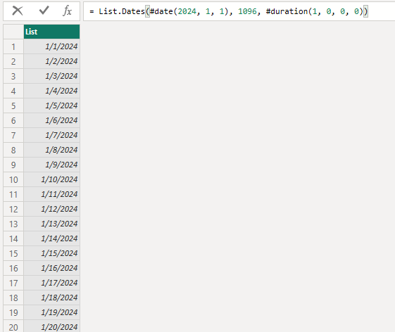

   The result above is a **list**: a sequence of date values. It starts at 2024-01-01, then 2024-01-02, then 2024-01-03, and ends at 2026-12-31.

   > [!NOTE]
   > **Read the three inputs to `List.Dates`**
   >
   > - `#date(2024, 1, 1)` makes the starting date: year, month, day.
   > - `1096` is the number of dates, including the starting day. It is 366 + 365 + 365 because 2024 is a leap year.
   > - `#duration(1, 0, 0, 0)` is the gap between dates: days, hours, minutes, seconds. Here it advances one day at a time.

   If you type only `= List.Dates` and press Enter, you get this screen instead:

   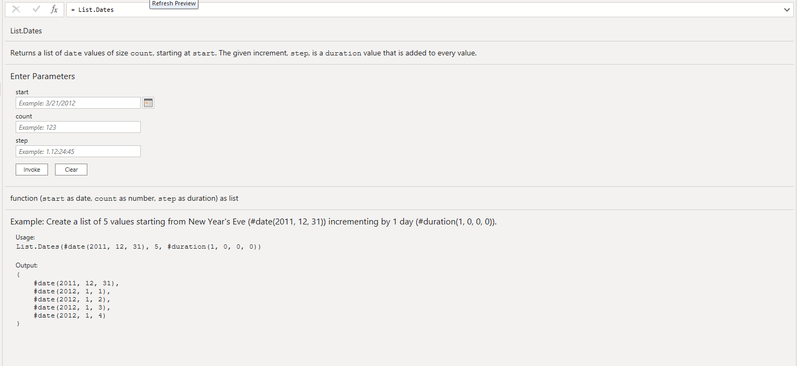

   > [!NOTE]
   > **The function itself and the result of calling it are different values**
   >
   > `List.Dates` names a built-in M function. A Power Query query can return a function, a list or a table; it does not always return a table. With only the function name, Power Query shows its description and boxes for its inputs: `start`, `count` and `step`. No date list has been generated yet.
   >
   > `List.Dates(#date(2024, 1, 1), 1096, #duration(1, 0, 0, 0))` **calls** that function. The parentheses supply its inputs, called arguments, and the result is the list in the first screenshot. Enter submits whichever expression you typed; the expression determines the result.
   >
   > The parameter screen does not mean we have written a custom function or applied it to each row of another table. We need one calendar here, so continue with the complete formula from instruction 1. Generating a separate list for each booking or project would be a different task.

2. **List Tools** → **Transform** → **To Table** → **OK**. 

   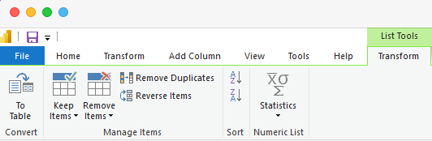

   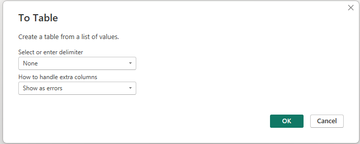

   **To Table** makes each item in the list a row of one column. It does not generate more dates. We need a table so we can add calendar attributes beside each date and load it into the model.

   Rename `Column1` to `date` and set its type to **Date**. *Why Date:* the relationship to `order_date` needs the same type on both sides.

   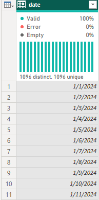

3. Rename the query `dates`.

**Check:** **1,096** rows (Table view, after step 2's **Close & Apply**).

**What just happened:** 2024-09-03 is one row of `dates`.

The profile's **1,096 distinct, 1,096 unique** means every date value occurs once. That gives us the `1` side of the date relationship we will create in activity 03.

## Step 2 · Add the columns reports group by

**Why this step:** a manager says "by month" or "by fiscal year", not "by date".

1. Select `date` → **Add Column** → **Date** → **Year** → **Year**; **Date** → **Month** → **Month**; **Date** → **Month** → **Name of Month**. Rename them `year`, `month_no`, `month`.

   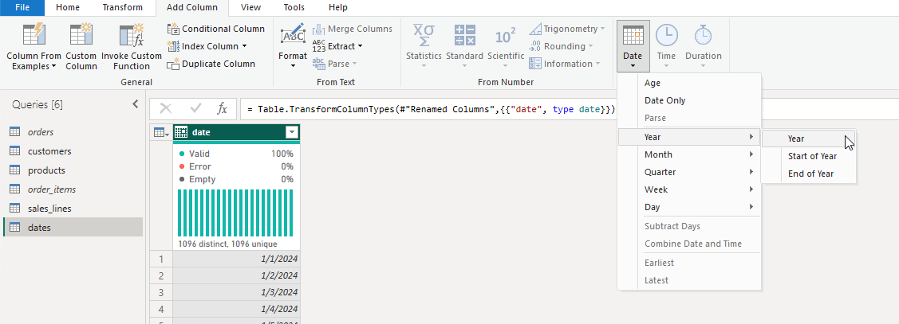

2. **Add Column** → **Custom Column**, twice:

| Name | Formula |
|---|---|
| `year_month` | `Date.ToText([date], "yyyy-MM", "en-US")` |
| `fiscal_year` | `let y = if Date.Month([date]) >= 9 then Date.Year([date]) else Date.Year([date]) - 1 in Text.From(y) & "-" & Text.End(Text.From(y + 1), 2)` |

*Why `"en-US"`:* on a computer set to another region, the text would come out in another calendar or language. *Why September:* Nakheel's year runs September to August, as D17's finance files.

> [!Note]
>
> **Break Down of the Arguments**
>
> `Date.ToText([date], "yyyy-MM", "en-US")`
>
> - **`[date]`**: The reference to the date or datetime column in your Power Query table.
> - **`"yyyy-MM"`**: The custom format string:
>   - `yyyy`: Represents the full 4-digit year (e.g., `2024`).
>   - `MM`: Represents the 2-digit zero-padded month (e.g., `01` for January through `12` for December). *(Note: Case sensitivity matters; `MM` is for months, while lowercase `mm` represents minutes).* [[1](https://powerbistudio.com/blog/power-query-formatter), [2](https://radacad.com/generate-year-month-day-combinations-in-power-bi-report-using-power-query-date-totext-function/)]
> - **`"en-US"`**: The culture (locale) parameter, which ensures that formatting conventions align with U.S. English (though for a numeric year-month pattern like `yyyy-MM`, the culture rarely changes the visual output)
>
> **Break Down of the Arguments**
>
> `let y = if Date.Month([date]) >= 9 then Date.Year([date]) else Date.Year([date]) - 1`
>
> - **The Condition:** It checks if the month of the `[date]` is September (`9`) or later.
> - **September to December:** If yes, it sets `y` to the **current year** of that date. (e.g., October 2025 becomes `2025`).
> - **January to August:** If no, it sets `y` to the **previous year**. (e.g., February 2025 becomes `2024`).
> - *Result:* `y` represents the calendar year in which the school/fiscal year *began*.
>
> `Text.From(y) & "-" & Text.End(Text.From(y + 1), 2)`
>
> This part joins three pieces of text together using the `&` operator:
>
> - **`Text.From(y)`**: Converts the starting year number into text (e.g., `2025`).
> - **`"-"`**: Adds a hyphen separator.
> - **`Text.End(Text.From(y + 1), 2)`**: Takes the *next* year (e.g., `2026`), converts it to text (`"2026"`), and grabs only the last two characters (`"26"`).

3. **Close & Apply**.

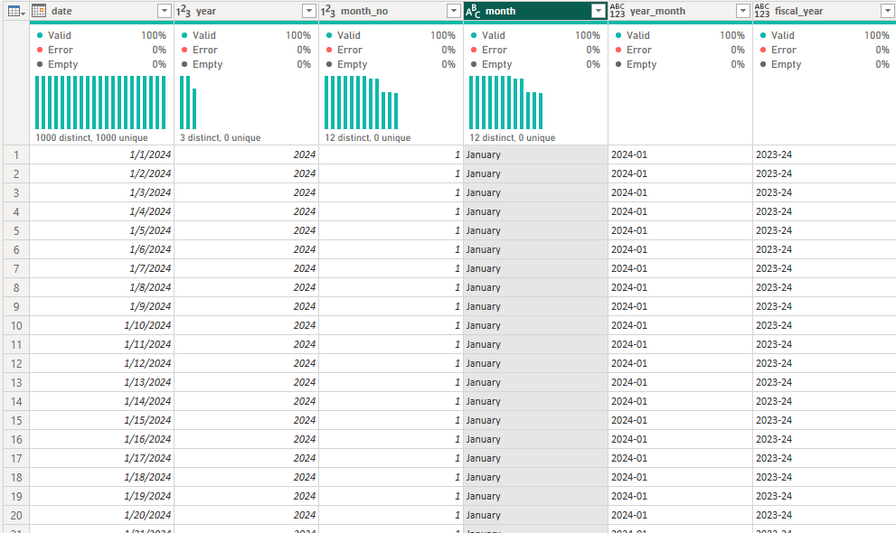

**Check:** 2025-09-01 has `fiscal_year` **2025-26**.

**What just happened:** 2024-09-03 now reads 2024, 9, September, 2024-09, 2024-25.

Read that row as one day with several ways to group it:

| Field | Value for 2024-09-03 | What we use it for |
|---|---|---|
| `date` | 2024-09-03 | Match a sale to its calendar day |
| `year` | 2024 | Group all days in a calendar year |
| `month_no` | 9 | Put the month names in calendar order |
| `month` | September | Compare months of the year, combining years unless a year filter separates them |
| `year_month` | 2024-09 | Keep September 2024 separate from September 2025 |
| `fiscal_year` | 2024-25 | Group September 2024 through August 2025 together |

The fiscal-year formula changes the label, not the date. For example, 2025-08-31 belongs to 2024-25, and the next day, 2025-09-01, starts 2025-26. All six fields describe the same calendar day; the table still has 1,096 rows.

## Step 3 · Put the month names in calendar order

**Why this step:** text sorts alphabetically, so a chart by `month` starts with April and August.

In the **Data** pane select `month` (in `dates`) → **Column tools** → **Sort by column** → `month_no`.

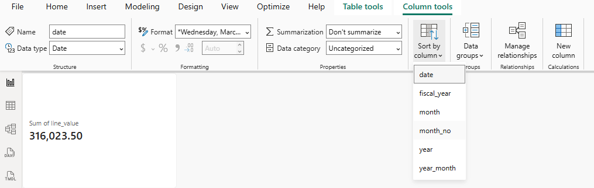

> **In Desktop:** **Column tools** appears in Report view. In Model view the same setting is **Properties** → **Advanced** → **Sort by column**.
>
> 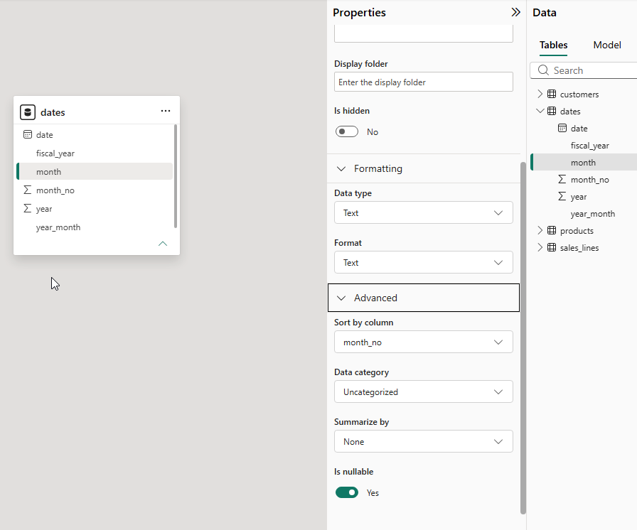
>
> **On the web:** select the column in the model editor's **Data** pane and use **Properties** → **Sort by column**.

**Check:** a table chart by `dates[month]` starts at **January**.

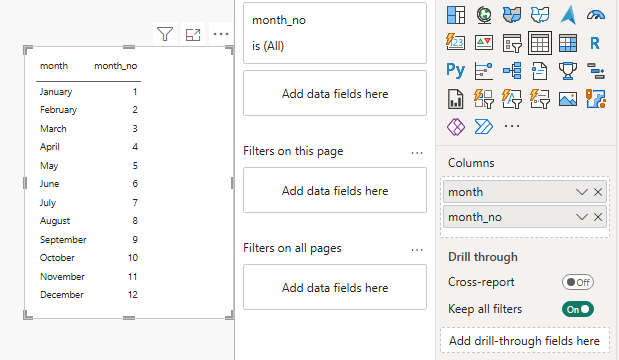

The table visual pairs each month name with its number: January with 1 through December with 12. **Sort by column** tells Power BI to order the names using those numbers. It does not change the text or sort revenue. Each month name must map to one number; all September dates map to 9. In the ribbon screenshot above, `date` is selected to show the control's location; the column to configure here is `month`.

**What just happened:** September sorts ninth, after August, because its `month_no` is 9.

## Step 4 · Mark dates as the date table

**Why this step:** marking identifies `dates[date]` as the date column for the classic DAX time calculations we use later. With **Auto date/time** off, Power BI stops making a hidden calendar for every date column.

Making the table, marking it and connecting it do different jobs. Power Query builds its rows and columns. Marking validates and identifies the date column. The relationship in activity 03 lets a month selected from this table filter sales; marking alone does not connect the tables.

1. Right-click `dates` → **Mark as date table** → choose `date` (turn the setting **On** if the dialog shows a switch) → **OK**. 

   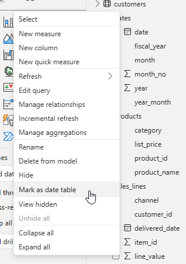

   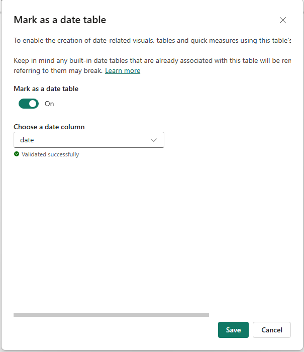

   Power BI checks four things: unique values, no blanks, no missing day, the same time on every value. `dates[date]` passes; `sales_lines[order_date]` would not.

2. **File** → **Options and settings** → **Options** → **Current File** → **Data Load** → untick **Auto date/time** → **OK**.

   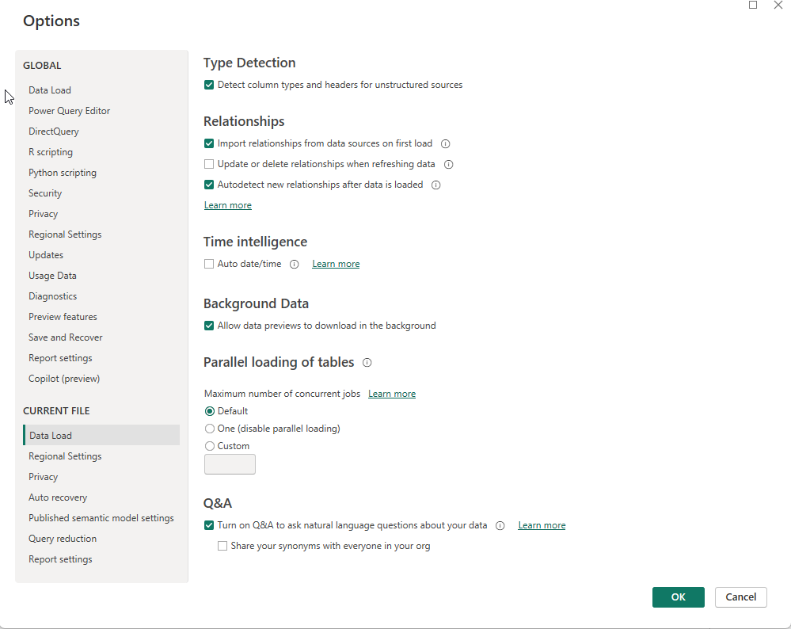

> **On the web:** **Mark as date table** is on the table's menu in the model editor; **Auto date/time** is under **File** → **Options**.

**Check:** the `dates` icon in the **Data** pane shows it is marked; `order_date` no longer expands into Year, Quarter, Month, Day.

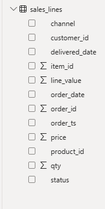

In the final screenshot, `order_date` is a single field rather than an expandable automatic hierarchy. We now choose period fields such as `dates[year_month]` from our calendar. The sales' original dates remain in `sales_lines` for the relationship to match.

**What just happened:** every month in the report will now come from `dates`; activity 03 connects it to `sales_lines`.

## Check yourself

| Step | One value |
|---|---|
| 1 | 1,096 rows |
| 2 | 2025-09-01 → 2025-26 |
| 3 | January first |
| 4 | `dates` marked |

## If something goes wrong

- **No To Table button:** select the list first; **List Tools** shows only then.
- **Month names in Arabic:** change `Date.MonthName([date])` to `Date.MonthName([date], "en-US")` in the formula bar.
- **Sort by column is greyed out:** select the column in the **Data** pane first.

## Hint

In our generated `dates` table, every other column is calculated from `date`.

## Bonus

The bars in a month chart may all show the same number until activity 03. Why?

## References

Microsoft: [List.Dates](https://learn.microsoft.com/en-us/powerquery-m/list-dates), [M functions and invocation](https://learn.microsoft.com/en-us/powerquery-m/m-spec-functions), [Date.ToText](https://learn.microsoft.com/en-us/powerquery-m/date-totext), [Design guidance for date tables in Power BI Desktop](https://learn.microsoft.com/en-us/power-bi/guidance/model-date-tables), [Set and use date tables](https://learn.microsoft.com/en-us/power-bi/transform-model/desktop-date-tables), [Auto date/time guidance](https://learn.microsoft.com/en-us/power-bi/guidance/auto-date-time). Function and modelling explanations checked 8 November 2026. Menu names are Power BI's in October 2026.
