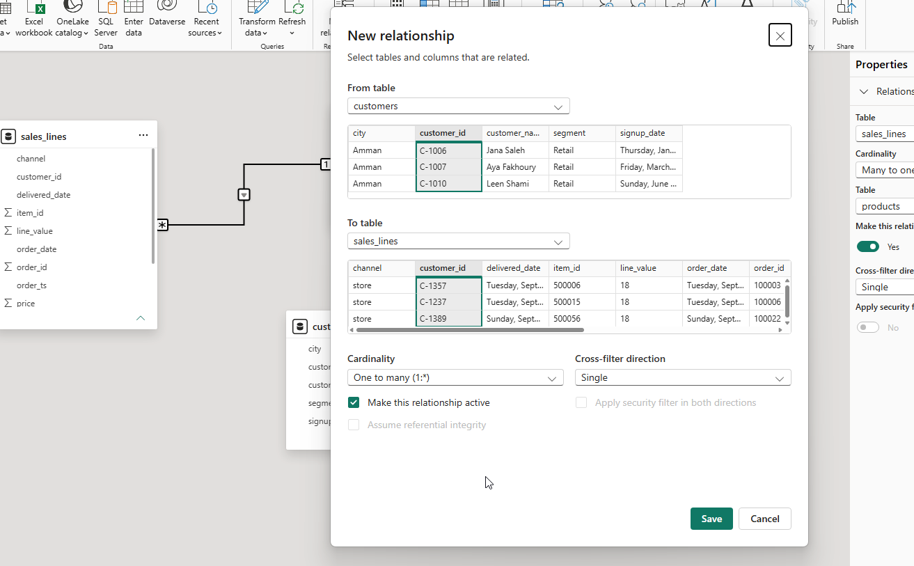
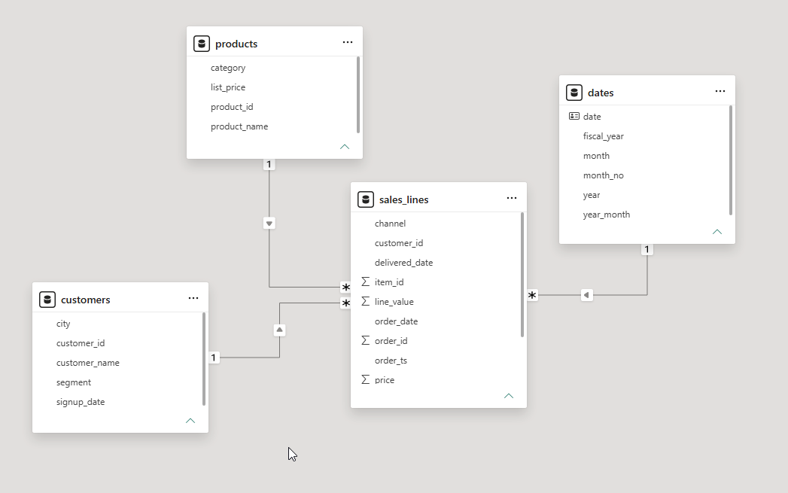
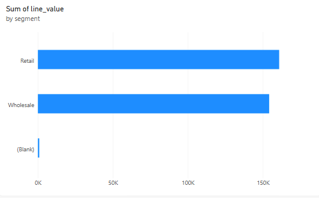
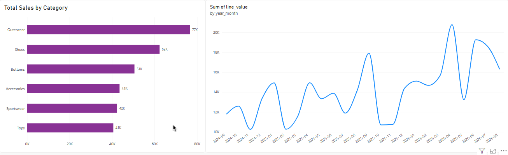
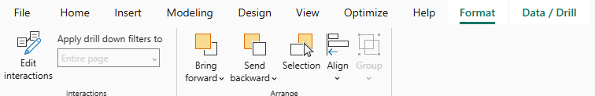
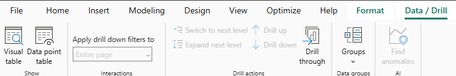
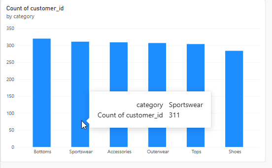
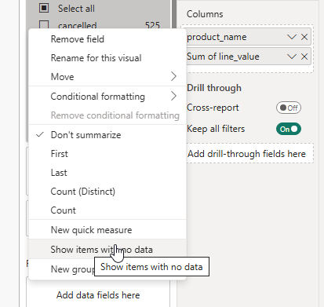
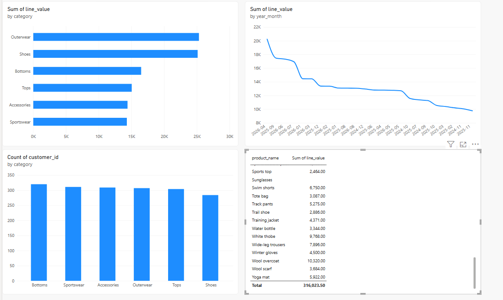

# Activity 03: relate the tables and answer the manager's questions

In this activity, you will connect `customers`, `products` and `dates` to `sales_lines` with three relationships, then answer five manager questions, each through one relationship.

**Files:** your file from activity 02 · **Data:** `sales_lines`, `customers`, `products` (activity 01); `dates` (activity 02) · **Guide:** [the D18 page](../README.md)

**The manager's questions:** 1. Retail or wholesale: who brings more? 2. Online only: the top category? 3. The best month? 4. How many different customers bought Sportswear? 5. Which products never sold? All on completed orders.

| Step | The problem you will see | The tool |
|---|---|---|
| 1 | A chart by segment shows the same total on every bar | **Model view**: drag a key |
| 2 | Question 1: one order has no customer | a bar chart by `customers[segment]` |
| 3 | Questions 2 and 3 | a filter on `channel`; `dates[year_month]` |
| 4 | Question 4 reads 500 on every bar | **Count (Distinct)** in the fact table |
| 5 | Question 5: unsold products are not on the chart | **Show items with no data** |

We follow **order 100003** (customer C-1357, three products, 2024-09-03).

## Step 1 · Draw the three relationships

**Why this step:** so far `sales_lines` and `customers` are two tables with no link; a chart that takes `segment` from one and `line_value` from the other has nothing to join them, so every bar shows the full total.

The tables remain separate. Unlike the Merge in activity 01, a relationship does not add columns to `sales_lines`. It tells Power BI how a filter on one table restricts rows in another: select Retail customers, match their IDs to sales lines, then sum the matching line values. We can reuse that relationship in every visual that groups sales by a customer field.

1. Open **Model view** (the third icon on the left). **Home** → **Manage relationships**: Power BI may have drawn some already. Keep `customers`–`sales_lines` on `customer_id` and `products`–`sales_lines` on `product_id`; delete any other.

2. Drag the missing ones: `customers[customer_id]` onto `sales_lines[customer_id]`, `products[product_id]` onto `sales_lines[product_id]`, `dates[date]` onto `sales_lines[order_date]`.

   

3. Click a line. The **Properties** pane shows its settings: **Cardinality** One to many (or Many to one, the same line seen from the other side), **Make this relationship active** Yes, and **Cross-filter direction** Single. Power BI sets these by default; we only read them here.

> **On the web:** open the semantic model, switch to **Editing**, and drag in the model diagram the same way. **Manage relationships** is on the **Home** ribbon.

**Check:** **three** solid lines into `sales_lines`, each with `1` at the dimension and `*` at `sales_lines`.

**What just happened:** C-1357 is once in `customers` (the `1`) and on 3 of order 100003's lines, among others (the `*`).

Read the diagram from a dimension toward the fact table: `1` means its key occurs once; `*` means that key can occur on many sales lines. The arrow shows the direction filters travel. A solid line is active, so visuals use it by default. This is the **star**: descriptive tables around the sales fact table. Their position on the canvas does not affect the calculation.

## Step 2 · Retail or wholesale (question 1)

**Why this step:** different revenue bars tell us whether the customer segment is filtering the sales lines. The blank segment also lets us check what happens to a sale with no matching customer.

Report view. A **Clustered bar chart**: `customers[segment]` on the Y-axis, `sales_lines[line_value]` on the X-axis, `sales_lines[status]` = completed in **Filters on this visual**.

**Check:** Retail 160,881.50, Wholesale 154,204.00 and **(Blank) 938.00**.

**What just happened:** (Blank) is order 101664, customer C-0999, which has no row in `customers`. A relationship works like a `LEFT JOIN` from the fact: no line is lost, and the three bars add up to 316,023.50. Order 100003's 47.00 is inside Retail.

The longer bar means Retail contributes slightly more completed revenue than Wholesale. It does not mean Retail customers spend more per customer; there are different numbers of customers in the two segments. **(Blank)** means the customer ID did not match the customer list, not that the sale had no value. Removing that bar would hide 938.00 from this view of revenue.

## Step 3 · The top online category and the best month (questions 2 and 3)

**Why this step:** two more dimensions, and one column of the fact table used as a filter.

1. Change the Y-axis to `products[category]`; add `sales_lines[channel]` = online to the visual's filters. *Why no relationship:* `channel` is a column of `sales_lines` itself.
2. A **Line chart**: `dates[year_month]` on the X-axis, `line_value` on the Y-axis, completed only.

**Check:** the best month is **2026-04, 20,237.00** (online's top category: Outerwear 25,315.50, just ahead of Shoes 25,120.50).

**What just happened:** order 100003's lines landed in Outerwear, Sportswear and Tops, and in 2024-09.

**Read the two visuals separately.** The bars compare completed **online** revenue across categories; Outerwear is only 195.00 ahead of Shoes. The line chart's month check, 20,237.00 for April 2026, is for completed sales across **all channels and categories**. The online filter belongs to the category visual, not the page or the month visual.

In this screenshot, Shoes is selected and the month labels are ordered by revenue, rather than from oldest to newest. The lower line values therefore do not show a decline over time. Clicking a bar can filter or highlight the other visual; the lighter bars show the unselected categories. For the month check, clear the selection by clicking the selected bar again. To read the line as a time trend, use its **…** menu to sort `year_month` ascending. Use a tooltip to read an exact value; `20K` on an axis is an abbreviated scale label.

> If clicking a bar chart opens a new window you instead of filtering the line chart there are two things you an try:
>
> ### 1. Enable cross-filtering
>
> 
>
> 1. Select your bar chart (on the left).
> 2. Go to the top ribbon and select Format → Edit interactions.
> 3. You should now see small icons appear above the line chart.
> 4. On the line chart, select the Filter (funnel icon) rather than Highlight or None.
> 5. Click Edit interactions again to exit editing mode.
>
> ### 2. If it still opens a separate window
>
> 
>
> You may have accidentally enabled Data point table mode, which produces similar behavior.
>
> 1. Select the bar chart.
> 2. In the top ribbon, go to Data / Drill.
> 3. Uncheck Data point table.
> 4. Try clicking a bar again.

## Step 4 · How many customers bought Sportswear (question 4)

**Why this step:** the obvious chart gives a wrong answer, and the reason is the filter's direction.

1. A bar chart: `products[category]` on the Y-axis, `customers[customer_id]` on the X-axis (Power BI makes it **Count**). Every bar reads 500. *Why:* the filter on a category travels from `products` to `sales_lines`, the arrow's way, and cannot go on to `customers`. The same number on every row means the filter cannot reach the table you count.

2. Replace the field with `sales_lines[customer_id]` and choose **Count (Distinct)** in its drop-down: count where the filter arrives.

   

**Check:** Sportswear **311** (Shoes 284).

These checks use completed sales across all channels, with no category selected in another visual. The completed filter on the earlier bar chart does not automatically apply to this new chart; its own `sales_lines[status]` filter must also be completed. **Count (Distinct)** means each customer ID is counted once within a category. An ordinary Count would count sales lines with an ID, so repeat purchases would increase it. Check the field's aggregation setting even if a chart title just says “Count of customer_id”.

**What just happened:** C-1357 bought Kids football boots (Sportswear) in order 100003, so C-1357 is one of the 311, counted once however many Sportswear lines it has.

## Step 5 · The products that never sold (question 5)

**Why this step:** a visual shows only the dimension rows that have facts.

A **Table** visual: `products[product_name]` and `line_value`, completed only: 56 rows. Right-click `product_name` in the **Columns** well → **Show items with no data**.

**Check:** **60** rows; four have no value: Hiking boot, Graphic T-shirt, Sunglasses, Headband.

The product names come from the full product list; the amounts come from matching completed sales. **Show items with no data** keeps products whose amount is blank in this context. It does not create sales rows. With a month or category selected, a blank could mean no sales in that selection, so clear other visual selections before checking the four products above.

**What just happened:** for each answer, name the relationship it used: segment `customers` → `sales_lines`; category `products` → `sales_lines`; month `dates` → `sales_lines`; channel, none.

## Check yourself

| Step | One value |
|---|---|
| 1 | 3 solid lines |
| 2 | (Blank) 938.00 |
| 3 | 2026-04: 20,237.00 |
| 4 | Sportswear 311 |
| 5 | 60 products |

## If something goes wrong

- **The same total on every bar:** the relationship is missing, or the field came from the wrong table. Open Model view.
- **Every month is (Blank):** check the relationship and whether a time component prevents dates from matching. Set both `dates[date]` and `order_date` to **Date** in Power Query so they match by calendar day. A **Date/Time** value at midnight can match a date; a different time on the same day will not.

## Hint

Filters run from the one side to the many side: from the thing to its events.

## Bonus

Wholesale Shoes: how much? (One more filter on the category chart.)

## References

Microsoft: [Model relationships in Power BI Desktop](https://learn.microsoft.com/en-us/power-bi/transform-model/desktop-relationships-understand), [Create and manage relationships](https://learn.microsoft.com/en-us/power-bi/transform-model/desktop-create-and-manage-relationships). Menu names are Power BI's in October 2026.
