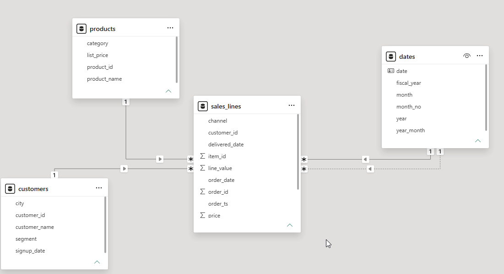
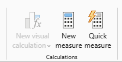
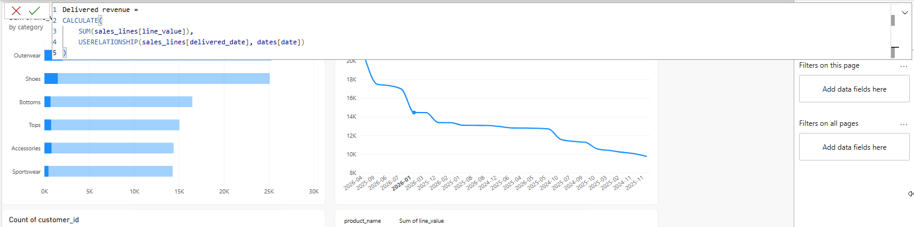
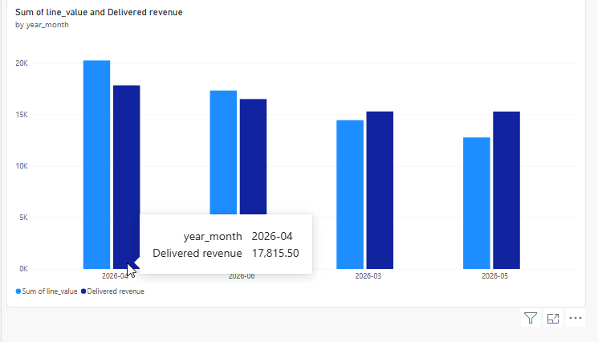
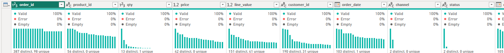
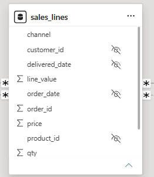
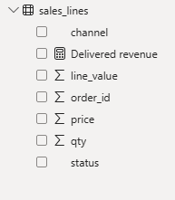

# Lab 04: two dates and a tidy model

In this lab, you will use the delivered date through a second, inactive relationship and a prepared measure, then remove two columns nobody uses and hide the keys a report author should not pick.

**When:** shown in class after the break; finish it on your own if class ran out of time. Not submitted. · **Files:** your file from activity 03 · **Data:** `sales_lines`, `dates` (activities 01–03) · **Prepared file:** [`Resources/delivered_revenue.dax`](../Resources/delivered_revenue.dax) · **Guide:** [the D18 page](../README.md)

**The question:** "How much did we sell in April 2026?" and "How much did we deliver in April 2026?" are different questions. And when you hand the model to a report author, which fields should they see?

| Step | The problem you will see | The tool |
|---|---|---|
| 1 | `dates` filters by order date only | a second relationship, inactive |
| 2 | No visual uses the inactive line | a prepared measure with `USERELATIONSHIP` |
| 3 | Two columns cost space and nobody uses them | **Remove Columns** in Power Query |
| 4 | The **Data** pane offers keys and bare dates | **Is hidden** |

We follow **order 100003** (a store order: ordered and delivered on 2024-09-03).

## Step 1 · Relate dates to the delivered date

**Why this step:** online orders take one to four days to arrive, so an order placed on 29 April can be delivered in May. `dates` plays two roles: order date and delivered date.

In Model view, drag `dates[date]` onto `sales_lines[delivered_date]`.

**Check:** the new line is **dashed** (inactive). *Why:* Power BI keeps one active path between two tables, and `dates` already reaches `sales_lines` through `order_date`. Leave it inactive.



**What just happened:** order 100003 has the same day in both roles; an online order placed near the end of April can belong to April by order date and May by delivered date.

Both lines in the screenshot match the same calendar to the same sales table, but they match different columns. The dashed line is a valid relationship held for a different question. An ordinary sum still uses the solid order-date line.

## Step 2 · Paste the prepared measure and compare April

**Why this step:** a dashed line does nothing until a measure asks for it. D19 teaches how measures are written; today you paste one.

1. Select `sales_lines` in the **Data** pane → **Home** → **New measure**. Paste the measure from [`delivered_revenue.dax`](../Resources/delivered_revenue.dax), from `Delivered revenue =` to the closing bracket (not the comment lines):

   

```dax
Delivered revenue =
CALCULATE(
    SUM(sales_lines[line_value]),
    USERELATIONSHIP(sales_lines[delivered_date], dates[date])
)
```



Read it in one sentence: add up `line_value`, using the delivered-date line instead of the order-date line, for this measure only.

`SUM` supplies the amount to add. `CALCULATE` evaluates that sum with a changed filter context: the rows included in the calculation. `USERELATIONSHIP` specifies the existing delivered-date relationship for this calculation. It does not move any dates, create sales, or permanently switch the solid line. The completed-status filter still comes from the visual below; it is not written into this measure.

2. A **Clustered column chart**: `dates[year_month]` on the X-axis; Sum of `line_value` and `Delivered revenue` as the values; filters `sales_lines[status]` = completed and, in **Basic filtering** on `year_month`, 2026-03 to 2026-06.

**Check:** April 2026: **20,237.00** sold, 17,815.50 delivered.



Read each pair using the legend: light blue is revenue from orders **placed** in that month; dark blue is revenue from orders **delivered** in it. For April, those are 20,237.00 and 17,815.50. The 2,421.50 difference is not an undelivered-order balance: April deliveries can include March orders, while some April orders arrive in May. The screenshot places April, June, March and May in revenue order; read the month labels rather than treating left-to-right position as time. Sort `year_month` ascending if you want to compare the sequence of months.

**What just happened:** both series add up to 316,023.50 over the two years: the same sales, counted in a different month.

That equality is for the full completed dataset, with the March–June month restriction removed. Totals over a shorter window need not agree because orders and deliveries can cross its boundaries.

## Step 3 · Remove the two columns nobody uses

**Why this step:** the model stores each column's distinct values; `item_id` (7,516 different values) and `order_ts` (3,000) are used by no visual and no relationship. Removing them in Power Query means they are never loaded.

**Transform data** → `sales_lines` → select `item_id` and `order_ts` → **Remove Columns** → **Close & Apply**. Keep `order_id`: D19 counts orders with it.

**Check:** `sales_lines` has **10** columns.



We remove these fields because this report does not use them, not because identifiers or timestamps are always unnecessary. `order_id` remains useful for counting orders; `customer_id` and `product_id` remain useful for relationships. Removing an unused column reduces what the model stores; it does not remove any sales rows.

**What just happened:** order 100003's lines lost their line numbers 500005–500007; nothing in the report used them.

## Step 4 · Hide the keys and the dates on the fact table

**Why this step:** a report author who picks `sales_lines[order_date]` gets bare dates with no month or fiscal year, and one who picks `sales_lines[customer_id]` gets codes instead of names. Hidden is not removed: the relationships still use the columns.

In Model view select `customer_id`, `product_id`, `order_date` and `delivered_date` in `sales_lines` (Ctrl+click) → **Properties** → **Is hidden** on.



> **On the web:** the same **Properties** pane in the model editor, in **Editing** mode.

**Check:** `sales_lines` shows **six** fields and the measure: `order_id`, `qty`, `price`, `channel`, `status`, `line_value`, `Delivered revenue`.



The crossed-eye icons in Model view mark columns hidden from the report author's normal field list. They still exist and the relationships still work. The final **Data** pane offers the six visible columns plus the calculator icon for `Delivered revenue`, a measure calculated for the current visual's filters. Hiding improves the choice of fields; it is not a way to secure data.

**What just happened:** a report author now finds order 100003's customer under `customers` and its month under `dates`: from the dimensions.

## Check yourself

| Step | One value |
|---|---|
| 1 | one dashed line |
| 2 | April 2026: 20,237.00 and 17,815.50 |
| 3 | 10 columns |
| 4 | six fields and one measure |

## If something goes wrong

- **The two values are equal:** this is expected for the full completed dataset. Compare April's values to check the date roles. If the measure raises an error, check the `delivered_date` relationship: `USERELATIONSHIP` uses an existing relationship, it does not make one.
- **The new line came in solid and `order_date` went dashed:** double-click the `order_date` line and tick **Make this relationship active**.
- **You removed `order_id`:** delete that step in **Applied steps**.

## Hint

Here, hide the fact-table keys and keep `customers[customer_id]` visible so a report author can identify a customer. In another model, hide keys that report authors do not need.

## Bonus

Microsoft's other route is a second date table, `delivery_dates`, with an active line of its own. What does it cost, and when would you need it? (Their guidance: when a report must filter or group order dates and delivery dates independently, such as orders placed in April and delivered in May.)

## References

Microsoft: [Active vs inactive relationship guidance](https://learn.microsoft.com/en-us/power-bi/guidance/relationships-active-inactive), [USERELATIONSHIP](https://learn.microsoft.com/en-us/dax/userelationship-function-dax), [Data reduction techniques for Import modeling](https://learn.microsoft.com/en-us/power-bi/guidance/import-modeling-data-reduction). Menu names are Power BI's in October 2026.
