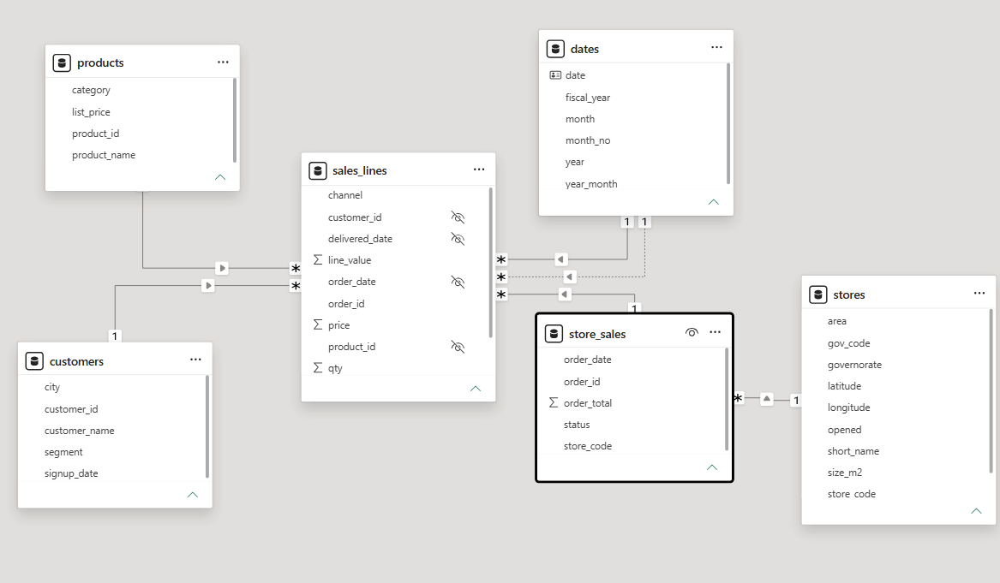
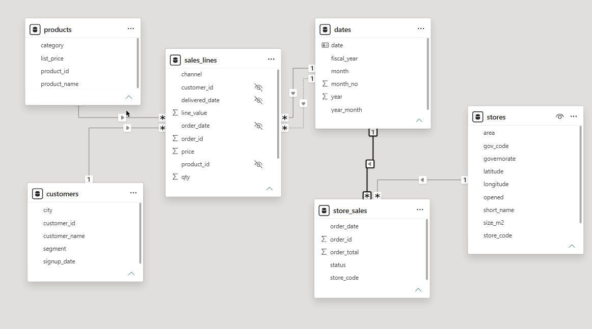
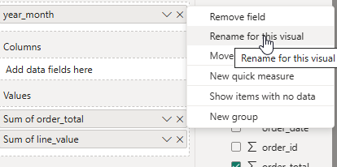
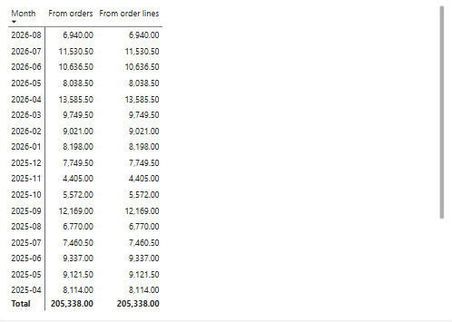
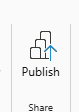
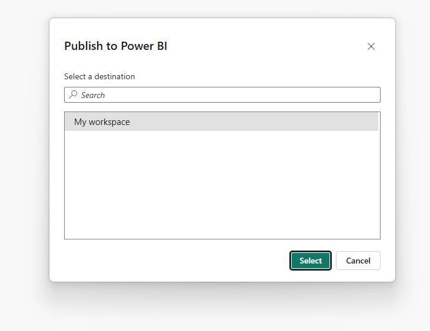
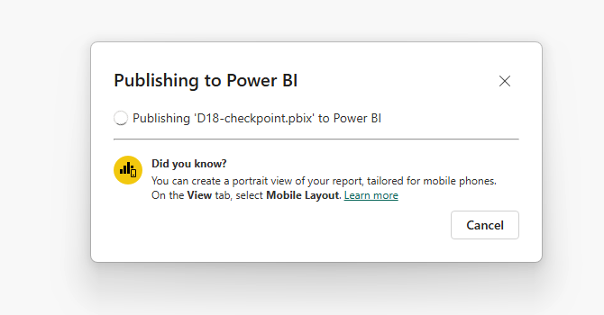
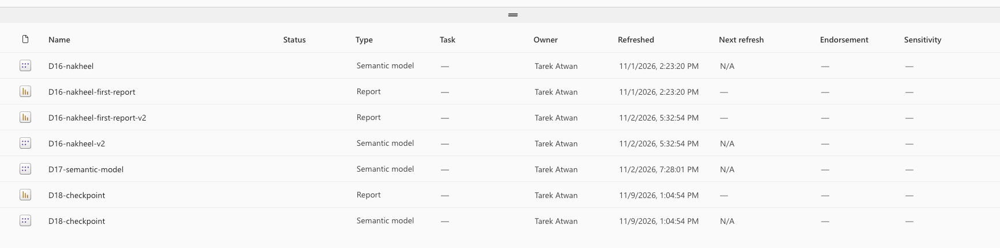
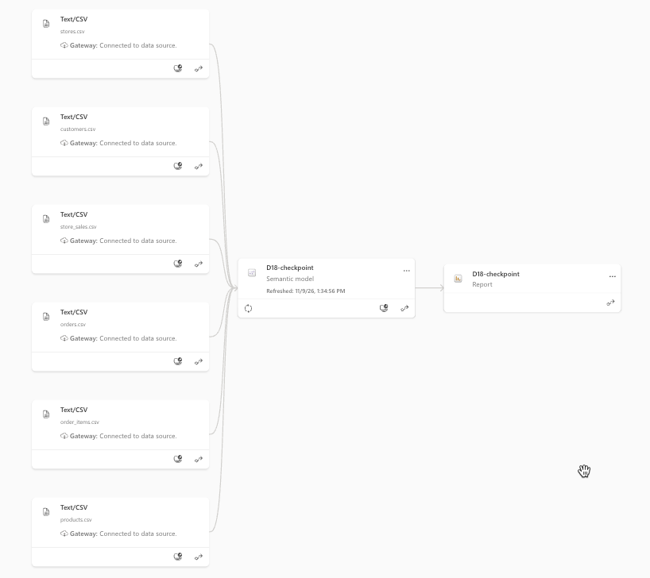

# Lab 05 (optional): add the shops to your D18 model

In this optional lab, you will add two supplied store tables to your D18 model and chart completed store revenue by governorate. The store names stay in their own table; relationships let you use them to group the sales.

**When:** optional practice. Not submitted. · **Open:** your D18 file/model after [Lab 04](../04-Lab-Two-Dates-Tidy-Model/README.md), or after [activity 03](../03-Evr-Relationships-And-Questions/README.md). · **Guide:** [the D18 page](../README.md)

**The question:** which governorates bring the most completed store revenue, and does the store total agree with the store lines already in our model?

## Before you start

Continue in **D18-checkpoint.pbix** on Desktop, or the **D18-nakheel** semantic model on the web. You should already have `sales_lines`, `customers`, `products` and `dates`, with the three active relationships from activity 03. If you have no D18 file, follow [activities 01–03](../README.md#the-activities-and-labs) first.

Download the two supplied CSVs linked below: on GitHub, open each file and select **Download raw file**. Keep them in your D18 data folder. Both are ready to load; you do not need to create or export them.

| Supplied file → table | What one row represents | Fields we use |
|---|---|---|
| [`Resources/store_sales.csv`](Resources/store_sales.csv) → `store_sales` | One store order; 1,901 rows | `order_id`, `store_code`, `order_date`, `status`, `order_total` |
| [`Resources/stores.csv`](Resources/stores.csv) → `stores` | One shop; 12 rows | `store_code` identifies the shop; `governorate` groups shops into regions |

The supplied store sales cover September 2024 to August 2026. The shop list is already cleaned, with consistent store codes. Our task is to connect these tables to the model and use the shop descriptions to group sales.

| Step | The problem you will see | The tool |
|---|---|---|
| 1 | The shop tables are not in your D18 model | **Text/CSV**, inside the existing model |
| 2 | A governorate or calendar month cannot yet filter the store orders | two relationships |
| 3 | We need completed revenue grouped by governorate | a bar chart |
| 4 | Store orders and sales lines have different grains | a matrix by a shared month |

We follow **order 100003**: shop **NK-AMM-01**, ordered **2024-09-03**, status **completed**, total **47.00**. It has one row in the supplied `store_sales` and three lines in D18's `sales_lines`.

## Step 1 · Load the two supplied store files

**Why this step:** the D18 model currently holds all sales at line grain. We add store orders at order grain and a list describing the shops.

1. Download the two files from this lab's `Resources` folder: [`store_sales.csv`](Resources/store_sales.csv) and [`stores.csv`](Resources/stores.csv). On GitHub, open each file and select **Download raw file**. The `nakheel_store_files.zip` download does not contain them. They are the two tables you built in D17: `store_sales` is the two finance files appended (activity 01), and `stores` is `stores_raw` split into clean columns (activity 04). Starting from these copies means everyone loads the same tables.
2. In your existing D18 file, open **Transform data** → **Home** → **New Source** → **Text/CSV** and choose `store_sales.csv`. Do the same again for `stores.csv`, so both queries sit in the same editor. Rename the queries `store_sales` and `stores` if needed.
3. Check the types: `store_code` and `status` are **Text**; `order_date` is **Date**; `order_total` is **Decimal Number**. In `stores`, `store_code` and `governorate` are **Text**. Matching store-code columns need the same type, and the order date must match the daily calendar.
4. **Close & Apply**, then save your D18 file.

> **On the web:** open **D18-nakheel** → **Editing** → **Transform data**. Inside that editor, use **Get data** → **Text/CSV** → **Upload file** for each supplied CSV. Finish with **Save**, apply changes if prompted, then return to the connected report and **Refresh**. Add both tables to this model; starting a new report for each upload would put them in separate models.

**Check:** `store_sales` has **1,901** rows and `stores` has **12**. On Desktop, select each in **Table view**; on the web, use an unfiltered Card with Count of `store_sales[order_id]` or Count of `stores[store_code]`.

**What just happened:** order 100003's 47.00 is now available once as a store-order total, alongside the three line values already in `sales_lines`. Importing it did not add store details to those lines.

## Step 2 · Relate stores and dates to store_sales

**Why this step:** a governorate in `stores` should filter its shops' orders. A month in `dates` should filter both the existing sales lines and these store orders.

1. Open **Model view** → **Manage relationships**. If you see a relationship between `store_sales` and `sales_lines`, select it and choose **Delete**. Keep the relationships from activities 03–04.
2. Create the two relationships below if they do not already exist. Check their settings even if Power BI created them for you.

| One side (`1`) | Many side (`*`) | Settings |
|---|---|---|
| `stores[store_code]` | `store_sales[store_code]` | Active; **Single**, from `stores` to `store_sales` |
| `dates[date]` | `store_sales[order_date]` | Active; **Single**, from `dates` to `store_sales` |

To check a relationship's settings, click its line in Model view and read the **Properties** pane.

**Check.** Trace the two solid lines out of `dates`. One goes to `sales_lines[order_date]` and the other goes to `store_sales[order_date]`. The other solid line into `store_sales` comes from `stores`. Each of those relationships has `1` at the dimension and `*` at the sales table.

This screenshot shows the model before the repair. The solid line above `store_sales` runs to `sales_lines`. If yours looks like this, complete steps 1 and 2 above before building the matrix. Leave the dotted delivery-date relationship in place if you added it in Lab 04.

**What just happened.** Amman in `stores` filters shop NK-AMM-01's orders, including order 100003. September 2024 in `dates` filters that store order and its three sales lines through separate relationships.

## Step 3 · Chart completed store revenue by governorate

**Why this step:** the governorate comes from the shop list and the amount comes from store orders. The relationship connects them when the visual is calculated.

On a new report page, add a **Clustered bar chart**:

- Y-axis: `stores[governorate]`.
- X-axis: **Sum** of `store_sales[order_total]`.
- **Filters on this visual:** `store_sales[status]` = **completed**.

Keep page/report filters clear and clear any selected bar or slicer. Use `store_sales[status]` here: a status filter on `sales_lines` does not filter the separate store-order table.

**Check:** completed store revenue totals **205,338.00**: Amman 83,914.50, Irbid 62,116.50, and the remaining governorates, including **(Blank) 858.00**. To check the total, put Sum of `store_sales[order_total]` on a Card with the same completed filter.

**What just happened:** order 100003's 47.00 contributes to Amman through its matching store code. No governorate column was copied into `store_sales`.

**(Blank)** is the Ramadan stall `NK-POP-01`: its sales have no matching row in `stores`. Those sales remain in the total. Jerash has a row in `stores` but no sales, so it appears only if you enable **Show items with no data**. A missing store record and a shop with no sales are different cases.

## Step 4 · Compare store orders with store sales lines by month

**Why this step.** Order 100003 contributes 47.00 from one row in `store_sales` and 24.00 + 18.00 + 5.00 from three rows in `sales_lines`. We can check whether those two ways of adding up completed store sales agree for a whole month.

1. Add a **Matrix** on a new report page so the governorate chart cannot affect the comparison. In **Build visual**, add these fields. Leave **Columns** empty.

   | Matrix field | Add from the model | Header to display |
   |---|---|---|
   | Rows | `dates[year_month]` | Month |
   | Values | Sum of `store_sales[order_total]` | From orders |
   | Values | Sum of `sales_lines[line_value]` | From order lines |

   Use **Rename for this visual** in each field's menu to set the headers. Sort by **Month** ascending and title the matrix **Completed store sales by month**.

   

   

2. Add the following under **Filters on this visual**. Keep page and report filters clear. The channel filter removes the online sales from the order-line column.

   | Filter field | Select |
   |---|---|
   | `store_sales[status]` | completed |
   | `sales_lines[status]` | completed |
   | `sales_lines[channel]` | store |

**Check.** Both columns should agree across the 24 months from September 2024 to August 2026. Here are two rows to check and the total across all months.

| Month | From orders | From order lines |
|---|---:|---:|
| 2024-09 | 8,757.50 | 8,757.50 |
| 2026-04 | 13,585.50 | 13,585.50 |
| Total | 205,338.00 | 205,338.00 |

**What just happened.** September selects its days in `dates`. One relationship brings order 100003 into **From orders**, and the other brings its three lines into **From order lines**. Each column counts the same sale, so adding the columns would count it twice. The shared calendar lets us compare the tables by month while keeping their rows separate.

## Check yourself

| Step | Expected result |
|---|---|
| 1 | `store_sales`: 1,901 rows; `stores`: 12 rows |
| 2 | 2 active relationships into `store_sales` |
| 3 | Completed store revenue: 205,338.00 |
| 4 | April 2026: 13,585.50 in both columns |

Save your work in the D18 file/model. [Lab 07](../07-Lab-Optional-Targets-By-Month/README.md) adds targets to this model; Lab 06 is optional and is not needed for 07.

## Step 5 · Publish your report

If you are using Power BI Desktop. Click on the **Publish** icon on the top. 

You will be asked to login to your account. Once signed in, you will select your workspace `My workspace`

Then it will publish to the cloud

Verify that it is saved in the web. Notice you have two objects: A **semantic model** and a **report**

Open the report and validate the numbers are correct. Check out the data lineage view from the workspace

 

## If something goes wrong

- **You have no D18 model yet:** follow D18 activities 01–03 from a blank file/model, then return here and load the two supplied store CSVs.
- **The new tables are in a separate web model:** return to `D18-nakheel` and import them inside its Power Query editor.
- **Every governorate bar is the same:** check the `stores`–`store_sales` relationship and use `store_sales[order_total]` as the value.
- **Dates do not match:** set `store_sales[order_date]` and `dates[date]` to **Date** in Power Query and check the active relationship.
- **From orders repeats the same amount each month.** Check that **Month** comes from `dates[year_month]` and that the solid line from `dates[date]` to `store_sales[order_date]` is in place. If the repeated number is **220,602.00**, the column is showing the full store total across all statuses. Apply the completed filter to `store_sales[status]` as well.
- **From order lines shows 340,370.00 in the total.** That's the total for all channels and statuses. Check both `sales_lines` filters. If April 2026 reads 20,237.00, the completed filter is applied and the amount still includes online sales.

## References

Nakheel's store files, course-made 28 October 2026 ([data guide](../../../../../shared/datasets/nakheel_stores/README.md)). Microsoft: [Model relationships](https://learn.microsoft.com/en-us/power-bi/transform-model/desktop-relationships-understand), [Edit semantic models on the web](https://learn.microsoft.com/en-us/power-bi/transform-model/service-edit-data-models). Menu names may vary by version.
