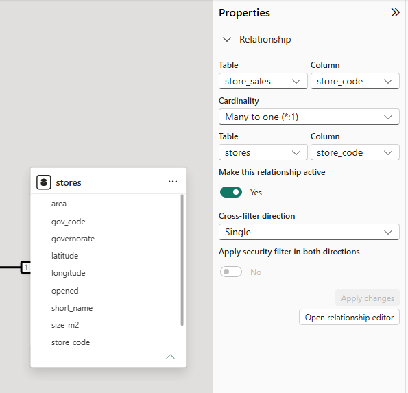
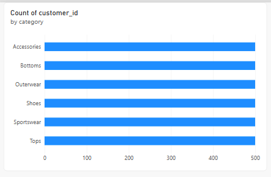
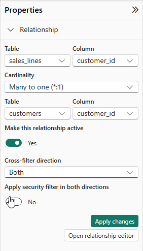
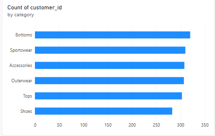

# Lab 06 (optional, PL-300): How to make a filter travel both ways

Every relationship in our model filters one way: from the descriptive table to the fact table. In this lab you change one relationship to filter both ways, use it to count the customers who bought Shoes, then see what it does to other visuals and switch it back.

**When:** optional practice for PL-300. Not submitted. · **Files:** your D18 model after [activity 03](../03-Evr-Relationships-And-Questions/README.md), or a later D18 checkpoint · **Data:** `sales_lines`, `customers`, `products` (activities 01–03); no new CSVs · **Guide:** [the D18 page](../README.md)

## Before you start

You need the three active relationships from D18 activity 03. Lab 05 is not required. If you have no D18 model, follow [activities 01–03](../README.md#the-activities-and-labs) first.

Power BI gives a new one-to-many relationship the direction **Single**, and no D18 activity or lab has changed it. To see it, open **Model view** and click a relationship line. The **Properties** pane on the right shows **Cross-filter direction: Single**.

**Desktop:** save a separate copy as `D18-filter-test.pbix` with **File** → **Save as**. **On the web:** use the existing `D18-nakheel` semantic model and finish step 3 to restore **Single**. A copy of a report still uses its original semantic model; it does not isolate relationship changes. Model changes are saved automatically on the web.

Create a new report page and clear page/report filters. Clear selections in other visuals before each check. Step 1's chart uses completed sales; step 2's new card deliberately uses every status. Keep those filters on the individual visuals.

**The question:** activity 03 counted the customers who bought Shoes in the fact table (284). Could the relationship do it instead?

| Step | The problem you will see | The tool |
|---|---|---|
| 1 | Count of customers reads 500 on every category | **Cross-filter direction: Both** |
| 2 | Every visual that counts customers now follows the category filter | a slicer and a card |
| 3 | We want the old behavior back | **Cross-filter direction: Single** |

We follow customer **C-1357**, who bought Outerwear, Sportswear and Tops in order 100003.

## Step 1 · Set Both on customers–sales_lines

**Why this step:** with **Single**, a filter on a category reaches `sales_lines` and stops; it cannot travel back to `customers`.

1. On the new page, add a **Clustered bar chart**. Put `products[category]` on the Y-axis and `customers[customer_id]` on the X-axis, then choose **Count** in the field's drop-down.
2. In **Filters on this visual**, set `sales_lines[status]` to **completed**, so the chart counts completed sales only. Every bar reads 500.

   

3. In **Model view**, click the `customers`–`sales_lines` line. In **Properties**, set **Cross-filter direction** to **Both**, then select **Apply changes**. The line now has two arrowheads.

   

**Check:** Shoes **283** (Bottoms 320, Sportswear 310).

**What just happened:** the Shoes filter now flows `products` → `sales_lines` → `customers`. It reads 283, not 284, because **Both** counts rows of `customers`. C-0999 appears in the sales lines but has no row in `customers`.

These are two populations: 284 distinct IDs in completed Shoes sales, and 283 matching customer records. The missing customer record explains the difference. A smaller number after changing the relationship is not automatically a better answer; first say whether the question asks for IDs on sales or people present in the customer list.

> [!note]
>
> **Single:** a filter passes from the one side to the many side and stops. In our model, a category in `products` filters `sales_lines`, but a choice in `sales_lines` does not filter `products`. The other relationships in our star stay Single, and this is the setting to keep.
>
> **Both:** a filter passes in both directions. Here, a category filters `sales_lines`, and the filtered `sales_lines` then filters `customers`. That is what lets the chart count customers by category. The cost is in step 2: every visual that counts customers starts following the category filter.

## Step 2 · See what else Both changed

**Why this step:** a relationship setting applies to every visual on every page, not just the chart you were fixing.

On a new page: a **Slicer** on `products[category]` and a **Card** with Count of `customers[customer_id]` (no `status` filter). Pick Shoes.

**Check:** the card reads **297**: every customer with a Shoes line, any status.

The bar chart's completed-status filter applies only to that visual. This new card has no such filter, so 297 is not the completed-only 283 from step 1. Read the selected category, status scope and table being counted together before comparing results.

**What just happened:** with **Both**, the slicer's category flows `products` → `sales_lines` → `customers`, so the card counts only the customers with a line in that category. C-1357 is counted under Outerwear, Sportswear and Tops, because order 100003 has a line in each. Every visual that counts customers is now filtered by the category slicer, even one built for a different question.

## Step 3 · Set the direction back to Single

**Why this step:** Microsoft: "minimize the use of bi-directional relationships": they can slow queries and confuse report users. Count in the fact table instead (activity 03, step 4), or, for one measure that needs it, `CROSSFILTER` (D19 onward).

Click the `customers`–`sales_lines` line again. In **Properties**, set **Cross-filter direction** to **Single**, then select **Apply changes**.

**Check:** the card reads **500** again.

**What just happened:** category filters stop at the sales lines again; they no longer restrict the customer list. Save the Desktop copy. On the web, check that the relationship is **Single** before leaving the model.

To continue with [Lab 07](../07-Lab-Optional-Targets-By-Month/README.md), use the D18 model with Lab 05's `store_sales` and `stores`. If you skipped 05, do it first. Changing to **Both** was only this lab's experiment; Lab 07 uses **Single** relationships.

## Check yourself

| Step | One value |
|---|---|
| 1 | Shoes 283 |
| 2 | 297 |
| 3 | 500 |

## If something goes wrong

- **Still 500 after step 1:** you changed `products`–`sales_lines`; it must be `customers`–`sales_lines`.
- **The new card reads 283 instead of 297:** a completed-status filter is reaching it. Keep that filter on step 1's chart only; clear it from the card, page and report.
- **The final card is not 500:** confirm **Single**, then clear page/report filters and any direct filter on `customers`.

## References

Microsoft: [Bi-directional relationship guidance](https://learn.microsoft.com/en-us/power-bi/guidance/relationships-bidirectional-filtering). Menu names are Power BI's in October 2026.
