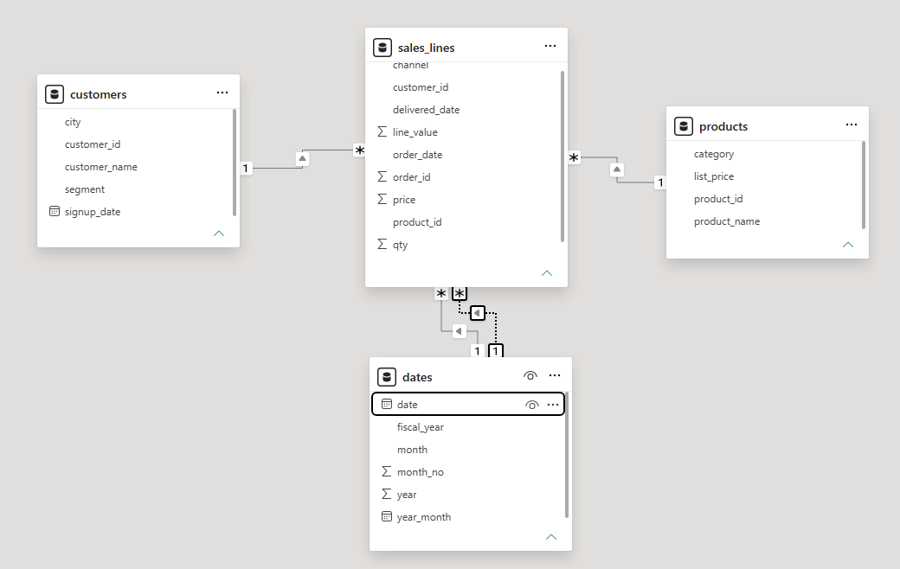
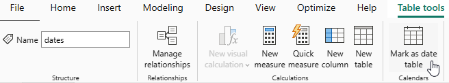
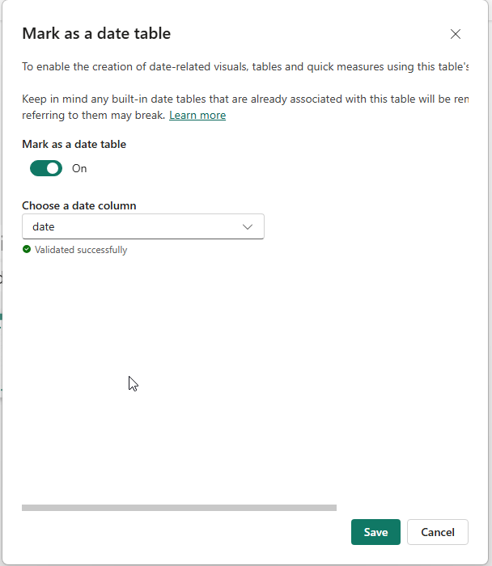
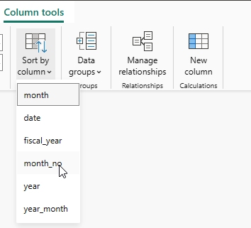
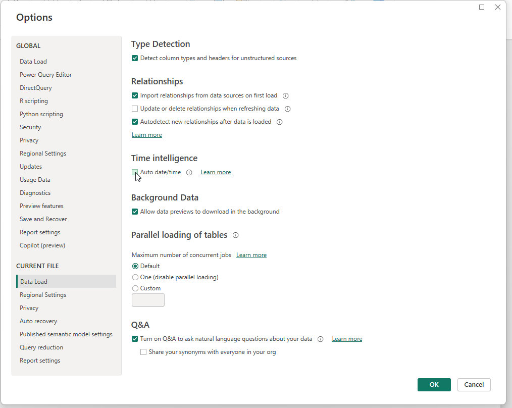
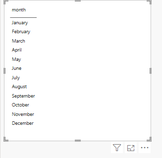
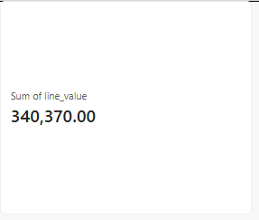

# Activity 01: load the four start files and relate the tables

In this activity, you will load D18's four finished tables into a new file and draw the four relationships again, so the rest of the day has a model to write measures on.

**Files:** a new Power BI file · **Data:** the four start files in [`Resources/start/`](../Resources/start/) (D18's tables) · **Guide:** [the D19 page](../README.md)

**The question:** "Can I rebuild Sunday's star from four files in a few minutes?" Yes: the tables are already clean; only the relationships and the date settings need doing again.

| Step | The problem you will see | The tool |
|---|---|---|
| 1 | An empty file | **Get data** → **Text/CSV**, four times |
| 2 | Four tables with no links between them | **Model view**: drag a key |
| 3 | Months sort April, August, December … | **Mark as date table**, **Sort by column** |
| 4 | Which number does a dragged column give? | a **Card** with `line_value` |

We follow **order 100003** all day: customer C-1357, a store order on 2024-09-03, three lines worth 24.00, 18.00 and 5.00.

## Step 1 · Load the four start files

**Why this step:** D19 starts from a new file (nothing from Sunday is needed), and these four files are Sunday's tables.

**Get data** → **Text/CSV** → `sales_lines.csv` → **Load**. Repeat for `customers.csv`, `products.csv` and `dates.csv`. *Why Load and not Transform Data:* the files are already clean.

> **On the web:** **+ New Report** → **Get data** → **Text/CSV** → **Upload file** for the first file, then **Get data** inside the same Power Query editor for the other three; **Create**.

**Check:** **Table view**: `sales_lines` **7,516** rows, `customers` 500, `products` 60, `dates` 1,096.

**What just happened:** order 100003 is three rows of `sales_lines`, each with C-1357, 2024-09-03 and its own `line_value`.

## Step 2 · Draw the four relationships

**Why this step:** without relationships, a chart that takes `category` from `products` and `line_value` from `sales_lines` cannot join them (D18).

1. **Model view**. Keep any line Power BI drew on `customer_id` or `product_id`; delete any other.
2. Drag the missing ones: `customers[customer_id]` onto `sales_lines[customer_id]`, `products[product_id]` onto `sales_lines[product_id]`, `dates[date]` onto `sales_lines[order_date]`.
3. Drag `dates[date]` onto `sales_lines[delivered_date]`. Power BI makes it inactive (dashed), because `dates` already reaches `sales_lines` through `order_date`.

> **On the web:** **Open semantic model** → **Editing**, then drag in the model diagram the same way.

**Check:** **three solid** one-to-many lines and **one dashed** line into `sales_lines`.

**What just happened:** C-1357 is one row of `customers` (the `1`) and three of order 100003's rows in `sales_lines` (the `*`).

## Step 3 · Mark the date table and sort the months

**Why this step:** a date table must be marked for Wednesday's time measures, and month names sort alphabetically unless told otherwise.

1. In the Report View. Select `dates` → **Table tools** → **Mark as date table** → column `date`.

   

   

2. Select `dates[month]` → **Column tools** → **Sort by column** → `month_no`.

   

3. **File** → **Options and settings** → **Options** → **Current File** → **Data Load**: untick **Auto date/time**.

   

**Check:** a **Table** visual with `dates[month]` starts with **January**.

**What just happened:** 2024-09-03, order 100003's day, is a September row of `dates`, in fiscal year 2024-25.

## Step 4 · A card with line_value dragged in

**Why this step:** this is how every number was made until today. Activity 02 replaces it with a measure you write.

A **Card**: drag `sales_lines[line_value]` into it. Power BI writes **Sum of line_value**. Set the display units to **None** ([the D19 page](../README.md)).

**Check:** **340,370.00**.

**What just happened:** every line of every status, order 100003's 47.00 included. D16's 316,023.50 counts completed orders only; activity 02 gets there.

## Check yourself

| Step | One value |
|---|---|
| 1 | 7,516 rows in `sales_lines` |
| 2 | three solid lines, one dashed |
| 3 | January first |
| 4 | 340,370.00 |

## If something goes wrong

- **`line_value` reads 100 times too big:** your Windows uses a decimal comma. In Power Query, `sales_lines` → `line_value` and `price` → **Change Type** → **Using Locale…** → **Decimal Number**, **English (United States)**.
- **The `delivered_date` line came in solid and `order_date` went dashed:** double-click the `order_date` line and tick **Make this relationship active**.
- **`delivered_date` is Text:** set it to **Date** in Power Query; the empty cells become blanks.

## References

Microsoft: [Create and manage relationships](https://learn.microsoft.com/en-us/power-bi/transform-model/desktop-create-and-manage-relationships), [Set and use date tables](https://learn.microsoft.com/en-us/power-bi/transform-model/desktop-date-tables). Menu names are Power BI's in November 2026.
