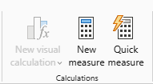
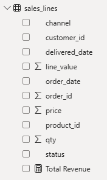
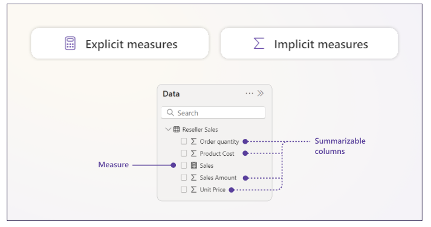
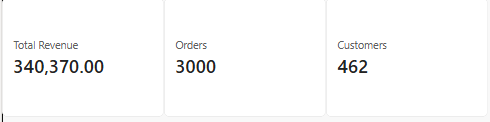
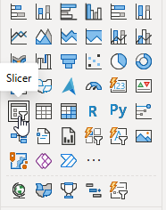
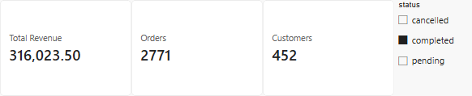
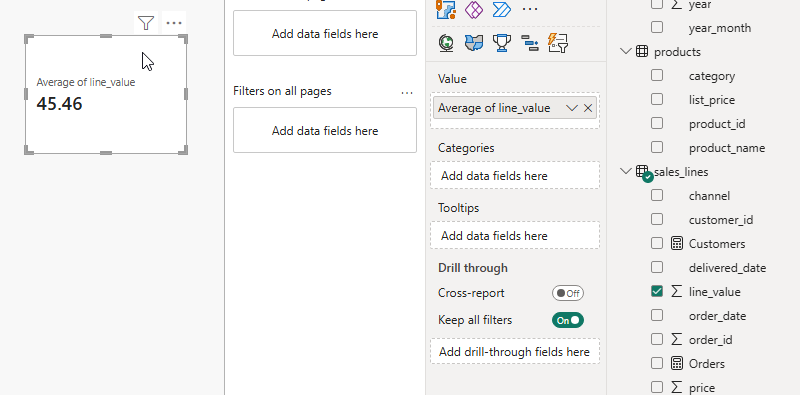
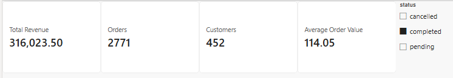

# Activity 02: write the base measures and check them against SQL

In this activity, you will write four explicit measures (Total Revenue, Orders, Customers and Average Order Value) and check each one against the answer you got in SQL.

**Files:** your file from activity 01 · **Data:** `sales_lines` (activity 01) · **Guide:** [the D19 page](../README.md)

**The question:** "What are completed revenue, completed orders, buying customers and the average order?" You know all four from SQL: 316,023.50 (D16), 2,771 (D07), 452 (D09) and 114.05 (D04).

| Step | The problem you will see | The tool |
|---|---|---|
| 1 | Sum of `line_value` is named and made by Power BI | **New measure**: Total Revenue |
| 2 | `sales_lines` has one row per line, not per order | `DISTINCTCOUNT` |
| 3 | The measures count every status | a **Slicer** on `status` |
| 4 | `AVERAGE` gives the average line | `DIVIDE` with two measures |

We follow **order 100003**: three rows of `sales_lines`, one order, worth 47.00.

## Step 1 · Total Revenue

**Why this step:** a measure is a named calculation, stored in the model, that every visual can use. Written once, it can be used inside other measures (step 4).

1. Select `sales_lines` in the **Data** pane → **Home** → **New measure**. *Why select it first:* the measure lands in the selected table.

   

2. In the formula bar type the measure and press **Enter**:

```dax
Total Revenue = SUM(sales_lines[line_value])
```



3. In activity 01's card, replace **Sum of line_value** with **Total Revenue** (it has a calculator icon in the **Data** pane).

> **On the web:** in **Editing** mode, select `sales_lines` and click **New measure** in the ribbon; the formula bar is the same.

**Check:** **340,370.00**, the same as Sum of `line_value`.

**What just happened**

Look at the field name in the card’s **Values** area.

- Drag in the `line_value` column and you see **Sum of line_value**. Power BI applies **Sum** in the visual. That’s an *implicit measure*.
- Drag in the measure and you see **Total Revenue** on its own. The `SUM` is already in the DAX formula you saved in the model. That’s an *explicit measure*.

For order 100003 alone, either field would give **47.00** by adding the same three lines (`24.00 + 18.00 + 5.00`). In Step 4, you’ll reuse the measure in `DIVIDE([Total Revenue], [Orders])` to calculate average order value.



## Step 2 · Orders and Customers

**Why this step:** `sales_lines` has one row per order line (D18's grain), so counting rows counts lines. `DISTINCTCOUNT` counts each order once.

Two more measures on `sales_lines`, each in its own card:

```dax
Orders = DISTINCTCOUNT(sales_lines[order_id])
Customers = DISTINCTCOUNT(sales_lines[customer_id])
```

**Check:** Orders **3,000**, Customers **462**.

**What just happened:** order 100003 is three rows and counts as one order; C-1357 counts once however many lines it has.



## Step 3 · A slicer on status

**Why this step**

The three cards use sales lines from completed, cancelled and pending orders. A slicer is a filter you can use directly on the report page. Add one so all three cards use only sales lines from completed orders. Then compare the revenue, order count and customer count with your SQL results.

1. On the page with the three cards, click a blank spot on the canvas. This lets you add a new visual without changing a card.

2. In the **Visualizations** pane, hover over the icons to read their names. You may see **Button slicer**, **Input slicer** and **List slicer**. For this lab, choose the icon labelled just **Slicer**. An empty slicer appears on the page.

   

3. Keep the slicer selected. In the **Data** pane, expand `sales_lines` and tick `status`. The slicer now lists **cancelled**, **completed** and **pending**.

4. Select **completed** in the slicer on the page. Watch the three cards update and leave **completed** selected for Step 4.

   

> **On the web** · Open the report in **Editing** mode and follow the same steps.

**Check**

Total Revenue reads **316,023.50** (D16), Orders **2,771** (D07) and Customers **452** (D09).

**What just happened**

Power BI recalculated the cards using only the rows where `status` is `completed`. Order 100003 still contributes **47.00** because all three of its lines have that status.

## Step 4 · Average Order Value with DIVIDE

**Why this step**

The **Average of line_value** card below gives the average amount per line because `sales_lines` has one row per order line. To find the average per order, we need to count each order once.



```dax
Average Order Value = DIVIDE([Total Revenue], [Orders])
```

`DIVIDE` returns a blank if `[Orders]` is zero or blank. That covers a filter selection with no orders to average. The square brackets let you refer to each measure by name.

**Check:** **114.05** (the completed slicer is still on).



**What just happened**

With **completed** selected, both averages use **316,023.50** in revenue.

- **Average line value** uses `AVERAGE(sales_lines[line_value])`. It divides by the **6,951 rows** with a line value. **316,023.50 ÷ 6,951 ≈ 45.46**.
- **Average order value** uses `[Orders]`, which counts **2,771 distinct order IDs** with `DISTINCTCOUNT(sales_lines[order_id])`. **316,023.50 ÷ 2,771 ≈ 114.05**.

Order 100003 adds three to the line count and one to the order count. Its three lines contribute **47.00** to the revenue in both calculations.

## Check yourself

| Step | One value |
|---|---|
| 1 | 340,370.00 |
| 2 | 3,000 orders, 462 customers |
| 3 | 316,023.50 · 2,771 · 452 |
| 4 | 114.05 |

## If something goes wrong

- **The measure fills every row of a table with the same number, or shows in Table view:** you made a **New column**. Delete it and use **New measure**.
- **Orders reads 7,516:** you counted rows (`COUNTROWS`, or Count of `order_id`). Use `DISTINCTCOUNT`.
- **The measure landed in another table:** select it → **Measure tools** → **Home table** → `sales_lines`. It works either way.

## Hint

Leave the completed slicer on: activity 03 starts with it.

## References

Microsoft: [Create measures for data analysis](https://learn.microsoft.com/en-us/power-bi/transform-model/desktop-measures), [Create a slicer](https://learn.microsoft.com/en-us/power-bi/visuals/power-bi-visualization-slicer-visual#create-a-slicer), [Slicer types](https://learn.microsoft.com/en-us/power-bi/visuals/power-bi-visualization-slicers), [DIVIDE function vs divide operator](https://learn.microsoft.com/en-us/dax/best-practices/dax-divide-function-operator). Menu names are Power BI's in November 2026.
