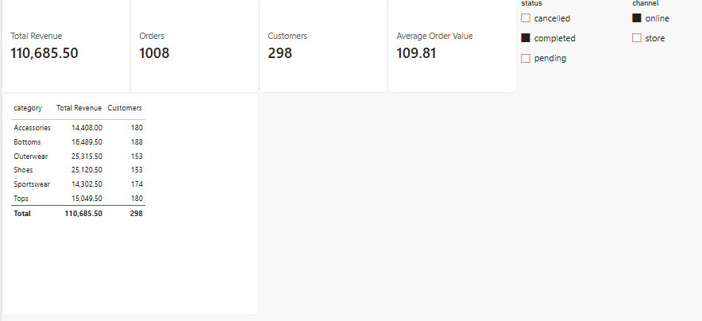
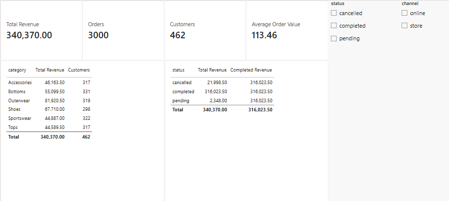

# Activity 03: one measure in a card, a table and under slicers, then CALCULATE

In this activity, you will put Total Revenue and Customers in a table by category and under a channel slicer, see why each place shows a different number, then write Completed Revenue with `CALCULATE`.

**Files:** your file from activity 02 · **Data:** `sales_lines`, `products` (activity 01); the measures (activity 02) · **Guide:** [the D19 page](../README.md)

**The question:** "Why does the same measure give 316,023.50 in the card, 76,637.00 on the Outerwear row and 110,685.50 under an online slicer?" Each place has different filters: its filter context.

| Step | The problem you will see | The tool |
|---|---|---|
| 1 | One measure, a different number on each row | a **Table** by `products[category]` |
| 2 | The rows of Customers do not add up to the total | the total row is calculated again |
| 3 | A slicer changes the card | a **Slicer** on `channel` |
| 4 | The status slicer is needed on every page | `CALCULATE` |

We follow **order 100003**, a store order: Fleece jacket 24.00 (Outerwear), Kids football boots 18.00 (Sportswear), Kids T-shirt 5.00 (Tops).

## Step 1 · Total Revenue by category

**Why this step**

Power BI evaluates a measure with the filters that apply to its cell. Those filters are its **filter context**. They can come from the category on a table row, a slicer selection, or the **Filters** pane. The pane lets you set a filter for one visual, the current page or all pages.

Keep activity 02's completed slicer on. A **Table** visual: `products[category]` and **Total Revenue**.

**Check:** Outerwear **76,637.00**; the total row 316,023.50.

**What just happened**

The completed slicer limits both the card and the table to completed orders. The Outerwear cell adds a second condition, `products[category] = "Outerwear"`. The relationship on `product_id` carries that filter to `sales_lines`, so `SUM` adds only completed Outerwear lines. Order 100003 contributes its full 47.00 to the card and only the jacket's 24.00 to the Outerwear cell.

## Step 2 · Customers by category

**Why this step**

The same customer can buy in several categories. Each category cell counts its own customers. The Total cell counts distinct customers across the categories together.

Add **Customers** to the table.

**Check:** Shoes **284**; the total row 452 (the six rows add up to 1,835).

**What just happened:** C-1357 bought in all six categories, so is counted in six rows and once in the total. Shoes 284 is D18's answer to "how many customers bought Shoes?".

## Step 3 · A slicer on channel

**Why this step**

The channel selection can narrow the completed orders further. Both slicers affect the cards and table on this page.

Keep **completed** selected. Add a second **Slicer** with `sales_lines[channel]` and select **online**.

**Check:** **110,685.50**.

**What just happened**

In the screenshot, the card and the Total row both read **110,685.50** for completed online sales across all categories. On the Outerwear row, Power BI applies the category filter as well as both slicers. **Total Revenue** there is **25,315.50**. Order 100003 is a store order, so its lines are outside both sums.



Clear the channel slicer before Step 4.

## Step 4 · Completed Revenue with CALCULATE

**Why this step**

Use `CALCULATE` to give a measure its own rule for status. Each time Power BI evaluates **Completed Revenue**, it runs `[Total Revenue]` with `sales_lines[status]` set to `completed`.

1. Clear the status slicer (or delete it).
2. A new measure on `sales_lines`:

```dax
Completed Revenue =
    CALCULATE(
        [Total Revenue],
        sales_lines[status] = "completed"
    )
```

3. A **Table** visual: `sales_lines[status]`, **Total Revenue** and **Completed Revenue**.

**Check:** Completed Revenue **316,023.50** on every status row (Total Revenue: 316,023.50 · 21,998.50 · 2,348.00).

**What just happened**

Read across the **cancelled** row below. **Total Revenue** uses the row's `status = cancelled` filter and gives **21,998.50**. For **Completed Revenue**, `CALCULATE` replaces that filter on the same column with `status = completed`, giving **316,023.50**. The row label still says **cancelled** because that is the group the table is displaying. The change applies inside **Completed Revenue**, which includes order 100003's 47.00 on every status row.



If you add **Completed Revenue** to the category table, the Outerwear row shows **76,637.00**. `CALCULATE` keeps the Outerwear filter and applies `status = completed`.

## Check yourself

| Step | One value |
|---|---|
| 1 | Outerwear 76,637.00 |
| 2 | Shoes 284; total 452 |
| 3 | 110,685.50 |
| 4 | 316,023.50 on every status row |

## If something goes wrong

- **Every category row shows 316,023.50 in step 1:** `products` is not related to `sales_lines` (activity 01, step 2).
- **An error on "completed":** DAX text needs double quotes, not single quotes.
- **Completed Revenue reads 21,998.50 on the cancelled row.** Check that you added the **Completed Revenue** measure to the table and that its `CALCULATE` sets `sales_lines[status]` to `"completed"`.

## Bonus

With both slicers cleared, add **Completed Revenue** to Step 1's category table. Compare **81,920.50** for Total Revenue and **76,637.00** for Completed Revenue on the Outerwear row. Which filter is shared by both measures, and which one does `CALCULATE` apply?

## References

Microsoft: [CALCULATE function](https://learn.microsoft.com/en-us/dax/calculate-function-dax), [Visual, page and report filters](https://learn.microsoft.com/en-us/power-bi/create-reports/power-bi-report-add-filter). Menu names are Power BI's in November 2026.
