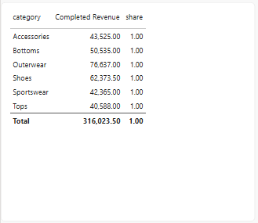
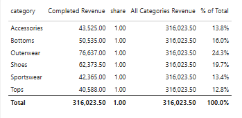

# Lab 04: percent of total by category, checked against SQL

In this lab, you will compute each category's share of completed revenue with two measures, `CALCULATE` with `REMOVEFILTERS` and then `DIVIDE`, and check the shares against D10's window query.

**When:** shown in class after the break; finish it on your own if class ran out of time. Not submitted. · **Files:** your file from activity 03 · **Data:** `sales_lines`, `products` (activity 01); Completed Revenue (activity 03) · **Guide:** [the D19 page](../README.md)

**The question:** "What share of completed revenue does each category bring?" On D10 you answered it with `SUM(revenue) OVER ()`, a window that puts the grand total beside every row.

| Step | The problem you will see | The tool |
|---|---|---|
| 1 | A measure divided by itself is 100% on every row | (the planned dead end) |
| 2 | The bottom number must see every category | `CALCULATE` with `REMOVEFILTERS(products)` |
| 3 | The share itself | `DIVIDE`, formatted as a percentage |
| 4 | Which slicer changes the denominator? | slicers on `category` and `channel` |

We follow **order 100003**: its Fleece jacket (24.00) is one of Outerwear's lines.

## Step 1 · The dead end: a measure divided by itself

**Why this step**

To find a category's share, we need the category amount and a total to compare it with. Try using the same measure for both.

On the report page from Activity 03, clear the status and channel slicers. Create a **Table** visual with `products[category]` and **Completed Revenue**. Create this temporary measure on `sales_lines` and add it to the table.

```dax
Share (wrong) = DIVIDE([Completed Revenue], [Completed Revenue])
```

**Check:** **100%** (shown as 1.00) on every row.



**What just happened**

On the Outerwear row, Power BI uses the Outerwear filter for both references to `[Completed Revenue]`. Dividing **76,637.00** by **76,637.00** gives **1.00**, or **100%**. The screenshots label this test column **share**. Keep it beside the new measures until you can compare the results in Step 3.

## Step 2 · All Categories Revenue

**Why this step**

To find Outerwear's share, divide completed Outerwear revenue by completed revenue across all categories. Create **All Categories Revenue** first so you can check the denominator, the number you divide by.

```dax
All Categories Revenue =
    CALCULATE(
        [Completed Revenue],
        REMOVEFILTERS(products)
    )
```

Add **All Categories Revenue** to the table.

**Check:** **316,023.50** on every row.

**What just happened**

`REMOVEFILTERS(products)` clears filters on fields in the `products` table for this calculation. That includes the Outerwear filter from the table row. It would also clear a filter on `products[category]` from a slicer or from the **Filters** pane at visual, page or report level. The argument `products` is what tells DAX which filters to clear.

Both measures still sum completed sales. On the Outerwear row, **Completed Revenue** includes only the jacket line from order 100003. **All Categories Revenue** includes all three lines from that order.

## Step 3 · % of Total

**Why this step:** the share is one measure divided by the other.

```dax
% of Total = DIVIDE([Completed Revenue], [All Categories Revenue])
```

Select the measure → **Measure tools** → **Format** → **Percentage**, one decimal place. Add it to the table.



> **On the web:** select the measure in **Editing** mode; **Format** is in the **Properties** pane.

**Check:** Outerwear **24.3%**; the total row 100.0%.

**What just happened**

On the Outerwear row, the **share** column divides 76,637.00 by itself. **% of Total** divides the same 76,637.00 by **316,023.50**, giving **24.3%**. Compare both columns in the screenshot, then delete the temporary `Share (wrong)` measure.

## Step 4 · Category and channel slicers

**Why this step**

The category slicer filters `products`. The channel slicer filters `sales_lines`. Predict which selection will change **All Categories Revenue**, then try each one.

1. Add a **Slicer** on `products[category]` and select **Outerwear**. On the Outerwear row, **Completed Revenue** is **76,637.00**, **All Categories Revenue** stays at **316,023.50**, and **% of Total** is **24.3%**. The slicer narrows the categories displayed. The denominator still includes all categories because `REMOVEFILTERS(products)` clears the slicer's filter for that calculation.
2. Clear the category slicer. Select **online** in the `sales_lines[channel]` slicer from Lab 03. **All Categories Revenue** now reads **110,685.50** on every category row. Outerwear's online revenue is **25,315.50**, giving **22.9%**.

**What just happened**

The channel slicer filters `sales_lines[channel]`, so that filter stays in both calculations. The bottom number is now completed **online** revenue across all categories. Order 100003 is a store order, so both sums exclude it.

## Check yourself

| Step | One value |
|---|---|
| 1 | 100% on every row |
| 2 | 316,023.50 on every row |
| 3 | Outerwear 24.3%, total 100.0% |
| 4 | Selecting Outerwear leaves the denominator at 316,023.50. Selecting online alone changes it to 110,685.50, with Outerwear at 22.9%. |

## If something goes wrong

- **Every category with revenue shows 100%.** Check that `[Completed Revenue]` is the top number and `[All Categories Revenue]` is the bottom number. Put `REMOVEFILTERS(products)` only in the bottom measure.
- **0.24 instead of 24.3%:** format % of Total as **Percentage**.
- **Outerwear reads 8.0% with online selected.** Check for `REMOVEFILTERS()` with no argument. It also clears the channel filter for the denominator. `[Completed Revenue]` then applies its own status rule, giving 316,023.50 across all categories and channels.

## Hint

`ALL(products)` does the same as `REMOVEFILTERS(products)` inside `CALCULATE`. Exam questions use both names.

## Bonus

Clear both slicers. Swap the table's rows to `customers[segment]`. Which filter does each segment row add, and which table would you name in `REMOVEFILTERS` to get a denominator across all segments?

## References

Microsoft: [CALCULATE function](https://learn.microsoft.com/en-us/dax/calculate-function-dax) (its example `Revenue % Total Channel` is the same pattern), [REMOVEFILTERS](https://learn.microsoft.com/en-us/dax/removefilters-function-dax). Menu names are Power BI's in November 2026.
