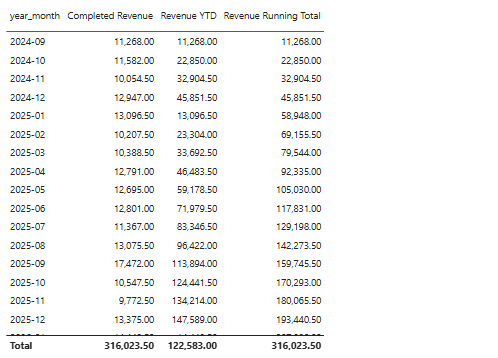
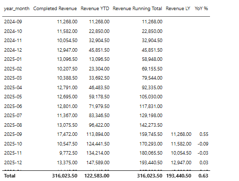

# Activity 02 · Compare revenue over time

You will use the same Completed Revenue measure for three date windows, then check whether the periods cover the same months. Open the model from [Activity 01](../01-Evr-Load-Start-Files-And-Measures/README.md). Its source files are in [this day's start folder](../Resources/start/).

| Step | What you need to know | Tool |
|---|---|---|
| 1 | How much revenue had accumulated by a month? | TOTALYTD |
| 2 | What did the same month earn a year earlier? | CALCULATE and SAMEPERIODLASTYEAR |
| 3 | How large was the change relative to last year? | DIVIDE |
| 4 | Were the periods comparable? | Shared month filter |

## 1. Add the year-to-date measure

**Why this step.** The April row shows April revenue. The year-to-date result includes January through April.

Make a table with `dates[year_month]` and Completed Revenue. Add this measure as another value.

```dax
Revenue YTD =
TOTALYTD([Completed Revenue], dates[date])
```

**Check.** April 2026 gives 62,497.50, and December 2025 gives 147,589.00. If every month has the same result, check the date field and active order-date relationship.

> [!Note]
>
> The `TOTALYTD()` behavior is that it **resets at the beginning of every year** . Year-to-Date only accumulates revenue within the same calendar year. This allows you to compare yearly performance. 
>
> What if you want to keep it accumulating? Then you can use 
>
> ```
> Revenue Running Total =
> CALCULATE(
>     [Completed Revenue],
>     FILTER(
>         ALL(dates),
>         dates[date] <= MAX(dates[date])
>     )
> )
> ```
>
> The condition `dates[date] <= MAX(dates[date])` means: include all dates up to and including the latest date in the current filter context. 



## 2. Read the same period last year

**Why this step.** Use April 2025 for a comparison with April 2026.

```dax
Revenue LY =
CALCULATE(
    [Completed Revenue],
    SAMEPERIODLASTYEAR(dates[date])
)
```

This measure calculates Completed Revenue for the same period last year (LY).

- `[Completed Revenue]`: Our existing revenue measure.
- `SAMEPERIODLASTYEAR(dates[date])`: Shifts the current date period back one year.
- `CALCULATE()`: Evaluates revenue using that previous year's dates.

> [!Note]
>
> This is particularly useful for calculating Year-over-Year (YoY) growth 

Add it to the table. **Check.** In the April 2026 row, the current column says 20,237.00 and Revenue LY says 12,791.00. The row label stays April 2026.

## 3. Express the difference as a percentage

**Why this step.** The difference of 7,446.00 needs a base. Use last year's revenue.

```dax
YoY % =
DIVIDE([Completed Revenue] - [Revenue LY], [Revenue LY])
```

Format the measure as a percentage with one decimal place. **Check.** April 2026 reads +58.2% (Power BI may display positive percentages without the plus sign). DIVIDE returns a blank when its denominator is zero or blank in this expression.



## 4. Compare years with the same months

**Why this step.** The August snapshot covers eight months of 2026. A comparison with all of 2025 gives a different answer.

Switch the table to `dates[year]` set to **Don’t summarize** and turn off the table’s totals. The selected months are contiguous within each year, while a total could combine separate date ranges. Record the unfiltered 2026 result, then filter this visual on `dates[month_no]` from 1 through 8 for both years. Keep the date table available to the prior-period measure.

**Check yourself.** The 2026 comparison changes from −16.9% to +27.1%. The like-for-like totals are 122,583.00 and 96,422.00. At month grain, if you extend the table to September 2026, the unguarded YoY may show −100% because current revenue is blank and September 2025 is 17,472.00. Filter through 31 August for the report. April remains in both date windows, while September drops out of the report.

[Microsoft time intelligence](https://learn.microsoft.com/en-us/power-bi/transform-model/desktop-time-intelligence) · [Activity 03](../03-Evr-SUMX-And-Quick-Measures/README.md)
