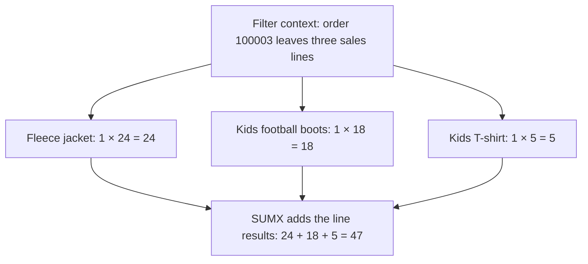

# Activity 03 · Calculate each sales line before adding the revenue

**The question:** each sales line has a quantity and a unit price. How can a measure multiply the correct pair on every line, then add the amounts?

You will compare the same multiplication in a measure, a calculated column and a SUMX measure. The difference is whether DAX has a **current row** from which to read the quantity and price.

Open the model from [Activity 01](../01-Evr-Load-Start-Files-And-Measures/README.md). Save a practice copy. Add a report page named **Line revenue**. Clear any date, category, channel and status restrictions affecting this practice page, including report-level filters in the practice copy. You will select individual orders and then return to the whole dataset.

| Step | What you will work out | What you build |
|---|---|---|
| [1 · Read the selected order and try a measure](#1-read-the-selected-order-and-try-a-measure) | Why naming columns does not identify a current row | A table of the three sales lines and a deliberately failing measure |
| [2 · Multiply the totals and inspect the mistake](#2-multiply-the-totals-and-inspect-the-mistake) | Why adding first loses the quantity/price pairs | A Wrong Revenue card |
| [3 · Use the same expression in a calculated column](#3-use-the-same-expression-in-a-calculated-column) | Why the multiplication works when a current row exists | DAX Line Value |
| [4 · Use SUMX to calculate each row and add the results](#4-use-sumx-to-calculate-each-row-and-add-the-results) | What SUMX’s table and expression arguments each provide | A correct revenue card and a comparison |

## 1. Read the selected order and try a measure

**Why this step.** Before writing a formula, inspect the rows it must calculate. One order can contain several sales lines, each with its own quantity and price.

1. Add a **Table** visual containing `products[product_name]` and `sales_lines[qty]`, `sales_lines[price]` and `sales_lines[line_value]`. For the numeric columns, choose **Don’t summarize** from the field menu in the visual.
2. Put `sales_lines[order_id]` in **Filters on this page** and select **100003**. Keep that page filter for the table and the cards you will add.

**Check the input.** The current course files contain these three rows. Their display order can differ.

| Product | Quantity | Unit price | Supplied line_value |
|---|---:|---:|---:|
| Fleece jacket | 1 | 24.00 | 24.00 |
| Kids football boots | 1 | 18.00 | 18.00 |
| Kids T-shirt | 1 | 5.00 | 5.00 |
| **Total** | **3** | **47.00** | **47.00** |

The sum of unit prices happens to equal revenue here because every quantity is 1. It is not a general revenue formula.

> [!NOTE]
> **Filter context** determines which rows participate in a calculation. The page filter selects the lines belonging to order 100003.
>
> **Row context** identifies a current row while DAX evaluates an expression. Selecting an order does not automatically give a measure a current sales line. All three lines remain available.

3. In `sales_lines`, choose **New measure** and try:

   ```dax
   Revenue attempt =
       sales_lines[qty] * sales_lines[price]
   ```

Read the error, then cancel the edit. A message about not being able to determine a single column value is the expected result.

**Why the measure fails.** The expression names the **columns**, but the measure has no automatic **current row**. With several lines in scope, which quantity and which price should it use? A table row displayed in a report does not itself create DAX row context for a measure.

**The connection to calculated columns:** this exact multiplication works as a calculated column because calculated columns evaluate each table row individually. In Step 3 you will use that same expression through **New column**, rather than **New measure**.

**C1.** You can see the three input lines, and the bare-column measure fails. The page filter has selected an order, but it has not supplied a current line for the multiplication.

## 2. Multiply the totals and inspect the mistake

**Why this step.** SUM produces a single value, so multiplying two sums gives a valid measure. A formula can be valid DAX and still answer the wrong business question.

1. Create this measure:

   ```dax
   Wrong Revenue =
       SUM(sales_lines[qty]) * SUM(sales_lines[price])
   ```

2. Add it to a **Card** visual. Keep order **100003** selected in the page filter.

**Work through the calculation.** DAX first adds all the selected quantities, then all the selected prices:

```text
SUM(qty)   = 1 + 1 + 1       = 3
SUM(price) = 24 + 18 + 5     = 47
Wrong Revenue = 3 × 47      = 141.00
```

But the revenue must preserve each line’s quantity/price pair:

```text
(1 × 24) + (1 × 18) + (1 × 5) = 47.00
```

Multiplying the totals applies the combined quantity to the combined prices. It no longer calculates each original sales line.

**Check.** The card shows **141.00**, even though the supplied line amounts add to **47.00**. Leave the wrong card visible for comparison with Step 4.

## 3. Use the same expression in a calculated column

**Why this step.** The failed measure had no current row. A calculated column has one: Power BI evaluates its expression once for each row of `sales_lines` and stores the results in this Import model.

1. In Desktop, right-click `sales_lines` in the **Data** pane and choose **New column**. On the web, open the semantic model in **Editing** mode, select `sales_lines` and choose **New column**.
2. Enter:

   ```dax
   DAX Line Value = sales_lines[qty] * sales_lines[price]
   ```

**Why the same multiplication now works.** For the Fleece jacket row, DAX reads that row’s quantity, 1, and that row’s price, 24.00. It stores 24.00 for that row. Then it evaluates the next row using that row’s values. That current-row evaluation is **row context**.

3. Add **DAX Line Value** to the table, with **Don’t summarize**. It should match the supplied `line_value` on each line.
4. Change the page’s order filter to **100142**. This order has quantities greater than 1, so the multiplication is easier to see:

| Product | Quantity | Unit price | DAX Line Value |
|---|---:|---:|---:|
| Hooded sweatshirt | 1 | 18.00 | 18.00 |
| Compression top | 3 | 16.00 | 48.00 |
| Yoga mat | 2 | 14.00 | 28.00 |

**C2.** Compression top stores **3 × 16.00 = 48.00**. The calculated column agrees with the supplied amount.

5. Add a slicer using `products[category]` and select **Outerwear**. Only Hooded sweatshirt remains in the table, worth **18.00**. Clear the category selection to see Compression top at **48.00** again.

**What the filter changed.** The slicer changes which stored rows appear. It does not recalculate Compression top’s stored amount. A calculated column’s row values differ from a measure’s result, which is evaluated under the current report filters.

Return the order filter to **100003** and clear the category slicer before Step 4.

## 4. Use SUMX to calculate each row and add the results

**Why this step.** A revenue measure needs a total that follows the report filters. SUMX provides a current row for the multiplication, evaluates it on each available row, then adds the results.

Create the measure:

```dax
Revenue (SUMX) =
    SUMX(
        sales_lines,
        sales_lines[qty] * sales_lines[price]
    )
```

SUMX is an **iterator**: it evaluates an expression for each row of a table.

| Argument | What it supplies here |
|---|---|
| `sales_lines` | The table whose available rows SUMX will visit. The order filter leaves three lines. |
| `sales_lines[qty] * sales_lines[price]` | The calculation to perform using the quantity and price of the current line. |

Naming `sales_lines[qty]` identifies a column. It does not establish a current row. `SUMX(sales_lines, …)` supplies the iteration that does.

### How SUMX evaluates order 100003



The order filter determines **which rows are available**. SUMX creates **row context during each iteration**, so the multiplication reads a matching quantity and price from one line at a time.

<details>
<summary>If you know Python: the same iteration in plain code</summary>

This is a conceptual analogy. The Python variable below represents the sales lines already selected by the report filters.

```python
total = 0
for row in selected_sales_lines:
    total += row["qty"] * row["price"]
```

The loop supplies the current `row`. SUMX supplies the current DAX row while evaluating its second argument. You do not need Python to complete this activity.

</details>

> [!NOTE]
> **Why does SUMX need a table argument if the expression already names sales_lines?**
>
> The column references identify where values come from. The table argument specifies what to iterate over. Iterators can also visit the rows of a filtered table or a table produced by another DAX expression, so the iteration table must be explicit.

Add **Revenue (SUMX)** and **Total Revenue** to cards. Compare all three cards under the same page filter.

| Filter | Wrong Revenue | Revenue (SUMX) | Total Revenue |
|---|---:|---:|---:|
| Order 100003 | 141.00 | 47.00 | 47.00 |
| Order 100142, category clear | 288.00 | 94.00 | 94.00 |

**C3.** SUMX and Total Revenue agree. Total Revenue can use SUM because `line_value` already stores each line’s amount. SUMX calculates each amount from quantity and price before adding it.

Clear the order filter and any status filter: the two correct measures show **340,370.00**. Select completed status only: both show **316,023.50**. These checks confirm that the row calculation also responds to a wider filter context.

### What to remember for PL-300

- **SUM** adds the values of one column.
- **SUMX** evaluates an expression for each row of a table, then adds the results.
- **Calculated columns** already have a current row during evaluation.
- **Measures** do not automatically have a current row. An iterator can create row context inside a measure.
- **Filter context** and **row context** coexist here: the filters select the available sales lines, and SUMX evaluates each selected line.

AVERAGEX evaluates an expression for each row and averages the results. FILTER evaluates a condition for each row and returns a table of the rows that pass. These iterators create a current row during evaluation, but they return different kinds of results.

## Optional: compare a quick YTD measure with your own

This optional comparison requires **Revenue YTD** from [Activity 02](../02-Evr-Time-Intelligence/README.md).

A quick measure generates DAX from selected fields. In Desktop, choose **New quick measure**, select **Year-to-date total**, set the base value to **Completed Revenue** and the date to `dates[date]`. Inspect the generated expression. Compare December 2025 (**147,589.00**) and April 2026 (**62,497.50**) with Revenue YTD from [Activity 02](../02-Evr-Time-Intelligence/README.md).

Use the handwritten measure if your editor does not offer the quick-measure control. Save the practice copy when you finish.

## If something does not match

- **Order 100003 does not show three lines.** Clear extra category, date, channel and status restrictions, then check the page’s order filter.
- **The cards do not use the same order.** Put order_id in Filters on this page rather than filtering only the table visual.
- **DAX Line Value appears as a sum in the table.** Set its visual field to Don’t summarize to inspect the stored line values.
- **SUMX differs from Total Revenue.** Use `sales_lines` as the iteration table and the supplied qty/price fields. Apply identical filters to both measures.

References: [SUMX](https://learn.microsoft.com/en-us/dax/sumx-function-dax) · [DAX context](https://learn.microsoft.com/en-us/dax/dax-overview#context) · [Calculated columns](https://learn.microsoft.com/en-us/power-bi/transform-model/desktop-calculated-columns) · [Web model editing](https://learn.microsoft.com/en-us/power-bi/transform-model/service-edit-data-models#create-calculated-columns) · [Quick measures](https://learn.microsoft.com/en-us/power-bi/transform-model/desktop-quick-measures).
