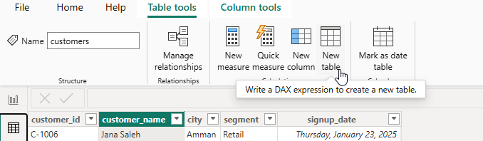
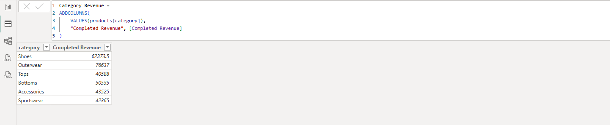
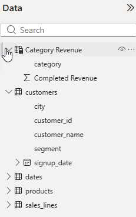

# Optional Lab 06 · PL-300 DAX workout: a second report page

**The ask.** The PL-300 exam tests several DAX and modelling features that the class only named. This lab lets you try six of them on the model you already have, one step each, all on one new report page called **Exam workout**. Every step explains **what** the feature is, **why** you would use it, then **how** to build it, and ends with a number to check.

The same two things come back in most steps, so you can compare methods: the **April 2026** row and the **Outerwear** category (76,637.00 completed revenue).

| Step | Feature you try | PL-300 skill | Check |
|---|---|---|---|
| 1 | A calculated table and a RELATED column | Create calculated tables or columns | Outerwear 76,637.00 |
| 2 | A second date relationship and a fiscal year | Role-playing dimensions; time intelligence | Delivered 17,815.50 · FYTD 113,664.50 |
| 3 | A calculation group | Create calculation groups | April YTD 62,497.50 and 539 orders |
| 4 | Visual calculations | Create visual calculations | Running total 122,583.00 · Outerwear 24.3% |
| 5 | The DAX query behind a visual | Performance Analyzer and DAX query view | Outerwear first, 76,637.00 |
| 6 | Closing stock from weekly snapshots | Create semi-additive measures | March 137 · April 79 |

## Before you start

1. Open the model from [Activity 01](../01-Evr-Load-Start-Files-And-Measures/README.md) with **Revenue YTD** and **Revenue LY** from [Activity 02](../02-Evr-Time-Intelligence/README.md).
2. **Save a copy** named `D20-workout`. Step 3 turns on a model setting that you cannot turn off, and it changes how dragged columns behave (Lab 05's scatter uses one). Keep your Lab 04 and Lab 05 report separate.
3. Add a page named **Exam workout**. Put `sales_lines[status]` in **Filters on this page** and tick **completed**.

**On the web.** Steps 1 and 2 work the same in the semantic model's **Editing** mode. The others differ:

- **Step 3.** Microsoft describes calculation groups in Desktop only. If the web editor has no **Calculation group** button, do Step 3 in Desktop.
- **Step 4.** Visual calculations live in the report: open the report in **Edit** mode and look for **New visual calculation**.
- **Step 5.** In the service, open the report, choose **Edit**, then **View → Performance analyzer**. It has **Copy query** but not **Run in DAX query view**. To run a query, use the semantic model's **…** menu in the workspace → **Write DAX queries** (needs write permission on the model).

## 1. Store a category summary as a table

### What and why

So far you have written two kinds of DAX: **measures** (Completed Revenue) and a **calculated column** (DAX Line Value in Activity 03). A **calculated table** is the third kind: a DAX formula whose result is a whole new table in the model.

| | Measure | Calculated column | Calculated table |
|---|---|---|---|
| What it produces | One value per visual cell | One value per row of an existing table | A whole new table |
| When it is calculated | Every time a visual asks | When the model refreshes | When the model refreshes |
| Stored in the file? | No | Yes | Yes |
| Does a slicer change it? | Yes | No (rows can be hidden, values stay) | No |
| Example | Completed Revenue | DAX Line Value | Category Revenue (this step) |

You use a calculated table for something you want to **keep** rather than recalculate: a small summary, a date table written in DAX, or a list of values for a slicer. The exam asks you to choose between the three, and the slicer row in the table above is usually the deciding fact.

### How: the calculated table

1. Open **Table view** (the grid icon on the left side of Desktop).
2. On the **Table tools** ribbon, choose **New table**.

   

3. Replace the text in the formula bar with this, then press **Enter**:

   ```dax
   Category Revenue =
   ADDCOLUMNS(
       VALUES(products[category]),
       "Completed Revenue", [Completed Revenue]
   )
   ```

   

4. Find **Category Revenue** in the **Data** pane. Its icon differs from the loaded tables: it was made by a formula, not loaded from a file.

   

### How the formula works

Read it from the inside out:

1. `VALUES(products[category])` returns a one-column table with each category once: six rows. It is like `SELECT DISTINCT category FROM products` in SQL.
2. `ADDCOLUMNS(table, "name", expression)` takes that table and adds a column. It visits the table **one row at a time**, like SUMX in Activity 03.
3. `"Completed Revenue"` is the name of the new column.
4. `[Completed Revenue]` is your existing measure. It is evaluated once for each category row.

**Why the measure gives a different number on each row.** On the Outerwear row, ADDCOLUMNS has a current row (Outerwear), but a current row is not a filter. When you call a **measure** there, DAX quietly wraps it in CALCULATE, and CALCULATE turns the current row into a filter: `products[category] = "Outerwear"`. This is **context transition** (D20 page 40). So each row gets its own category's revenue.

Try it the other way to see the difference. If you wrote `SUM(sales_lines[line_value])` instead of `[Completed Revenue]`, there would be no CALCULATE, no filter, and every row would show the same number: 340,370.00, the total of all sales lines.

The same table in SQL:

```sql
-- In BigQuery the sales lines are two tables, orders and order_items
SELECT p.category,
       SUM(i.qty * i.price) AS completed_revenue
FROM nakheel.order_items AS i
JOIN nakheel.orders   AS o ON o.order_id = i.order_id
JOIN nakheel.products AS p ON p.product_id = i.product_id
WHERE o.status = 'completed'
GROUP BY p.category;
```

**Check.** The table has 6 rows. Outerwear reads **76,637**.

### See that a slicer does not change it

1. Back on the **Exam workout** page, add a **Table** visual with `Category Revenue[category]` and `Category Revenue[Completed Revenue]`.
2. Next to it, add a second table with `products[category]` and the **Completed Revenue** measure.
3. Add a **Slicer** with `sales_lines[channel]` and select **online**.

**Check.** The second table's Outerwear drops to **25,315.50** (online only). The first table still shows **76,637**. It was calculated once, at refresh, and it has no relationship to `sales_lines`, so the slicer cannot reach it. Clear the slicer before Step 2.

### How: a RELATED column

**What and why.** `RELATED` fetches a value from the table on the **one** side of a relationship, for the current row. It works like a lookup (`VLOOKUP` in Excel, a join in SQL). `sales_lines` has `product_id` but no category; RELATED follows the `products` relationship to get it.

1. In **Table view**, select `sales_lines` and choose **New column**.
2. Enter:

   ```dax
   Category = RELATED(products[category])
   ```

- `products[category]` is the column to fetch.
- RELATED needs a **current row** (a calculated column has one) and a relationship from `sales_lines` to `products`.

**Check.** Filter Table view to order 100003. The Fleece jacket row shows **Outerwear** and Kids T-shirt shows **Tops**.

**What just happened.** Outerwear's 76,637 is now stored in the model, in a table you made with a formula. The `Category` column copied each sales line's category from `products` through the relationship.

## 2. Use the delivery date and Nakheel's fiscal year

### What and why

**A second role for the date table.** `sales_lines` has two dates: `order_date` and `delivered_date`. In Activity 01 you related both to `dates[date]`, but Power BI allows only **one active** relationship between two tables. The order-date line is solid (active); the delivered-date line is dashed (inactive). Using one date table for two meanings is called a **role-playing dimension**. To report by delivery date, a measure must switch the inactive relationship on.

**A fiscal year.** Nakheel's financial year runs from 1 September to 31 August. `dates[fiscal_year]` already labels each day (for example 2025-26). Year to date for a fiscal year must start counting on 1 September, not 1 January.

### How

1. Create the two measures:

   ```dax
   Delivered Revenue =
   CALCULATE(
       [Completed Revenue],
       USERELATIONSHIP(dates[date], sales_lines[delivered_date])
   )
   ```

   - `[Completed Revenue]` is what to calculate.
   - `USERELATIONSHIP(dates[date], sales_lines[delivered_date])` names the two ends of the inactive relationship. Inside this CALCULATE only, that relationship is used instead of the order-date one.
   - Result: a month row now filters the lines **delivered** in that month.

   ```dax
   Revenue FYTD =
   TOTALYTD([Completed Revenue], dates[date], "8/31")
   ```

   - The first two arguments are the same as Revenue YTD in Activity 02.
   - `"8/31"` is the **last day of the fiscal year**, written month/day. TOTALYTD starts counting the day after it, on 1 September.

2. Add a **Matrix** with `dates[year_month]` on **Rows**, and **Completed Revenue**, **Delivered Revenue**, **Revenue YTD** and **Revenue FYTD** in **Values**.

**Check.** In the April 2026 row:

- Completed Revenue **20,237.00**; Delivered Revenue **17,815.50**. Some orders placed in April were delivered in May, and some delivered in April were ordered in March.
- Revenue YTD **62,497.50** (from 1 January 2026); Revenue FYTD **113,664.50** (from 1 September 2025).

**If Revenue FYTD does not match or is rejected.** Microsoft notes that `"8/31"` is read in the locale of the computer where the file was created, so a computer set to day-first dates may misread it. Use this version instead, which reads the `fiscal_year` column and needs no date text:

```dax
Revenue FYTD =
VAR LastDay = MAX(dates[date])
VAR ThisFY = MAX(dates[fiscal_year])
RETURN
    CALCULATE(
        [Completed Revenue],
        REMOVEFILTERS(dates),
        dates[fiscal_year] = ThisFY,
        dates[date] <= LastDay
    )
```

Line by line, for the April 2026 row:

- `VAR LastDay = MAX(dates[date])`: the last date in the row's filter, 30 April 2026.
- `VAR ThisFY = MAX(dates[fiscal_year])`: that row's fiscal year, 2025-26.
- `REMOVEFILTERS(dates)`: forget the "April only" filter.
- `dates[fiscal_year] = ThisFY, dates[date] <= LastDay`: keep the days of 2025-26 up to 30 April. That is 1 September 2025 to 30 April 2026.

The same in SQL, for one month:

```sql
SELECT SUM(order_total) AS revenue_fytd
FROM nakheel.orders
WHERE status = 'completed'
  AND order_date BETWEEN '2025-09-01' AND '2026-04-30';
```

**What just happened.** The April 2026 row reached `sales_lines` by a different path (delivered date) or from a different start day (1 September) in each measure, while the row label stayed April 2026.

## 3. Create a time calculation group for revenue and orders

### What and why

Activity 02 gave you Revenue YTD and Revenue LY. If you also wanted Orders YTD and Orders LY, you would write two more measures, and two more for every other measure. A **calculation group** removes that repetition. You write each time view **once** (Current, YTD, Last year), and Power BI applies it to whichever measure is in the visual.

The key function is `SELECTEDMEASURE()`. It is a placeholder that means "the measure in this cell". In a cell of Completed Revenue it becomes Completed Revenue; in a cell of Orders it becomes Orders.

### How

1. Open **Model view** and choose **Calculation group** on the ribbon.
2. If Power BI asks to turn on **Discourage implicit measures**, choose **Yes**. An **implicit measure** is the automatic "Sum of …" Power BI makes when you drag a numeric column into a visual. Calculation groups work only with measures you wrote, so this setting stops that automatic summing in this file.
3. In the **Data** pane (Model view), find the new calculation group. Double-click it and rename it `Time View`. Expand it and rename its column to `Period`.
4. Power BI made one item already. Rename it `Current` and set its formula to `SELECTEDMEASURE()`.
5. Right-click **Calculation items** → **New calculation item**, and add the other two:

   ```dax
   Current   = SELECTEDMEASURE()
   YTD       = CALCULATE(SELECTEDMEASURE(), DATESYTD(dates[date]))
   Last year = CALCULATE(SELECTEDMEASURE(), SAMEPERIODLASTYEAR(dates[date]))
   ```

   - `DATESYTD(dates[date])` returns the dates from 1 January to the last date in the current filter. It is the set of dates TOTALYTD uses inside; here you hand it to CALCULATE yourself.
   - `SAMEPERIODLASTYEAR(dates[date])` shifts the current dates back one year, as in Revenue LY.

6. Back on the **Exam workout** page, add a **Matrix**: `dates[year_month]` on **Rows**, `Time View[Period]` on **Columns**, and **Completed Revenue** and **Orders** in **Values**.

**Check.** In the April 2026 row:

| Measure | Current | YTD | Last year |
|---|---|---|---|
| Completed Revenue | 20,237.00 | 62,497.50 | 12,791.00 |
| Orders | 137 | 539 | 103 |

The revenue values match Revenue YTD and Revenue LY from Activity 02. Orders counts completed orders because of the page filter.

**What just happened.** Three items produced six results. In each cell, `SELECTEDMEASURE()` was replaced by that cell's measure, then the item's date change was applied to it.

## 4. Add a running total and a share inside the visuals

### What and why

A **visual calculation** is DAX written **inside one visual**. It can only see the rows and columns that visual shows, which makes some formulas very short: "add up the rows above me", "divide by the visual's total". The trade-off: it belongs to that one visual. A model measure can be reused anywhere.

### How

1. Add a **Table** with `dates[year_month]` and **Completed Revenue**. In the **Filters** pane, under **Filters on this visual**, set `dates[year]` to **2026**.
2. Select the table and choose **New visual calculation** (Home ribbon, or right-click the visual). Enter:

   ```dax
   Running total = RUNNINGSUM([Completed Revenue])
   ```

   - `[Completed Revenue]` here is the **column in this visual**, the values you can see.
   - `RUNNINGSUM` adds each row to all the rows above it, in the visual's order (January first).

3. Add a **Clustered bar chart** with `products[category]` and **Completed Revenue**. Choose **New visual calculation** and enter:

   ```dax
   Share = DIVIDE([Completed Revenue], COLLAPSEALL([Completed Revenue], ROWS))
   ```

   - `COLLAPSEALL([Completed Revenue], ROWS)` reads the value at the **total** of the visual's rows: all six categories together, 316,023.50.
   - `DIVIDE(part, total)` gives each category's share and returns blank instead of an error if the total is zero.

4. Format **Share** as a percentage.

**Check.** The running total reaches **122,583.00** at 2026-08, the same January to August total as Activity 02. Outerwear's Share is **24.3%** (76,637.00 ÷ 316,023.50), which matches D19's `% of Total`.

Now remove **Completed Revenue** from the bar chart. Share has no input any more and fails: a visual calculation can only use what is in its visual. Put it back.

**What just happened.** D19's `% of Total` measure found the total with `REMOVEFILTERS(products)`, a change to the filters. `COLLAPSEALL` found it by reading the visual's own total row.

## 5. Read the query behind a visual

### What and why

Every visual asks the model a question in DAX, called a **DAX query**, and draws the answer. Two tools let you see that:

- **Performance Analyzer** records how long each visual takes, split into **DAX query** (the model working) and **Visual display** (drawing). That tells you whether a slow visual has a slow measure or simply too much to draw.
- **DAX query view** runs a query and shows the resulting table, so you can read or test it.

### How

1. In **Report view**, open **Optimize → Performance analyzer**. Choose **Start recording**, then **Refresh visuals**.
2. Expand the line for the Step 3 matrix and choose **Run in DAX query view**. Power BI opens the query it sent. (If you only see **Copy query**, open **DAX query view** from the left side of Desktop, paste it into a new tab and choose **Run**.)
3. In a new DAX query tab, run this short query of your own:

   ```dax
   EVALUATE
   SUMMARIZECOLUMNS(
       products[category],
       "Completed Revenue", [Completed Revenue]
   )
   ORDER BY [Completed Revenue] DESC
   ```

   - `EVALUATE` means "run this and show me the table". A measure returns one value; a query returns a table.
   - `SUMMARIZECOLUMNS(group-by column, "name", expression)` makes one row per category and calculates the measure for each.
   - `ORDER BY ... DESC` sorts it, largest first.

   In SQL:

   ```sql
   SELECT p.category, SUM(i.qty * i.price) AS completed_revenue
   FROM nakheel.order_items AS i
   JOIN nakheel.orders   AS o ON o.order_id = i.order_id
   JOIN nakheel.products AS p ON p.product_id = i.product_id
   WHERE o.status = 'completed'
   GROUP BY p.category
   ORDER BY completed_revenue DESC;
   ```

**Check.** The first row is Outerwear, **76,637.00**, the same as Step 1. In Performance Analyzer, compare **DAX query** with **Visual display** for one visual: which part took longer?

**What just happened.** The same Outerwear figure has now come from a stored table, a measure, a visual calculation and a query.

## 6. Use the last weekly snapshot as closing stock

### What and why

Revenue is **additive**: you can add it over products and over days. January's revenue plus February's is the revenue of both months.

Stock on hand is different. It is a **balance**: a count of units on the shelf at one moment. You can add it across **products** on the same day (50 jackets + 30 bottles = 80 units on the shelf). You cannot add it across **days**: 80 units on Friday plus 80 on the next Friday is not 160 units. For a month, the right answer is the balance on the **last** day you recorded. A measure that adds one way but not the other is **semi-additive**.

### How

1. Download [inventory_snapshots.csv](Resources/inventory_snapshots.csv) and skim its [data dictionary](Resources/README.md). It holds the units on hand for four products, counted every Friday from 6 March to 24 April 2026.
2. Import it as `inventory_snapshots`. Set `snapshot_date` to **Date**, `product_id` to **Text** and `units_on_hand` to **Whole number**. (Desktop: **Home → Get data → Text/CSV**. Web: the semantic model in **Editing** mode → **Get data**.)

   **Check.** 32 rows: four products × eight Fridays.

3. In **Model view**, create two relationships, both **one-to-many**, **Single**, active:
   - `dates[date]` (one) to `inventory_snapshots[snapshot_date]` (many)
   - `products[product_id]` (one) to `inventory_snapshots[product_id]` (many)

   *Why:* a month on the rows then reaches the snapshot dates, and a product filter reaches that product's balances. The stock table has no link to `sales_lines`.

   **Check.** Both lines are solid, with arrows pointing towards `inventory_snapshots`.

4. Create the measure:

   ```dax
   Stock on Hand =
   CALCULATE(
       SUM(inventory_snapshots[units_on_hand]),
       LASTNONBLANK(
           dates[date],
           CALCULATE(COUNTROWS(inventory_snapshots))
       )
   )
   ```

   Read it from the inside out, for the March 2026 row:

   - `CALCULATE(COUNTROWS(inventory_snapshots))` counts the snapshot rows **on one date**. CALCULATE turns the date being tested into a filter. On a Friday it gives 4; on any other day, blank.
   - `LASTNONBLANK(dates[date], ...)` walks through March's 31 dates and keeps the **last** one where that count is not blank: Friday 27 March.
   - The outer `CALCULATE(SUM(...), <that date>)` adds the units on 27 March across the four products: 34 + 39 + 46 + 18 = **137**.

5. Add a **Matrix** with `dates[year_month]` on **Rows** and **Stock on Hand** in **Values**. Filter this visual to **2026-03** and **2026-04**. Do not put `Time View[Period]` on it.

   (The page's completed-status filter acts on `sales_lines`. It cannot reach `inventory_snapshots` through these relationships, so the stock numbers are unaffected.)

**Check.** March **137**, April **79**. The **Total** row also shows **79**, not 137 + 79 = 216: the total covers March and April together, and its last snapshot is 24 April.

6. For comparison, add the exam's built-in function to the matrix:

   ```dax
   Stock at Calendar Month End =
   CLOSINGBALANCEMONTH(
       SUM(inventory_snapshots[units_on_hand]),
       dates[date]
   )
   ```

   `CLOSINGBALANCEMONTH` takes the balance on the **last calendar day** of the month: 31 March and 30 April.

**Check.** It is blank for both months: neither 31 March nor 30 April has a snapshot (they are not Fridays). A plain `SUM(units_on_hand)` would instead show 580 for March, adding four Fridays' balances together, which is wrong for stock.

**What just happened.** The measure added across products on one date and picked one date across time. CLOSINGBALANCEMONTH works when you record a balance on every day or on each month's last day. With weekly counts, LASTNONBLANK finds the last day that has one. This file has every product on every Friday; if some products were missing on some Fridays, you would need a different rule.

## Finish the page

Arrange the visuals into a page you could show a manager. Give each a title that says what it shows and for which period. Save the file.

[Calculated tables](https://learn.microsoft.com/en-us/power-bi/transform-model/desktop-calculated-tables) · [RELATED](https://learn.microsoft.com/en-us/dax/related-function-dax) · [USERELATIONSHIP](https://learn.microsoft.com/en-us/dax/userelationship-function-dax) · [TOTALYTD](https://learn.microsoft.com/en-us/dax/totalytd-function-dax) · [Calculation groups](https://learn.microsoft.com/en-us/power-bi/transform-model/calculation-groups) · [Visual calculations](https://learn.microsoft.com/en-us/power-bi/transform-model/desktop-visual-calculations-overview) · [Performance Analyzer](https://learn.microsoft.com/en-us/power-bi/create-reports/performance-analyzer) · [DAX query view](https://learn.microsoft.com/en-us/power-bi/transform-model/dax-query-view) · [LASTNONBLANK](https://learn.microsoft.com/en-us/dax/lastnonblank-function-dax) · [Edit models in the service](https://learn.microsoft.com/en-us/power-bi/transform-model/service-edit-data-models)
