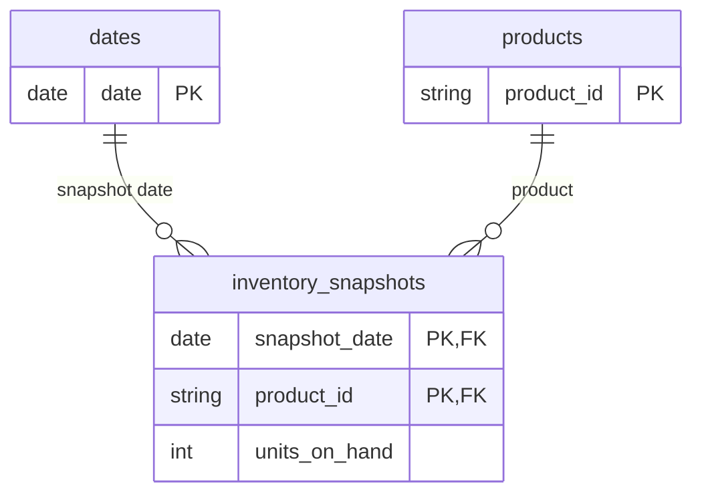

# Inventory snapshots for closing stock

[inventory_snapshots.csv](inventory_snapshots.csv) records stock on hand for four Nakheel products on eight Fridays, from 6 March to 24 April 2026. One row is one product at the close of one Friday. The file has **32 rows**, **4 products** and **8 dates**.

These are **course-made synthetic stock balances**, prepared on 11 November 2026. Opening balances and deliveries are invented teaching inputs. Units sold come from completed orders in the [D20 sales lines](../../Resources/start/sales_lines.csv). There is no external inventory source or live company data. A public reuse licence has not been selected.

| Column | Type | Meaning |
|---|---|---|
| snapshot_date | Date | Friday on which the balance was recorded |
| product_id | Text | Product key matching the D20 products table |
| units_on_hand | Whole number | Units held at the close of that Friday |

The primary key is **snapshot_date + product_id**. Each combination appears once. All units are nonnegative. Every Friday contains all four products, so their balances can be summed on the same date.

## How the tables connect

Relate `dates[date]` to `inventory_snapshots[snapshot_date]` and `products[product_id]` to `inventory_snapshots[product_id]`. Both relationships are active, one-to-many and Single from the dimension to the snapshot table. Do not relate the stock fact directly to sales_lines. Filters on the sales fact, such as completed status, do not propagate back to these dimensions with this direction.

## How the balances were made

The opening balances at 28 February are Fleece jacket (P-014) 40, Kids T-shirt (P-026) 70, Water bottle (P-059) 60 and Running shoe (P-002) 25 units. For each Saturday–Friday week, subtract units from completed sales lines and add any stated delivery:

| Delivery week ending | Product | Units received |
|---|---|---:|
| 13 March | P-026 | 40 |
| 20 March | P-059 | 40 |
| 3 April | P-002 | 30 |
| 10 April | P-014 | 30 |

This simplified teaching rule uses order dates as the stock-reduction dates. It does not model reservations, returns, stock transfers or real warehouse fulfilment.

## Check the monthly balances

| Period | Last snapshot | Closing units | Sum of all snapshots |
|---|---|---:|---:|
| March 2026 | 27 March | 137 | 580 |
| April 2026 | 24 April | 79 | 400 |

March’s four product balances are 34, 39, 46 and 18 units, summing to 137. Summing the four Fridays repeats balances from earlier dates. There is no record on 31 March or 30 April. This file supports **last recorded balance within the selected period**, rather than an assumed balance on every calendar day. A period with no snapshot returns blank. Missing product snapshots would need a separately defined carry-forward rule.
