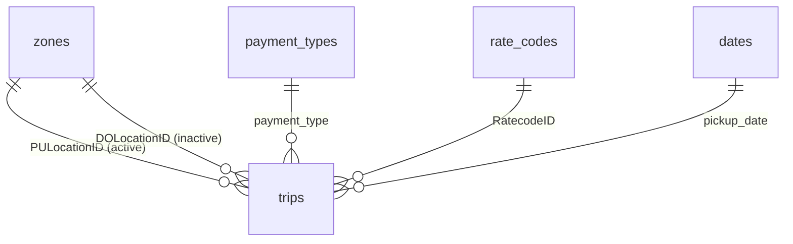

# Assignment 3: A Power BI dashboard of New York taxi trips, 2019–2020

**Modules 4–7, Power BI · 50% of the course grade · Released online Wednesday 18 November, briefed in class Monday 23 November · Due before 4:00 PM, Thursday 26 November**

## The owner's questions

You work for a company that runs a fleet of yellow taxis in New York City. The owner has the meter records for
2019 and 2020, published by the city's Taxi and Limousine Commission (TLC). She knows 2020 was a bad year. She does not know how bad, which months and places lost the
most trips, or whether the business had recovered by December.

She asks you for a **Power BI dashboard she can open herself**, and a **short story** that tells her what to remember.

When you finish, you will have a three-page report on real city data and a story you can tell in two minutes. You
can show both to an employer: D27 shows how to put them on GitHub.

| Her question | Where you answer it |
|---|---|
| A. How much did 2020 change our trips and revenue? | Page 1, Overview |
| B. Where do trips start and end, and which places lost the most? | Page 2, Places |
| C. What is the one thing I should remember, and what should I do? | Page 3, Story, and your PDF |

You get a **mockup** of each page: a drawing that shows where each visual goes, the question it answers and the fields
it uses (the same kind of drawing you sketched in D21 Activity 01). Your job is to build a working report that matches
it. The layout and the questions are fixed. Colours, theme, fonts, titles, tooltips and the small touches that make a
page easy to read are yours: that is where you show your own design.

## What you hand in

Two files, before **4:00 PM on Thursday 26 November**, through the link your TA shares in your group channel:

| File | What is in it |
|---|---|
| `A03_<FirstName>_<LastName>.pbix` | Your Power BI file with the three pages |
| `A03_<FirstName>_<LastName>.pdf` | Your slides saved as PDF: **the story** (3 to 5 slides) and **how I built it** (listed below). You can make the slides in PowerPoint, Google Slides or any tool that saves a PDF |

The "how I built it" slides. The marker opens your `.pbix` to see your model and measures, so with a `.pbix` you
make three slides: S1, S4 and S5. S2 and S3 are for the PDF-only route below.

| Slide | What is on it | Part | Who makes it |
|---|---|---|---|
| S1 Power Query | The **Applied steps** of `trips`, the row count after each of R1, R2 and R3, and your sentence from 1.6 | 1 | Everyone |
| S2 Model | The model diagram with all five relationship lines | 2 | PDF only |
| S3 Measures | Each measure's name and formula | 3 | PDF only |
| S4 Your design | Your own touch from Part 4, and why it helps; any chart you changed from the mockup, and why | 4 | Everyone |
| S5 Share | Your Part 6 screenshot or access plan | 6 | Everyone |

**If you work in the browser** and cannot download a `.pbix` file, hand in the PDF only. Then make all five slides,
and also show what a marker would open the file to see:

- On S1, the **Applied steps** of every query (`trips`, `zones`, `payment_types`, `rate_codes`, `dates`).
- On S2, also the settings from 2.3: `dates` marked as the date table, `month` sorted by `month_no`, the hidden keys.
- After S4, three slides P1, P2 and P3: one screenshot of each page, with the slicer and filter settings visible.

You can get full marks this way.

**Order your PDF:** the story slides, then S1 to S5 (with P1 to P3 after S4 if you have them), then one slide for each
bonus task you did, titled B1 to B7.

**Points:** the core tasks are worth 100 points. The bonus tasks are optional and give up to 10 extra points (your
total cannot go above 100). The rubric is in [`A03_rubric.md`](A03_rubric.md): read it before you start.

**How long:** about 7 to 8 hours: two full days, or four evenings. You have the whole week, so short sessions work
well. A plan that works:

| Session | Do | You are on track when |
|---|---|---|
| 1 | [D21 Activity 06](../../labs/D21/06-Evr-Four-Moves-For-A3/README.md) if you did not finish it in class, Before you start, then Part 1 | `trips` has 217,338 rows and 14 columns |
| 2 | Parts 2 and 3 | Your `Trips` card reads 48,791 for 2020 |
| 3 | Part 4, the three pages | Every row of "Check yourself (Part 4)" matches |
| 4 | Parts 5 and 6, then the PDF | Every slide is in your PDF; hand in both files |

**Help:** your TA can help you read an error message or find a button. They will not build a step for you. Your
measures may look like a classmate's: there is often one right formula. Your pages, your titles and your story must be
your own work.

**New steps.** Five steps are new in this assignment: counting rows without removing them (H1), a Top N filter (H2),
a second data label (H3), a single-select slicer (H4), and a page filter and a visual filter (H5). Each is marked
**(Help H1)** to **(Help H5)** where you meet it, and [Step-by-step help](#step-by-step-help-for-the-new-steps), after
Part 6, walks you through it. You practise H1 to H4, in the same order, on the Nakheel model in
[D21 Activity 06](../../labs/D21/06-Evr-Four-Moves-For-A3/README.md): do it first. Following new instructions on your
own is part of the job, and part of this assignment.

**What it trains for PL-300.** Every part is a skill the exam measures
([Microsoft's PL-300 study guide](https://learn.microsoft.com/en-us/credentials/certifications/resources/study-guides/pl-300),
skills as of 20 April 2026):

| Exam area | Weight | Where you practise it |
|---|---|---|
| Prepare the data | 25–30% | Part 1: profile the data, set types, remove bad rows, fill empty values |
| Model the data | 25–30% | Parts 2 and 3: a star model, a date table, an inactive relationship, `CALCULATE` and time intelligence |
| Visualize and analyze the data | 25–30% | Parts 4 and 5: slicers, interactions, Top N, conditional formatting, a story |
| Manage and secure Power BI | 15–20% | Part 6 and bonus B1: publish to a workspace, plan who sees what, a row-level security role |

## Words you will see

| Word | What it means here | Example |
|---|---|---|
| trip | One row of the trip file: one ride, from the moment the meter goes on until it goes off | A ride from Midtown to JFK |
| zone | One of 265 areas of the city the TLC uses, each with a number | 132 is JFK Airport |
| borough | One of the five parts of New York City | Manhattan, Queens, Brooklyn, Bronx, Staten Island |
| pickup, dropoff | Where the meter went on, and where it went off | `PULocationID`, `DOLocationID` |
| revenue | `total_amount` added up: what passengers were charged, in US dollars. Cash tips are not in it | 4,116,717.47 for both years |
| sample | A part of the data chosen by a fixed rule. Here: 1 trip in 500 | Real 2020 trips were about 500 times our number |
| Top N | A filter that keeps only the N largest items of a visual, by a measure you choose | The 10 zones with the most trips |
| Single select | A slicer setting that lets the reader choose only one item at a time | One year, never both |
| semantic model | The tables, relationships and measures behind a report. In the browser you edit it separately from the report | `trips`, `zones`, `dates` and the measures |
| YoY | Year on year: this period compared with the same period one year earlier | April 2020 against April 2019 |
| YTD | Year to date: added up from 1 January to the end of the period you look at | Revenue YTD in June = January to June |
| mockup | A drawing of a report page before it is built | The three pictures below |

## The data

Four CSV files in [`shared/datasets/nyc_taxi/`](../../../../shared/datasets/nyc_taxi/README.md). The dataset
README explains every column, the source and how the sample was taken. Read it first.

| File | Rows | One row is | Rename the query to |
|---|---:|---|---|
| [`yellow_trips_2019_2020_sample.csv`](../../../../shared/datasets/nyc_taxi/yellow_trips_2019_2020_sample.csv) (21 MB) | 217,911 | One trip | `trips` |
| [`taxi_zone_lookup.csv`](../../../../shared/datasets/nyc_taxi/taxi_zone_lookup.csv) | 265 | One zone | `zones` |
| [`payment_types.csv`](../../../../shared/datasets/nyc_taxi/payment_types.csv) | 7 | One way to pay | `payment_types` |
| [`rate_codes.csv`](../../../../shared/datasets/nyc_taxi/rate_codes.csv) | 7 | One fare rate | `rate_codes` |

How the tables connect (the date table is the one you add in Part 2):



The data is the TLC's, unchanged. It has real mistakes in it: trips dated 2009, trips that end before they start,
refunds with a negative total. The data only covers part of the story, too: cash tips are not recorded. You will
meet all of these.

## Before you start (about 20 minutes)

1. **Download the four files** above into one folder on your computer. On GitHub, open each file and select
   **Download raw file**.
2. **Choose your tool.** Power BI Desktop (Windows) is easier for this assignment. If you do not have Windows, use the
   browser route from D16 and D17: **+ New report → Get data**, upload `yellow_trips_2019_2020_sample.csv`, then
   **Open semantic model → Editing → Get data** to add the other three files.
   The steps with pictures: [D17 entry page](../../../04-power-query/labs/D17/README.md).
3. **Load the four files** and open **Transform data** (Power Query). Rename the four queries as in the table above.
4. **Check it.** `trips` has **217,911** rows and **18** columns. The preview's `999+ rows` is not the full count. To
   count every row: at the bottom left, change **Column profiling based on top 1000 rows** to **entire data set** (the browser
   already profiles the entire data set; profiling 217,911 rows can take a minute),
   turn on **View → Column profile** (browser: **View → Data view**), and select any column: **Count** in its column
   statistics is the number of rows. This is how you check every row count below. If your browser does not show the
   statistics, check the count after loading instead: put `tpep_pickup_datetime` in a card and set it to **Count**
   (in the Visualizations pane, select the arrow beside the field). Use that column because no trip has it empty.
   `VendorID` has empty values and would give 215,787.

> **Numbers look wrong?** If `fare_amount` shows 95 instead of 9.5, or the dates are errors, your computer's region
> reads the file differently. Select the column's type icon → **Using Locale…** → choose the type and
> **English (United States)**. D17 showed the same fix.

---

## Part 1. Clean the data in Power Query (20 points)

Each rule fixes one problem in `trips`. Apply them **in this order**, each as its own filter step, and check the row
count after each. (R2 needs three small steps: its hint below shows them.) To read a count again later, select that
step in **Applied steps**: the preview and the column statistics show the table as it was at that step.
On slide S1, show the **Applied steps** pane and the row count after each of R1, R2 and R3.

**1.1 Set the column types.** The two `tpep_` columns are **Date/Time**. `trip_distance` and every `_amount`,
`extra`, `mta_tax` and `_surcharge` column are **Decimal number**. The `ID` and `_type` columns and
`passenger_count` are **Whole number**. To set a type, select the icon at the left of the column name and choose it.
Power BI usually guesses the three small tables correctly (numbers as Whole number, names as Text): check them once.

**1.2 Three rules that remove rows.**

| Rule | Keep only the trips where … | Why | Rows left |
|---|---|---|---:|
| R1 | the pickup is **on or after** 1/1/2019 00:00 **and before** 1/1/2021 00:00 | A few meters sent wrong clock times (2009, 2015) | **217,908** |
| R2 | the dropoff is at or after the pickup | A trip cannot end before it starts | **217,868** |
| R3 | `total_amount` is 0 or more | Negative totals are refunds and cancelled charges, not rides | **217,338** |

> **How to filter R1.** Select the arrow on `tpep_pickup_datetime` → **Date/Time Filters → Custom Filter…**. First
> line: **is after or equal to** 1/1/2019 12:00 AM. Choose **And**. Second line: **is before** 1/1/2021 12:00 AM.
>
> **Careful with R1.** Use **is before** 1/1/2021, not "is before or equal to" 31/12/2020: Power Query reads that
> date as midnight at the start of 31 December and drops the 94 trips of the last day (217,814 rows instead of
> 217,908).
>
> **Hint for R2.** A filter compares a column with a value, not with another column. Add a custom column
> `= [tpep_dropoff_datetime] >= [tpep_pickup_datetime]`, filter it to `TRUE`, then remove it.
>
> **How to filter R3.** Select the arrow on `total_amount` → **Number Filters → Greater Than Or Equal To** → `0`.

**1.3 Fill two gaps.** After R1 to R3, 2,084 trips have an empty `payment_type` and an empty `RatecodeID`: the meter
sent no payment details. (Before the rules there are 2,124. R1 to R3 remove the other 40 with the bad rows.) Fill them:

1. Select `payment_type`, then **Transform → Replace Values**.
2. **Value To Find:** type the word `null`. **Replace With:** `5` (5 means Unknown). **OK**.
3. Do the same in `RatecodeID`, with `99` (99 means Unknown).

Now every trip finds its row in `payment_types` and `rate_codes`. The same 2,084 trips also have no
`passenger_count`: leave that column empty.

**1.4 Add a pickup date column for the relationship.** Select `tpep_pickup_datetime`, then **Add Column → Date →
Date Only**. (Or use **Add Column → Custom Column** with `= DateTime.Date([tpep_pickup_datetime])`.) The new column is
called `Date`: rename it `pickup_date` and check that its type is **Date**.
Why: `dates[date]` holds dates with no time. `tpep_pickup_datetime` holds 1 January 2019 00:04:06, which never equals
1 January 2019, so a relationship on it would match almost nothing. `pickup_date` holds 1 January 2019 and matches.

**1.5 Remove what the report does not use.** Remove `VendorID`, `store_and_fwd_flag`, `extra`, `mta_tax` and
`improvement_surcharge` (select the five with Ctrl+click, then **Home → Remove Columns**). `trips` now has **14**
columns.

**1.6 Count three kinds of odd rows, and keep them.** Some odd rows are real trips, and removing them would hide something true. Count them and
keep them (Help H1 shows how): trips of 0 miles (**2,081**), trips with 0 passengers (**4,006**), pickups in the two
`Unknown` zones (**2,139**). In one sentence on slide S1: *why might a real trip show 0 miles?*

### Check yourself (Part 1)

| After | `trips` rows | Something else to check |
|---|---:|---|
| 1.2 | 217,338 | The first trip is on 1 January 2019 at 00:04:06 |
| 1.3 | 217,338 | `payment_type` and `RatecodeID` have 0 empty values (column quality) |
| 1.5 | 217,338 | 14 columns |

---

## Part 2. Build the model (15 points)

**2.1 A date table.** Make a table `dates` with one row for every day from 1 January 2019 to 31 December 2020:
**731 rows** (2020 has 29 February). In Power Query: **New Source → Blank Query**,
`= List.Dates(#date(2019, 1, 1), 731, #duration(1, 0, 0, 0))`, **To Table**, name the column `date`, type **Date**.
Select `date`, then **Add Column → Date → Year → Year**, **Month → Month** and **Month → Name of Month**, and
rename the three new columns `year`, `month_no` and `month`. This is D18 Activity 02 with new dates.
If the month names come out in Arabic (a computer set to an Arabic region does this), delete the **Inserted Month Name** step in
**Applied steps** and make `month` with **Add Column → Custom Column** instead: `= Date.MonthName([date], "en-US")`, type **Text**. In the browser,
a blank query is **Get data → Blank query** in the Power Query editor.

**2.2 Load the tables, then relate them.** In Desktop select **Close & Apply**; in the browser select **Save** (D17
entry page). In Model view, make these relationships. Each is **many to one**, with a
**single** filter direction, from `trips` (many) to the lookup table (one). Desktop may already have drawn some of
these lines for you, because some column names match: check each line against the list below, keep it if it
matches, and delete any line that is not in the list.

| From `trips` | To | Active? |
|---|---|---|
| `pickup_date` | `dates[date]` | Yes |
| `PULocationID` | `zones[LocationID]` | Yes |
| `DOLocationID` | `zones[LocationID]` | **No** (dashed line; Power BI allows only one active path between two tables) |
| `payment_type` | `payment_types[payment_type]` | Yes |
| `RatecodeID` | `rate_codes[RatecodeID]` | Yes |

> **Use `pickup_date`, not `tpep_pickup_datetime`.** If Model view offers you `tpep_pickup_datetime`, go back to 1.4:
> a date-and-time column cannot join a date table.

**2.3 Tidy it.** Mark `dates` as the date table (column `date`). Sort `month` by `month_no`. Hide the key columns in
`trips` (the five above), so nobody drags a zone number into a chart by mistake.

Arrange Model view so all five lines are visible. If you hand in the PDF only, put the diagram on slide S2.

---

## Part 3. Write the measures (20 points)

Make each measure in `trips` (or in a measures table, if you like). For each, write the formula yourself. Where the
idea is new, the starter shows the shape with blanks `___`. Then check it against the numbers below with a card or a
table. Set each measure's format when you make it (**Measure tools → Format**): counts with no decimals, money with
two, percentages with one. If you hand in the PDF only, list each measure's name and formula on slide S3.

| Measure | What it gives | Taught in |
|---|---|---|
| `Trips` | The number of trips: `COUNTROWS(trips)` | D19 |
| `Revenue` | The sum of `total_amount` | D19 |
| `Average per Trip` | Revenue divided by trips, with `DIVIDE` | D19 |
| `Trips LY` | Trips in the same period one year earlier: `CALCULATE` with `SAMEPERIODLASTYEAR(dates[date])` | D20 |
| `Trips YoY %` | `DIVIDE([Trips] - [Trips LY], [Trips LY])`, formatted as a percentage | D20 |
| `Revenue YTD` | Revenue from 1 January to the end of the period: `TOTALYTD` | D20 |
| `% of Trips` | This row's trips as a share of all zones: `DIVIDE([Trips], CALCULATE([Trips], REMOVEFILTERS(zones)))` | D19 |
| `Dropoff Trips` | Trips counted by **where they end**, using the inactive relationship | D18 |
| `Card Tip %` | Tips as a share of fares, for card payments only | D19 |

The two new ones:

```text
Dropoff Trips =
CALCULATE ( [Trips], USERELATIONSHIP ( trips[___], zones[LocationID] ) )

Card Tip % =
CALCULATE (
    DIVIDE ( SUM ( trips[tip_amount] ), SUM ( trips[___] ) ),
    payment_types[payment_name] = "___"
)
```

For `Card Tip %`, compare the tips with `fare_amount`, the meter fare (`total_amount` already includes the tip).
Type the payment name exactly as `payment_types.csv` writes it for code 1: a different spelling gives a blank card.

> **Why only card payments for tips?** The TLC records a tip only when it is paid by card. Cash tips are never in the
> data, so a "tip %" over all trips would mix real tips with zeros that are not really zeros.

### Check yourself (Part 3)

| Measure | Check (no filter, unless the row says one) |
|---|---|
| `Trips` | 217,338 · 2019: 168,547 · 2020: 48,791 |
| `Revenue` | 4,116,717.47 · 2020: 898,025.57 |
| `Average per Trip` | 2019: 19.10 · 2020: 18.41 |
| `Trips LY` | 2020: 168,547 (the 2019 trips) · 2019: blank |
| `Trips YoY %` | 2020: −71.1% · April 2020: −96.6% |
| `Revenue YTD` | June 2020: 623,273.42 · December 2020: 898,025.57 |
| `% of Trips` | Manhattan pickups: 90.9% |
| `Dropoff Trips` | Manhattan: 192,089 (against 197,459 Manhattan pickups) |
| `Card Tip %` | 2019: 22.6% · 2020: 23.4% |

If a number is different, check your Part 1 rules first, then the relationship the measure uses.

---

## Part 4. Build the three pages (30 points)

Build each page to match its mockup. Each box is labelled: **box type · the question it answers** (box types are
Card, Trend, Breakdown, Detail and Evidence), then the visual and the fields. The small charts inside the boxes show
the kind of visual only: they are not drawn to scale. "Card" is a card visual; "text box" is **Insert → Text box**.


What "matching" means:

- **Every box is there**, in about the same place, with the visual and the fields the mockup names.
- **It works.** The slicers filter the page.
  - Set the year slicers on pages 1 and 2 to **Single select** (Help H4), so one year is always chosen: with no year
    chosen, `Trips YoY %` compares both years with 2019 alone and shows +28.9%, which means nothing. The borough
    slicer stays a dropdown where the reader can choose several boroughs.
  - **Page 1:** the tip chart compares the two years, so the year slicer must not filter it. Select the year slicer,
    then **Format → Edit interactions**, and select the **None** icon (a circle with a line through it) above the tip
    chart (D21 Activity 02). Select **Edit interactions** again to finish.
  - **Page 2:** the airport chart compares the two years too. Do the same for the year slicer and for the borough
    slicer above the airport chart (the airports are in Queens and Newark, so a borough filter hides some or all of
    them). The chart shows `Trips`. Keep only the three airports with a visual filter (Help H5).
  - **Page 2:** both Top 10 visuals use a **Top N** filter in the Filters pane (Help H2), and the borough bar chart
    shows `% of Trips` as a second data label (Help H3).
  - **Page 2:** the table colours `Trips YoY %` with conditional formatting: in the Visualizations pane, open the arrow
    on `Trips YoY %` in **Columns** → **Conditional formatting → Background color**, then the gradient from
    [D20 Lab 04, Step 5](../../labs/D20/04-Lab-Overview-Page/README.md#5-colour-the-yoy--column).
  - **Page 2:** the dropoff chart uses the dropoff relationship, so the borough slicer filters it by where trips
    **end**. The table and the borough chart are filtered by where trips start. The airport chart is not filtered by the
    borough slicer at all.
- **It reads well.** Each visual's title says what it shows. Bars are sorted, largest first, except in two places.
  Where months are on the axis, select **More options (…) → Sort axis → month**, then **Sort ascending**, so January
  comes first. On page 3, the biggest loss goes on top (see below). Numbers use the formats you set in Part 3 (not
  "217338.00").
  On each card, set **Format visual → Visual → Callout value → Display units** to **None**, so it reads 48,791 and
  not 48.79K. **Every page** says that the data is **1 trip in 500**.
- **Your own touch.** Choose a theme and colours that help the reader (for example, one colour for 2020 used on every
  page). Add at least one thing the mockup does not ask for: a tooltip, a reference line, a better title, or
  conditional formatting on a visual where the mockup does not already ask for it. Name it on slide S4,
  with one sentence on why it helps.

**Page 3 is your finding**, not a copy of page 1. Its title is one sentence with a number, the way D23's story page said
*"Austin's bikes follow the school calendar first and the heat second."* The page shows 2020: add a page filter
`dates[year]` is 2020 in the Filters pane (Help H5), so `Trips YoY %` always compares 2020 with 2019. For Evidence 2, choose the
places that prove your point best: boroughs, or zones. With zones, keep only big ones (a Top N filter, Top 10 by
`Trips LY`, Help H2): a zone with 3 trips in 2019 and 0 in 2020 shows −100% and tells the reader nothing. With
boroughs, leave out Unknown, EWR and Staten Island (Filters pane, untick them): the sample has too few of their trips
to say anything (Staten Island has 8 in each year). Sort the chart by `Trips YoY %`, **ascending**, so the place that
lost the most is on top.

### Check yourself (Part 4)

| Page | With this filter | You should see |
|---|---|---|
| 1 | Year 2020 | Trips 48,791 · Trips YoY % −71.1% · Credit card 34,667 trips |
| 1 | Year 2020 | The Revenue YTD columns rise from January to December and end at 898,025.57 |
| 1 | Year 2019 | The Trips LY line and the Trips YoY % card are empty (there is no 2018 in the data) |
| 2 | Year 2020, borough slicer cleared | Upper East Side South first in the table, 2,236 trips, −68.6% |
| 2 | Year 2020, borough slicer cleared | Upper East Side North first in the dropoff chart, 2,238 trips |
| 2 | Any year | The airport chart still shows both years: JFK Airport 1,147 pickups in 2020, 5,379 in 2019 |

---

## Part 5. The story (10 points)

Make **3 to 5 slides** for the owner. She will read them on her phone, so keep each slide to one idea:

1. **The finding.** One sentence with a number, as the title of the first slide.
2. **The evidence.** One or two slides, each with a screenshot of a visual from your report and one sentence that
   says what to see in it.
3. **What to do.** One recommendation she can act on, and one thing to check before she does. Say that the numbers
   come from a sample of 1 trip in 500, and what that means for the totals.

> **A strong title:** "Trips fell X% in 2020, and by December they were still Y% below 2019."
> **A weak title:** "Trips analysis 2019–2020."

## Part 6. Share it (5 points)

Choose **one** route. Both get the same marks.

| Route | What to do | What goes on your slide |
|---|---|---|
| **A. Publish** (any free Power BI account) | **Publish → My workspace** (D22 Activity 01). Open the report in the browser. If you built it in the browser, it is already in My workspace: open it from there | A screenshot of the report open in the browser, with the address bar showing |
| **B. Plan it** (no Service access, or publishing fails) | Write a short access plan, as in D22 Lab 04 | Three lines: who should see the report, who should not see what, and how often the data would be refreshed if it came from the TLC each month |

Do not use **Publish to web**: it makes the report public to anyone on the internet.

---

## Step-by-step help for the new steps

Each guide below is short: follow the steps in order and check the result before you go on. You practised H1 to H4 on the
Nakheel model in [D21 Activity 06](../../labs/D21/06-Evr-Four-Moves-For-A3/README.md). Power BI's menus move a little
between versions: if a name differs, look for the nearest match in the same place.

### H1. Count rows without removing them (Part 1.6)

1. Turn on column profiling for the **entire data set** (Before you start, step 4; the browser does this already).
2. Select `trip_distance`. In **Column statistics**, the **Zero** line is the number of 0-mile trips: **2,081**.
3. Select `passenger_count`. Its **Zero** line is **4,006** (the empty ones are counted separately, as **Empty**).
4. For the Unknown zones (264 and 265): select the arrow on `PULocationID` → **Number Filters → Greater Than Or Equal
   To** → `264` → **OK**. Select any column: **Count** is **2,139**.
5. In **Applied steps**, select the **X** beside the filter step you just made, to delete it. Check that `trips` is
   back to **217,338** rows.

**In the browser, without column statistics:** count after Part 3 instead. Put a `Trips` card on a page. In the
Filters pane, drag `trip_distance` into **Filters on this visual**, choose **Advanced filtering → is → 0**, and
**Apply filter**: the card reads 2,081. Remove that filter (the **X** on its filter card), then do the same with `passenger_count` (4,006).
Remove it again, and do the same with `zones[Borough]` is `Unknown` (**Basic filtering**, 2,139). Then delete the card.

### H2. Keep only the Top 10 (a Top N filter)

1. Select the visual: the table on page 2, the dropoff chart on page 2, or the zones chart on page 3.
2. Open the **Filters** pane. Under **Filters on this visual**, expand `Zone`.
3. Set **Filter type** to **Top N**. Set **Show items** to **Top** and type **10**.
4. Drag the measure that decides the ranking into **By value**: `Trips` for the page 2 table, `Dropoff Trips` for the
   dropoff chart, `Trips LY` for page 3.
5. Select **Apply filter**. Then sort the visual. On page 2, sort by the same measure, largest first (select the
   column header in a table, or **More options (…) → Sort axis** in a chart). On page 3, sort by `Trips YoY %`,
   **ascending**, so the biggest loss is on top.

Check: page 2 with year 2020 shows 10 zones, with Upper East Side South first (2,236 trips).

### H3. Show a second number on each bar (page 2, borough chart)

1. Format `% of Trips` as a percentage with one decimal: select the measure, then **Measure tools → Format →
   Percentage**, and set the decimals to 1.
2. Select the borough bar chart (Y-axis `Borough`, X-axis `Trips`).
3. **Format visual** (the paintbrush) **→ Visual → Data labels**: turn it on.
4. Inside **Data labels**, expand **Detail**, turn it on, and choose `% of Trips` as its data.

Check: with 2020 chosen and no borough, the Manhattan bar shows **44,524** trips and, under them, **91.3%** (2019:
152,935 and 90.7%). If your version
has no **Detail** setting, put `% of Trips` in the chart's **Tooltips** box instead, and say so on slide S4.

### H4. Make the year slicers single select (Part 4)

1. Select a year slicer (page 1, then page 2). Open **Format visual** (the paintbrush) → **Visual** → **Slicer settings**.
2. Under **Options**, set **Style** to **Tile**. (The borough slicer on page 2 is a **Dropdown**; leave it multi-select.)
3. Under **Selection**, turn on **Single select**.
4. Select **2020** on the slicer before you save, so the page opens on a year.

Check: on page 1 you can choose 2019 or 2020, never both, and the `Trips YoY %` card never reads +28.9%.

### H5. Filter a whole page, or one visual

**A page (page 3):** select an empty part of the canvas, so no visual is selected. In the Filters pane, drag
`dates[year]` into **Filters on this page**, choose **Basic filtering** and tick **2020**. Check: every visual on the
page now shows 2020, and the Trips YoY % chart has twelve columns, all below zero.

**One visual (page 2, airport chart):** select the chart, drag `zones[service_zone]` into **Filters on this visual**,
and tick both **Airports** and **EWR**. Check: three zones, JFK Airport, LaGuardia Airport and Newark Airport.

---

## Bonus tasks (optional, up to 10 extra points)

There are seven. Each is worth 2 points, and we count your best five (up to 10). Do them only after the core tasks,
and add one slide for each to the end of your PDF.
A bonus task that is partly done gets 1 point.

- **B1. A role that shows only Manhattan pickups.** Make a role `Manhattan pickups` on `zones[Borough]` (D22 Activity
  02). Add a new page with one `Trips` card and no year filter, and show **View as** with the role: the card reads
  197,459. (On page 1 with 2020 chosen it reads 44,524.) Then look at the Dropoff Trips chart under the role. What do you see? Read the remarks on Microsoft's
  [USERELATIONSHIP page](https://learn.microsoft.com/en-us/dax/userelationship-function-dax) and explain it.
- **B2. Drillthrough.** Add a page `Zone detail` that a reader reaches by right-clicking a zone (D21 Activity 03).
  Show trips by month and payment types for that zone.
- **B3. A tooltip page.** Make a small tooltip page that shows Trips, Trips LY and Card Tip % when the reader hovers
  over a borough (D21 Activity 03).
- **B4. Bookmarks.** Add two buttons on page 1 that switch the trend chart between Trips and Revenue (D21 Activity 04). The Revenue view can show Revenue alone, or
  Revenue and Revenue LY if you do B7.
- **B5. A visual calculation.** In the page 1 trend chart, add a running total of Trips with a visual calculation
  (D21 Activity 04). How is it different from Revenue YTD?
- **B6. Trip length in minutes.** Add `trip_minutes` in Power Query with **Add Column → Custom Column**:
  `= Duration.TotalMinutes([tpep_dropoff_datetime] - [tpep_pickup_datetime])`, type Decimal number. (The
  **Duration → Minutes** button gives only the minutes part, 0 to 59, so use the formula.) Then make a histogram
  with bins (D20 Lab 05). How many trips last more than 3 hours (516)? What is the longest? What do you think happened
  on those trips, and would you keep them?
- **B7. Revenue against trips.** Add `Revenue LY` and `Revenue YoY %`, the same way as `Trips LY` and `Trips YoY %`.
  In 2020 revenue fell a little more than trips: −72.1% against −71.1%.
  Which measure from Part 3 explains why?

---

## If you missed a class, start here

| You need | Where we did it | Read or redo |
|---|---|---|
| Load CSV files, the browser route, change types | D16, D17 | [D16 first clean](../../../04-power-query/labs/D16/11-Lab-Power-Query-First-Clean/README.md), [D17 entry page](../../../04-power-query/labs/D17/README.md) |
| Filter rows, replace values, custom columns, locale | D17 | [D17 split, reference, errors](../../../04-power-query/labs/D17/04-Evr-Split-Reference-Errors/README.md), [D17 import errors](../../../04-power-query/labs/D17/10-Lab-Import-Errors/README.md) |
| The date table, sort by column, mark as date table | D18 | [D18 date table](../../../05-data-modeling-and-dax/labs/D18/02-Evr-Date-Table/README.md) |
| Relationships, and an inactive one with `USERELATIONSHIP` | D18 | [D18 relationships](../../../05-data-modeling-and-dax/labs/D18/03-Evr-Relationships-And-Questions/README.md), [D18 two dates](../../../05-data-modeling-and-dax/labs/D18/04-Lab-Two-Dates-Tidy-Model/README.md) |
| Measures, `DIVIDE`, `CALCULATE`, share of total | D19 | [D19 base measures](../../../05-data-modeling-and-dax/labs/D19/02-Evr-Base-Measures/README.md), [D19 CALCULATE](../../../05-data-modeling-and-dax/labs/D19/03-Evr-Filter-Context-And-Calculate/README.md), [D19 percent of total](../../../05-data-modeling-and-dax/labs/D19/04-Lab-Percent-Of-Total/README.md) |
| `TOTALYTD`, `SAMEPERIODLASTYEAR`, YoY % | D20 | [D20 time intelligence](../../../05-data-modeling-and-dax/labs/D20/02-Evr-Time-Intelligence/README.md) |
| A first report page, cards, sorting, formatting | D20 | [D20 overview page](../../labs/D20/04-Lab-Overview-Page/README.md) |
| Mockups, slicers, edit interactions, drillthrough, tooltips, bookmarks, visual calculations | D21 | [D21 labs](../../labs/D21/README.md) |
| Count rows and keep them, Top N, a second data label, single select | D21 | [D21 Activity 06](../../labs/D21/06-Evr-Four-Moves-For-A3/README.md) |
| Publish, roles, an access plan | D22 | [D22 labs](../../../07-power-bi-service/labs/D22/README.md) |
| A story page with the finding as its title | D23 | [D23 story page](../../../07-power-bi-service/labs/D23/05-Evr-Story-Page-And-Publish/README.md) |

## Reading for Parts 4 and 5

| Read | Why |
|---|---|
| [TLC trip record user guide and data dictionary](https://www.nyc.gov/site/tlc/about/tlc-trip-record-data.page) (NYC TLC) | What each column means, from the people who publish the data |
| [Tips for designing a great Power BI dashboard](https://learn.microsoft.com/en-us/power-bi/create-reports/service-dashboards-design-tips) (Microsoft) | Why the mockups put the cards top left: readers start there and move to the detail |
| [Design Power BI reports for accessibility](https://learn.microsoft.com/en-us/power-bi/create-reports/desktop-accessibility-creating-reports) (Microsoft), the checklist at the end | Titles without jargon, colours with enough contrast, alt text: a page every reader can use |

## References

Data: NYC Taxi and Limousine Commission, TLC Trip Record Data (yellow taxi, 2019–2020) and Taxi Zone Lookup Table,
through NYC Open Data. A fixed sample of 1 trip in 500, taken 15 November 2026. Details in the
[dataset README](../../../../shared/datasets/nyc_taxi/README.md).
