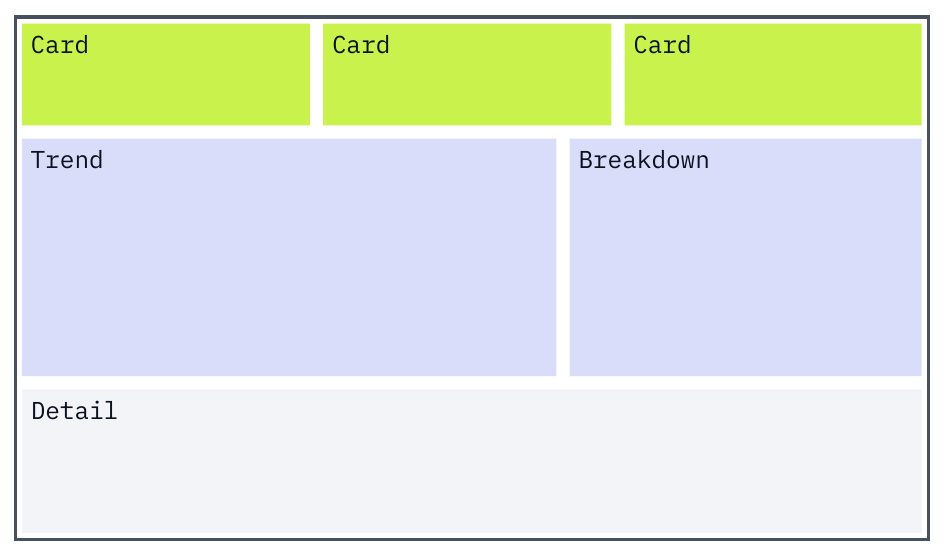

# Activity 01 · Sketch a mockup of the channel page

A store manager asks: **how are the two channels doing this year, and which categories drive them?** Before you open Power BI, you plan the page on paper. A mockup is a rough drawing of the page: boxes for each visual, in the place they will go, each labelled with the question it answers. Moving a box on paper takes a second. Moving five built visuals, with their filters and formatting, takes much longer.

You will need paper and a pen, or a blank PowerPoint slide.

## 1. Write the question and the reader at the top

**Why this step.** Every visual on the page must help answer one question for one reader. If you cannot say the question, you cannot decide what to leave out.

Write one line at the top of the page: the reader (store manager), the question, and how long they have to read the page (about one minute).

**C1.** Your line names the reader and the question in one sentence.

## 2. Draw the zones

**Why this step.** Readers scan a page from the top left, across, then down. The numbers the reader needs first go where the eye starts.

Draw a 16:9 rectangle. Inside it, draw five zones:

- **three cards** along the top (revenue, orders, average order value);
- a **trend** in the middle left (revenue by month);
- a **breakdown** in the middle right (revenue by category);
- a **detail** zone along the bottom (products, or months by category);
- a small **slicer** for channel, at the top or the left edge.

Compare with the sample below. Yours does not need to match it.

**C2.** Your page has five zones and the cards are along the top.

## 3. Label each zone with its question, visual and field

**Why this step.** A label turns a box into a plan you can build from. A zone whose question you cannot write is a visual you can drop.

Beside each zone, write three things: the question it answers, the visual type and the field. For example: *Breakdown · Which categories drive revenue? · bar chart, sorted · products[category]*.

**C3.** All five zones have a question, a visual and a field. Keep the sketch: you build from it in Activities 02–04 and in Assignment 3.

**What just happened.** You decided what the page shows before you built anything. In the class demo, the same five visuals placed without a plan made the reader hunt for the numbers. Placed on this grid, they read in order.
