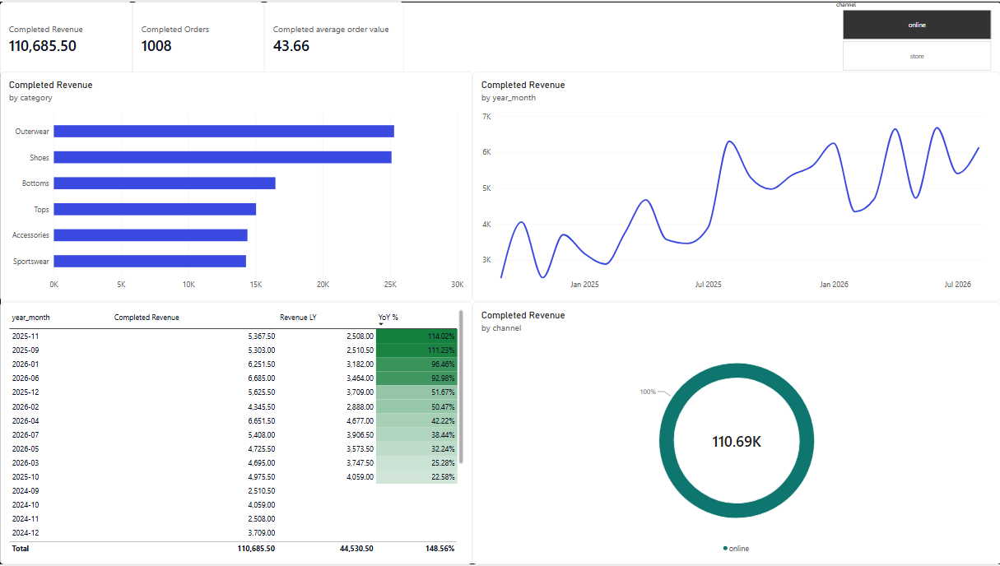
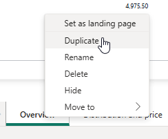
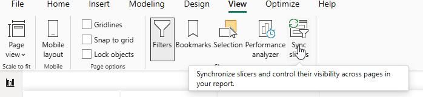
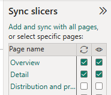
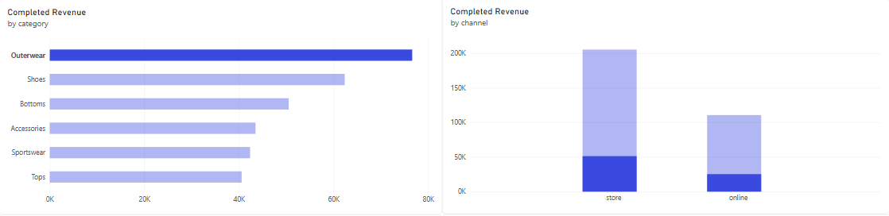
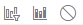

# Activity 02 · A channel slicer on two pages, and how visuals react to a click

**The ask.** The manager wants to switch the whole report between the **store** and **online** channels without opening the Filters pane. They also want to click a category and see what happens to the other charts. You will:

1. add a **slicer** for channel,
2. make it control **two pages** at once (**sync slicers**),
3. see what a click on one chart does to another (**interactions**), and change it.

**Start from** the overview page you built in [D20 Lab 04](../../D20/04-Lab-Overview-Page/README.md), or the file described on the [D21 entry page](../README.md). A card with Completed Revenue shows **316,023.50**.

| Step | What you do | Check |
|---|---|---|
| 1 | Add a channel slicer | online 110,685.50 · store 205,338.00 |
| 2 | Sync it to a second page | The second page also shows 110,685.50 |
| 3 | Click a category and read the highlight | Outerwear 51,321.50 store · 25,315.50 online |
| 4 | Change the click to filter, then to none | The channel columns change, then stay fixed |

## 1. Add a channel slicer

**What and why.** A **slicer** is a filter that sits on the page, where the reader can see and change it. The Filters pane can do the same job, but most readers never open it. A slicer makes the choice visible: "you are looking at online".

**How.**

1. Open the **Overview** page and click an empty part of the canvas.

2. In the **Visualizations** pane, choose **Slicer**. Drag `sales_lines[channel]` into its **Field** well.

3. With the slicer selected, open **Format visual → Visual → Slicer settings → Options** and set **Style** to **Tile**. The two channels now show as two buttons.

4. Click **online**.

   

**C1.** The Completed Revenue card shows **110,685.50**. Click **store**: **205,338.00**. The two add up to 316,023.50. Click the selected button again to clear it.

## 2. Sync the slicer to a second page

**What and why.** Each page keeps its own filters. If a reader picks **online** on one page and moves to another, the second page still shows **all** channels, and the reader may not notice. **Sync slicers** links one slicer's choice to other pages, so the choice follows the reader.

**How.**

1. Right-click the **Overview** page tab → **Duplicate page**. Rename the copy **Detail** (double-click its tab).

   

2. On **Detail**, select the copied slicer and delete it. You want the choice to come from Overview, not a second slicer.

3. Go back to **Overview** and select the slicer.

4. Open **View → Sync slicers**. A pane lists every page with two tick boxes:
   - **Sync** (the arrows icon): this page follows the slicer's choice.

   - **Visible** (the eye icon): the slicer is shown on this page.

     

5. Tick **Sync** for **Overview** and **Detail**. Leave **Visible** ticked for Overview only.

   

6. Select **online** on Overview, then open **Detail**.

**C2.** The card on **Detail** shows **110,685.50**, although Detail has no slicer. Before you synced, it showed 316,023.50.

**On the web.** Recent versions have the **Sync slicers** pane under **View**. If yours does not, add `sales_lines[channel]` to **Filters on all pages** instead, and note that the reader must open the Filters pane to change it.

## 3. Read the default interaction: highlight

**What and why.** Power BI connects the visuals on a page. When you **click** a bar, the other visuals react to it. For most charts the default reaction is **highlight**: the other chart keeps its full bars and shades the part that belongs to what you clicked, so you see it as a **share** of the whole.

**How.**

1. On **Overview**, clear the slicer so both channels are shown.

2. Add a **Clustered column chart** with `sales_lines[channel]` on the **X-axis** and **Completed Revenue** on the **Y-axis**.

3. In the category **bar chart** from Lab 04, click the **Outerwear** bar.

4. Hover the shaded part of each channel column.

   

**C3.** Both channel columns keep their full height (205,338.00 and 110,685.50). A darker part shows Outerwear inside each: **51,321.50** in store and **25,315.50** online. Your donut from Lab 04 reacts too.

Click Outerwear again to clear the selection.

## 4. Change the interaction to filter, then to none

**What and why.** Sometimes the reader wants to see **only** the clicked category, not its share. Sometimes a chart should **ignore** clicks altogether, for example a total that must never change. **Edit interactions** sets the reaction for each pair of visuals. It has three choices:

| Icon | Name | What the other visual does when you click |
|---|---|---|
| Funnel | **Filter** | Shows only the clicked part |
| Bar with a shaded part | **Highlight** | Keeps the whole, shades the part (the default) |
| Circle with a line through it | **None** | Ignores the click |

**How.**

1. Select the **category bar chart** (the visual you will click).
2. Open the **Format** ribbon and choose **Edit interactions**. Small icons appear at the top of every other visual on the page.
3. On the **channel column chart**, click the **filter** icon (the funnel).
4. Choose **Edit interactions** again to turn it off.
5. Click **Outerwear** in the bar chart.

**C4.** The channel columns now show only Outerwear: **51,321.50** and **25,315.50**, and the axis rescales to fit them.

6. Turn **Edit interactions** on again, choose the **none** icon on the channel column chart, turn it off, and click Outerwear once more. The columns stay at **205,338.00** and **110,685.50**, whatever you click.

**What just happened.** A click on one visual sends a filter to the others. **Highlight** keeps the total and shades the part, **filter** keeps only the part, and **none** ignores the click. You set which one each visual receives, one pair at a time.

[Microsoft: slicers](https://learn.microsoft.com/en-us/power-bi/visuals/power-bi-visualization-slicers) · [Microsoft: sync slicers](https://learn.microsoft.com/en-us/power-bi/visuals/power-bi-visualization-slicers#sync-and-use-slicers-on-other-pages) · [Microsoft: visual interactions](https://learn.microsoft.com/en-us/power-bi/create-reports/service-reports-visual-interactions)
