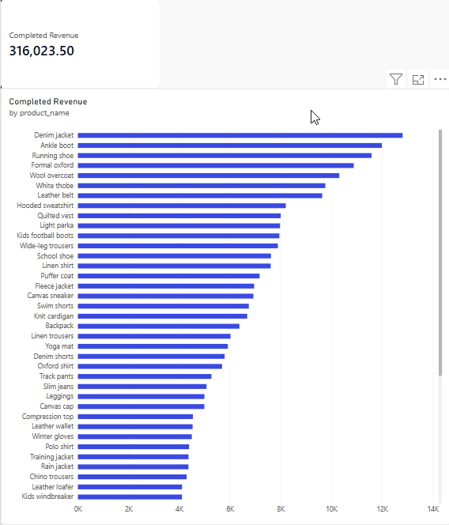
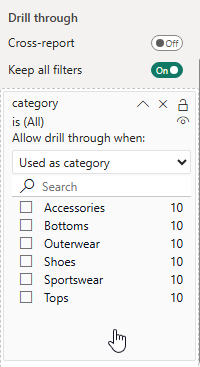
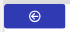
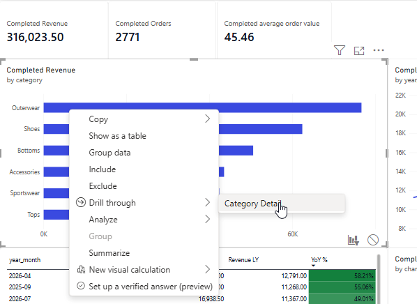
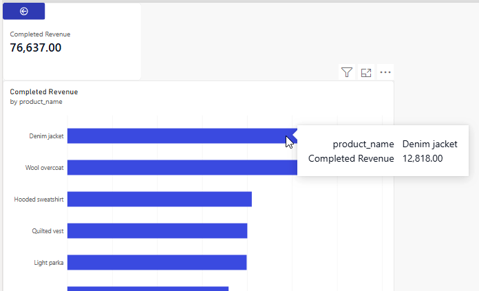
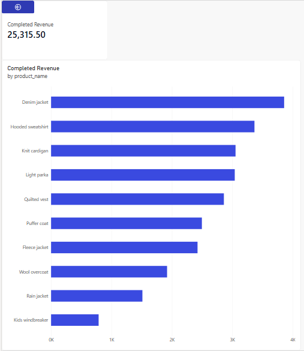
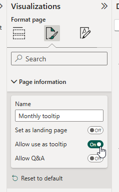
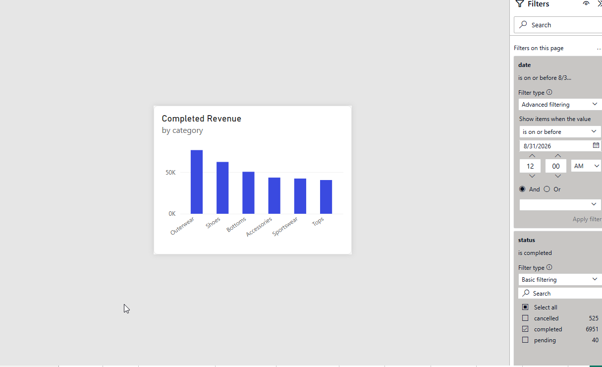
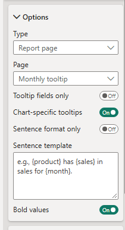
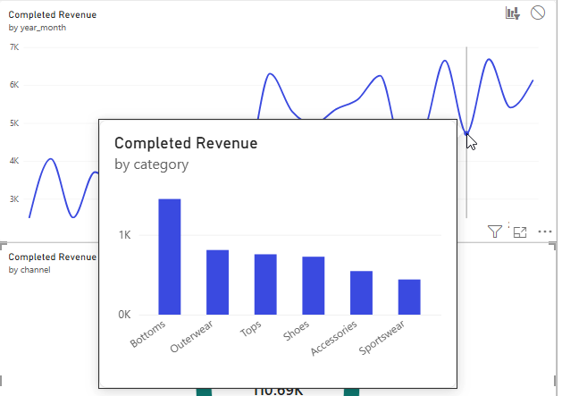

# Activity 03 · An Outerwear detail page and a tooltip page

**The ask.** On the overview, Outerwear is the top category. The manager asks: **"Which Outerwear products sell the most?"** The overview cannot answer that without getting crowded. You will give the manager two ways to see more detail without cluttering the overview:

1. **Drillthrough**: right-click a category, jump to a full page about that category, and come back.
2. **A report-page tooltip**: hover over a month on the line chart, and a small chart pops up with that month's categories.

**Start from** your file after [Activity 02](../02-Evr-Slicers-Sync-Interactions/README.md). Clear the channel slicer before you begin.

| Step | What you do | Check |
|---|---|---|
| 1 | Build a category detail page | The card shows 316,023.50 for now |
| 2 | Turn it into a drillthrough page and use it | Outerwear 76,637.00; Denim jacket first |
| 3 | Build a tooltip page for the monthly line | April's tooltip shows Outerwear 5,068.50 |

## 1. Build the detail page

**What and why.** A detail page answers a narrower question than the overview: "what is inside **one** category?" You build it once, and it will work for whichever category the reader picks in Step 2.

**How.**

1. Add a new page (the **+** next to the page tabs) and rename it **Category detail**.

2. Add the two page filters used on every page today: `sales_lines[status]` = **completed**, and `dates[date]` on or before **31 August 2026**.

3. Add a **Card** with **Completed Revenue**.

4. Add a **Clustered bar chart** with `products[product_name]` on the **Y-axis** and **Completed Revenue** on the **X-axis**. Sort it by revenue, largest first (**…** → **Sort axis** → **Completed Revenue**, **Sort descending**).

   

**C1.** The card shows **316,023.50**. Right now the page shows **every** category, because nothing has told it which one to show. Step 2 fixes that.

## 2. Turn it into a drillthrough page

**What and why.** Dropping a field into the page's **Drill through** well tells Power BI two things:

- this page shows **one value** of that field at a time, and
- every visual that uses that field can **jump here**, carrying the value the reader right-clicked.

**How.**

1. Stay on **Category detail** and click an empty part of the canvas, so no visual is selected.

2. In the **Visualizations** pane (the **Build visual** tab), scroll to the bottom to find the **Drill through** section.

   

3. Drag `products[category]` into **Add drill-through fields here**. Power BI adds a **back arrow** button at the top left of the page.

   

4. Go to the **Overview** page. **Right-click** the **Outerwear** bar → **Drill through** → **Category detail**.

   

**C2.** You land on Category detail. The card shows **76,637.00**. The top product is **Denim jacket** at **12,818.00**, then Wool overcoat at 10,320.00.

5. To return, **Ctrl+click** the back arrow in Desktop (a plain click works in the Power BI service; in Desktop a plain click only selects the button while you edit).

**The slicer travels too.** Under the Drill through well, **Keep all filters** is on by default. So any filter on the overview, including the channel slicer, comes along. Try it:

6. On Overview, select **online** in the slicer, then drill through on Outerwear again.

   

**Check.** The card now shows **25,315.50**: Outerwear sold online. Clear the slicer when you finish.

## 3. Build a tooltip page for the monthly line

**What and why.** A normal tooltip shows the numbers under your mouse. A **report-page tooltip** shows a small **page** you design instead, filtered to the point you are hovering. Hover April on the line chart and you see April's categories, without leaving the overview.

**How: make the small page.**

1. Add a new page and rename it **Month tooltip**.

2. Click an empty part of the canvas. In the **Visualizations** pane, open **Format page**:
   - Under **Page information**, turn on **Allow use as tooltip**.

   - Under **Canvas settings**, set **Type** to **Tooltip**. The page becomes small.

     

3. Add the same two page filters as before (completed, on or before 31 August 2026).

4. Add a **Clustered bar chart** with `products[category]` and **Completed Revenue**, sorted largest first. Make it fill the small page.

**How: connect it to the line chart.**

5. Go to **Overview** and select the **monthly line chart**.

6. In **Format visual → General → Tooltips**, set **Type** to **Report page** and **Page** to **Month tooltip**.

   

7. Hover the **2026-04** point on the line.

   

**C3.** The tooltip shows the six categories for April 2026. Outerwear is first at **5,068.50**, out of April's **20,237.00**.

**What just happened.** Both new pages receive a filter from the visual you used. Drillthrough sent the **category** you right-clicked and opened a full page. The tooltip sent the **month** you hovered and drew a small page on top.

**Drill down is different.** Drill **down** stays inside one visual and moves through a hierarchy, for example year → month on one axis. Drill **through** goes to another page.

[Microsoft: drillthrough](https://learn.microsoft.com/en-us/power-bi/create-reports/desktop-drillthrough) · [Microsoft: report-page tooltips](https://learn.microsoft.com/en-us/power-bi/create-reports/desktop-tooltips)
