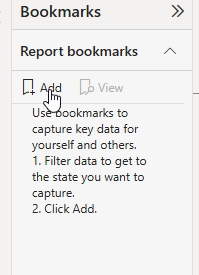
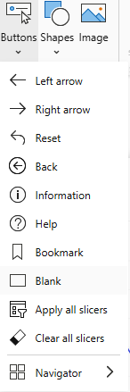
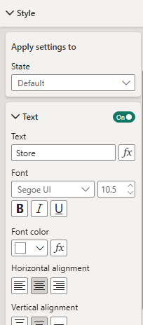
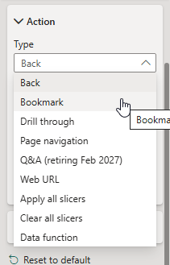

# Activity 04 · Two bookmark buttons, a running total and a rank

**The ask.** The manager has three more requests:

1. "Give me **one click** for the store view and one for the online view." You will save two **bookmarks** and put them behind two **buttons**.
2. "Show me revenue **so far in 2026**, month by month." You will add a **running total**.
3. "Tell me the **order** of the categories, not just the bar lengths." You will add a **rank**.

Requests 2 and 3 use **visual calculations**: short DAX formulas that live inside one visual.

**Start from** your file after [Activity 03](../03-Evr-Drillthrough-And-Tooltip/README.md). Work on the **Overview** page and clear the channel slicer.

| Step | What you do | Check |
|---|---|---|
| 1 | Save two bookmarks | Store 205,338.00 · Online 110,685.50 |
| 2 | Add two buttons that open them | Online button shows 110,685.50 |
| 3 | Add a running total | April 62,497.50 · August 122,583.00 |
| 4 | Rank the categories | Outerwear 1, Tops 6; online: Tops 4 |

## 1. Save two bookmarks

**What and why.** A **bookmark** is a saved snapshot of a page: the slicer selection, filters, sort order and which visuals are visible. Selecting the bookmark puts the page back exactly that way. It is like saving a "view" you can return to.

**How.**

1. Open **View → Bookmarks**. The Bookmarks pane opens.

   

2. In the channel slicer, select **store**.

3. In the Bookmarks pane, choose **Add**. A bookmark called **Bookmark 1** appears. Double-click it and rename it `Store`.

4. In the slicer, select **online**. Choose **Add** again and rename the new bookmark `Online`.

**C1.** Click the `Store` bookmark in the pane: the card shows **205,338.00** and the slicer shows store. Click `Online`: **110,685.50**.

**What the bookmark remembers.** Each bookmark's **…** menu has three ticks. Leave all three on for now:

- **Data**: the filters and slicer choices.
- **Display**: which visuals are shown or hidden.
- **Current page**: the page it was saved on, so the bookmark also takes you there.

## 2. Add two buttons

**What and why.** Readers do not open the Bookmarks pane, and in the service they may not know it exists. A **button** on the page makes the bookmark one click away.

**How.**

1. Open **Insert → Buttons → Blank**. An empty button appears on the page.

   

2. With the button selected, open **Format → Button → Style → Text**, turn **Text** on and type `Store`.

   

3. Still in the Format pane, turn on **Action**. Set **Type** to **Bookmark** and **Bookmark** to `Store`.

   

4. Repeat steps 1–3 for a second button: text `Online`, bookmark `Online`.

5. Place both buttons near the slicer.

**C2.** **Ctrl+click** the `Online` button in Desktop (a plain click in the service): the card shows **110,685.50**. Ctrl+click `Store`: **205,338.00**.

## 3. Add a running total as a visual calculation

**What and why.** A **running total** adds each month to all the months before it: January, then January + February, and so on. You could write a model measure for this (Activity 02's Revenue YTD did it with dates). A **visual calculation** is simpler: it works only on the rows the visual already shows, so "add this row to the rows above it" is one function.

| | Model measure | Visual calculation |
|---|---|---|
| Lives in | The semantic model | One visual |
| Can be reused | In any visual | No, only where you wrote it |
| Sees | The whole model, through filters | Only the rows and columns in its visual |

**How.**

1. Clear the slicer. Add a **Table** with `dates[year_month]` and **Completed Revenue**.
2. Limit it to 2026: with the table selected, drag `dates[year]` into **Filters on this visual** and tick **2026**.
3. Select the table and choose **New visual calculation** (on the **Home** ribbon, or right-click the visual). A formula bar opens above a preview of the table.
4. Choose the **Running sum** template, or type:

   ```dax
   Running revenue = RUNNINGSUM([Completed Revenue])
   ```

   - `[Completed Revenue]` here means the **column in this table**, the numbers you can see.
   - `RUNNINGSUM` goes down the rows in the table's order (by `year_month`) and keeps adding.

5. Press **Enter**, then go back to the report.

**C3.** January shows **14,449.50**, April **62,497.50** and August **122,583.00**. These are the same as Revenue YTD from D20: the same answer, reached by adding the visible rows instead of filtering dates.

## 4. Rank the categories

**What and why.** A **rank** gives the order as a number (1st, 2nd, …), so the reader does not have to compare bar lengths by eye.

**How.**

1. Add a **Table** with `products[category]` and **Completed Revenue**.
2. Select it, choose **New visual calculation**, and type:

   ```dax
   Category rank = RANK(DENSE, ORDERBY([Completed Revenue], DESC))
   ```

   - `ORDERBY([Completed Revenue], DESC)` says what to rank by: revenue, largest first.
   - `DENSE` says how to handle ties: tied values share a rank, and the next rank follows with no gap (1, 2, 2, 3).

3. Press **Enter** and go back to the report.

**C4.** Outerwear is **1** (76,637.00) and Tops is **6** (40,588.00).

4. Now select **online** in the channel slicer.

**Check.** The ranks change: online, Shoes is close behind Outerwear, and Tops moves up to **4**. The rank uses only the rows in its visual, so when the slicer changes those rows, the rank changes too.

**What just happened.** The bookmarks saved two views of the page, and the buttons made them one click away. The two visual calculations worked only on the rows already in their visuals. A model measure would be reusable in any visual; a visual calculation belongs to the one visual where you wrote it.

[Microsoft: bookmarks](https://learn.microsoft.com/en-us/power-bi/create-reports/desktop-bookmarks) · [Microsoft: buttons](https://learn.microsoft.com/en-us/power-bi/create-reports/desktop-buttons) · [Microsoft: visual calculations](https://learn.microsoft.com/en-us/power-bi/transform-model/desktop-visual-calculations-overview)
