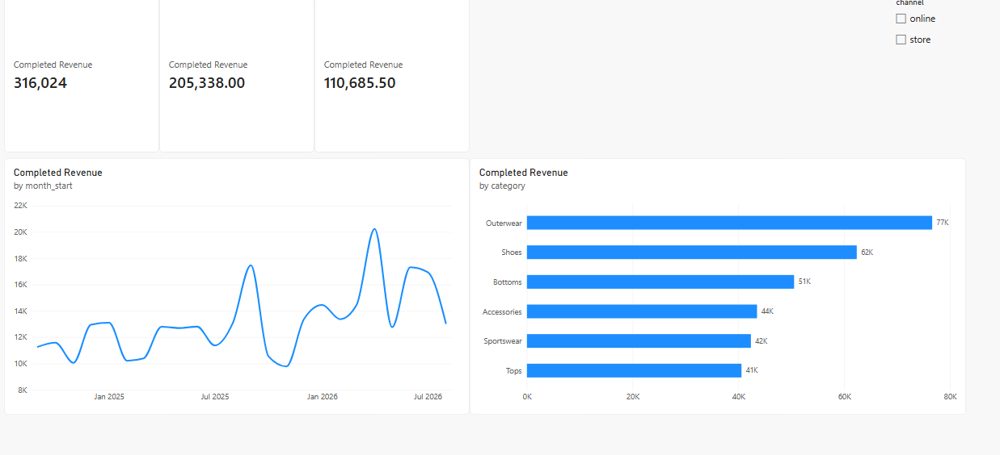
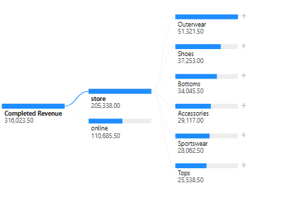
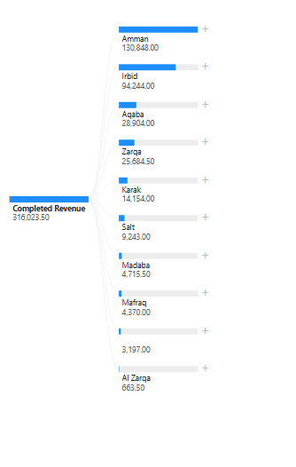

# Activity 00 · Build the Nakheel overview report from one file

The Nakheel sales director wants one page that answers three questions: how much did we sell, which channel sold it, and is it growing? You build that page in Power BI Desktop from a single file, then use it for the rest of D22: you publish it, pin it, secure it and plan its refresh. You do not need any file from an earlier day.

People often call a page like this a dashboard. In Power BI, a **dashboard** is something else: a page of tiles pinned from reports in the Service. You make one from this report in Activity 01.

| Step | What the director needs | Tool |
|---|---|---|
| 1 | The sales in Power BI | Get data → Text/CSV |
| 2 | One number for completed sales | New measure |
| 3 | The page: totals, channels, months and categories | Cards, line chart, bar chart, slicer |
| 4 | Is the month good or bad, and which way is it going? | Analytics pane: average line and trend line |
| 5 | Where does the total come from? (optional) | Decomposition tree |

**Data:** [Resources/start/sales_lines.csv](../Resources/start/sales_lines.csv) → table `sales_lines`. It is D20's `sales_lines` with the product's category, the customer's city and the month already added, so it needs no other table. One row is one line on an order: 7,516 rows, September 2024 to August 2026.

## 1. Load the file

**Why this step.** Today is about sharing a report, not modelling one. One table publishes, refreshes and takes a security role exactly as a four-table model does, and it loads in a minute.

Open a new file in Power BI Desktop. Select **Get data → Text/CSV**, choose `sales_lines.csv` and select **Load**. Save the file as `D22.pbix`.

In **Table view**, check the column types: `order_date` and `month_start` are **Date**, `line_value` is **Decimal number**, `year_month` is **Text**. Change any that are not.

**Check.** The table `sales_lines` has 7,516 rows: Table view shows the count at the bottom left, or put `order_id` on a card. **Count of order_id** shows **7516**. It counts rows, one per order line, not orders: an order with three products has three lines, so there are fewer orders (3,000).


## 2. Add two measures

**Why this step.** The file holds completed, cancelled and pending lines. The director counts completed sales only, and every card, chart and security role today reuses that one number.

Select **Home → New measure** and type the first measure. Repeat for the second.

```DAX
Total Revenue = SUM(sales_lines[line_value])
```

```DAX
Completed Revenue = CALCULATE([Total Revenue], sales_lines[status] = "completed")
```

**Check.** A card with Completed Revenue shows **316,023.50**. A card with Total Revenue shows 340,370.00: the difference is cancelled and pending lines.

## 3. Build the page

**Why this step.** Each visual answers one of the director's questions. Together they are the page you will publish in Activity 01.

Rename the page `Overview`. Add these five visuals. Give each card its own title (**Format → General → Title**): with the default title, all three cards say *Completed Revenue* and the reader cannot tell them apart.

| Visual | Fields | Title |
|---|---|---|
| Card | Completed Revenue | Completed revenue |
| Card | Completed Revenue, with `channel` = store in **Filters on this visual** | Store revenue |
| Card | Completed Revenue, with `channel` = online in **Filters on this visual** | Online revenue |
| Line chart | X-axis `month_start`, Y-axis Completed Revenue | Completed revenue by month |
| Clustered bar chart | Y-axis `category`, X-axis Completed Revenue | Completed revenue by category |

For the line chart: in the X-axis well, open the arrow on `month_start` and select **month_start** (not Date Hierarchy). 


Add a **Slicer** with `channel` at the side of the page.

**Check.**

| Visual | Value |
|---|---|
| Store revenue | 205,338.00 |
| Online revenue | 110,685.50 |
| Highest month on the line | April 2026, 20,237.00 |
| Longest bar | Outerwear, 76,637.00 |



If the first card shows **316,024**, Power BI rounded it for display (**Display units: Auto**). The value is still 316,023.50. To show the decimals, select the card, then **Format → Visual → Callout value** and set **Display units** to **None** and **Value decimal places** to **2**.

Select **online** in the slicer and predict each card before you look. The first card shows **110,685.50**, the line and bars shrink, the online card stays **110,685.50**, and the store card goes **blank**. Clear the slicer before the next step.

**What just happened.** Store and online add up to the first card: 205,338.00 + 110,685.50 = 316,023.50. A slicer and a visual filter both apply, and a row must pass both. The store card asks for channel = store *and* channel = online, which no row satisfies, so it is blank. That is the D21 rule on filter levels: each level narrows the rows the measure adds.

## 4. Add an average line and a trend line

**Why this step.** A line of 24 months is hard to judge by eye. Is 15,000 a good month? Is revenue growing or only noisy? The **Analytics pane** draws reference lines that the model computes for you, so the reader does not have to.

Select the line chart. In the **Visualizations** pane, select the magnifying-glass icon (**Add further analyses to your visual**). This is the Analytics pane.

1. Open **Average line** and select **Add line**. *Why:* every month above the line is better than the typical month.

   

2. Open **Trend line** and turn it **On**. *Why:* the trend line is a straight line fitted through the 24 months; its slope says which way revenue is going.

   


**Planned dead end.** Swap the X-axis field for `year_month` (text). The **Trend line** and **Forecast** options disappear from the Analytics pane. They need a continuous axis: a date or a number, with **X-axis → Type → Continuous** in the Format pane. A text month is a category. Swap `month_start` back.

**Check.**

| Line | What you should see |
|---|---|
| Average line | 13,167.65 (hover over it). That is 316,023.50 ÷ 24 months |
| Trend line | Rises from left to right, about 213 a month |
| April 2026 | Well above the average line |

**What just happened.** The average and the trend come from the same measure and follow the slicer: select **online** and both lines move to online sales only. A trend line shows the direction, not the reason: it says revenue tended to grow, not why.

## 5. Optional: split the total with a decomposition tree

**Why this step.** The director asks "where does the 316,023.50 come from?" A decomposition tree splits a measure one field at a time, and the reader chooses each split.

Add a new page `Explore`. Add a **Decomposition tree**: **Analyze** Completed Revenue, **Explain by** `channel`, `category` and `city`. Select **+** next to the total and choose `channel`, then **+** next to store and choose `category`.



**Check.** The first split shows store 205,338.00 and online 110,685.50. Under store: Outerwear 51,321.50, Shoes 37,253.00, Bottoms 34,045.50, Accessories 29,117.00, Sportswear 28,062.50, Tops 25,538.50.

**Planned dead end.** Split by `city` from the total. Amman shows 130,848.00 because Power BI ignores case, so `amman` joins it. But `Al Zarqa` (663.50) is a separate branch from `Zarqa` (25,684.50), and a blank city holds 3,197.00. A tree only splits the values it is given; the fix belongs in Power Query. You meet this again in Activity 02, when a security role is written on a column.



Save the file. **Do not publish yet:** Activity 01 publishes it once, after the page is finished. Publishing again later would replace the copy in the Service and break nothing, but there is no reason to do it twice.

## What you built

| Page | Visual | Answers |
|---|---|---|
| Overview | Three cards | How much, and which channel |
| Overview | Line with average and trend | Is a month good, and which way is it going |
| Overview | Bars by category | What sells |
| Explore | Decomposition tree | Where the total comes from |

**If you already have a working D21 or D20 file**, you may use it instead: Completed Revenue on a card must show 316,023.50. The rest of D22 works on either file.

[Microsoft: the Analytics pane](https://learn.microsoft.com/en-us/power-bi/transform-model/desktop-analytics-pane) · [Microsoft: decomposition tree](https://learn.microsoft.com/en-us/power-bi/visuals/power-bi-visualization-decomposition-tree)
