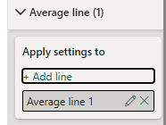
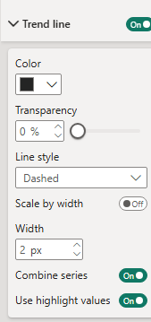
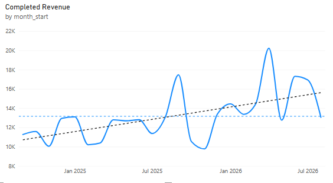

# Activity 01 · Add reference lines to the monthly chart with the Analytics pane

The sales director asks: was April 2026 a good month, and is revenue growing? A line of 24 months cannot answer that by eye. You add the reference lines that the Analytics pane computes, one at a time, and read what each one says. The slides for this activity are D21 pages 36–42.

**Where:** Power BI Desktop, in your `D22.pbix` from [Activity 00](../00-Evr-Build-The-Overview-Report/README.md), on the **Overview** page. You work on the line chart **Completed revenue by month**, which has `month_start` on its X-axis. Nothing is published yet; Activity 03 publishes the finished report.

| Step | What the director needs | Analytics pane line |
|---|---|---|
| 1 | A typical month to compare with | Average, median |
| 2 | The best and the worst month | Min, max |
| 3 | The months that passed the target | Constant line |
| 4 | Which way revenue is going | Trend line |
| 5 | Why the trend option sometimes disappears | (planned dead end) |
| 6 | The next three months (optional) | Forecast |

**What the Analytics pane is.** Select the line chart. In the **Visualizations** pane, select the magnifying-glass icon (**Add further analyses to your visual**). The lines it adds are computed from the values already in the visual, so they follow the slicers like the line they sit on.

## 1. Add an average line and a median line

**Why this step.** "Is 15,000 good?" needs something to compare with. The average is the typical month; the median is the middle month, and one very big month moves it less.

Open **Average line** and select **Add line**. Then open **Median line** and select **Add line**.

**Check.**

| Line | Value (hover over it) |
|---|---|
| Average | 13,167.65 (316,023.50 ÷ 24 months) |
| Median | 12,874.00 |

**What just happened.** The average is higher than the median because April 2026 pulls it up.

## 2. Add min and max lines

**Why this step.** The range from the worst to the best month tells the director how unusual April was.

Add **Min line** and **Max line**.

**Check.** Min **9,772.50** (November 2025); max **20,237.00** (April 2026).

## 3. Add a constant line for the target

**Why this step.** The business set a target of 15,000 a month. A constant line is a value you type: Power BI computes nothing.

Open **Constant line → Add line**. Set **Value** to `15000`. Turn **Data label** on.

**Check.** Four months are above the line: September 2025, April 2026, June 2026, July 2026.

## 4. Add a trend line

**Why this step.** The trend line is a straight line fitted through the 24 months. Its slope answers "is revenue growing?"

Open **Trend line** and turn it **On**.

**Check.** The line rises from left to right, about **213** a month.

**What just happened.** The trend line says revenue tended to grow. It does not say why.

## 5. Planned dead end: the trend option disappears

**Why this step.** You will meet this on your own data, and it looks like a missing feature.

Drag `year_month` (text) onto the X-axis in place of `month_start`. Open the Analytics pane: **Trend line** and **Forecast** are gone. Put `month_start` back, and check that **Format → X-axis → Type** is **Continuous**.

**What just happened.** A text month is a label, so Power BI cannot measure the distance between months. Trend and forecast need a continuous axis: a date or a number.

## 6. Optional: add a forecast

Open **Forecast**, turn it **On**, set **Forecast length** to `3` points and keep the **Confidence interval** at 95%. Select **Apply**.

**Check.** A line continues past August 2026 with a shaded range that widens with each month.

## Check yourself

| Question | Answer |
|---|---|
| Was April 2026 a good month? | The best of 24: 20,237.00 against an average of 13,167.65 |
| Is revenue growing? | Yes, by about 213 a month on the trend line |
| How often was the target met? | 4 of 24 months |

**Bonus.** Select **online** in the channel slicer. Every line moves to online sales only. Which months pass 15,000 now? Clear the slicer before Activity 02.

[Microsoft: the Analytics pane](https://learn.microsoft.com/en-us/power-bi/transform-model/desktop-analytics-pane)
