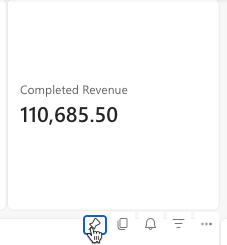
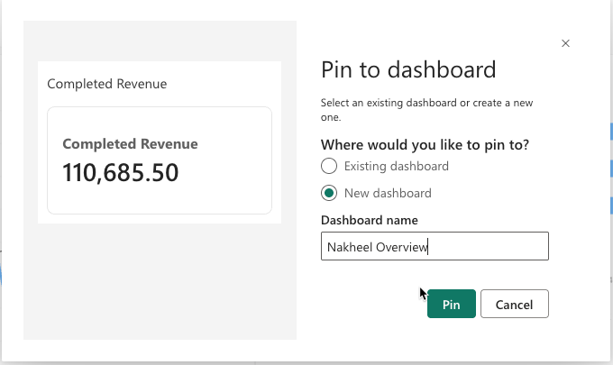
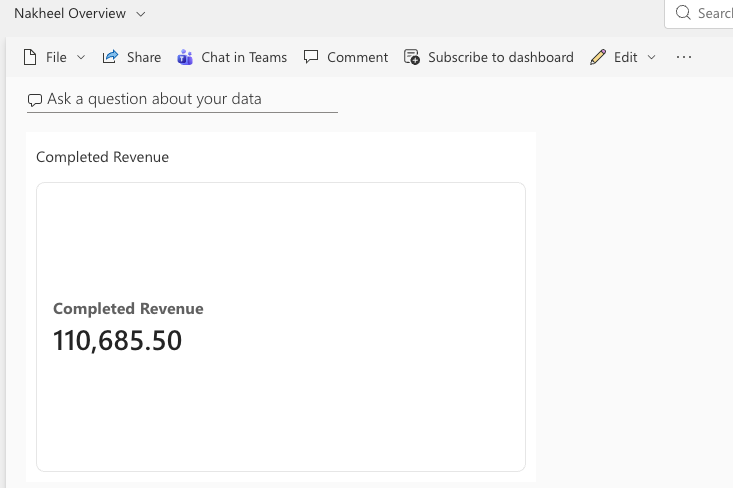
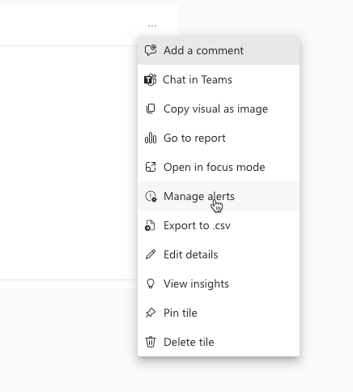
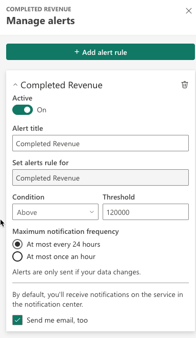

# Activity 01 · Publish the report, pin a tile and set a data alert

The online manager wants to see online revenue each morning without opening Desktop, and to hear about it when revenue passes a target. You publish the report to the Power BI service, pin the online card to a dashboard and set an alert on it. Everything here works on a free account.

Start from your `D22.pbix` from [Activity 00](../00-Evr-Build-The-Overview-Report/README.md), saved but not yet published. Activity 00 only builds; this activity publishes it, once. Its **Overview** page already has the **Online revenue** card you will pin: a card filtered to online in **Filters on this visual**, showing **110,685.50**.

| Step | Where | What the manager needs | Feature |
|---|---|---|---|
| 1 | Power BI Desktop | The report in the Service | Publish |
| 2 | The Service, in your browser | The online number on a page of key figures | Pin to a dashboard |
| 3 | The Service, in your browser | A message when the number passes a target | Data alert |

Step 1 is the last thing you do in Desktop. Dashboards and alerts exist only in the Service (app.powerbi.com), so steps 2 and 3 happen in your browser.

**Why the online card works as a tile.** A dashboard tile is pinned from one visual and keeps that visual's filters. The online card has its own visual filter, so its tile always shows online revenue, whatever a reader selects in the report.

## 1. Publish to My workspace

**Why this step.** Desktop files live on your laptop. Publishing copies the report and its model to the Service, where other people and dashboards can reach them. A free account can publish to My workspace only.

Save the file. Select **Home → Publish**, choose **My workspace** and select **Select**. When Desktop says it succeeded, select **Open 'D22.pbix' in Power BI**. The report opens in your browser, in the Service. Keep that tab: the rest of this activity happens there.

**C1.** In My workspace there are two items named `D22`: a **Report** and a **Semantic model**. The report's online card still shows **110,685.50**.

**What just happened.** One file became two items. The report holds the pages; the semantic model holds the tables, measures and data. Refresh, security and sharing are set on the semantic model.

## 2. Pin the online card to a new dashboard

**Where:** the Service, in your browser, in the D22 report you opened at the end of step 1. If you closed it, go to [app.powerbi.com](https://app.powerbi.com), open **My workspace** and select the **D22** report (the bar-chart icon).

**Why this step.** A **dashboard** is one page of key numbers that a reader glances at; it exists only in the Service. **Pinning** puts one visual from a report onto a dashboard as a **tile**. The tile stays connected to the semantic model, so its number updates after each refresh, and it keeps the filters the visual had, so the online card's tile always shows online revenue. Selecting the tile opens the report.

1. On the **Overview** page, hover over the **Online revenue** card (110,685.50). A row of small icons appears just below the card, at its right edge.

2. Select the first icon, the **pin** (**Pin visual**).

   

3. In **Pin to dashboard**, choose **New dashboard**, name it `Nakheel overview` and select **Pin**.

   

4. Select **Go to dashboard**.

**C2.** The dashboard has one tile that shows **110,685.50**. Selecting the tile opens the `Overview` page of the report.

**Not this pin.** If the dialog shows the whole page as its preview and its button says **Pin live**, you used the pin in the ribbon at the top of the report. That pins the whole page, and a whole-page tile cannot carry the alert in step 3. Select **Cancel** and use the pin under the card.

**What just happened.** The manager now has one place to look each morning. When the model refreshes, the tile shows the new number without anyone opening the report. Step 3 sets the alert on this tile.

## 3. Add a data alert to the tile

**Where:** the **Nakheel overview** dashboard you created in step 2. **Go to dashboard** took you there. If you left it, open **My workspace** and select **Nakheel overview**: it is listed with type **Dashboard**, next to the D22 report and semantic model.

**Why this step.** An alert checks the tile after each data refresh and notifies you when the number crosses a threshold, so the manager does not have to check it every day. Alerts work on card, gauge and KPI tiles on a dashboard.

1. On the dashboard, hover over the **110,685.50** tile. Select **More options (…)** at the tile's top-right corner.

2. Select **Manage alerts**, then **Add alert rule**.

   

3. Set **Condition** to **Above** and **Threshold** to `120000`.

4. Under **Maximum notification frequency**, keep **At most every 24 hours** (the other choice is **At most once an hour**). Tick **Send me email, too** if you want an email as well as a notification in the Service.

5. Select **Save and close**.

   

The panel notes that **alerts are only sent if your data changes**: the rule is checked after each refresh, not continuously.

**C3.** **Manage alerts** lists one rule, *Above 120,000*. No notification arrives: 110,685.50 is below the threshold, and the data has not refreshed since you published.

**What just happened.** The alert is yours alone; nobody else who opens the dashboard sees it. It will only fire after a refresh (Part 3 of today, and D23 for a source that refreshes without a gateway).

## Trial or Pro: share the report with a friend

With a trial or Pro account, open the report, select **Share**, choose **Specific people**, type your neighbour's course email and untick **Allow recipients to build content with the data associated with this report**. Your neighbour opens it from **Shared with me**. A free account cannot open a shared report, so this needs both of you on a trial or Pro.

[Microsoft: data alerts](https://learn.microsoft.com/en-us/power-bi/create-reports/service-set-data-alerts) · [Microsoft: share reports](https://learn.microsoft.com/en-us/power-bi/collaborate-share/service-share-dashboards)
