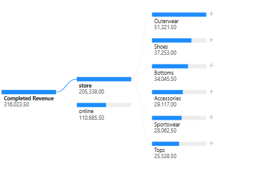
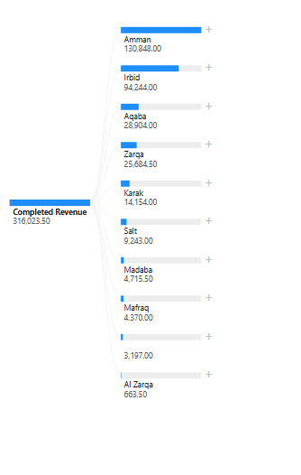

# Activity 02 · Find patterns with the AI visuals and check what they say

The director now asks why April 2026 stood out and what drives revenue. Power BI's AI visuals find patterns in the rows: an unusual month, the split of a total, the values linked to a bigger sale. You build each one and say what it shows and what it cannot show. The slides for this activity are D21 pages 43–48.

**Where:** Power BI Desktop, in the same `D22.pbix`. You add a second page, **Explore**, so the Overview page stays as it is for publishing in Activity 03.

| Step | The director's question | Visual |
|---|---|---|
| 1 | Is April 2026 unusual? | Find anomalies (line chart) |
| 2 | Where does the total come from? | Decomposition tree |
| 3 | What goes with a bigger sale? | Key influencers |
| 4 | Can I just ask? | Q&A |

Select **+** at the bottom of the canvas to add a page and rename it `Explore`.

## 1. Find the anomalies on the monthly line

**Why this step.** An average line shows which months were above typical. Anomaly detection asks a sharper question: which months are outside the range the rest of the line predicts?

On the Explore page, add a **Line chart** with `month_start` on the X-axis (choose **month_start**, not Date Hierarchy) and Completed Revenue on the Y-axis. In the Analytics pane, open **Find anomalies** and select **Add**.

**Check.** April 2026 is marked. Select the marker: the pane shows the expected range and the actual value, 20,237.00.

**What just happened.** The visual flags the month; it cannot say what happened in it. That is a question for the business.

## 2. Split the total with a decomposition tree

**Why this step.** The reader decides each split, one field at a time, and sees the numbers at every level.

Add a **Decomposition tree**. **Analyze:** Completed Revenue. **Explain by:** `channel`, `category`, `city`. Select **+** next to the total and choose `channel`; then **+** next to store and choose `category`.

**Check.** Store 205,338.00 and online 110,685.50. Under store: Outerwear 51,321.50, Shoes 37,253.00, Bottoms 34,045.50, Accessories 29,117.00, Sportswear 28,062.50, Tops 25,538.50.

**Planned dead end.** Split the total by `city` instead. Amman shows 130,848.00 because Power BI ignores case, so `amman` joins it. But `Al Zarqa` (663.50) is a separate branch from Zarqa (25,684.50), and the blank cities hold 3,197.00. A tree only splits the values it is given; the fix belongs in Power Query. You meet this again in Activity 04, when a security role is written on a column.

## 3. Ask what goes with a bigger sale: key influencers

**Why this step.** Key influencers compares the average of a column with and without each value of the fields you give it, and ranks the biggest differences.

Add a **Key influencers** visual. **Analyze:** `line_value` (a column, not the measure). **Explain by:** `category`, `channel`. In the Filters pane, add a filter on this visual: `status` is **completed**.

**Check.** Category Outerwear is at or near the top. The arithmetic behind it: Outerwear lines average about 72.03 against about 40.66 for every other line.

**What just happened.** Outerwear is linked to bigger lines because a jacket costs more than a pair of socks. Key influencers shows association, not cause.

## 4. Ask a question with Q&A

**Why this step.** Q&A turns a typed question into a visual. Test it on a question you can check before you trust it on a new one.

Add a **Q&A** visual. Type `completed revenue by channel`.

**Check.** Store 205,338.00 and online 110,685.50, the same as the tree. If the answer differs, the question was read differently: try the exact measure name.

Copilot works the same way but needs a paid Fabric capacity, which free accounts do not have.

## Check yourself

| Visual | What it showed | What it cannot tell you |
|---|---|---|
| Find anomalies | April 2026 is outside the expected range | What happened in April |
| Decomposition tree | Store 205,338.00; Outerwear leads in store | Which split matters to the business |
| Key influencers | Outerwear lines are bigger | Whether selling more Outerwear would raise revenue |
| Q&A | The channel totals | Whether a new question was understood, until you check it |

Save the file. Activity 03 publishes both pages.

**Bonus.** Write one sentence about April 2026 that uses two of these visuals and names one limit.

[Microsoft: decomposition tree](https://learn.microsoft.com/en-us/power-bi/visuals/power-bi-visualization-decomposition-tree) · [Microsoft: key influencers](https://learn.microsoft.com/en-us/power-bi/visuals/power-bi-visualization-influencers) · [Microsoft: anomaly detection](https://learn.microsoft.com/en-us/power-bi/visuals/power-bi-visualization-anomaly-detection) · [Microsoft: Q&A](https://learn.microsoft.com/en-us/power-bi/visuals/power-bi-visualization-q-and-a)
