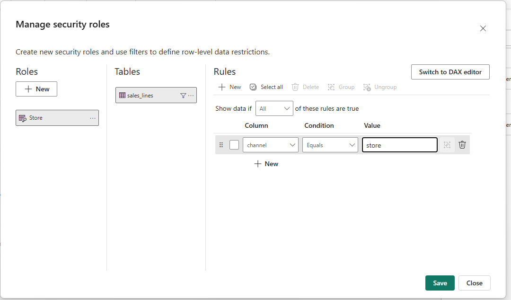
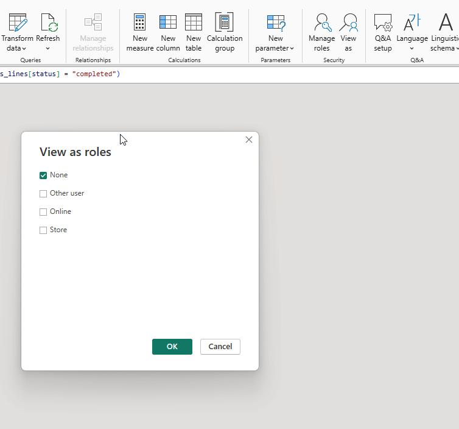

# Activity 02 · A static store role, tested with View as

Nakheel has a store manager and an online manager. Each should open the same report and see only their own channel's sales. You write one security role for each channel and test both in Desktop before anything is published. Everything here works on a free account.

**Where:** back in **Power BI Desktop**, in your `D22.pbix`. Activity 01 ended in the browser; this activity changes the model, and the model is edited in Desktop. The copy you published in Activity 01 has no roles yet and does not change until you publish again (end of this activity).

Start from your `D22.pbix` from [Activity 00](../00-Evr-Build-The-Overview-Report/README.md). Completed Revenue on a card is 316,023.50.

*The web route.* The Service can also edit roles: on the D22 semantic model, **… → Open semantic model → Manage roles**. Edits there change the published model directly, and your `.pbix` no longer matches it. Use one place for the model; in this course that is Desktop.

| Step | What you need | Feature |
|---|---|---|
| 1 | A rule that keeps only store sales lines | Manage roles |
| 2 | The same rule for online | A second role |
| 3 | Proof that the store role works | View as |
| 4 | What a person in both roles sees | View as, two roles |
| 5 | The roles in the Service | Publish again |

## 1. Create the Store role

**Why this step.** A role is a filter on one table. Power BI checks the rule on every row; rows where it is TRUE stay visible to members of the role, and the others disappear from every visual and measure.

Select **Modeling → Manage roles**. The **Manage security roles** window has three panes: **Roles**, **Tables** and **Rules**.

1. Under **Roles**, select **+ New** and rename the role `Store` (its **…** menu has **Rename**).
2. Under **Tables**, select `sales_lines`.
3. Under **Rules**, select **+ New**. Set **Column** to `channel`, **Condition** to **Equals** and **Value** to `store`. Keep **Show data if All of these rules are true**.
4. Select **Save**.

## 2. Create the Online role

**Why this step.** A static role has its value typed in, so each channel needs its own role. Nakheel has two channels, so two roles.

In **Manage roles**, under **Roles**, select **+ New** again and name it `Online`. Select `sales_lines` under **Tables**, then under **Rules** select **+ New** and set `channel` **Equals** `online`. Select **Save**.

**C2.** The role list shows two roles, **Store** and **Online**, each with one rule on `sales_lines`.

## 3. Test the Store role with View as

**Why this step.** Desktop cannot add people to a role, but it can show the report as a role member would see it. Test every role before you publish.

Select **Modeling → View as**. Tick **Store** and select **OK**. A banner at the top says you are viewing as Store.

**C3.** On the Overview page, the first card shows **205,338.00**, the store card **205,338.00**, and the online card is **blank**: the role removed every online row before any card added them up. The channel slicer lists only **store**.

## 4. View as both roles

**Why this step.** One person can be in more than one role. Power BI then shows the rows that any of their roles allows, not only the rows all roles share.

Open **View as** again, tick **Store** and **Online**, and select **OK**. Then select **Stop viewing** in the banner.

**C4.** With both roles the first card shows **316,023.50**, the full total, and both channel cards show their numbers. After **Stop viewing** it shows 316,023.50 again, as the author.

**What just happened.** The rule sits on `sales_lines`, the table every measure adds up. Store keeps 4,756 of the 7,516 sales lines, so every measure, card and chart shrinks to the store's rows. In a model with separate products, customers and dates tables (D20's), those tables are not filtered: a product slicer still lists every product. In Activity 00's one-table file, category and city sit on `sales_lines`, so they are filtered with it.

## 5. Publish again so the Service has the roles

**Why this step.** Roles travel with the semantic model. The Service only knows about them once you publish the model that contains them.

Save the file. Select **Home → Publish → My workspace**. Power BI asks whether to **Replace** the existing D22 semantic model: select **Replace**.

**C5.** In the Service, on the D22 semantic model, **… → Security** lists the roles **Store** and **Online**. Adding people to them needs the trial or Pro (D22 page 32). Your dashboard tile from Activity 01 still shows 110,685.50: you are the author, and roles do not restrict the author.

[Microsoft: row-level security in Power BI](https://learn.microsoft.com/en-us/fabric/security/service-admin-row-level-security)
