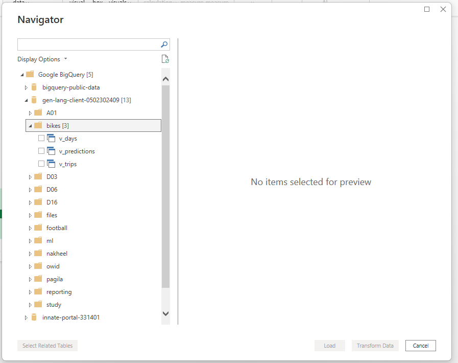
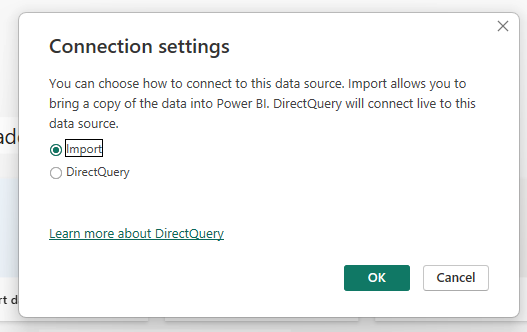
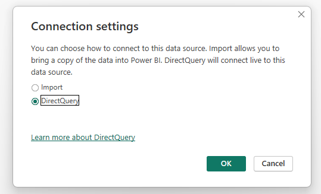
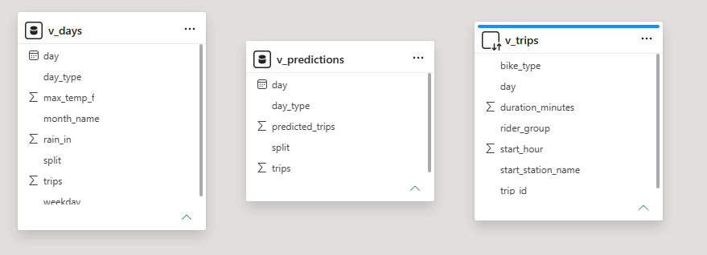
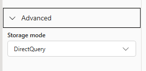
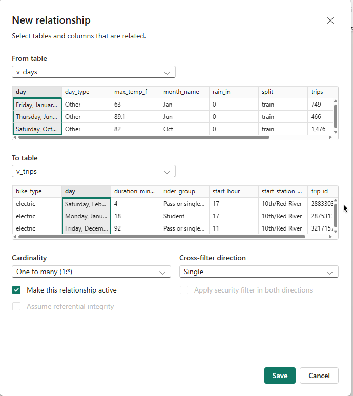
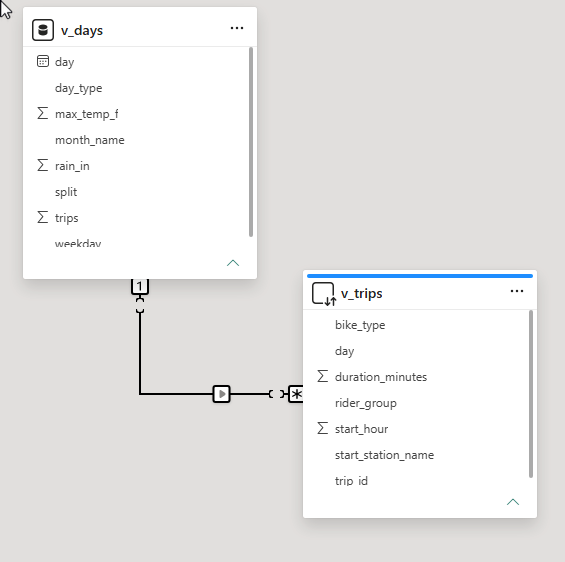
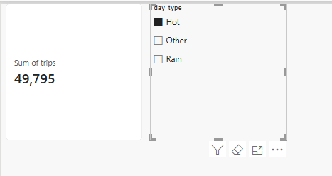

# Activity 04 · Connect Power BI to BigQuery: Import and DirectQuery

Your three views are ready in BigQuery. Power BI can read a view in two ways. **Import** copies the rows into the report file; visuals are fast and the copy is as fresh as the last refresh. **DirectQuery** copies nothing; every visual sends a query to BigQuery when it is drawn, so the data is always current, and every visual costs a query. You import the two small day views and query the trip view live, then watch both at work.

**Where you are:** 01 Explore → 02 Views → 03 Model → **04 Connect** → 05 Story. You bring three views from BigQuery; you hand on a Power BI model that Activity 05 turns into a story page.

**Remember (D22, pages 37–38).** A storage mode says where a table's data lives. **Import** keeps a copy in the model: fast, and as fresh as the last refresh. **DirectQuery** keeps no data and asks the source each time a visual is drawn. **Remember (D18).** A relationship lets a filter on one table reach the rows of another; here the shared column is `day`.

### What each table brings, and why its mode

| Table | One row is | Rows | Mode | Why this mode |
|---|---|---:|---|---|
| `v_days` | one day | 364 | Import | small, changes once a day: a copy is cheap and fast |
| `v_predictions` | one day, actual and predicted rides | 364 | Import | the same size; the model's output does not change between refreshes |
| `v_trips` | one trip | 282,696 | DirectQuery | large: Power BI asks for the totals it needs instead of copying every trip |

The day tables answer "what kind of day was it?"; the trip table answers "who rode, from where, at what hour?". The relationship on `day` lets a Hot slicer from `v_days` filter the trips in `v_trips`.

### Choosing a storage mode: a strategy you can reuse

The choice is made table by table, and it follows what kind of table it is.

| Kind of table | Example | How often it changes | Usual choice |
|---|---|---|---|
| Dimension or reference: describes things | stations, dates, products, rider groups, `v_days` | rarely; small | **Import**. If the facts it filters are in DirectQuery, **Dual** (below) |
| Fact with history: one row per event, past events fixed | sales lines, last year's trips | new rows daily; old rows stay | **Import** with a scheduled refresh (or incremental refresh, D22) |
| Fact that is huge or must be current to the minute | today's trips, sensor readings, live orders | constantly | **DirectQuery** |
| Model output scored in batches | `v_predictions` | when the model is retrained | **Import**, refreshed after each retraining |

Import is the default for a reason: the visuals are fast, every DAX function works, and the source is read once per refresh instead of once per click. Choose DirectQuery when the table is too big to copy or the reader needs data newer than the last refresh. Here `v_trips` (283 thousand rows) would import easily; you use DirectQuery on it to learn it on a table where you can see the cost.

**Dual** is a third mode for a dimension: it acts as Import when a visual uses only imported tables, and as DirectQuery when it is joined to a DirectQuery table, so the relationship stays a regular one. You can set Dual only on a table that was loaded in DirectQuery.

**Why `v_predictions` is imported, and when it would not be.** BigQuery ML scores the 364 days once, when you create the view's model; the predictions change only when you retrain. That is **batch scoring**, and its result is reference data: Import it and refresh after each retraining. In DirectQuery, `v_predictions` would run `ML.PREDICT` again on every click: slower, and paid for each time, for the same numbers. **Real-time scoring** (a fraud check at the card machine, a price at checkout) happens in the application that needs the answer, not in a report. The usual design writes each score to a table as it is made, and the report reads that table, in DirectQuery if readers need the latest scores.

**Develop fast, then switch?** Power BI changes storage mode in one direction only: a DirectQuery table can become Import or Dual, but an imported table can never go back to DirectQuery. So to build a DirectQuery report quickly, connect in DirectQuery to a small development view (one month, say), design the pages, then point the query at the full view. If you prototyped in Import, moving to DirectQuery means adding the table again in DirectQuery and rebuilding what used it.

| Step | What you need | Power BI |
|---|---|---|
| 1 | The day views as a copy in the file | Google BigQuery connector, Import |
| 2 | The trip view queried live | Google BigQuery connector, DirectQuery |
| 3 | Day filters that reach the trips | A relationship on `day` |
| 4 | Proof of what each mode does | Performance analyzer, BigQuery job history |

Open Power BI Desktop with a new, blank report, signed in with your course account.

## 1. Import `v_days` and `v_predictions`

**Why this step.** `v_days` has 364 rows and `v_predictions` 364. A small table is cheap to copy, and a copy makes every visual fast. It is also the default, and the mode PL-300 expects you to choose unless there is a reason not to.

Select **Home → Get data → More…**, search for **Google BigQuery**, and select **Connect**. The first time, select **Sign in**, choose your Google account in the Google window, allow access, and select **Connect**.

The **Navigator** opens first. Open your project, then `bikes`, and tick `v_days` and `v_predictions`.

Select **Load**. Power BI then asks for the **Connection settings**: choose **Import** and select **OK**.

If you see **Access Denied … bigquery.jobs.create**, start again and open **Advanced options**: in **Billing Project ID**, type your project's ID (shown in the BigQuery console's project picker). Power BI then runs its queries in your sandbox.

**C1.** On a card, `trips` from `v_days` shows about **282,696** (Tarek's run, 23 November 2026; it was 283,964 on 15 November, before Google revised June 2023's trips).

## 2. Add `v_trips` in DirectQuery

**Why this step.** `v_trips` has one row per trip. Importing it would copy 282,696 rows into the file and repeat the copy at every refresh; DirectQuery leaves them in BigQuery and asks only for the totals each visual needs.

Select **Get data → Google BigQuery** again. Tick `v_trips` in the Navigator and select **Load**. In **Connection settings**, choose **DirectQuery** this time and select **OK**. Power BI warns that the report now mixes Import and DirectQuery (a composite model); select **OK**.

**C2.** In **Model view**, select `v_trips`: **Properties → Advanced → Storage mode** says **DirectQuery**, while `v_days` says **Import**. A card with **Count of trip_id** shows the same number as C1, from the other storage mode.

In the **Properties** pane, expand **Advanced** to see **Storage mode**.

Look at the table cards too. `v_days` and `v_predictions` show a database icon; `v_trips` shows a different icon (a table with arrows) and a blue bar along its top. That is how Model view marks a DirectQuery table, so you can tell the modes apart without opening Properties.

## 3. Relate the days to the trips

**Why this step.** The day type lives in `v_days`; the trips live in `v_trips`. A relationship on `day` lets a filter on hot days reach the trips, even though one table is a copy and the other is in BigQuery.

In Model view, drag `v_days[day]` onto `v_trips[day]`. The dialog shows **From table** `v_days`, **To table** `v_trips` and **Cardinality One to many (1:\*)**: one day, many trips. Keep **Cross-filter direction Single** and select **Save**. Drag `v_days[day]` onto `v_predictions[day]` too (one to one).

Power BI draws the first line differently, with open half-circles at its ends: the two tables come from different source groups (an imported copy and a live BigQuery table), so it is a **limited relationship**. It filters correctly; its limits matter for blank rows, which this data does not have. In a real report you would load `v_days` in DirectQuery and set it to **Dual**, which keeps the relationship regular.

**C3.** Add a slicer on `v_days[day_type]` and select **Hot**. The `v_days` card and the `v_trips` card show the same number: **49,795** in Tarek's run on 23 November 2026 (50,428 on 15 November). The two cards agreeing is the check; the exact number moves when Google revises the trips.

## 4. Watch each mode work

**Why this step.** The choice between Import and DirectQuery is a trade-off you should be able to see, not just recite: a copy refreshed on a schedule against a live query on every click.

Select **Optimize → Performance analyzer → Start recording**, then **Refresh visuals**. Expand the two cards. Then, in the BigQuery console, open **Job history → Personal history**.

**C4.** The `v_trips` card lists a **Direct query** row; the `v_days` card does not. In BigQuery's job history, the newest job is a query from Power BI that reads `bikes.v_trips`, run a moment ago. Each click on the slicer adds another.

**What just happened.** One report reads the same data two ways. The imported tables answered from the copy in your file. The DirectQuery table sent BigQuery a query for each visual, so its numbers are always current and each one costs a few tens of MB of your free terabyte. In a real report you would import dimensions and slowly changing facts, and keep DirectQuery for tables that are huge or must be current to the minute (the strategy table above). Note that DirectQuery cannot use BigQuery's date-and-time columns; that is why `v_trips` keeps the date and the hour separately.

[Microsoft: Google BigQuery connector](https://learn.microsoft.com/en-us/power-query/connectors/google-bigquery) · [Microsoft: use composite models](https://learn.microsoft.com/en-us/power-bi/transform-model/desktop-composite-models)
