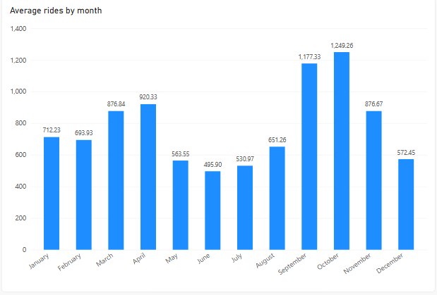
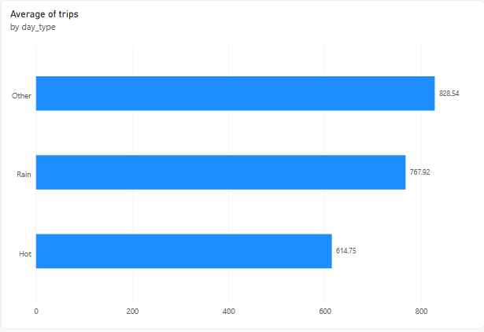
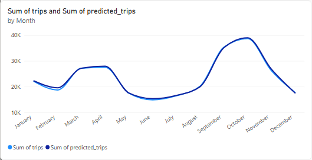
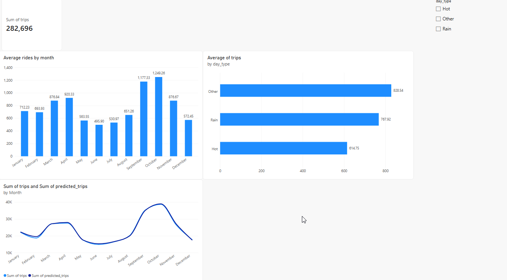
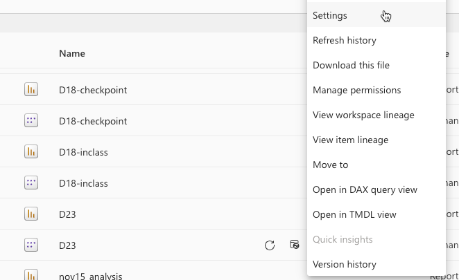
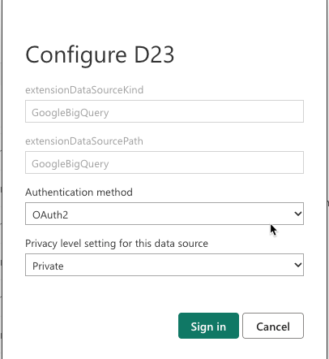
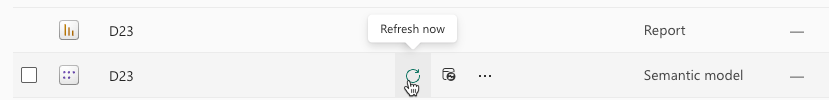
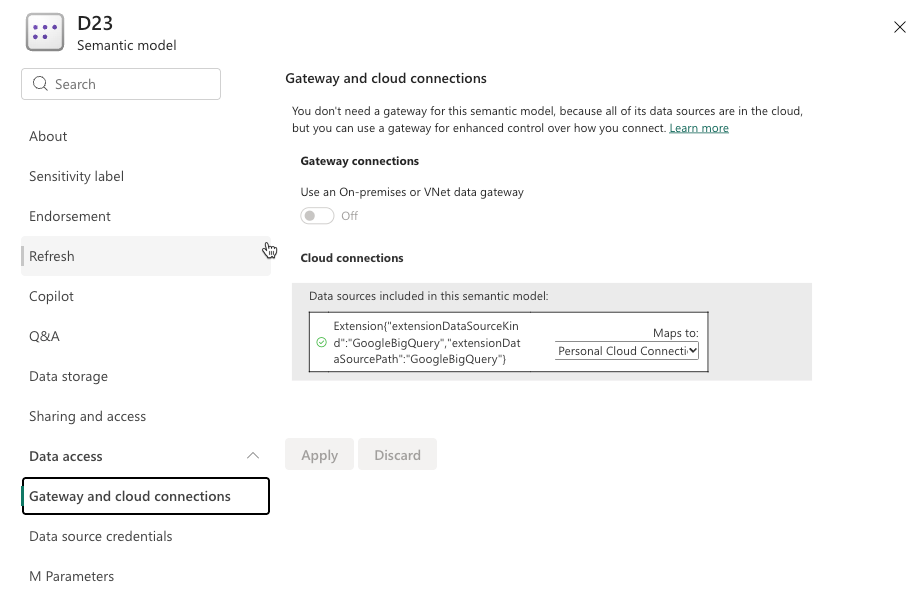

# Activity 05 · A story page, published with no gateway

Your model gives the answer; one report page has to tell it. You build three visuals in the order a reader needs them, write the finding as the title, publish the report, and set its credentials so it can refresh from BigQuery. The source is in the cloud, so the Service needs no gateway (D22).

**Where you are:** 01 Explore → 02 Views → 03 Model → 04 Connect → **05 Story**. You bring the model from Activity 04; you hand on a published report that refreshes from BigQuery.

**Remember (D21, pages 50–51).** A finding has a headline, evidence, a recommendation and limits. **Remember (D22, page 40).** A source the Service can reach on the internet, such as BigQuery, needs no gateway; files on your laptop would.

### The story the page tells, visual by visual

| Visual | The question it answers | The evidence it shows |
|---|---|---|
| Rides by month | When do people ride? | October about 1,249 a day; May to July and December below 575, June lowest |
| Rides by day type | Does the weather matter? | Hot days 614.8, others 828.5: the quick answer |
| Actual against predicted | Does month + weekday + weather explain the year? | The lines follow each other; October 38,727 against about 39,000 |
| Title and sentence | So what? | The calendar first, the heat second: about 700 against about 225 rides a day |

Each visual comes from an earlier step: the months and day types from `v_days` (Activity 02), the predicted line from `v_predictions` (Activity 03), the numbers in the sentence from the model's weights (Activity 03, step 4).

| Step | What the reader needs | Visual |
|---|---|---|
| 1 | When do people ride? | Column chart, average rides by month |
| 2 | How much does the weather change it? | Bar chart, average rides by day type |
| 3 | Does the model capture the pattern? | Line chart, actual and predicted |
| 4 | The report online, able to refresh | Publish, credentials, refresh |

Continue in the file from Activity 04. Add a new page and name it **Story**.

## 1. Average rides by month

**Why this step.** The biggest pattern goes first. Monthly totals depend on how many days a month has; an average per day compares months fairly.

Add a **Clustered column chart**. Put `v_days[day]` on the X-axis and keep only **Month** in its date hierarchy. Put `v_days[trips]` on the Y-axis and change its summary from **Sum** to **Average**.

**C1.** October is highest at **1,249.3** rides a day, then September (1,177.3). June (495.9), July (531.0), May (563.6) and December (572.5) are the lowest: the months without classes. (Tarek's run, 23 November 2026. On 15 November June showed 538.1: Google has since removed about 1,270 June trips.)

## 2. Average rides by day type

**Why this step.** This is the quick answer from Activity 01. Showing it next to the months lets the reader see that the hot days sit inside the quiet months.

Add a **Clustered bar chart** with `v_days[day_type]` on the Y-axis and **Average of trips** on the X-axis. Sort by the average.

**C2.** Other 828.5, Rain 767.9, Hot 614.8 (Tarek's run, 23 November 2026). Hot days are still about a quarter below other days.

## 3. Actual and predicted rides

**Why this step.** The model's predictions show whether the month, weekday and weather explain the year's shape. Where the two lines part, something else happened.

Add a **Line chart** with `v_predictions[day]` on the X-axis (Month only), and **Sum of trips** and **Sum of predicted_trips** on the Y-axis.

**C3.** In October the lines are close: **38,727** actual and **about 39,000** predicted.

Give the page a title in a text box: **Austin's bikes follow the school calendar first and the heat second.** Under it, one sentence: *With the month held fixed, a 100 °F day costs about 225 rides; the autumn semester adds up to about 700 a day.*

## 4. Publish and set the credentials

**Why this step.** In the Service, the semantic model needs its own sign-in to BigQuery: your Desktop sign-in stays on your laptop. BigQuery is reached over the internet, so no gateway is involved.

Save the file as `D23.pbix`. Select **Home → Publish → My workspace**. In the Service, open **My workspace**. You see two items named **D23**: the report (a bar-chart icon) and the semantic model (a grid of dots). On the **semantic model** row, select **More options (…) → Settings**.

Choose **Settings**, not **Open semantic model**. *Why:* Open semantic model opens the model editor (measures, roles, relationships), which has no credentials. Credentials belong to the semantic model's settings page.

On the settings page, expand **Data source credentials**. Next to Google BigQuery, select **Edit credentials**, choose **OAuth2** as the authentication method, select **Sign in** and use the same Google account as in Desktop. 

Then go back to the workspace and select **Refresh now** (the circular arrow) on the semantic model row.

**C4.** Three places to check:

- **No gateway.** On the same settings page, expand **Gateway and cloud connections** (it sits above Data source credentials). Google BigQuery is listed as a cloud source, and the page does not ask you to choose a gateway. A model built on CSV files from your laptop would ask for one here (D22).
- **The refresh worked.** Back in My workspace, on the semantic model row, select **More options (…) → Refresh history**. The newest row says **Completed**. If it says **Failed**, select it to read the error; an expired Google sign-in is the usual cause, fixed by **Edit credentials** again.
- **The report shows the data.** Open the D23 report in the browser: the `v_trips` card shows the same total as in Desktop (Activity 04, C1).

**What just happened.** The report went from a public dataset to a page anyone with access can open: SQL shaped the data, views handed it to Power BI, a model tested the quick answer, and the page states the finding as its title. A refresh copies the imported views again; the DirectQuery table needs no refresh at all, because it asks BigQuery each time.

[Microsoft: configure scheduled refresh](https://learn.microsoft.com/en-us/power-bi/connect-data/refresh-scheduled-refresh)
