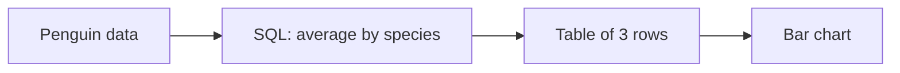

# Activity 03 · How to put a project on GitHub

In this activity, you will upload a small project to GitHub (a data file, a SQL query and a chart) and write the page that explains it. The files are supplied; you lay them out and write the README, the page GitHub shows first.

## What you will learn

- How to upload files and keep their folders
- How to write a project README that opens with what was found
- How to add an image, a link to a file and a diagram to a README
- How to describe a repository so others can find it

## Before you start

1. Sign in to [github.com](https://github.com) ([no account yet?](../README.md#before-you-start-a-github-account)).
2. Open [penguin-project.zip](Resources/penguin-project.zip) and click the **Download raw file** icon, at the right.
3. Unzip it on your computer. On Windows, right-click the file and choose **Extract All**. On a Mac, double-click it, unless it is already a folder.
4. Work from the extracted folder. On Windows, opening the ZIP looks like opening a folder, but dragging files out of that window can fail.

You get a folder named `penguin-project` with three folders inside:

| Folder | File | What it is |
|---|---|---|
| `data` | `penguins.csv` | 344 penguins measured on three islands in Antarctica. One row is one penguin |
| `sql` | `weight_by_species.sql` | The query that averages body mass for each species |
| `images` | `weight-by-species.png` | A chart of the result |

> **Words used here.** A **repository** is the folder for one project, with its history. A **commit** is a saved change with a short message. `main` is the version visitors see. The **+** menu is at the top right of every GitHub page, and the **pencil** (**Edit this file**) is above a file, at the right. A **README** is written in **Markdown**, plain text with marks such as `#` for a heading. More in [GitHub words in plain language](../Resources/github-words.md).

**The question** the project answers: which of the three penguin species is the heaviest?

## 1. Create the repository

**Why this step.** Keep each project in its own repository. A visitor then finds the data, the query and the result in one place.

1. **+ → New repository**. **Repository name:** `penguin-weights`.
2. Choose **Public** and turn **Add README** on. Click **Create repository**.

**C1.** The page shows `your-username / penguin-weights` and one file, `README.md`.

## 2. Upload the three folders

**Why this step.** Folders tell a visitor where to look. Dragging the folders themselves, not the files inside them, keeps them as folders on GitHub.

1. Choose **Add file → Upload files**.
2. Open the `penguin-project` folder on your computer. Select `data`, `sql` and `images` together, and drag them onto the GitHub page.
3. Wait until GitHub lists three files, each with its folder in front: `data/penguins.csv`, `sql/weight_by_species.sql`, `images/weight-by-species.png`.
4. Type the message `Add the penguin data, SQL and chart` and click **Commit changes**.

**C2.** The front page lists three folders, `data`, `images` and `sql`, and `README.md`.

**If the files arrived without their folders,** you dragged the files, or your browser dropped the folders. Upload again in Chrome or Edge and drag the folders.

## 3. See how GitHub shows each file

**Why this step.** You are about to link to these files, so look at what a visitor will see when they click.

1. Open `data/penguins.csv`. GitHub shows it as a table. Type `Gentoo` in the search box above it.
2. Open `sql/weight_by_species.sql`. The SQL words are coloured and the lines are numbered.
3. Open `images/weight-by-species.png`. The chart shows Gentoo first, with **5,076 g**.

**C3.** All three open without downloading anything.

## 4. Write what was found, and show the chart

**Why this step.** Many visitors read only the first screen. Put the answer there, with its number, and the chart that shows it. How it was done comes after, for the reader who wants to check.

1. On the front page, open `README.md`, click the pencil, delete what is there and type:

```markdown
# Penguin weights

**Gentoo penguins are the heaviest of three species: 5,076 grams on average, over 1.3 kg more than the other two.**


*Practice project from a GitHub class. The data, the SQL and the chart were supplied; this page is mine.*
```

2. Click **Preview**.

**C4.** The title, one bold sentence with **5,076 grams**, and the chart.

**How the image line works.** `!` means an image. The words in `[ ]` describe it, for people who use a screen reader and for when the image does not load. The path in `( )` says where it is: the folder `images`, then the file name, with the same letters and the same case.

**Why the last line matters.** A reader will assume that everything in your repository is your own work. Say which parts are not.

## 5. Add the numbers, the method and the limits

**Why this step.** A reader who believes the first line wants to check it. Give them the numbers, the query and where the data came from, and say what the result cannot tell them.

Click **Edit**, go to the end, press Enter twice and add:

```markdown
## The numbers

| Species | Penguins weighed | Average body mass (g) |
|---|---:|---:|
| Gentoo | 123 | 5,076 |
| Chinstrap | 68 | 3,733 |
| Adelie | 151 | 3,701 |

## How it was done

The query is in [sql/weight_by_species.sql](sql/weight_by_species.sql). It reads the same data from a public table in BigQuery, groups the penguins by species and averages their body mass.

## The data

[data/penguins.csv](data/penguins.csv): the Palmer penguins, 344 birds on three islands near Palmer Station, Antarctica. Source: [palmerpenguins](https://allisonhorst.github.io/palmerpenguins/), licence CC0 (free to reuse).

## Limits

- Two of the 344 penguins have no body mass, so 342 were averaged.
- The Gentoo penguins were all measured on one island, Biscoe. The data cannot say whether Gentoo penguins elsewhere weigh the same.
- The averages mix males and females, and males are heavier.
```

Click **Commit changes…**, message `Write the project README`, **Commit changes**.

**C5.** On the front page, the README shows a table with 3 rows. Click **sql/weight_by_species.sql** in the README: the query opens.

**Check the arithmetic.** 123 + 68 + 151 = **342** penguins weighed, and 342 + 2 = **344** rows.

## 6. Add a diagram

**Why this step.** A picture of the steps is quicker to read than a paragraph. GitHub draws one from text, so you can change it by editing a line. The language is called **Mermaid**.

1. Open `README.md`, click the pencil, and add this under **How it was done**:

````markdown

````

2. Click **Preview**. Then **Commit changes…**, message `Add a diagram of the steps`, **Commit changes**.

If your keyboard makes the backtick (`` ` ``) hard to find, use the copy icon at the corner of the block above and paste.

**C6.** Four boxes in a row, joined by three arrows. `A`, `B`, `C` and `D` are names for the boxes; the words in `[ ]` are what a reader sees; `LR` means left to right.

## 7. Describe the repository

**Why this step.** The description is the one line people see when your repository appears in a search or on your profile.

1. On the front page, click the **gear** beside **About**, at the right.
2. **Description:** `Which penguin species is the heaviest? SQL and one chart.`
3. **Topics:** `sql`, `data-analysis`, `penguins`. Click **Save changes**.

**C7.** Your description and three topics appear under **About**. The history has **4 commits**.

## What you can do now

Lay out a project in folders, load its files, and write a README a visitor understands from the first screen.

## Use it for your own work

Copy the [empty project README](Resources/project-README-template.md) into a new repository and fill it in for something you made. Use your own files. Publish graded work only after it has been graded.

## Challenge

Change the README so it answers a second question from the data, for example: on which islands were the Adelie penguins found? You can answer it without any tool: open `data/penguins.csv` on GitHub and search. *(Expected: three islands, Biscoe, Dream and Torgersen.)*

## Resources

- [What is in the project folder](Resources/README.md), and [the finished README](Resources/finished-README.md) to compare with yours
- [About READMEs](https://docs.github.com/en/repositories/managing-your-repositorys-settings-and-features/customizing-your-repository/about-readmes)
- [Creating diagrams](https://docs.github.com/en/get-started/writing-on-github/working-with-advanced-formatting/creating-diagrams)
