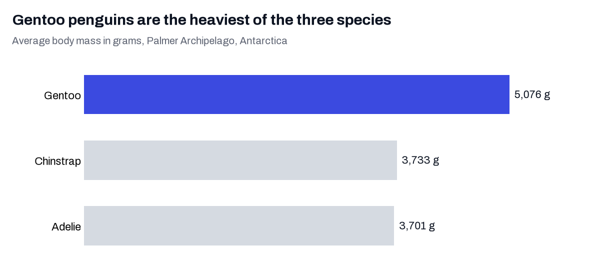

# Penguin weights

**Gentoo penguins are the heaviest of three species: 5,076 grams on average, over 1.3 kg more than the other two.**

*Practice project from a GitHub class. The data, the SQL and the chart were supplied; this page is mine.*

## The numbers

| Species | Penguins weighed | Average body mass (g) |
|---|---:|---:|
| Gentoo | 123 | 5,076 |
| Chinstrap | 68 | 3,733 |
| Adelie | 151 | 3,701 |

## How it was done

The query is in [sql/weight_by_species.sql](penguin-project/sql/weight_by_species.sql). It reads the same data from a public table in BigQuery, groups the penguins by species and averages their body mass.

## The data

[data/penguins.csv](penguin-project/data/penguins.csv): the Palmer penguins, 344 birds on three islands near Palmer Station, Antarctica. Source: [palmerpenguins](https://allisonhorst.github.io/palmerpenguins/), licence CC0 (free to reuse).

## Limits

- Two of the 344 penguins have no body mass, so 342 were averaged.
- The Gentoo penguins were all measured on one island, Biscoe. The data cannot say whether Gentoo penguins elsewhere weigh the same.
- The averages mix males and females, and males are heavier.
