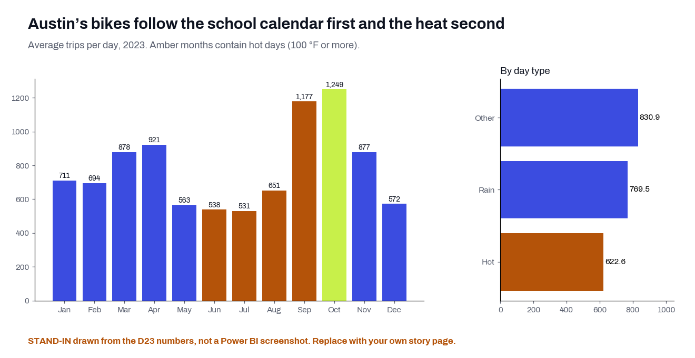

# Austin's bikes, 2023

**Finding:** Austin's bikes follow the school calendar first and the heat second: October averaged 1,249 rides a day, July 531.

*October, mid-semester, is the busiest month. June and July, without classes, are the quietest, and they hold most of the hot days.*

## The question

Austin's bike-share riders took 283,964 trips in 2023, and hot days had fewer rides than other days: 622.6 a day against 830.9. Is it the heat?

## The data

- Austin MetroBike trips, City of Austin Open Data, read in BigQuery as `bigquery-public-data.austin_bikeshare` ([terms of use](https://data.austintexas.gov/stories/s/ranj-cccq)).
- Daily weather for Austin Camp Mabry (station 722544), NOAA Global Surface Summary of the Day, `bigquery-public-data.noaa_gsod`.
- Calendar year 2023: 364 days with trips (none on 1 February, during an ice storm).

## Method

1. SQL in BigQuery to count rides by day and join each day to its weather. A day is **Hot** at 100 °F or more and **Rain** at 0.25 inches or more.
2. Views (`v_days`, `v_trips`) as the hand-off to Power BI.
3. A linear regression in BigQuery ML on day type, weekday and month, trained on 291 days and tested on 73 it never saw.
4. A Power BI report: the day views in Import, the trip view in DirectQuery, one story page, published.

All the SQL is in [sql/d23_bigquery.sql](sql/d23_bigquery.sql).

## More findings

- With the month and weekday held fixed, a hot day has about 226 fewer rides than an ordinary one.
- October has about 705 more rides a day than December, three times the effect of the heat.
- Students took 51.4% of the year's trips, which is why the university calendar moves the totals so much.

| Day type | Days | Rides a day |
|---|---:|---:|
| Hot | 81 | 622.6 |
| Rain | 26 | 769.5 |
| Other | 257 | 830.9 |

## Limits

- **2023 only.** The operator changed rider types on 24 July 2024, so later years do not compare.
- **The model is rough.** It is off by 171.4 rides a day on test days, against 271.1 for a median guess. Games, holidays and exams are not among its features.
- **One weather station.** Camp Mabry stands for the whole city.

## Tools

SQL · BigQuery · BigQuery ML · Power BI (Power Query, DAX, DirectQuery)
