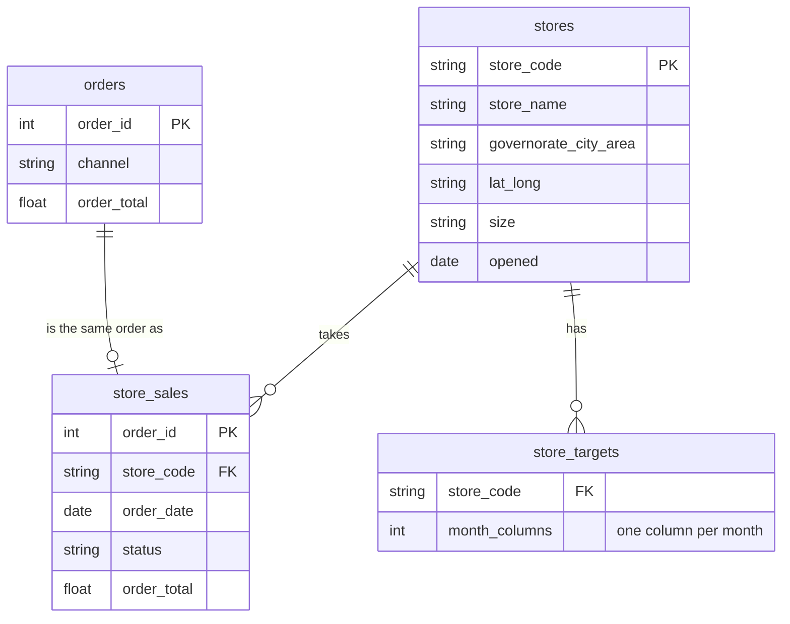

# Nakheel Retail: store files

Nakheel's eleven shops send their sales to head office as files, not as a database. This folder holds those files as they arrived: two yearly exports from the finance team, one file from each shop, the store list, a month of website orders as JSON, one raw till export and a year of sales targets. They cover the same 24 months as the [Nakheel tables](../nakheel/README.md), and every number in them comes from those tables, so a total you compute here can be checked against the SQL you already wrote.

**Download everything at once:** [`nakheel_store_files.zip`](nakheel_store_files.zip). Unzip it to a folder you can find again, for example `Documents\nakheel_store_files`.

| Fact | Value |
|---|---|
| Source | Generated for ASAC on 28 October 2026 from the Nakheel course tables (seed 20261101). No third-party data |
| Terms | Course-owned. Reuse freely inside ASAC materials |
| Period | Store orders from 1 September 2024 to 31 August 2026 |
| Currency | Jordanian dinar (JOD) |
| Encoding | UTF-8, comma-separated |

## Files

| File | Rows | What it is |
|---|---:|---|
| `stores_raw.csv` | 12 | The store list as head office keeps it in a spreadsheet: code, name, where the store is, its position, its size and the day it opened |
| `finance/store_sales_2024-25.csv` | 892 | Every store order from September 2024 to August 2025, from the finance team |
| `finance/store_sales_2025-26.csv` | 1,009 | Every store order from September 2025 to August 2026. The till system changed in September 2025, and so did the export |
| `store_files/` | 12 files, 1,901 rows | One file per shop, named after its store code, with the same orders. The folder also holds a note from head office |
| `online_orders_2026-08.json` | 77 orders | The website's orders for August 2026, as the website sends them: each order with its customer and its list of items |
| `till_export_raw.csv` | — | One shop's August 2026 file as the till prints it |
| `store_targets_2025-26.csv` | 11 | The monthly revenue target for each shop, September 2025 to August 2026, one column per month |

## Columns

| File | Column | Meaning |
|---|---|---|
| `stores_raw.csv` | `store_code` | The store's code, for example `NK-AMM-01` |
| | `store_name` | The name over the door |
| | `governorate - city - area` | Three facts in one column: the governorate's code, the governorate, and the town or the part of Amman |
| | `lat / long` | Latitude and longitude in one column |
| | `size` | Selling floor area, typed by hand |
| | `opened` | The day the store opened |
| `store_sales_*.csv`, `store_files/*.csv` | `order_id` | The order number; the same number as in the Nakheel `orders` table |
| | `store_code` | The shop that took the order (not in the shop files: the file name says it) |
| | `order_date` | The date of the order |
| | `status` | `completed`, `cancelled` or `pending` |
| | `order_total` | Value of the goods on the order, in dinars |
| `online_orders_2026-08.json` | `orders[]` | One record per order: `order_id`, `order_date`, `status`, `customer` (a record with `customer_id` and `city`), `shipping_fee`, and `items` (a list of records with `product_id`, `qty`, `price`) |
| `store_targets_2025-26.csv` | `store_code` | The shop |
| | `2025-09` … `2026-08` | The revenue target for that month, in dinars |

## How the files connect

`store_sales` is what you get when the yearly files, or the shop files, are put together. Each of its 1,901 rows is one store order from the Nakheel `orders` table (the rows where `channel` is `store`), so its completed revenue, 205,338.00 dinars, is the SQL answer to `SUM(order_total)` for completed store orders.

Like the files a real company receives, these are not tidy, and some of the untidiness is there on purpose. Finding it is part of the work, so do not fix the files before you load them.

## How the files were made

A script made the files from the Nakheel tables with a fixed starting value (the seed above), so running it again produces exactly the same files. A second script checks every total quoted in the course against them. Both scripts are kept with the course staff.
