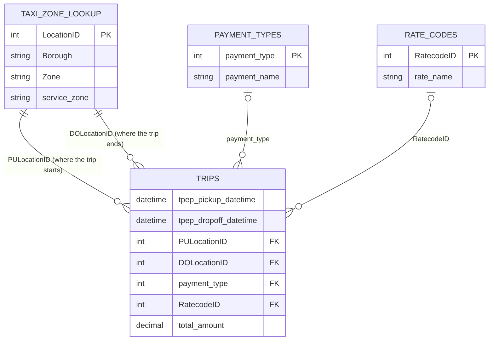

# NYC yellow taxi trips, 2019–2020 (Assignment 3)

Trips in New York City's yellow taxis, the ones you can hail in the street, from 1 January 2019 to 31 December 2020. The full record has 109,047,518 trips in those two years. This course copy keeps **1 trip in 500**: 217,911 trips, chosen by a fixed rule, so every learner has the same rows. One row is one trip.

Because it is a sample, every total is about 1/500 of the real one. Shares, averages and changes (for example "trips fell by 71%") are close to the real ones; totals are not. Say so on any page that shows a total.

| | |
|---|---|
| Source | NYC Taxi and Limousine Commission (TLC), [TLC Trip Record Data](https://www.nyc.gov/site/tlc/about/tlc-trip-record-data.page): yellow taxi trip records, January 2019 – December 2020, and the Taxi Zone Lookup Table |
| Copy used | The monthly CSV copies of the TLC files kept by DataTalksClub ([`nyc-tlc-data`](https://github.com/DataTalksClub/nyc-tlc-data), release `yellow`), and the TLC's `taxi_zone_lookup.csv` from the same repository |
| Terms | NYC Open Data: public data, free to use, with no licence requirement ([NYC Open Data FAQ](https://opendata.cityofnewyork.us/faq/)). The City and TLC give no warranty: TLC says the trip data was collected by technology providers and it makes no claim about its accuracy |
| Course copy | Taken 15 November 2026. The trip file keeps the TLC's columns and values unchanged; rows are sorted by pickup time. `payment_types.csv` and `rate_codes.csv` are course-made from the [TLC yellow trips data dictionary](https://www.nyc.gov/assets/tlc/downloads/pdf/data_dictionary_trip_records_yellow.pdf) (18 March 2025) |
| Used in | Assignment 3 ([`modules/06-visualization-and-storytelling/assignments/A03-NYC-Taxi-Dashboard/`](../../../modules/06-visualization-and-storytelling/assignments/A03-NYC-Taxi-Dashboard/README.md)) |

## Files

| File | Rows | What one row is |
|---|---:|---|
| [`yellow_trips_2019_2020_sample.csv`](yellow_trips_2019_2020_sample.csv) (21 MB) | 217,911 | One trip |
| [`taxi_zone_lookup.csv`](taxi_zone_lookup.csv) | 265 | One taxi zone (a neighbourhood or an airport) |
| [`payment_types.csv`](payment_types.csv) | 7 | One way to pay |
| [`rate_codes.csv`](rate_codes.csv) | 7 | One fare rate |

The data is as the taxi meters sent it. It has mistakes and odd rows on purpose: you find and clean them in Assignment 3.

## How the tables connect

Every trip has a pickup zone and a dropoff zone, and both are in `taxi_zone_lookup.csv`. The zone table is used **twice**: once for where the trip starts and once for where it ends. In Power BI only one of the two relationships can be active at a time (as with the two dates in D18). Some trips have an empty `payment_type` and `RatecodeID`, so those two relationships are optional ("zero or one") until you fill the gaps. There is no date table: you build one.

## Columns of the trip file

| Column | Type | Description (TLC data dictionary) |
|---|---|---|
| `VendorID` | Whole number | The company whose meter sent the record: 1 Creative Mobile Technologies, 2 Curb Mobility (VeriFone in older files) |
| `tpep_pickup_datetime` | Date and time | When the meter was switched on |
| `tpep_dropoff_datetime` | Date and time | When the meter was switched off |
| `passenger_count` | Whole number | Passengers, typed in by the driver |
| `trip_distance` | Decimal | Miles, from the meter |
| `RatecodeID` | Whole number | The fare rate at the end of the trip: see `rate_codes.csv` |
| `store_and_fwd_flag` | Text | `Y` if the taxi kept the record in memory and sent it later because it had no connection |
| `PULocationID` | Whole number | Taxi zone where the meter was switched on |
| `DOLocationID` | Whole number | Taxi zone where the meter was switched off |
| `payment_type` | Whole number | How the passenger paid: see `payment_types.csv` |
| `fare_amount` | Decimal | The time-and-distance fare from the meter, in US dollars |
| `extra` | Decimal | Extras and surcharges (rush hour, overnight) |
| `mta_tax` | Decimal | A fixed tax added by the meter |
| `tip_amount` | Decimal | Tip. **Recorded for card payments; cash tips are not recorded.** One trip in this sample is marked cash and still shows a tip |
| `tolls_amount` | Decimal | Tolls paid during the trip |
| `improvement_surcharge` | Decimal | A fixed surcharge added at the start of the trip |
| `total_amount` | Decimal | The total charged to the passenger. Does not include cash tips |
| `congestion_surcharge` | Decimal | New York State congestion surcharge (started in February 2019, so empty on many early trips) |

## Columns of the lookup tables

| Table | Column | Description |
|---|---|---|
| `taxi_zone_lookup.csv` | `LocationID` | Zone number, 1 to 265 |
| | `Borough` | Manhattan, Brooklyn, Queens, Bronx, Staten Island; `EWR` for Newark Airport; `Unknown` for zones 264 and 265 |
| | `Zone` | Zone name, for example `JFK Airport`, `Midtown Center` |
| | `service_zone` | `Yellow Zone` (central Manhattan), `Boro Zone`, `Airports`, `EWR` or `N/A` |
| `payment_types.csv` | `payment_type`, `payment_name` | 0 Flex fare, 1 Credit card, 2 Cash, 3 No charge, 4 Dispute, 5 Unknown, 6 Voided trip |
| `rate_codes.csv` | `RatecodeID`, `rate_name` | 1 Standard rate, 2 JFK, 3 Newark, 4 Nassau or Westchester, 5 Negotiated fare, 6 Group ride, 99 Unknown |

## How the sample was taken

Every trip in the 24 monthly files got a number calculated from seven of its columns (a hash). The trips whose number divides by 500 were kept. The rule does not look at the date, the place or the price, so the sample keeps the shape of the full data: 2019 has 84.4 million trips in the full files and 168,880 here; 2020 has 24.6 million and 49,028 here. These are counts before cleaning: after Assignment 3's three rules, 168,547 and 48,791 remain.

Credit: data from the NYC Taxi and Limousine Commission, through NYC Open Data.
